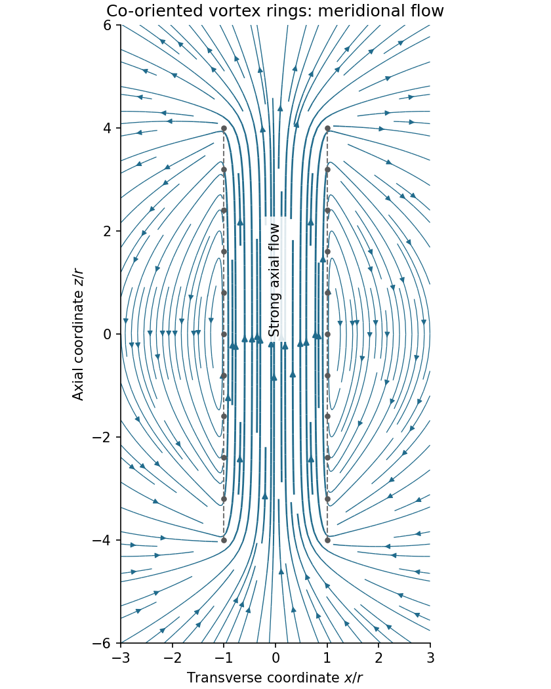

<h1 id="section-a/a5/solution">Solution</h1>

↑ **Parent:** [A5](../a5.md)

Assume all rings have the same [circulation](../../../../../circulation-physics.md) $\Gamma$ and orientation, and that there is no imposed background flow. [Vortex lines](../../../../../vortex-line.md) describe the direction of [vorticity](../../../../../vorticity-split.md), not the direction of [velocity](../../../../../velocity.md). For an incompressible [fluid](../../../../../fluid.md), the [velocity](../../../../../velocity.md) induced by a thin [vortex filament](../../../../../vortex-filament.md) has the same Biot-Savart [integral](../../../../../integral-split.md) form as the [magnetic field](../../../../../magnetic-field-split.md) of a current filament:

$$
\mathbf u(\mathbf x)=\frac{\Gamma}{4\pi}\oint
\frac{d\boldsymbol\ell\times(\mathbf x-\mathbf x')}{|\mathbf x-\mathbf x'|^3}.
$$

A closely spaced coaxial array of [vortex rings](../../../../../vortex-ring.md) is therefore analogous to a solenoid. The [velocity field](../../../../../velocity-field.md) passes **along the common axis through the rings and returns outside a finite array**. Its orientation reverses if every [circulation](../../../../../circulation-physics.md) is reversed. In a long array, far from its ends and vortex cores, the [velocity field of a dense coaxial vortex-ring array](../../../../../velocity-field-of-a-dense-coaxial-vortex-ring-array.md) is approximately

$$
\boxed{\mathbf u\simeq\frac{\Gamma}{l}\widehat{\mathbf z}\quad(\rho<r),
\qquad \mathbf u\simeq0\quad(\rho>r).}
$$

The exterior field is exactly zero only in the ideal continuous infinitely long limit, with the background [velocity](../../../../../velocity.md) set to zero. In a finite array the [streamlines](../../../../../streamline.md) spread out at one end, run back outside, and converge into the other. A large number of closely spaced rings alone does not guarantee that the total array [length](../../../../../length.md) greatly exceeds $r$; if it does not, the end and return flows remain substantial. Different unspecified ring circulations would require superposing their actual signed contributions.

**[Figure 1](#section-a/a5/image-induced-velocity-through-and-around-a-finite-array-of-co-oriented-vortex-rings). Induced velocity through and around a finite array of co-oriented vortex rings**. Original Biot-Savart calculation for 81 equal rings with spacing 0.1 radii and a small numerical core smoothing. Streamlines lie in a plane containing the common axis; the grey markers sample intersections with the vortex rings, rather than fluid trajectories. Flow returns outside the finite array.

## ↑ Ancestors (14)

1. [A5](../a5.md)
2. [Section A](../../section-a.md)
3. [Paper 2](../../../paper-2-split.md)
4. [2017](../../../split.md)
5. [Past exam of the physics B course of the University of Cambridge](../../../../split.md)
6. [Physics B course of the University of Cambridge](../../../../../physics-b-course-of-the-university-of-cambridge.md)
7. [Physics course of the year 2 of the natural sciences course of the University of Cambridge](../../../../../physics-course-of-the-year-2-of-the-natural-sciences-course-of-the-university-of-cambridge.md)
8. [Year 2 of the natural sciences course of the University of Cambridge](../../../../../year-2-of-the-natural-sciences-course-of-the-university-of-cambridge.md)
9. [Year of the natural sciences course of the University of Cambridge](../../../../../year-of-the-natural-sciences-course-of-the-university-of-cambridge.md)
10. [Natural sciences course of the University of Cambridge](../../../../../natural-sciences-course-of-the-university-of-cambridge.md)
11. [Course of the University of Cambridge](../../../../../course-of-the-university-of-cambridge.md)
12. [University of Cambridge](../../../../../university-of-cambridge-split.md)
13. [List of universities](../../../../../list-of-universities.md)
14. [Codex Wiki](../../../../../split.md)
