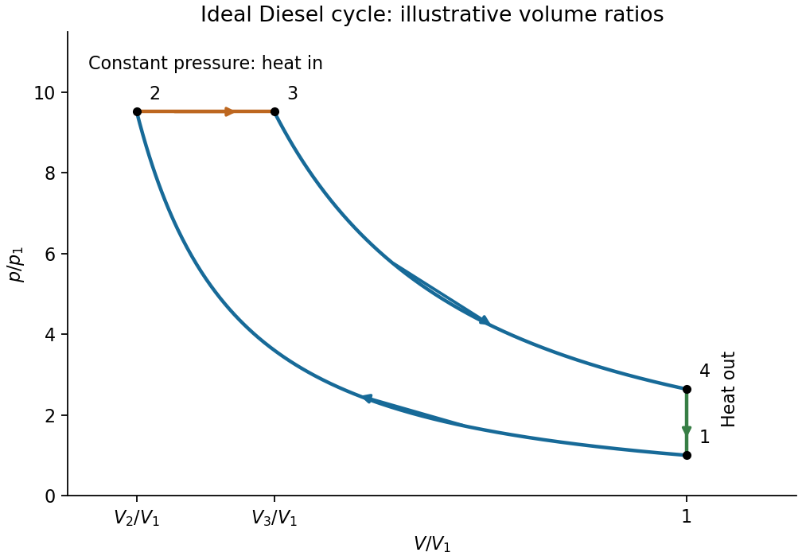

<h1 id="section-c/c10/diesel-cycle-geometry/solution">Solution</h1>

↑ **Parent:** [Diesel-cycle geometry](../diesel-cycle-geometry.md)

Label the initial state 1, the end of compression 2, the end of constant-pressure heating 3, and the end of adiabatic expansion 4. The [volume](../../../../../../volume-thermodynamics.md) sequence is $V_1\to V_2\to V_3\to V_1\to V_1$, with $V_2<V_3<V_1$. The [Diesel cycle](../../../../../../diesel-cycle.md) has a compression [adiabat](../../../../../../adiabat.md) $1\to2$, a horizontal constant-pressure heat-input segment $2\to3$, an expansion [adiabat](../../../../../../adiabat.md) $3\to4$, and a vertical constant-volume cooling segment $4\to1$.

**[Figure 3](#section-c/c10/diesel-cycle-geometry/image-clockwise-ideal-diesel-cycle-with-its-four-thermodynamic-states). Clockwise ideal Diesel cycle with its four thermodynamic states**. Original dimensionless example with V2/V1=0.2, V3/V1=0.4 and gamma=1.4. The curved segments are reversible adiabats, the upper horizontal segment adds heat at fixed pressure and the right vertical segment rejects heat at fixed volume. The enclosed area is the positive net work output.

For an [ideal gas](../../../../../../ideal-gas-split.md), a reversible [adiabat](../../../../../../adiabat.md) obeys $pV^\gamma=\mathrm{constant}$, so it falls more steeply than an [isotherm](../../../../../../isotherm.md). The expansion [adiabat](../../../../../../adiabat.md) lies above the compression [adiabat](../../../../../../adiabat.md) at equal [volume](../../../../../../volume-thermodynamics.md) between $V_3$ and $V_1$, giving a clockwise cycle with positive [work](../../../../../../work.md) output.

## ↑ Ancestors (15)

1. [Diesel-cycle geometry](../diesel-cycle-geometry.md)
2. [C10](../../c10.md)
3. [Section C](../../../section-c.md)
4. [Paper 2](../../../../paper-2-split.md)
5. [2017](../../../../split.md)
6. [Past exam of the physics B course of the University of Cambridge](../../../../../split.md)
7. [Physics B course of the University of Cambridge](../../../../../../physics-b-course-of-the-university-of-cambridge.md)
8. [Physics course of the year 2 of the natural sciences course of the University of Cambridge](../../../../../../physics-course-of-the-year-2-of-the-natural-sciences-course-of-the-university-of-cambridge.md)
9. [Year 2 of the natural sciences course of the University of Cambridge](../../../../../../year-2-of-the-natural-sciences-course-of-the-university-of-cambridge.md)
10. [Year of the natural sciences course of the University of Cambridge](../../../../../../year-of-the-natural-sciences-course-of-the-university-of-cambridge.md)
11. [Natural sciences course of the University of Cambridge](../../../../../../natural-sciences-course-of-the-university-of-cambridge.md)
12. [Course of the University of Cambridge](../../../../../../course-of-the-university-of-cambridge.md)
13. [University of Cambridge](../../../../../../university-of-cambridge-split.md)
14. [List of universities](../../../../../../list-of-universities.md)
15. [Codex Wiki](../../../../../../split.md)
