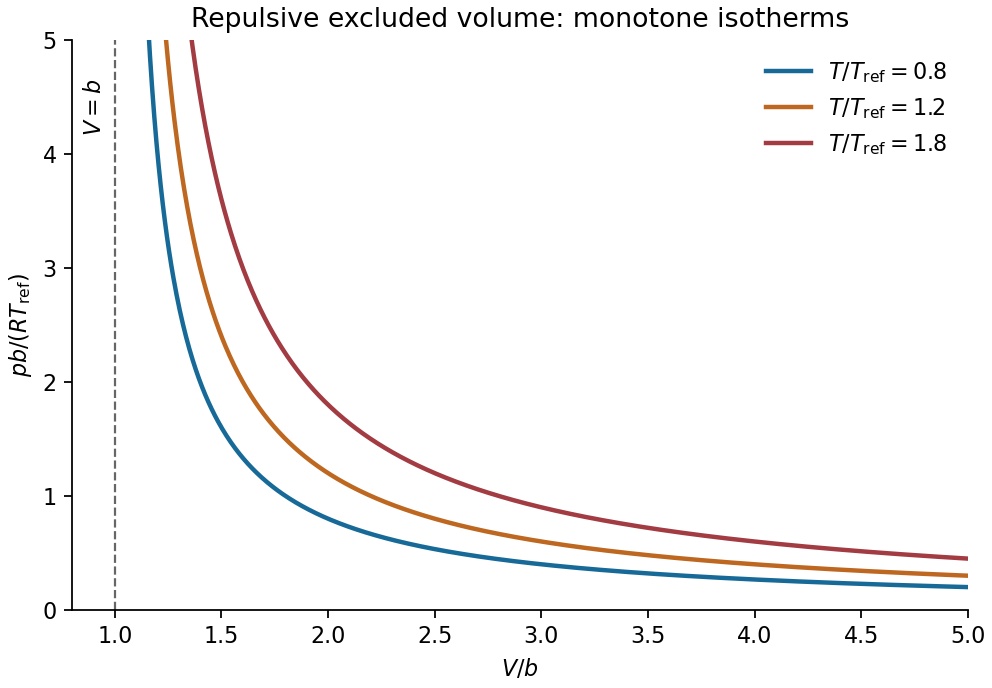

<h1 id="section-c/c11/isotherms-and-excluded-volume/solution">Solution</h1>

↑ **Parent:** [Isotherms and excluded volume](../isotherms-and-excluded-volume.md)

For the given one-mole model,

$$
p=\frac{RT}{V-b},\qquad V>b.
$$

At fixed positive [temperature](../../../../../../temperature-split.md) its [isotherm](../../../../../../isotherm.md) is an ideal-gas hyperbola shifted right by $b$: [pressure](../../../../../../pressure-split.md) diverges as $V\to b^+$ and tends to zero as $V\to\infty$. Higher [temperatures](../../../../../../temperature-split.md) give higher [pressure](../../../../../../pressure-split.md) at any fixed allowed [volume](../../../../../../volume-thermodynamics.md).

**[Figure 4](#section-c/c11/isotherms-and-excluded-volume/image-pressure-volume-isotherms-for-the-excluded-volume-ideal-gas). Pressure-volume isotherms for the excluded-volume ideal gas**. Original dimensionless isotherms with a common vertical asymptote at V=b. They are monotonically decreasing and have no coexistence plateau or critical inflection.

For positive $b$, the [volume](../../../../../../volume-thermodynamics.md) $V-b$ is the effective [volume](../../../../../../volume-thermodynamics.md) available to molecular motion. Thus $b$ describes excluded-volume repulsion or an effective incompressible molecular core. It is a molar [volume](../../../../../../volume-thermodynamics.md) in this one-mole equation, not necessarily the literal sum of molecular geometric [volume](../../../../../../volume-thermodynamics.md). Setting $b=0$ recovers the [ideal gas law](../../../../../../ideal-gas-law.md). No attractive-energy term is included.

## ↑ Ancestors (15)

1. [Isotherms and excluded volume](../isotherms-and-excluded-volume.md)
2. [C11](../../c11.md)
3. [Section C](../../../section-c.md)
4. [Paper 2](../../../../paper-2-split.md)
5. [2017](../../../../split.md)
6. [Past exam of the physics B course of the University of Cambridge](../../../../../split.md)
7. [Physics B course of the University of Cambridge](../../../../../../physics-b-course-of-the-university-of-cambridge.md)
8. [Physics course of the year 2 of the natural sciences course of the University of Cambridge](../../../../../../physics-course-of-the-year-2-of-the-natural-sciences-course-of-the-university-of-cambridge.md)
9. [Year 2 of the natural sciences course of the University of Cambridge](../../../../../../year-2-of-the-natural-sciences-course-of-the-university-of-cambridge.md)
10. [Year of the natural sciences course of the University of Cambridge](../../../../../../year-of-the-natural-sciences-course-of-the-university-of-cambridge.md)
11. [Natural sciences course of the University of Cambridge](../../../../../../natural-sciences-course-of-the-university-of-cambridge.md)
12. [Course of the University of Cambridge](../../../../../../course-of-the-university-of-cambridge.md)
13. [University of Cambridge](../../../../../../university-of-cambridge-split.md)
14. [List of universities](../../../../../../list-of-universities.md)
15. [Codex Wiki](../../../../../../split.md)
