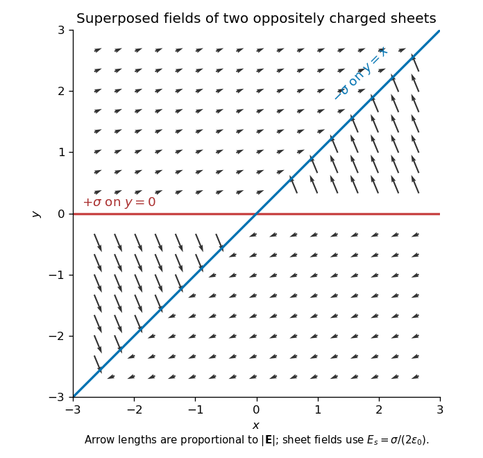

<h1 id="section-a/a1/solution">Solution</h1>

↑ **Parent:** [A1](../a1.md)

An infinite sheet of [surface charge density](../../../../../surface-charge-density.md) $\sigma$ gives an [electric field](../../../../../electric-field-split.md) of magnitude $E_s=\sigma/(2\varepsilon_0)$ on either side, normal to the sheet and directed away from positive charge. Use the [superposition principle](../../../../../superposition-principle.md) for the two sheets. Choose normals $\widehat{\mathbf y}$ for $y=0$ and $\mathbf n=(-\widehat{\mathbf x}+\widehat{\mathbf y})/\sqrt2$ for $y=x$. Away from the charged planes,

$$
\boxed{\mathbf E=E_s\left[\operatorname{sgn}(y)\widehat{\mathbf y}
-\operatorname{sgn}(y-x)\frac{-\widehat{\mathbf x}+\widehat{\mathbf y}}{\sqrt2}\right].}
$$

The minus sign on the second contribution makes its field point toward the negatively charged sheet. Each sector has a uniform [electric field](../../../../../electric-field-split.md); its direction changes on crossing a sheet.

**[Figure 1](#section-a/a1/image-original-calculated-electric-field-directions-for-the-intersecting-positive-and-negative-charge-sheets-arrows-retain-the-relative-field-magnitudes-in-the-four-sectors). Original calculated electric-field directions for the intersecting positive and negative charge sheets; arrows retain the relative field magnitudes in the four sectors**.

For example, above both sheets the field points right and slightly upward, whereas in the sector $y>0$ but $y<x$ it points left and steeply upward. The other two sectors follow by inversion through the origin. The normal field jumps by the appropriate surface charge divided by $\varepsilon_0$; a single field value on an ideal zero-thickness charged sheet is not required.

## ↑ Ancestors (14)

1. [A1](../a1.md)
2. [Section A](../../section-a.md)
3. [Paper 1](../../../paper-1-split.md)
4. [2018](../../../split.md)
5. [Past exam of the physics B course of the University of Cambridge](../../../../split.md)
6. [Physics B course of the University of Cambridge](../../../../../physics-b-course-of-the-university-of-cambridge.md)
7. [Physics course of the year 2 of the natural sciences course of the University of Cambridge](../../../../../physics-course-of-the-year-2-of-the-natural-sciences-course-of-the-university-of-cambridge.md)
8. [Year 2 of the natural sciences course of the University of Cambridge](../../../../../year-2-of-the-natural-sciences-course-of-the-university-of-cambridge.md)
9. [Year of the natural sciences course of the University of Cambridge](../../../../../year-of-the-natural-sciences-course-of-the-university-of-cambridge.md)
10. [Natural sciences course of the University of Cambridge](../../../../../natural-sciences-course-of-the-university-of-cambridge.md)
11. [Course of the University of Cambridge](../../../../../course-of-the-university-of-cambridge.md)
12. [University of Cambridge](../../../../../university-of-cambridge-split.md)
13. [List of universities](../../../../../list-of-universities.md)
14. [Codex Wiki](../../../../../split.md)
