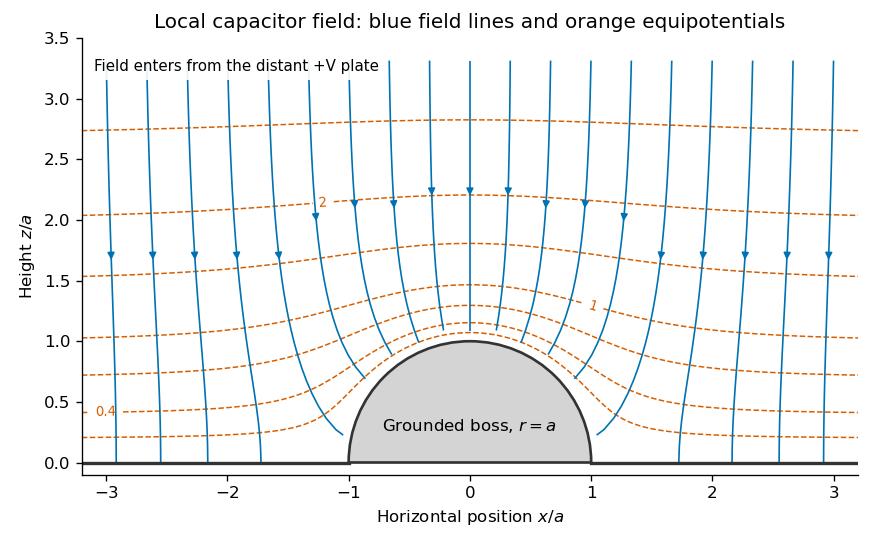

<h1 id="section-b/b6/solution">Solution</h1>

↑ **Parent:** [B6](../b6.md)

**The boundary-value method.** In a charge-free region, the [electric potential](../../../../../electric-potential.md) obeys the [Laplace equation](../../../../../laplace-equation.md), $\nabla^2\Phi=0$, and $\mathbf E=-\nabla\Phi$. Conductors impose equipotential boundaries, with specified voltages or charges, and a far-field condition fixes the remaining behaviour. The [Uniqueness of the Dirichlet problem](../../../../../uniqueness-of-the-dirichlet-problem.md) guarantees that a solution meeting the prescribed conductor potentials is the physical one. To see why, the difference $w$ of two candidate solutions is harmonic and vanishes on the boundaries; integration by parts gives $\int|\nabla w|^2\,dV=0$, hence no difference in their fields. An exterior problem also needs the appropriate condition at infinity.

**Two axisymmetric harmonic functions.** For $\Phi=f(r)\cos\theta$ in [spherical coordinates](../../../../../spherical-coordinate-system.md), the [Laplacian](../../../../../laplacian.md) reduces to

$$
\nabla^2\Phi=\frac{\cos\theta}{r^2}
\left[\frac{d}{dr}(r^2f')-2f\right].
$$

For $f=r$, the bracket is $2r-2r=0$. For $f=r^{-2}$, it is $2r^{-2}-2r^{-2}=0$. Therefore

$$
\boxed{\nabla^2(r\cos\theta)=0,\qquad
\nabla^2(\cos\theta/r^2)=0\quad(r>0).}
$$

The second function is singular at the origin, which is allowed here because that point lies inside the excluded conductor. The printed spherical Laplacian has a typo in its azimuthal term: its denominator should be $r^2\sin^2\theta$. Both functions are axisymmetric, so that term vanishes and the typo does not affect these calculations.

**Potential and field geometry.** Set the lower conductor to zero potential and the distant upper plate to $V$. The small boss sees approximately uniform background field $-E_0\widehat{\mathbf z}$, where $E_0=V/d$. Combining the two harmonic functions to make $\Phi=0$ on $r=a$ gives the [conducting hemispherical protrusion in a uniform field](../../../../../conducting-hemispherical-protrusion-in-a-uniform-field.md),

$$
\boxed{\Phi=E_0\left(r-\frac{a^3}{r^2}\right)\cos\theta
=E_0z\left(1-\frac{a^3}{r^3}\right).}
$$

It also vanishes on the surrounding plane $z=0$. The [electric field](../../../../../electric-field-split.md) components are

$$
E_r=-E_0\left(1+\frac{2a^3}{r^3}\right)\cos\theta,\qquad
E_\theta=E_0\left(1-\frac{a^3}{r^3}\right)\sin\theta.
$$

Equipotentials crowd near the apex, and field lines meet the conductor normally.

**[Figure 2](#section-b/b6/image-original-calculated-local-equipotentials-and-electric-field-lines-above-the-hemispherical-boss-this-is-the-small-boss-approximation-rather-than-an-exact-finite-gap-solution). Original calculated local equipotentials and electric-field lines above the hemispherical boss; this is the small-boss approximation rather than an exact finite-gap solution**.

The formula has the correct uniform far field but does not exactly impose a flat upper equipotential at finite $d$. It is the leading approximation justified by $a\ll d$; an exact finite-gap solution would include further corrections.

## ↑ Ancestors (14)

1. [B6](../b6.md)
2. [Section B](../../section-b.md)
3. [Paper 1](../../../paper-1-split.md)
4. [2018](../../../split.md)
5. [Past exam of the physics B course of the University of Cambridge](../../../../split.md)
6. [Physics B course of the University of Cambridge](../../../../../physics-b-course-of-the-university-of-cambridge.md)
7. [Physics course of the year 2 of the natural sciences course of the University of Cambridge](../../../../../physics-course-of-the-year-2-of-the-natural-sciences-course-of-the-university-of-cambridge.md)
8. [Year 2 of the natural sciences course of the University of Cambridge](../../../../../year-2-of-the-natural-sciences-course-of-the-university-of-cambridge.md)
9. [Year of the natural sciences course of the University of Cambridge](../../../../../year-of-the-natural-sciences-course-of-the-university-of-cambridge.md)
10. [Natural sciences course of the University of Cambridge](../../../../../natural-sciences-course-of-the-university-of-cambridge.md)
11. [Course of the University of Cambridge](../../../../../course-of-the-university-of-cambridge.md)
12. [University of Cambridge](../../../../../university-of-cambridge-split.md)
13. [List of universities](../../../../../list-of-universities.md)
14. [Codex Wiki](../../../../../split.md)
