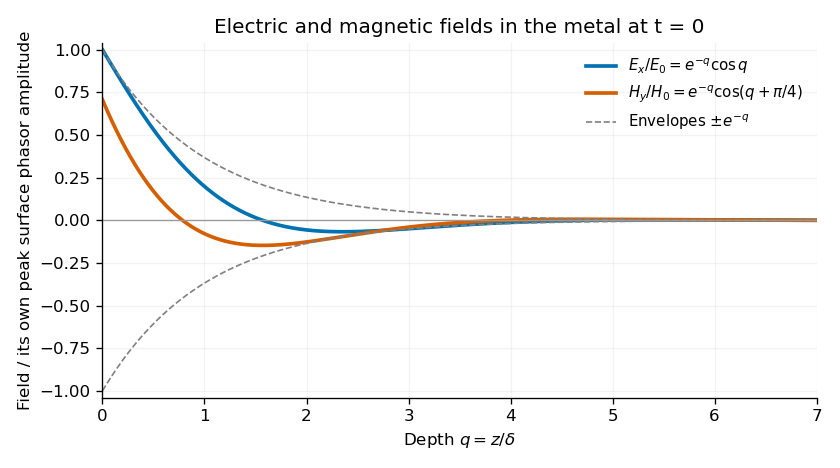

<h1 id="section-b/b8/solution">Solution</h1>

↑ **Parent:** [B8](../b8.md)

**Effective permittivity.** Use peak [phasors](../../../../../phasor.md) with time dependence $e^{-i\omega t}$. The [Ampere-Maxwell law](../../../../../ampere-s-circuital-law.md) is

$$
\nabla\times\mathbf H=\sigma\mathbf E+\partial_t\mathbf D
=(\sigma-i\omega\varepsilon_0\epsilon)\mathbf E
=-i\omega\varepsilon_0\epsilon'\mathbf E.
$$

The [conductive contribution to complex permittivity](../../../../../conductive-contribution-to-complex-permittivity.md) is therefore

$$
\boxed{\epsilon'=\epsilon+\frac{i\sigma}{\omega\varepsilon_0}.}
$$

Here $\epsilon'$ is the source's effective relative [permittivity](../../../../../permittivity-split.md), not just the real part of a complex response. The positive imaginary term is the loss sign appropriate to this time convention.

**The penetrating electric wave.** Combine this equation with [Faraday's law of induction](../../../../../faraday-s-law-of-induction.md). In a uniform source-free medium the transverse phasor satisfies

$$
\frac{d^2\widetilde E_x}{dz^2}+k^2\widetilde E_x=0,\qquad
k^2=\mu_0\varepsilon_0\epsilon'\omega^2.
$$

For a good conductor of [electrical conductivity](../../../../../electrical-conductivity.md) $\sigma$, $\sigma\gg\omega\epsilon\varepsilon_0$, so $k^2\simeq i\mu_0\sigma\omega$. The root which decays into $z>0$ is

$$
k=\frac{1+i}{\delta},\qquad
\delta=\sqrt{\frac2{\mu_0\sigma\omega}}.
$$

Choose the surface phasor amplitude $E_0$ real. Taking the real part of $\widetilde E_x=E_0e^{ikz}$ gives

$$
\boxed{E_x(z,t)=E_0e^{-z/\delta}
\cos\left(\frac z\delta-\omega t\right).}
$$

The [skin depth](../../../../../skin-depth.md) $\delta$ is an amplitude-decay distance in metres.

**The magnetic wave and phase.** The curl of an $x$-polarized field varying in $z$ is in the $y$ direction. Since $\nabla\times\widetilde{\mathbf E}=i\omega\mu_0\widetilde{\mathbf H}$,

$$
\widetilde H_y=\frac{k}{\mu_0\omega}\widetilde E_x
=\frac{1+i}{\mu_0\omega\delta}\widetilde E_x.
$$

Thus

$$
\boxed{H_y=H_0e^{-z/\delta}
\cos\left(\frac z\delta-\omega t+\frac\pi4\right),\qquad
H_0=\sqrt{\frac{\sigma}{\mu_0\omega}}\,E_0.}
$$

The phase sign follows the specified convention. Equivalently the [surface impedance of a good conductor](../../../../../surface-impedance-of-a-good-conductor.md) is $E_x/H_y=(1-i)/(\sigma\delta)$.

**How the fields differ from those in vacuum.** The two metal fields have the same exponential envelope and spatial period $2\pi\delta$, but their phase arguments differ by $\pi/4$.

**[Figure 3](#section-b/b8/image-original-normalized-electric-and-magnetic-field-profiles-inside-a-good-conductor-at-one-instant-showing-their-common-decay-envelope-and-quarter-of-a-right-angle-phase-difference). Original normalized electric and magnetic field profiles inside a good conductor at one instant, showing their common decay envelope and quarter-of-a-right-angle phase difference**.

An individual travelling wave in the lossless exterior has no attenuation, real wave impedance and in-phase electric and magnetic fields. The exterior total field also includes the reflected wave and may show interference, so it need not share that simple phase relation everywhere. At the interface the tangential fields match; $E_0$ is the field just inside the metal, not necessarily the incident amplitude. A good conductor reflects strongly and its wave impedance is much smaller than the vacuum impedance.

**Average inward energy flux.** For peak [phasors](../../../../../phasor.md), the [Poynting vector](../../../../../poynting-vector.md) averaged over a cycle is $\langle\mathbf S\rangle=\operatorname{Re}(\widetilde{\mathbf E}\times\widetilde{\mathbf H}^*)/2$. The fields give

$$
\langle S_z\rangle=\frac{E_0^2}{2\mu_0\omega\delta}e^{-2z/\delta}
=\frac{\sigma\delta E_0^2}{4}e^{-2z/\delta}.
$$

Consequently the constant in the question is

$$
\boxed{A=\frac{\sigma\delta E_0^2}{4}
=E_0^2\sqrt{\frac{\sigma}{8\mu_0\omega}}.}
$$

The flux is in the $+z$ direction and has units $\mathrm{W\,m^{-2}}$.

**Local energy conservation.** The [Poynting flux and local heating in a skin layer](../../../../../poynting-flux-and-local-heating-in-a-skin-layer.md) satisfy

$$
\boxed{-\frac{d\langle S_z\rangle}{dz}
=\frac{\sigma E_0^2}{2}e^{-2z/\delta}
=\langle\mathbf j\cdot\mathbf E\rangle.}
$$

The decrease becomes [Joule heating](../../../../../joule-heating.md) in each layer. The [Poynting theorem](../../../../../poynting-theorem.md) includes this transfer from field energy to the metal; averaged electromagnetic energy storage has zero time derivative in the periodic state, so no energy is lost from the complete balance.

## ↑ Ancestors (14)

1. [B8](../b8.md)
2. [Section B](../../section-b.md)
3. [Paper 1](../../../paper-1-split.md)
4. [2018](../../../split.md)
5. [Past exam of the physics B course of the University of Cambridge](../../../../split.md)
6. [Physics B course of the University of Cambridge](../../../../../physics-b-course-of-the-university-of-cambridge.md)
7. [Physics course of the year 2 of the natural sciences course of the University of Cambridge](../../../../../physics-course-of-the-year-2-of-the-natural-sciences-course-of-the-university-of-cambridge.md)
8. [Year 2 of the natural sciences course of the University of Cambridge](../../../../../year-2-of-the-natural-sciences-course-of-the-university-of-cambridge.md)
9. [Year of the natural sciences course of the University of Cambridge](../../../../../year-of-the-natural-sciences-course-of-the-university-of-cambridge.md)
10. [Natural sciences course of the University of Cambridge](../../../../../natural-sciences-course-of-the-university-of-cambridge.md)
11. [Course of the University of Cambridge](../../../../../course-of-the-university-of-cambridge.md)
12. [University of Cambridge](../../../../../university-of-cambridge-split.md)
13. [List of universities](../../../../../list-of-universities.md)
14. [Codex Wiki](../../../../../split.md)
