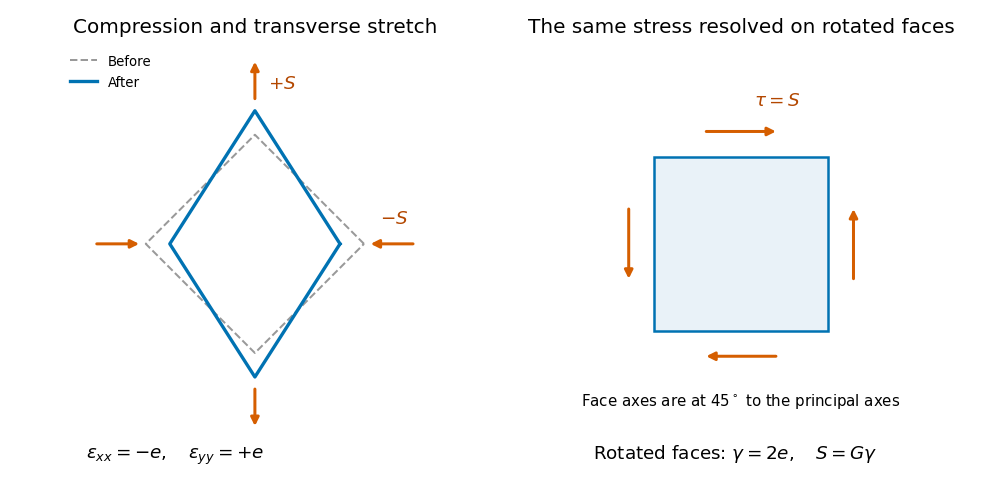

<h1 id="section-c/c12/solution">Solution</h1>

↑ **Parent:** [C12](../c12.md)

**Compression and stretch viewed on rotated faces.** To isolate shear, take equal small principal strains $\epsilon_{xx}=-e$, $\epsilon_{yy}=+e$. A square with sides at $45^\circ$ to these directions becomes a rhombus: adjacent side lengths are unchanged to first order, but their right angle changes by $2e$. In axes rotated through $45^\circ$, the same strain tensor has zero diagonal entries and off-diagonal entries of magnitude $e$.

The [pure shear from opposite principal strains](../../../../../pure-shear-from-opposite-principal-strains.md) therefore has engineering [shear strain](../../../../../shear-strain.md) $\gamma=2e$, not $e$. Equal opposite principal stresses $(-S,+S)$ give purely tangential traction of magnitude $S$ on those rotated faces. Hence

$$
\boxed{\gamma=2e,\qquad \tau=S=G\gamma=2Ge.}
$$

If the compression and stretch are not equal and opposite, an additional dilatational strain remains; their deviatoric part still supplies shear.

**[Figure 4](#section-c/c12/image-original-comparison-of-compression-and-transverse-extension-with-the-same-stress-resolved-as-shear-on-faces-rotated-through-45-degrees-deformation-is-exaggerated). Original comparison of compression and transverse extension with the same stress resolved as shear on faces rotated through 45 degrees; deformation is exaggerated**.

**The shaft's torsional stiffness.** At radius $r$, an end twist $\phi$ over length $L$ gives tangential displacement $r\phi$ and shear angle $r\phi/L$. The local [shear stress](../../../../../shear-stress.md) is $Gr\phi/L$. An annular area $dA=2\pi r\,dr$ contributes torque $r\tau\,dA$, so

$$
C=\int_0^a r\frac{Gr\phi}{L}\,2\pi r\,dr
=\frac{2\pi G\phi}{L}\frac{a^4}{4}.
$$

Thus [torsion of a solid circular shaft](../../../../../torsion-of-a-solid-circular-shaft.md) gives

$$
\boxed{C=\frac{\pi a^4G}{2L}\phi=\frac{GJ_p}{L}\phi,\qquad
J_p=\frac{\pi a^4}{2}.}
$$

Here $J_p$ is the [polar second moment of area](../../../../../polar-second-moment-of-area.md), in $\mathrm{m^4}$, not a mass moment of inertia. This $C$ is the transmitted torque magnitude; the shaft's restoring couple opposes the twist. The formula assumes small elastic shear and a circular uniform section.

## ↑ Ancestors (14)

1. [C12](../c12.md)
2. [Section C](../../section-c.md)
3. [Paper 1](../../../paper-1-split.md)
4. [2018](../../../split.md)
5. [Past exam of the physics B course of the University of Cambridge](../../../../split.md)
6. [Physics B course of the University of Cambridge](../../../../../physics-b-course-of-the-university-of-cambridge.md)
7. [Physics course of the year 2 of the natural sciences course of the University of Cambridge](../../../../../physics-course-of-the-year-2-of-the-natural-sciences-course-of-the-university-of-cambridge.md)
8. [Year 2 of the natural sciences course of the University of Cambridge](../../../../../year-2-of-the-natural-sciences-course-of-the-university-of-cambridge.md)
9. [Year of the natural sciences course of the University of Cambridge](../../../../../year-of-the-natural-sciences-course-of-the-university-of-cambridge.md)
10. [Natural sciences course of the University of Cambridge](../../../../../natural-sciences-course-of-the-university-of-cambridge.md)
11. [Course of the University of Cambridge](../../../../../course-of-the-university-of-cambridge.md)
12. [University of Cambridge](../../../../../university-of-cambridge-split.md)
13. [List of universities](../../../../../list-of-universities.md)
14. [Codex Wiki](../../../../../split.md)
