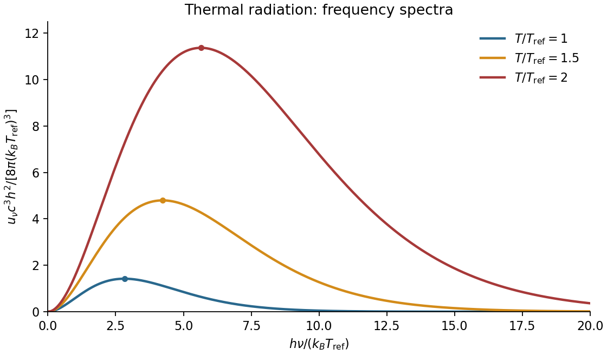

# Paper 2

↑ **Parent:** [2018](../2018.md)

[Original paper, released PDF pages 196–201](https://www.whatdotheyknow.com/request/natural_science_tripos_physics_e/response/2127325/attach/3/FOI%202022%20639%20Sullivan%20materials.pdf?cookie_passthrough=1#page=196)

**Table of contents**

- [Section A](#section-a)
  - [A1](#section-a/a1)
    - [Solution](#section-a/a1/solution)
  - [A2](#section-a/a2)
    - [Solution](#section-a/a2/solution)
  - [A3](#section-a/a3)
    - [Solution](#section-a/a3/solution)
  - [A4](#section-a/a4)
    - [Solution](#section-a/a4/solution)
  - [A5](#section-a/a5)
    - [Solution](#section-a/a5/solution)
- [Section B](#section-b)
  - [B6](#section-b/b6)
    - [a](#section-b/b6/a)
      - [Solution](#section-b/b6/a/solution)
    - [b](#section-b/b6/b)
      - [Solution](#section-b/b6/b/solution)
    - [c](#section-b/b6/c)
      - [Solution](#section-b/b6/c/solution)
    - [d](#section-b/b6/d)
      - [Solution](#section-b/b6/d/solution)
  - [B7](#section-b/b7)
    - [Solution](#section-b/b7/solution)
  - [B8](#section-b/b8)
    - [a](#section-b/b8/a)
      - [Solution](#section-b/b8/a/solution)
    - [b](#section-b/b8/b)
      - [Solution](#section-b/b8/b/solution)
    - [c](#section-b/b8/c)
      - [Solution](#section-b/b8/c/solution)
    - [d](#section-b/b8/d)
      - [Solution](#section-b/b8/d/solution)
  - [B9](#section-b/b9)
    - [Solution](#section-b/b9/solution)
- [Section C](#section-c)
  - [C10](#section-c/c10)
    - [Free-energy identity](#section-c/c10/free-energy-identity)
      - [Solution](#section-c/c10/free-energy-identity/solution)
    - [a](#section-c/c10/a)
      - [Solution](#section-c/c10/a/solution)
    - [b](#section-c/c10/b)
      - [Solution](#section-c/c10/b/solution)
    - [c](#section-c/c10/c)
      - [Solution](#section-c/c10/c/solution)
    - [Isothermal work and heat](#section-c/c10/isothermal-work-and-heat)
      - [Solution](#section-c/c10/isothermal-work-and-heat/solution)
    - [Reversible adiabats](#section-c/c10/reversible-adiabats)
      - [Solution](#section-c/c10/reversible-adiabats/solution)
    - [Adiabatic temperature and energy changes](#section-c/c10/adiabatic-temperature-and-energy-changes)
      - [Solution](#section-c/c10/adiabatic-temperature-and-energy-changes/solution)
  - [C11](#section-c/c11)
    - [Solution](#section-c/c11/solution)
  - [C12](#section-c/c12)
    - [Diffusion with a heat source](#section-c/c12/diffusion-with-a-heat-source)
      - [Solution](#section-c/c12/diffusion-with-a-heat-source/solution)
    - [a](#section-c/c12/a)
      - [Solution](#section-c/c12/a/solution)
    - [b](#section-c/c12/b)
      - [Solution](#section-c/c12/b/solution)
    - [Surface cooling](#section-c/c12/surface-cooling)
      - [Solution](#section-c/c12/surface-cooling/solution)
  - [C13](#section-c/c13)
    - [Solution](#section-c/c13/solution)

## Section A

↑ **Parent:** [Paper 2](paper-2.md)

<h3 id="section-a/a1">A1</h3>

↑ **Parent:** [Section A](#section-a)

<h4 id="section-a/a1/solution">Solution</h4>

↑ **Parent:** [A1](#section-a/a1)

For the usual hollow [rectangular electromagnetic waveguide](../../electromagnetic-wave.md#rectangular-electromagnetic-waveguide), let the propagation axis be $z$ and the interior be $0<x<a$, $0<y<b$. A [transverse magnetic polarization](../../electromagnetic-wave.md#transverse-magnetic-polarization) has $B_z=0$ and $E_z\ne0$. At a [perfect conductor](../../electromagnetic-wave.md#perfect-conductor) wall the tangential [electric field](../../electric-field.md) vanishes. Since $E_z$ is tangential to all four side walls, it satisfies a homogeneous [Dirichlet boundary condition](../../differential-equation.md#dirichlet-boundary-condition) around the rectangle.

Separating the transverse [Helmholtz equation](../../partial-differential-equation.md#helmholtz-equation) therefore gives the [transverse magnetic mode of a rectangular waveguide](../../electromagnetic-wave.md#transverse-magnetic-mode-of-a-rectangular-waveguide)

$$
E_z=E_0\sin\left(\frac{n\pi x}{a}\right)\sin\left(\frac{m\pi y}{b}\right)e^{i(k_z z-\omega t)},
\qquad n,m=1,2,\ldots.
$$

A zero value of either index makes $E_z$ identically zero, rather than producing a nonzero field uniform along that direction. The transverse electric and [magnetic fields](../../magnetic-field.md) of this TM family are obtained from transverse [derivatives](../../calculus.md#derivative) of $E_z$, so they also vanish. Thus **both TM indices must be nonzero: neither $\mathrm{TM}_{n0}$ nor $\mathrm{TM}_{0m}$ exists** in this rectangular hollow-guide model. In contrast, transverse electric modes obey a [Neumann boundary condition](../../differential-equation.md#neumann-boundary-condition) on $B_z$ and may have one zero index. The claim is about this [waveguide](../../wave.md#waveguide) geometry, not all possible guides.

<h3 id="section-a/a2">A2</h3>

↑ **Parent:** [Section A](#section-a)

<h4 id="section-a/a2/solution">Solution</h4>

↑ **Parent:** [A2](#section-a/a2)

Use absolute [temperatures](../../temperature.md) $T_c=278.15\,\mathrm K$ and $T_h=298.15\,\mathrm K$. Let $\dot Q_c$ be the [heat](../../heat.md) extracted from the ground, $\dot Q_h$ the [heat](../../heat.md) delivered indoors, and $P$ the electrical input [power](../../energy.md#power). For a reversible [heat pump](../../thermodynamics.md#heat-pump), the [entropy](../../entropy.md) transferred per unit time balances:

$$
\frac{\dot Q_h}{T_h}=\frac{\dot Q_c}{T_c},
\qquad \dot Q_h=\dot Q_c+P.
$$

Consequently the [coefficient of performance](../../thermodynamics.md#coefficient-of-performance) is

$$
\mathrm{COP}_{\rm heating}=\frac{\dot Q_h}{P}
=\frac{T_h}{T_h-T_c}=\frac{298.15}{20}=14.9075.
$$

The requested [heat](../../heat.md) delivery is a rate, since the duration is unspecified:

$$
\boxed{\dot Q_h\simeq14.9\,\mathrm{kW}.}
$$

Of this, $13.9\,\mathrm{kW}$ comes from the ground and $1.0\,\mathrm{kW}$ from the electricity. A [coefficient of performance](../../thermodynamics.md#coefficient-of-performance) greater than one is consistent with [conservation of energy](../../mathematical-physics.md#conservation-of-energy) because the [heat pump](../../thermodynamics.md#heat-pump) transports [heat](../../heat.md) as well as converting electrical [energy](../../energy.md).

<h3 id="section-a/a3">A3</h3>

↑ **Parent:** [Section A](#section-a)

<h4 id="section-a/a3/solution">Solution</h4>

↑ **Parent:** [A3](#section-a/a3)

Let the particle have [mass](../../classical-mechanics.md#mass) $m$, and assume its [force](../../force.md) is derived from a time-independent [potential energy](../../energy.md#potential-energy) $V(x)$ during the stated interval. Differentiation gives

$$
\dot x=nAt^{n-1},\qquad \ddot x=n(n-1)At^{n-2}.
$$

For $n\ne0$, choose a branch on which $t=(x/A)^{1/n}$ is real. [Conservation of energy](../../mathematical-physics.md#conservation-of-energy) is the quickest integration of [Newton's second law](../../force.md#newton-s-second-law):

$$
\frac12m\dot x^2+V(x)=E,
\qquad
\boxed{V(x)=E-\frac{mn^2A^2}{2}\left(\frac{x}{A}\right)^{2-2/n}.}
$$

The additive constant $E$ is arbitrary. For instance, the displayed expression applies directly for $t>0$, $A\ne0$ and $x/A>0$, without raising a possibly negative $A$ to a fractional power. Its [derivative](../../calculus.md#derivative) gives $-V'(x)=mn(n-1)At^{n-2}$ along the trajectory, as required. The second term has units of [kinetic energy](../../energy.md#kinetic-energy) because $A$ has units $\mathrm{m\,s^{-n}}$.

For $n=1$, the [velocity](../../classical-mechanics.md#velocity) is constant, so the [potential energy](../../energy.md#potential-energy) is constant on the visited interval; the expression above reduces to such a constant. For $n=0$, or $A=0$, the particle is stationary: the trajectory only fixes $V'$ to vanish at its position and does not determine the [potential energy](../../energy.md#potential-energy) elsewhere. These exceptional cases cannot determine a unique nonconstant function.

<h3 id="section-a/a4">A4</h3>

↑ **Parent:** [Section A](#section-a)

<h4 id="section-a/a4/solution">Solution</h4>

↑ **Parent:** [A4](#section-a/a4)

Model air as a dilute [ideal gas](../../ideal-gas.md) of [molecules](../../molecule.md) described by the [hard sphere](../../statistical-physics.md#hard-sphere) model. The [number density](../../statistical-physics.md#number-density) and [mean free path](../../ideal-gas.md#mean-free-path) are

$$
n=\frac{p}{k_BT},\qquad \lambda=\frac{1}{\sqrt2\,n\pi d^2}
=\frac{k_BT}{\sqrt2\,\pi d^2p}.
$$

The factor $\sqrt2$ accounts for the relative motion of the colliding [molecules](../../molecule.md). A molecular [collision](../../classical-mechanics.md#collision) diameter has to be estimated because none is supplied. Taking $d\simeq0.37\,\mathrm{nm}$, appropriate as an order-of-magnitude size for the main constituents of air, gives

$$
n=\frac{10^5}{(1.380649\times10^{-23})(298.15)}
\simeq2.43\times10^{25}\,\mathrm{m^{-3}},
\qquad
\lambda\simeq6.8\times10^{-8}\,\mathrm m.
$$

Thus **the [mean free path](../../ideal-gas.md#mean-free-path) is about $7\times10^{-8}\,\mathrm m$, or $70\,\mathrm{nm}$**. A slightly smaller assumed diameter $0.35\,\mathrm{nm}$ gives about $76\,\mathrm{nm}$, illustrating the intended precision of the estimate.

<h3 id="section-a/a5">A5</h3>

↑ **Parent:** [Section A](#section-a)

<h4 id="section-a/a5/solution">Solution</h4>

↑ **Parent:** [A5](#section-a/a5)

The appropriate quantity to minimize is the [energy](../../energy.md) including exchange of particles with the [electron](../../physics.md#electron) reservoir, $\mathcal E=E-\mu N$. The [occupation of an interacting localized electron level](../../bloch-s-theorem.md#occupation-of-an-interacting-localized-electron-level) follows from

$$
\begin{array}{c|c|c|c}
N&E&\text{number of spin states}&E-\mu N\\\hline
0&0&1&0\\
1&\epsilon&2&\epsilon-\mu\\
2&2\epsilon+U&1&2\epsilon+U-2\mu
\end{array}
$$

**For repulsion $U>0$**, the first [electron](../../physics.md#electron) costs $\epsilon$ and the second costs $\epsilon+U$. Comparing all three grand [energies](../../energy.md) gives

$$
\boxed{N(\mu)=\begin{cases}0,&\mu<\epsilon,\\1,&\epsilon<\mu<\epsilon+U,\\2,&\mu>\epsilon+U.\end{cases}}
$$

**For attraction $U<0$**, the singly occupied state never minimizes the grand [energy](../../energy.md). At the crossing of the empty and doubly occupied states, $\mu_*=\epsilon+U/2$, its grand [energy](../../energy.md) is $-U/2>0$, while both competing states have zero grand [energy](../../energy.md). Hence

$$
\boxed{N(\mu)=\begin{cases}0,&\mu<\epsilon+U/2,\\2,&\mu>\epsilon+U/2.\end{cases}}
$$

For $U=0$ the two thresholds coincide at $\mu=\epsilon$, giving a direct $0\to2$ step. At a threshold, distinct occupations are degenerate; zero-[temperature](../../temperature.md) minimization alone does not select a unique occupation. A [grand canonical ensemble](../../statistical-physics.md#grand-canonical-ensemble) at small positive [temperature](../../temperature.md) smooths the steps, with

$$
\Xi=1+2e^{-\beta(\epsilon-\mu)}+e^{-\beta(2\epsilon+U-2\mu)},\qquad
\langle N\rangle=\frac{2e^{-\beta(\epsilon-\mu)}+2e^{-\beta(2\epsilon+U-2\mu)}}{\Xi}.
$$

In particular, the equal-weight empty/pair limit for $U<0$ gives [mean](../../expected-value.md) occupation one exactly at its crossing; this is not a finite-width singly occupied plateau.

**[Figure 1](#section-a/a5/image-zero-temperature-occupation-of-a-localized-impurity-level-in-a-crystal-with-repulsive-zero-and-attractive-interaction). Zero-temperature occupation of a localized impurity level in a crystal with repulsive, zero and attractive interaction**. Original plots of the minimizing occupation away from degeneracy points. Dashed vertical lines mark the chemical potentials at which different occupations have equal grand energy. Their vertical segments indicate jumps, not intermediate stable states.

## Section B

↑ **Parent:** [Paper 2](paper-2.md)

<h3 id="section-b/b6">B6</h3>

↑ **Parent:** [Section B](#section-b)

<h4 id="section-b/b6/a">a</h4>

↑ **Parent:** [B6](#section-b/b6)

<h5 id="section-b/b6/a/solution">Solution</h5>

↑ **Parent:** [A](#section-b/b6/a)

**[Magnetic field](../../magnetic-field.md) and [force](../../force.md).** A steady [electric current](../../electric-charge.md#electric-current) produces a [magnetic field](../../magnetic-field.md). In [vacuum](../../physics.md#vacuum) the [Biot-Savart law](../../electromagnetism.md#biot-savart-law) gives

$$
\mathbf B_1(\mathbf r)=\frac{\mu_0I_1}{4\pi}
\int_{C_1}\frac{d\boldsymbol\ell_1\times(\mathbf r-\mathbf r_1)}{|\mathbf r-\mathbf r_1|^3}.
$$

The [Lorentz force](../../relativistic-electromagnetism.md#lorentz-force) on the charge carriers transfers [force](../../force.md) to the material carrying them. The resulting [force](../../force.md) on a current element of another circuit is $d\mathbf F_2=I_2\,d\boldsymbol\ell_2\times\mathbf B_1$, or, for a continuous current distribution, the magnetic [force](../../force.md) per unit [volume](../../thermodynamics.md#volume-thermodynamics) is $\mathbf f=\mathbf J\times\mathbf B$.

For two long parallel straight wires a distance $r$ apart, [Ampère's law](../../maxwell-equations.md#ampere-s-circuital-law) gives $B_1=\mu_0 I_1/(2\pi r)$. Therefore

$$
\boxed{\frac{F}{L}=\frac{\mu_0 I_1I_2}{2\pi r}.}
$$

The [force](../../force.md) is **attractive for parallel currents and repulsive for opposite currents**, by the [cross product](../../vector-space.md#cross-product) rule. Its units are $\mathrm{N\,m^{-1}}$. This approximation neglects wire thickness and end effects; a complete circuit includes its return current. Element-by-element [forces](../../force.md) need not form an isolated Newton's-third-law pair, but complete stationary circuits have balanced mutual [forces](../../force.md) when the entire system is included.

**[Energy](../../energy.md) description.** For two linear coupled circuits the [magnetic energy](../../electromagnetic-wave.md#magnetic-energy) is

$$
W_B=\frac12L_1I_1^2+\frac12L_2I_2^2+M(q)I_1I_2.
$$

Here $q$ is a mechanical coordinate and $M$ the signed [mutual inductance](../../electromagnetism.md#mutual-inductance). At prescribed currents, the generalized [force](../../force.md) is $I_1I_2\,\partial M/\partial q$ if the self-inductances do not vary. This positive [derivative](../../calculus.md#derivative) is obtained from [magnetic coenergy](../../electromagnetic-wave.md#magnetic-coenergy), or by including the electrical sources' [work](../../energy.md#work); differentiating $W_B$ with a minus sign at fixed currents would omit that source [work](../../energy.md#work). At prescribed flux linkages the [force](../../force.md) instead equals the negative [derivative](../../calculus.md#derivative) of stored [magnetic energy](../../electromagnetic-wave.md#magnetic-energy) with those linkages fixed. The geometry thus determines both [inductance](../../electromagnetism.md#inductance) and mechanical [force](../../force.md).

<h4 id="section-b/b6/b">b</h4>

↑ **Parent:** [B6](#section-b/b6)

<h5 id="section-b/b6/b/solution">Solution</h5>

↑ **Parent:** [B](#section-b/b6/b)

**[Integral](../../integral.md) conservation.** [Electric charge](../../electric-charge.md) cannot be created by ordinary transport. For a fixed [volume](../../thermodynamics.md#volume-thermodynamics) $V$, outward current reduces the enclosed charge:

$$
\frac{d}{dt}\int_V\rho_e\,dV=-\oint_{\partial V}\mathbf J\cdot\widehat{\mathbf n}\,dA.
$$

Here $\rho_e$ has units $\mathrm{C\,m^{-3}}$ and $\mathbf J$ has units $\mathrm{A\,m^{-2}}$. Applying the [divergence theorem](../../multivariable-calculus.md#divergence-theorem) to an arbitrary [volume](../../thermodynamics.md#volume-thermodynamics) gives the local [continuity equation](../../mathematical-physics.md#continuity-equation)

$$
\boxed{\frac{\partial\rho_e}{\partial t}+\nabla\cdot\mathbf J=0.}
$$

It is local [charge conservation](../../electric-charge.md#charge-conservation): a net outflow must be accompanied by depletion. In a steady state, $\nabla\cdot\mathbf J=0$. Integrating over a small circuit junction then gives [Kirchhoff's current law](../../random-walk.md#kirchhoff-node-law). During a transient the junction can accumulate charge and the incoming and outgoing conduction currents need not yet match.

**Consistency with [Maxwell's equations](../../maxwell-equations.md).** In [vacuum](../../physics.md#vacuum), take the [divergence](../../multivariable-calculus.md#divergence) of the [Ampère-Maxwell equation](../../maxwell-equations.md#ampere-s-circuital-law):

$$
\nabla\times\mathbf B=\mu_0\mathbf J+\mu_0\epsilon_0\partial_t\mathbf E,
\qquad
0=\mu_0\nabla\cdot\mathbf J+\mu_0\epsilon_0\partial_t(\nabla\cdot\mathbf E).
$$

[Gauss's law](../../maxwell-equations.md#gauss-s-law), $\nabla\cdot\mathbf E=\rho_e/\epsilon_0$, reproduces the [continuity equation](../../mathematical-physics.md#continuity-equation). The [displacement current](../../maxwell-equations.md#displacement-current) term makes these equations consistent for time-dependent charge distributions, such as a charging [capacitor](../../electromagnetism.md#capacitor). It is not a stream of free charges across the insulating gap. In matter, $\nabla\cdot\mathbf D=\rho_f$ and $\nabla\times\mathbf H=\mathbf J_f+\partial_t\mathbf D$ give the analogous [conservation law](../../mathematical-physics.md#conservation-law) for [free charge](../../electric-charge.md#free-charge); total charge also includes [bound charge](../../electromagnetism.md#bound-charge).

<h4 id="section-b/b6/c">c</h4>

↑ **Parent:** [B6](#section-b/b6)

<h5 id="section-b/b6/c/solution">Solution</h5>

↑ **Parent:** [C](#section-b/b6/c)

An [electrical transformer](../../electrical-engineering.md#transformer-electrical-engineering) transfers alternating electrical [power](../../energy.md#power) between windings through a shared changing [magnetic flux](../../magnetic-field.md#magnetic-flux). A core with large [magnetic permeability](../../maxwell-equations.md#permeability-electromagnetism) confines most of the flux, so both windings link approximately the same flux $\Phi(t)$. [Faraday's law](../../maxwell-equations.md#faraday-s-law-of-induction) gives induced electromotive [forces](../../force.md)

$$
\mathcal E_p=-N_p\frac{d\Phi}{dt},\qquad
\mathcal E_s=-N_s\frac{d\Phi}{dt}.
$$

For an ideal [electrical transformer](../../electrical-engineering.md#transformer-electrical-engineering), negligible winding resistance and leakage flux imply the terminal-voltage magnitude ratio

$$
\boxed{\frac{V_s}{V_p}=\frac{N_s}{N_p}.}
$$

The relative phase depends on the winding sense and terminal convention. At a loaded secondary, Lenz's law makes the secondary current oppose the flux change. The primary draws an additional current which approximately cancels the secondary magnetomotive [force](../../force.md): $N_pI_p\simeq N_sI_s$ in magnitude when the magnetizing current is negligible. Consequently

$$
\boxed{V_pI_p=V_sI_s,\qquad \frac{I_s}{I_p}=\frac{N_p}{N_s}}
$$

for a resistive load, using [root mean square](../../analysis.md#root-mean-square) values. More generally the ideal device conserves instantaneous [power](../../energy.md#power), with the appropriate current signs. A load impedance $Z_L$ appears at the primary as $Z_{\rm in}=(N_p/N_s)^2Z_L$, enabling [impedance matching](../../electrical-circuit.md#impedance-matching) and electrical isolation.

For sinusoidal flux, $\Phi=\Phi_{\max}\sin\omega t$ gives $V_{\rm rms}=\omega N\Phi_{\max}/\sqrt2$. At a given supply voltage, reducing [frequency](../../wave.md#frequency) increases the required peak flux and can drive the core into [magnetic saturation](../../electromagnetism.md#magnetic-saturation). Real losses include winding [Joule heating](../../electric-charge.md#joule-heating), magnetic [hysteresis](../../critical-phenomenon.md#hysteresis), [eddy currents](../../electromagnetism.md#eddy-current) and leakage flux; a laminated core suppresses eddy-current loops. A steady [direct current](../../electric-charge.md#direct-current) produces no continuing secondary electromotive [force](../../force.md), while its small winding resistance can allow a damaging primary current after switching transients.

<h4 id="section-b/b6/d">d</h4>

↑ **Parent:** [B6](#section-b/b6)

<h5 id="section-b/b6/d/solution">Solution</h5>

↑ **Parent:** [D](#section-b/b6/d)

The absence of magnetic monopoles is expressed by $\nabla\cdot\mathbf B=0$. In a regular simply connected region, a magnetic [vector](../../vector-space.md#vector) potential may be introduced so that

$$
\boxed{\mathbf B=\nabla\times\mathbf A.}
$$

Its units are $\mathrm{T\,m}=\mathrm{Wb\,m^{-1}}$. It is not unique: adding a gradient leaves the [magnetic field](../../magnetic-field.md) unchanged because $\nabla\times\nabla\chi=0$. In time-dependent electromagnetism,

$$
\mathbf E=-\nabla\phi-\partial_t\mathbf A,
\qquad
\mathbf A\mapsto\mathbf A+\nabla\chi,\quad
\phi\mapsto\phi-\partial_t\chi
$$

is a [gauge transformation](../../electromagnetism.md#gauge-transformation) preserving both physical fields. [Stokes theorem](../../multivariable-calculus.md#stokes-theorem) gives $\oint_C\mathbf A\cdot d\boldsymbol\ell=\int_S\mathbf B\cdot d\mathbf S=\Phi_B$ for a contour bounding an appropriate surface.

For localized steady currents, choose the [Coulomb gauge](../../electromagnetism.md#coulomb-gauge) $\nabla\cdot\mathbf A=0$. Substitution into [Ampère's law](../../maxwell-equations.md#ampere-s-circuital-law) and the curl-of-curl identity gives

$$
-\nabla^2\mathbf A=\mu_0\mathbf J,
\qquad
\mathbf A(\mathbf r)=\frac{\mu_0}{4\pi}\int\frac{\mathbf J(\mathbf r')}{|\mathbf r-\mathbf r'|}\,d^3r'.
$$

[Boundary conditions](../../differential-equation.md#boundary-condition) are needed in addition to the gauge choice. For a uniform [magnetic field](../../magnetic-field.md) one convenient choice is $\mathbf A=\tfrac12\mathbf B\times\mathbf r$. For a magnetic dipole, $\mathbf A=\mu_0\mathbf m\times\mathbf r/(4\pi r^3)$ outside its source. The magnetic [vector](../../vector-space.md#vector) potential simplifies field calculations and appears directly in the [Lagrangian](../../calculus-of-variations.md#lagrangian) of a charged particle, $L=\tfrac12m v^2+q\mathbf v\cdot\mathbf A-q\phi$. In multiply connected regions, a field-free region can retain nontrivial circulation of $\mathbf A$, relevant to the [Aharonov-Bohm effect](../../topological-quantum-matter.md#aharonov-bohm-effect); a local gauge argument cannot remove every global circulation.

<h3 id="section-b/b7">B7</h3>

↑ **Parent:** [Section B](#section-b)

<h4 id="section-b/b7/solution">Solution</h4>

↑ **Parent:** [B7](#section-b/b7)

**From molecular dipoles to macroscopic fields.** A [dielectric](../../permittivity.md#dielectric) contains charges which remain bound to its atoms or [molecules](../../molecule.md). An applied [electric field](../../electric-field.md) displaces positive and negative charge centres and can orient permanent [electric dipoles](../../electrostatics.md#electric-dipole). The [electric polarization](../../electromagnetism.md#polarization-density) $\mathbf P$ is [electric dipole moment](../../electrostatics.md#electric-dipole-moment) per unit [volume](../../thermodynamics.md#volume-thermodynamics), in $\mathrm{C\,m^{-2}}$. Its associated [bound charge](../../electromagnetism.md#bound-charge) is

$$
\rho_b=-\nabla\cdot\mathbf P,\qquad \sigma_b=\mathbf P\cdot\widehat{\mathbf n}
$$

at the boundary of the polarized material, where $\widehat{\mathbf n}$ points outward. A uniform [electric polarization](../../electromagnetism.md#polarization-density) has no [volume](../../thermodynamics.md#volume-thermodynamics) [bound charge](../../electromagnetism.md#bound-charge), but generally has surface [bound charge](../../electromagnetism.md#bound-charge). The [electric field](../../electric-field.md) remains the [force](../../force.md) per unit test charge; it includes the fields of both free and bound charges.

Introducing the [electric displacement field](../../electromagnetism.md#electric-displacement-field) $\mathbf D=\epsilon_0\mathbf E+\mathbf P$ packages the free-charge source separately:

$$
\nabla\cdot\mathbf E=\frac{\rho_f+\rho_b}{\epsilon_0},\qquad
\nabla\cdot\mathbf D=\rho_f,\qquad \nabla\times\mathbf E=0.
$$

For a homogeneous linear isotropic [dielectric](../../permittivity.md#dielectric),

$$
\mathbf P=\epsilon_0\chi_e\mathbf E,\qquad
\mathbf D=\epsilon\mathbf E,\qquad \epsilon=\epsilon_0(1+\chi_e)=\epsilon_0\epsilon_r.
$$

The [electric susceptibility](../../permittivity.md#electric-susceptibility) $\chi_e$ is dimensionless; the [permittivity](../../permittivity.md) $\epsilon$ has units $\mathrm{F\,m^{-1}}$. This is a constitutive approximation. An anisotropic [dielectric](../../permittivity.md#dielectric) requires a [permittivity tensor](../../permittivity.md#permittivity-tensor), while a nonlinear [dielectric](../../permittivity.md#dielectric) need not have [electric polarization](../../electromagnetism.md#polarization-density) proportional to [electric field](../../electric-field.md). The field in these equations is the macroscopic field, not necessarily the [local field](../../non-archimedean-analysis.md#local-field) at an individual [molecule](../../molecule.md).

**Interfaces.** Let $\widehat{\mathbf n}$ point from medium 1 into medium 2. Integrating [Gauss's law](../../maxwell-equations.md#gauss-s-law) over a thin pillbox, and the electrostatic [curl](../../multivariable-calculus.md#curl) equation around a thin loop, gives the [electrostatic interface boundary conditions](../../electrostatics.md#electrostatic-interface-boundary-conditions)

$$
\boxed{\widehat{\mathbf n}\cdot(\mathbf D_2-\mathbf D_1)=\sigma_f,
\qquad \widehat{\mathbf n}\times(\mathbf E_2-\mathbf E_1)=0.}
$$

Thus normal electric [displacement](../../classical-mechanics.md#displacement) is continuous when there is no free surface charge, whereas tangential [electric field](../../electric-field.md) is continuous even if the [permittivity](../../permittivity.md) changes. Normal [electric field](../../electric-field.md) generally jumps because the interface carries [bound charge](../../electromagnetism.md#bound-charge). The electric potential is continuous for an ordinary interface without an ideal dipole sheet. These conditions, together with [Laplace's equation](../../partial-differential-equation.md#laplace-equation) in each homogeneous charge-free region, determine the field.

**[Energy](../../energy.md) and electrical sources.** Reversibly assembling [free charge](../../electric-charge.md#free-charge) requires incremental [work](../../energy.md#work) $\delta W=\int\mathbf E\cdot\delta\mathbf D\,dV$. For a linear [dielectric](../../permittivity.md#dielectric) whose response can be reversibly integrated from zero field, the [electrostatic energy](../../electrostatics.md#electrostatic-energy) is

$$
\boxed{W=\frac12\int\mathbf E\cdot\mathbf D\,dV.}
$$

This includes the material polarization response, rather than simply using $\epsilon_0E^2/2$ everywhere. In a [capacitor](../../electromagnetism.md#capacitor), $W=Q^2/(2C)=CV^2/2$. Inserting a [dielectric](../../permittivity.md#dielectric) increases [capacitance](../../electromagnetism.md#capacitance). At fixed charge the stored [energy](../../energy.md) decreases. At fixed voltage the stored field [energy](../../energy.md) increases, but the voltage source supplies $V\,dQ$; the appropriate mechanical [energy](../../energy.md) including that source changes by $-V^2dC/2$. Both cases predict attraction of [dielectric](../../permittivity.md#dielectric) into the [capacitor](../../electromagnetism.md#capacitor). A [force](../../force.md) calculation must state which electrical quantity is fixed. A lossy or hysteretic [dielectric](../../permittivity.md#dielectric) also dissipates [energy](../../energy.md), so the reversible quadratic expression does not describe its full history.

**Shape and depolarization.** Suppose the [dielectric](../../permittivity.md#dielectric) is surrounded by [vacuum](../../physics.md#vacuum) and the distant imposed [electric field](../../electric-field.md) is $\mathbf E_0$. Bound surface charge produces a [depolarization field](../../electromagnetism.md#depolarization-field). For a uniformly polarized [ellipsoid](../../euclidean-geometry.md#ellipsoid), along a [principal axis](../../rigid-body-dynamics.md#principal-axis),

$$
E_{\rm in}=E_0-\frac{N_dP}{\epsilon_0},\qquad
P=\epsilon_0(\epsilon_r-1)E_{\rm in},
\qquad
\boxed{E_{\rm in}=\frac{E_0}{1+N_d(\epsilon_r-1)}.}
$$

Here $N_d$ is the [depolarization factor of a dielectric ellipsoid](../../electromagnetism.md#depolarization-factor-of-a-dielectric-ellipsoid). This self-consistent field explains why the same material responds differently in different shapes.

An infinite slab with [electric field](../../electric-field.md) normal to its faces has $N_d=1$, giving $E_{\rm in}=E_0/\epsilon_r$; its opposite surface bound charges reduce the internal field. For [electric field](../../electric-field.md) parallel to the faces, $N_d=0$, giving $E_{\rm in}=E_0$. End effects are neglected.

A very long circular rod in an axial [electric field](../../electric-field.md) has negligible depolarization away from its ends, so $E_{\rm in}\simeq E_0$. In a transverse [electric field](../../electric-field.md) the infinite-cylinder solution has $N_d=1/2$, giving $E_{\rm in}=2E_0/(\epsilon_r+1)$. To see the latter directly, take the applied field along $x$. The interior and exterior electric potentials can be written $\phi_{\rm in}=-B r\cos\theta$ and $\phi_{\rm out}=-E_0r\cos\theta+A\cos\theta/r$. Continuity of potential and normal electric [displacement](../../classical-mechanics.md#displacement) at $r=a$ gives $B=2E_0/(\epsilon_r+1)$.

For a [sphere](../../euclidean-geometry.md#sphere) of radius $a$, $N_d=1/3$ and

$$
\boxed{\mathbf E_{\rm in}=\frac{3}{\epsilon_r+2}\mathbf E_0,
\qquad \mathbf p=4\pi\epsilon_0a^3\frac{\epsilon_r-1}{\epsilon_r+2}\mathbf E_0.}
$$

For example, write $\phi_{\rm in}=-B r\cos\theta$ and $\phi_{\rm out}=-E_0r\cos\theta+C\cos\theta/r^2$. Continuity of potential gives $B=E_0-C/a^3$, and continuity of normal electric [displacement](../../classical-mechanics.md#displacement) gives $\epsilon B=\epsilon_0(E_0+2C/a^3)$. Solving yields $B=3E_0/(\epsilon_r+2)$ and $C=a^3E_0(\epsilon_r-1)/(\epsilon_r+2)$. The $1/r^2$ potential is that of the [electric dipole moment](../../electrostatics.md#electric-dipole-moment) above. For $\epsilon_r=1$ all these induced effects vanish; as $\epsilon_r$ becomes very large the normal-field [sphere](../../euclidean-geometry.md#sphere) and slab approach the corresponding conductor field exclusion. The ideal infinitely long rod in an exactly axial imposed field has a different, singular end-free limit.

<h3 id="section-b/b8">B8</h3>

↑ **Parent:** [Section B](#section-b)

<h4 id="section-b/b8/a">a</h4>

↑ **Parent:** [B8](#section-b/b8)

<h5 id="section-b/b8/a/solution">Solution</h5>

↑ **Parent:** [A](#section-b/b8/a)

A [Hohmann transfer orbit](../../celestial-mechanics.md#hohmann-transfer-orbit) connects two coplanar circular orbits using two tangential, effectively instantaneous [velocity](../../classical-mechanics.md#velocity) changes. Take outward transfer radii $r_2>r_1$, and write $\mu_g=GM$ for the central body's [gravitational parameter](../../newton-s-law-of-universal-gravitation.md#standard-gravitational-parameter). The intervening ellipse has [periapsis](../../celestial-mechanics.md#periapsis) $r_1$, [apoapsis](../../celestial-mechanics.md#apoapsis) $r_2$, [semimajor axis](../../celestial-mechanics.md#semi-major-axis) $a_t=(r_1+r_2)/2$ and [orbital eccentricity](../../celestial-mechanics.md#orbital-eccentricity) $e=(r_2-r_1)/(r_1+r_2)$.

The circular speed is $\sqrt{\mu_g/r}$. Conservation of orbital [energy](../../energy.md) gives the [vis-viva equation](../../celestial-mechanics.md#vis-viva-equation) $v^2=\mu_g(2/r-1/a_t)$. Therefore the transfer speeds at the two impulses are

$$
v_{t1}=\sqrt{\frac{2\mu_g r_2}{r_1(r_1+r_2)}},\qquad
v_{t2}=\sqrt{\frac{2\mu_g r_1}{r_2(r_1+r_2)}}.
$$

The first prograde impulse raises the far side of the orbit; the second prograde impulse raises the near side to circularize at $r_2$. Their magnitudes are

$$
\boxed{\Delta v_1=\sqrt{\frac{\mu_g}{r_1}}\left(\sqrt{\frac{2r_2}{r_1+r_2}}-1\right),
\quad
\Delta v_2=\sqrt{\frac{\mu_g}{r_2}}\left(1-\sqrt{\frac{2r_1}{r_1+r_2}}\right).}
$$

The transfer takes half an ellipse period. [Kepler's third law](../../mathematical-physics.md#kepler-s-third-law) gives

$$
\boxed{t_t=\pi\sqrt{\frac{[(r_1+r_2)/2]^3}{\mu_g}}.}
$$

For inward transfer the same ellipse is traversed from [apoapsis](../../celestial-mechanics.md#apoapsis) to [periapsis](../../celestial-mechanics.md#periapsis) and both burns are retrograde. A rendezvous also needs the correct initial phase of the target: for outward transfer its initial angular lead is $\pi-\sqrt{\mu_g/r_2^3}\,t_t$ modulo $2\pi$. The method assumes a two-body [gravitational field](../../physics.md#gravitational-field), negligible atmospheric [drag](../../fluid-mechanics.md#drag-physics) and burns short compared with an orbit. It is an economical two-impulse transfer between these circles; it is not universally the least-$\Delta v$ transfer if additional impulses and very large intermediate radii are permitted.

<h4 id="section-b/b8/b">b</h4>

↑ **Parent:** [B8](#section-b/b8)

<h5 id="section-b/b8/b/solution">Solution</h5>

↑ **Parent:** [B](#section-b/b8/b)

Let a coordinate frame rotate with [angular velocity](../../rigid-body-dynamics.md#angular-velocity) $\boldsymbol\Omega$ relative to an [inertial frame](../../mathematical-physics.md#inertial-frame). For any [vector](../../vector-space.md#vector) $\mathbf u$,

$$
\left(\frac{d\mathbf u}{dt}\right)_{\rm inertial}
=\left(\frac{d\mathbf u}{dt}\right)_{\rm rotating}+\boldsymbol\Omega\times\mathbf u.
$$

Applying this twice to position, with coincident nonaccelerating origins, gives

$$
\mathbf a_{\rm inertial}=\mathbf a_{\rm rotating}
+2\boldsymbol\Omega\times\mathbf v_{\rm rotating}
+\boldsymbol\Omega\times(\boldsymbol\Omega\times\mathbf r)
+\dot{\boldsymbol\Omega}\times\mathbf r.
$$

[Newton's second law](../../force.md#newton-s-second-law) written using rotating coordinates therefore contains the [Coriolis force](../../mathematical-physics.md#coriolis-force)

$$
\boxed{\mathbf F_C=-2m\boldsymbol\Omega\times\mathbf v_{\rm rotating}.}
$$

The other inertial corrections are the [centrifugal force](../../mathematical-physics.md#centrifugal-force) and, for changing [rotation](../../riemannian-geometry.md#rotation-mathematics) rate, the [Euler force](../../mathematical-physics.md#euler-force). An accelerating origin introduces an additional translational [fictitious force](../../mathematical-physics.md#fictitious-force).

The [Coriolis force](../../mathematical-physics.md#coriolis-force) depends on [velocity](../../classical-mechanics.md#velocity) and is perpendicular to it, so $\mathbf F_C\cdot\mathbf v_{\rm rotating}=0$: **the [Coriolis force](../../mathematical-physics.md#coriolis-force) does no [work](../../energy.md#work) in the [rotating frame](../../mathematical-physics.md#rotating-reference-frame)**. It bends trajectories without directly changing their rotating-frame speed. It is absent for motion parallel to the [rotation](../../riemannian-geometry.md#rotation-mathematics) axis.

For locally horizontal motion on Earth at latitude $\lambda$, take $x$ east, $y$ north and $z$ up. Keeping the vertical component $\Omega\sin\lambda$ gives

$$
\dot v_x=fv_y,\qquad \dot v_y=-fv_x,
\qquad f=2\Omega\sin\lambda.
$$

Horizontal motion is deflected right in the northern hemisphere and left in the southern hemisphere. In the ideal absence of other horizontal [forces](../../force.md) these equations give inertial circles with [angular frequency](../../lagrangian-mechanics.md#angular-frequency) $|f|$. The same velocity-dependent correction explains the [precession](../../rigid-body-dynamics.md#precession) of a [Foucault pendulum](../../simple-pendulum.md#foucault-pendulum), whose precession-rate magnitude is $\Omega|\sin\lambda|$. Terrestrial vertical motions also involve Earth's horizontal [rotation](../../riemannian-geometry.md#rotation-mathematics) component, so the reduced horizontal equations are not the full [force](../../force.md) law.

<h4 id="section-b/b8/c">c</h4>

↑ **Parent:** [B8](#section-b/b8)

<h5 id="section-b/b8/c/solution">Solution</h5>

↑ **Parent:** [C](#section-b/b8/c)

In [Lagrangian](../../calculus-of-variations.md#lagrangian) mechanics, [generalized coordinates](../../lagrangian-mechanics.md#generalized-coordinate) $q_i$ describe the independent configurations allowed by the [constraints](../../classical-mechanics.md#constraint-mechanics). For particles with ordinary conservative [forces](../../force.md) in an [inertial frame](../../mathematical-physics.md#inertial-frame), use $L=T-V$, with [kinetic energy](../../energy.md#kinetic-energy) $T$ and [potential energy](../../energy.md#potential-energy) $V$. [Holonomic constraints](../../classical-mechanics.md#holonomic-constraint) can often be built into the coordinates, avoiding explicit [constraint](../../classical-mechanics.md#constraint-mechanics) [forces](../../force.md).

The [principle of stationary action](../../lagrangian-mechanics.md#principle-of-stationary-action) makes the [action](../../lagrangian-mechanics.md#action) $\mathcal S=\int_{t_1}^{t_2}L(q,\dot q,t)\,dt$ stationary for variations vanishing at the endpoints. Integrating the [velocity](../../classical-mechanics.md#velocity) variation by parts gives

$$
\delta\mathcal S=\int_{t_1}^{t_2}\sum_i
\left(\frac{\partial L}{\partial q_i}-\frac{d}{dt}\frac{\partial L}{\partial\dot q_i}\right)\delta q_i\,dt.
$$

Since each independent variation is arbitrary, the [Euler-Lagrange equations](../../analysis.md#euler-lagrange-equation) are

$$
\boxed{\frac{d}{dt}\frac{\partial L}{\partial\dot q_i}-\frac{\partial L}{\partial q_i}=0.}
$$

If nonconservative [generalized forces](../../classical-mechanics.md#generalized-forces) are present, their components appear on the right. The formalism is invariant under suitable coordinate changes and adding a total time [derivative](../../calculus.md#derivative) to $L$ leaves the fixed-endpoint equations unchanged.

The [generalized momentum](../../lagrangian-mechanics.md#generalized-momentum) is $p_i=\partial L/\partial\dot q_i$. If $q_i$ is cyclic, $\partial L/\partial q_i=0$ and $p_i$ is conserved. If $L$ has no explicit time dependence, the conserved [energy](../../energy.md) function is

$$
E_L=\sum_i\dot q_i\frac{\partial L}{\partial\dot q_i}-L.
$$

For a [kinetic energy](../../energy.md#kinetic-energy) quadratic in [velocities](../../classical-mechanics.md#velocity) and a velocity-independent [potential energy](../../energy.md#potential-energy), this equals $T+V$. This connects [symmetry](../../physics.md#symmetry-physics) to [conservation laws](../../mathematical-physics.md#conservation-law).

For example, a [simple pendulum](../../simple-pendulum.md) of [mass](../../classical-mechanics.md#mass) $m$ and length $\ell$ has

$$
L=\frac12m\ell^2\dot\theta^2-mg\ell(1-\cos\theta),
\qquad \ddot\theta+\frac{g}{\ell}\sin\theta=0.
$$

Its [tension](../../force.md#tension) does not appear because the fixed-length [constraint](../../classical-mechanics.md#constraint-mechanics) is already imposed. Expanding for small $\theta$ gives [simple harmonic motion](../../classical-mechanics.md#simple-harmonic-motion) with $\omega=\sqrt{g/\ell}$. More generally, expansion of $T$ and $V$ to quadratic order about a [stable equilibrium](../../dynamical-systems.md#stable-equilibrium) leads directly to the normal-mode [eigenvalue](../../linear-operator-theory.md#eigenvalue) problem.

<h4 id="section-b/b8/d">d</h4>

↑ **Parent:** [B8](#section-b/b8)

<h5 id="section-b/b8/d/solution">Solution</h5>

↑ **Parent:** [D](#section-b/b8/d)

For a slender [elastic beam](../../elasticity-physics.md#elastic-beam) undergoing small bending, assume plane cross-sections remain plane and normal to the [neutral axis](../../elasticity-physics.md#neutral-axis). Fibres a signed distance $z$ from that axis have longitudinal [strain](../../continuum-mechanics.md#strain) $\varepsilon_{xx}=-z/R$, where $R$ is the local [radius of curvature](../../differential-geometry.md#radius-of-curvature). [Hooke's law](../../elasticity-physics.md#hooke-s-law) gives [stress](../../continuum-mechanics.md#stress) $\sigma_{xx}=-Ez/R$, where $E$ is [Young's modulus](../../elasticity-physics.md#young-s-modulus). Zero resultant axial [force](../../force.md) places the [neutral axis](../../elasticity-physics.md#neutral-axis) through the section's [centroid](../../euclidean-geometry.md#centroid) for a homogeneous beam.

The [bending moment](../../elasticity-physics.md#bending-moment) is the moment of this [stress](../../continuum-mechanics.md#stress) distribution. Its magnitude is

$$
\boxed{M=\frac{EI_A}{R},\qquad I_A=\int_{\rm section}z^2\,dA.}
$$

The [second moment of area](../../elasticity-physics.md#second-moment-of-area) $I_A$ has units $\mathrm{m^4}$, and the [bending stiffness](../../elasticity-physics.md#bending-stiffness) $EI_A$ has units $\mathrm{N\,m^2}$. A rectangular section of width $b$ and depth $h$ has $I_A=bh^3/12$, so placing more material far from the [neutral axis](../../elasticity-physics.md#neutral-axis) strongly resists bending. This is the purpose of an I-section.

For small deflection $y(x)$, the signed [curvature](../../differential-geometry.md#curvature) is approximately $y''$. A consistent variational sign convention follows from the [elastic energy](../../elasticity-physics.md#elastic-energy) and a transverse load $q(x)$:

$$
\Pi[y]=\frac12\int EI_A(y'')^2\,dx-\int qy\,dx,
\qquad \boxed{(EI_Ay'')''=q.}
$$

For constant [bending stiffness](../../elasticity-physics.md#bending-stiffness) this is the [Euler-Bernoulli beam equation](../../elasticity-physics.md#euler-bernoulli-beam-equation) $EI_Ay''''=q$. A clamped end fixes $y=y'=0$; a simply supported end has $y=0$ and zero [bending moment](../../elasticity-physics.md#bending-moment); an unloaded free end has zero moment and shear, $y''=y'''=0$ for uniform $EI_A$. Endpoint loads replace the corresponding zero-force [boundary conditions](../../differential-equation.md#boundary-condition).

For a cantilever of length $L$ carrying a tip [force](../../force.md) $F$, choose positive deflection along $F$. The internal bending gives $EI_Ay''=F(L-x)$, with $y(0)=y'(0)=0$. Two integrations give

$$
y(x)=\frac{Fx^2(3L-x)}{6EI_A},
\qquad \boxed{y(L)=\frac{FL^3}{3EI_A}.}
$$

This approximation requires small slopes, elastic strains and a length large compared with section dimensions. Shear deformation, rotary inertia, plastic yielding and large [rotations](../../riemannian-geometry.md#rotation-mathematics) require extensions. Adding inertia gives [flexural waves](../../elasticity-physics.md#flexural-wave) with $\omega^2=(EI_A/\rho_m A_s)k^4$ for a uniform beam, where $\rho_m A_s$ is [mass](../../classical-mechanics.md#mass) per unit length.

<h3 id="section-b/b9">B9</h3>

↑ **Parent:** [Section B](#section-b)

<h4 id="section-b/b9/solution">Solution</h4>

↑ **Parent:** [B9](#section-b/b9)

**Definition and equations.** A [normal mode](../../wave-equation.md#normal-mode) is a motion in which every component of a [linear system](../../linear-algebra.md#system-of-linear-equations) has the same time dependence with fixed amplitude ratios and phases. For a conservative system near equilibrium, the most useful form is

$$
\mathbf q(t)=\operatorname{Re}\{a\,\mathbf u\,e^{-i\omega t}\}.
$$

The [vector](../../vector-space.md#vector) $\mathbf u$ describes the [mode shape](../../wave-equation.md#mode-shape), while $\omega$ is its [angular frequency](../../lagrangian-mechanics.md#angular-frequency). Linear combinations of modes describe arbitrary sufficiently small motions when the modes form a complete [basis](../../vector-space.md#basis).

Let $q_i$ be displacements of independent [generalized coordinates](../../lagrangian-mechanics.md#generalized-coordinate) from equilibrium. Expand the [Lagrangian](../../calculus-of-variations.md#lagrangian) to quadratic order:

$$
L=\frac12\dot{\mathbf q}^{\mathsf T}M\dot{\mathbf q}
-\frac12\mathbf q^{\mathsf T}K\mathbf q,
\qquad M\ddot{\mathbf q}+K\mathbf q=0.
$$

The [mass matrix](../../finite-element-method.md#mass-matrix) $M$ defines a [positive-definite quadratic form](../../quadratic-form.md#positive-definite-quadratic-form) on the independent coordinates, while the [stiffness matrix](../../finite-element-method.md#stiffness-matrix) $K$ is the [Hessian](../../multivariable-calculus.md#hessian-matrix) of the [potential energy](../../energy.md#potential-energy). Substituting a mode gives the [generalized eigenvalue problem for small oscillations](../../lagrangian-mechanics.md#generalized-eigenvalue-problem-for-small-oscillations)

$$
\boxed{K\mathbf u=\omega^2M\mathbf u,
\qquad \det(K-\omega^2M)=0.}
$$

A practical calculation identifies the equilibrium, chooses independent coordinates, computes the quadratic kinetic and potential [energies](../../energy.md), solves for the [eigenvalues](../../linear-operator-theory.md#eigenvalue) and then obtains their [eigenvectors](../../linear-operator-theory.md#eigenvector). One can equivalently diagonalize the real symmetric [matrix](../../vector-space.md#matrix) $M^{-1/2}KM^{-1/2}$. This guarantees real $\omega^2$ and a complete [orthogonal basis](../../inner-product.md#orthogonal-basis) in mass-weighted coordinates.

For distinct [eigenvalues](../../linear-operator-theory.md#eigenvalue), the fact that $K$ and $M$ are real [symmetric matrices](../../linear-algebra.md#symmetric-matrix) implies

$$
(\omega_i^2-\omega_j^2)\mathbf u_j^{\mathsf T}M\mathbf u_i=0.
$$

Thus distinct modes are [orthogonal](../../inner-product.md#orthogonal-vectors) in the [inner product](../../inner-product.md) weighted by the [mass matrix](../../finite-element-method.md#mass-matrix). Choosing $\mathbf u_i^{\mathsf T}M\mathbf u_j=\delta_{ij}$ decouples the motion into $\ddot Q_i+\omega_i^2Q_i=0$, with total [energy](../../energy.md) $\sum_i(\dot Q_i^2+\omega_i^2Q_i^2)/2$. A [positive-definite matrix](../../quadratic-form.md#positive-definite-matrix) $K$ gives positive [eigenvalues](../../linear-operator-theory.md#eigenvalue) and oscillatory stability. Zero modes can describe rigid translations or [rotations](../../riemannian-geometry.md#rotation-mathematics) without restoring [force](../../force.md); a negative [eigenvalue](../../linear-operator-theory.md#eigenvalue) gives exponential instability rather than an oscillatory mode.

**[Symmetry](../../physics.md#symmetry-physics).** A [symmetry](../../physics.md#symmetry-physics) preserving both quadratic [energies](../../energy.md) maps modes into modes of the same [frequency](../../wave.md#frequency). Coordinates adapted to [symmetry](../../physics.md#symmetry-physics) divide the [eigenvalue](../../linear-operator-theory.md#eigenvalue) problem into smaller independent blocks. For two identical subsystems, exchanging them gives symmetric and antisymmetric modes. The [degeneracy of normal modes](../../wave-equation.md#degeneracy-of-normal-modes) means that independent modes share one [frequency](../../wave.md#frequency). Higher-dimensional [group representations](../../representation-theory.md#group-representation) of a [symmetry](../../physics.md#symmetry-physics) can enforce such degeneracies; [symmetry](../../physics.md#symmetry-physics) does not require every pair of modes to be degenerate, and accidental degeneracies can also occur. Within a degenerate [eigenspace](../../linear-operator-theory.md#eigenspace), [orthogonal](../../inner-product.md#orthogonal-vectors) linear combinations are equally valid [mode shapes](../../wave-equation.md#mode-shape).

For two equal masses $m$, each attached to a fixed support by a spring of stiffness $k$ and coupled to the other by a spring of stiffness $k_c$,

$$
K=\begin{pmatrix}k+k_c&-k_c\\-k_c&k+k_c\end{pmatrix},\qquad M=m\mathsf I.
$$

The symmetric mode $\mathbf u_+\propto(1,1)$ leaves the coupling spring unstretched and has $\omega_+^2=k/m$. The antisymmetric mode $\mathbf u_-\propto(1,-1)$ stretches it and has $\omega_-^2=(k+2k_c)/m$. Superposing the two gives [beats](../../physical-optics.md#beat) when their [frequencies](../../wave.md#frequency) are close.

**Continuous systems.** The same idea replaces matrices by [differential operators](../../analysis.md#differential-operator) and mode [vectors](../../vector-space.md#vector) by functions satisfying [boundary conditions](../../differential-equation.md#boundary-condition). For a taut string of length $L$, [tension](../../force.md#tension) $\mathcal T$ and [mass](../../classical-mechanics.md#mass) per unit length $\mu_\ell$, the [wave equation](../../wave-equation.md) and fixed endpoints give

$$
y_n(x,t)=A_n\sin(n\pi x/L)\cos(\omega_nt+\phi_n),
\qquad \omega_n=\frac{n\pi}{L}\sqrt{\frac{\mathcal T}{\mu_\ell}},\quad n\geq1.
$$

[Orthogonality](../../inner-product.md#orthogonal-vectors) of the [sine](../../geometry-and-topology.md#sine) functions allows an arbitrary initial [displacement](../../classical-mechanics.md#displacement) to be decomposed into modes. Changing the endpoints changes the spectrum: [boundary conditions](../../differential-equation.md#boundary-condition) are part of the physical mode problem.

A uniform chain of equal masses $m$ joined by springs $k_s$, with spacing $a$, has travelling [normal modes](../../wave-equation.md#normal-mode) $q_j\propto e^{i(kja-\omega t)}$ with

$$
\omega^2(k)=\frac{4k_s}{m}\sin^2(ka/2).
$$

Their quantization gives [phonons](../../quantum-ideal-gas-statistics.md#phonon); the long-wavelength limit is a [sound](../../mathematical-logic.md#soundness) wave. [Rectangular electromagnetic cavity](../../electromagnetic-wave.md#rectangular-electromagnetic-cavity) modes satisfy [Maxwell's equations](../../maxwell-equations.md) and conductor [boundary conditions](../../differential-equation.md#boundary-condition), with $\omega=c|\mathbf k|$ in [vacuum](../../physics.md#vacuum). An [elastic beam](../../elasticity-physics.md#elastic-beam) instead has a fourth-order spatial equation and flexural dispersion $\omega\propto k^2$. These examples show how restoring [forces](../../force.md) and geometry determine the [frequency spectrum](../../fourier-analysis.md#frequency-spectrum).

**Real systems.** Small-amplitude motion is often approximately linear even when the full equations are nonlinear. Large amplitudes produce [frequency](../../wave.md#frequency) shifts, mode coupling and transfer of [energy](../../energy.md) between modes. Friction broadens resonances and makes free oscillations decay. A [damping](../../wave-equation.md#damping) [matrix](../../vector-space.md#matrix) proportional to $M$ or $K$ can retain the undamped [mode shapes](../../wave-equation.md#mode-shape); general [damping](../../wave-equation.md#damping) need not, and the appropriate eigenfrequencies and modes can be complex. External periodic forcing predominantly excites modes near [resonance](../../dynamical-systems.md#resonance), with amplitude set by coupling to the forcing and dissipation. Imperfections split ideal degeneracies, while radiation or coupling to a surrounding fluid can remove [energy](../../energy.md) from the chosen subsystem. **[Normal modes](../../wave-equation.md#normal-mode) remain useful when [linearization](../../algebra.md#linearization), the [boundary conditions](../../differential-equation.md#boundary-condition) and the treatment of [damping](../../wave-equation.md#damping) accurately describe the motion being measured.**

## Section C

↑ **Parent:** [Paper 2](paper-2.md)

<h3 id="section-c/c10">C10</h3>

↑ **Parent:** [Section C](#section-c)

<h4 id="section-c/c10/free-energy-identity">Free-energy identity</h4>

↑ **Parent:** [C10](#section-c/c10)

<h5 id="section-c/c10/free-energy-identity/solution">Solution</h5>

↑ **Parent:** [Free-energy identity](#section-c/c10/free-energy-identity)

Treat the film at fixed material content, with [area](../../differential-geometry.md#surface-area) $A$ the coordinate conjugate to the [surface tension](../../surface-tension.md) in the stated [work](../../energy.md#work) term. The [Helmholtz free energy](../../thermodynamic-potential.md#helmholtz-free-energy) is a [Legendre transform](../../convex-optimization.md#convex-conjugate) of the [internal energy](../../internal-energy.md):

$$
F=U-TS,\qquad dF=dU-T\,dS-S\,dT=-S\,dT+\gamma\,dA.
$$

Its natural independent variables are therefore $T,A$, so

$$
S=-\left(\frac{\partial F}{\partial T}\right)_A,
\qquad \gamma=\left(\frac{\partial F}{\partial A}\right)_T.
$$

Equality of mixed second [partial derivatives](../../multivariable-calculus.md#partial-derivative) gives the [Maxwell relation](../../thermodynamics.md#maxwell-relations) for the [thermodynamics of a liquid film](../../surface-tension.md#thermodynamics-of-a-liquid-film):

$$
\boxed{\left(\frac{\partial\gamma}{\partial T}\right)_A
=-\left(\frac{\partial S}{\partial A}\right)_T.}
$$

The [area](../../differential-geometry.md#surface-area) convention matters: the supplied fundamental relation already specifies the coefficient of $dA$. There is no additional factor of two unless one changes from total interfacial [area](../../differential-geometry.md#surface-area) to a projected film [area](../../differential-geometry.md#surface-area) and changes the [work](../../energy.md#work) term consistently.

<h4 id="section-c/c10/a">a</h4>

↑ **Parent:** [C10](#section-c/c10)

<h5 id="section-c/c10/a/solution">Solution</h5>

↑ **Parent:** [A](#section-c/c10/a)

Write $\gamma'=d\gamma/dT<0$. The [Maxwell relation](../../thermodynamics.md#maxwell-relations) gives

$$
\left(\frac{\partial S}{\partial A}\right)_T=-\gamma'>0.
$$

Thus **isothermal stretching increases the [entropy](../../entropy.md)**. For an infinitesimal increase, $dS=-\gamma'\,dA$; if the [derivative](../../calculus.md#derivative) is independent of [area](../../differential-geometry.md#surface-area), this integrates to $\Delta S=-\gamma'\Delta A$ at fixed [temperature](../../temperature.md). Mechanical [energy](../../energy.md) used to create extra surface is not, in general, identical to the increase of [internal energy](../../internal-energy.md) at fixed [temperature](../../temperature.md), because the stretching can also absorb [heat](../../heat.md).

<h4 id="section-c/c10/b">b</h4>

↑ **Parent:** [C10](#section-c/c10)

<h5 id="section-c/c10/b/solution">Solution</h5>

↑ **Parent:** [B](#section-c/c10/b)

The definition of [heat capacity at constant area](../../heat.md#heat-capacity-at-constant-area) and the [Maxwell relation](../../thermodynamics.md#maxwell-relations) give the [entropy](../../entropy.md) differential

$$
dS=\frac{C_A}{T}\,dT-\gamma'\,dA.
$$

For a reversible [adiabatic process](../../first-law-of-thermodynamics.md#adiabatic-process), $dS=0$. Hence

$$
\boxed{\left(\frac{dT}{dA}\right)_S=\frac{T\gamma'}{C_A}<0}
$$

for positive [heat capacity](../../heat.md#heat-capacity) $C_A$. **Reversible adiabatic stretching cools the film.** Reversibility, or negligible [entropy](../../entropy.md) production, is essential to this inference. Adiabatic isolation alone only sets the [heat transfer](../../heat.md#heat-transfer) to zero; an irreversible stretch can generate [entropy](../../entropy.md), so its [temperature](../../temperature.md) change is not fixed by this isentropic [derivative](../../calculus.md#derivative).

<h4 id="section-c/c10/c">c</h4>

↑ **Parent:** [C10](#section-c/c10)

<h5 id="section-c/c10/c/solution">Solution</h5>

↑ **Parent:** [C](#section-c/c10/c)

Substitute the [entropy](../../entropy.md) differential into the fundamental relation:

$$
dU=T\left(\frac{C_A}{T}\,dT-\gamma'\,dA\right)+\gamma\,dA.
$$

Therefore

$$
\boxed{dU=C_A\,dT+\left(\gamma-T\frac{d\gamma}{dT}\right)dA.}
$$

The coefficient of $dA$ is the change of [internal energy](../../internal-energy.md) per added [area](../../differential-geometry.md#surface-area) at fixed [temperature](../../temperature.md), whereas $\gamma$ is the change of [Helmholtz free energy](../../thermodynamic-potential.md#helmholtz-free-energy) per added [area](../../differential-geometry.md#surface-area). Their difference $-T\gamma'$ is the [heat](../../heat.md) absorbed per added [area](../../differential-geometry.md#surface-area) in a reversible isothermal stretch. Both $\gamma$ and $T\gamma'$ have units $\mathrm{J\,m^{-2}}=\mathrm{N\,m^{-1}}$.

<h4 id="section-c/c10/isothermal-work-and-heat">Isothermal work and heat</h4>

↑ **Parent:** [C10](#section-c/c10)

<h5 id="section-c/c10/isothermal-work-and-heat/solution">Solution</h5>

↑ **Parent:** [Isothermal work and heat](#section-c/c10/isothermal-work-and-heat)

Reading the original PDF graph gives approximately

$$
\gamma(330\,\mathrm K)\simeq22\,\mathrm{mN\,m^{-1}},\qquad
\gamma'\simeq-0.13\,\mathrm{mN\,m^{-1}K^{-1}}
=-1.3\times10^{-4}\,\mathrm{J\,m^{-2}K^{-1}}.
$$

For example, the points near $330\,\mathrm K$ and $450\,\mathrm K$ are about $22$ and $6.5\,\mathrm{mN\,m^{-1}}$, respectively, giving this slope. The graph supports approximate values rather than exact fitted constants. The [area](../../differential-geometry.md#surface-area) increment is $\Delta A=10^{-4}\,\mathrm{m^2}$.

At fixed [temperature](../../temperature.md), the [surface tension](../../surface-tension.md) is constant during this stretch. The [work](../../energy.md#work) done _on_ the film is positive:

$$
W_{\rm on}=\int\gamma\,dA\simeq(22\times10^{-3})(10^{-4}),
\qquad \boxed{W_{\rm on}\simeq2.2\,\mathrm{\mu J}.}
$$

For a reversible [isothermal process](../../second-law-of-thermodynamics.md#isothermal-process), the [heat](../../heat.md) supplied is $Q=T\Delta S=-T\gamma'\Delta A$. Thus

$$
\boxed{Q\simeq(330)(1.3\times10^{-4})(10^{-4})
=4.3\,\mathrm{\mu J}.}
$$

The film absorbs [heat](../../heat.md) while its [temperature](../../temperature.md) stays constant. The first law gives the useful consistency check $\Delta U=Q+W_{\rm on}\simeq6.5\,\mathrm{\mu J}$, agreeing with $(\gamma-T\gamma')\Delta A$.

<h4 id="section-c/c10/reversible-adiabats">Reversible adiabats</h4>

↑ **Parent:** [C10](#section-c/c10)

<h5 id="section-c/c10/reversible-adiabats/solution">Solution</h5>

↑ **Parent:** [Reversible adiabats](#section-c/c10/reversible-adiabats)

Over the plotted range, approximate the [surface tension](../../surface-tension.md) by $\gamma(T)=\gamma_0-\beta T$ with constant positive $\beta=-\gamma'$, and take $C_A=70\,\mathrm{mJ\,K^{-1}}=0.070\,\mathrm{J\,K^{-1}}$. A reversible adiabat has

$$
0=dS=\frac{C_A}{T}\,dT+\beta\,dA.
$$

Integrating gives

$$
\boxed{C_A\ln\left(\frac{T}{T_*}\right)+\beta A=\text{constant},
\qquad \beta\simeq1.3\times10^{-4}\,\mathrm{J\,m^{-2}K^{-1}}.}
$$

The arbitrary fixed reference [temperature](../../temperature.md) $T_*$ makes the [logarithm](../../calculus.md#logarithm) dimensionless; changing it only shifts the integration constant. This is the dimensionally precise version of writing $C_A\ln T+\beta A$ as constant. Each term has units of [entropy](../../entropy.md). Between two states,

$$
\boxed{T_f=T_i\exp\left(-\frac{\beta\Delta A}{C_A}\right).}
$$

If the graph had substantial [curvature](../../differential-geometry.md#curvature), the [entropy](../../entropy.md) differential would still hold, but this particular constant-$\beta$ exponential would no longer follow.

<h4 id="section-c/c10/adiabatic-temperature-and-energy-changes">Adiabatic temperature and energy changes</h4>

↑ **Parent:** [C10](#section-c/c10)

<h5 id="section-c/c10/adiabatic-temperature-and-energy-changes/solution">Solution</h5>

↑ **Parent:** [Adiabatic temperature and energy changes](#section-c/c10/adiabatic-temperature-and-energy-changes)

For the specified increment,

$$
\frac{\beta\Delta A}{C_A}
=\frac{(1.3\times10^{-4})(10^{-4})}{0.070}
\simeq1.86\times10^{-7}.
$$

Using the adiabat, or its first-order [Taylor expansion](../../calculus.md#taylor-expansion),

$$
\Delta T=330\left(e^{-1.86\times10^{-7}}-1\right)\,\mathrm K
\simeq-330(1.86\times10^{-7})\,\mathrm K,
\qquad
\boxed{\Delta T\simeq-6.1\times10^{-5}\,\mathrm K.}
$$

This is a very small cooling, about $61\,\mathrm{\mu K}$. There is no [heat](../../heat.md) exchange, and the film is stretched against positive [surface tension](../../surface-tension.md), so the [internal energy](../../internal-energy.md) **increases**, with

$$
\boxed{\Delta U=W_{\rm on}=\int_{A_i}^{A_f}\gamma(T(A))\,dA
\simeq2.2\,\mathrm{\mu J}>0.}
$$

The cooling does not contradict this increase. In the linear model, $\gamma-T\gamma'=\gamma_0\simeq0.065\,\mathrm{J\,m^{-2}}$, so

$$
\Delta U=C_A\Delta T+\gamma_0\Delta A
\simeq-4.3\,\mathrm{\mu J}+6.5\,\mathrm{\mu J}.
$$

Creation of surface raises the [internal energy](../../internal-energy.md) more than the cooling lowers its temperature-dependent part. The change in [surface tension](../../surface-tension.md) during this tiny [temperature](../../temperature.md) fall changes the [work](../../energy.md#work) only at a negligible higher order.

<h3 id="section-c/c11">C11</h3>

↑ **Parent:** [Section C](#section-c)

<h4 id="section-c/c11/solution">Solution</h4>

↑ **Parent:** [C11](#section-c/c11)

**Equilibrium radiation and cavity [frequencies](../../wave.md#frequency).** A [blackbody](../../astrophysics.md#blackbody) absorbs all incident radiation at every [frequency](../../wave.md#frequency) and direction. In [thermal equilibrium](../../thermal-equilibrium.md) its emission spectrum depends only on its [temperature](../../temperature.md). Radiation inside an isothermal absorbing cavity, sampled through a small aperture that hardly disturbs equilibrium, realizes [black-body radiation](../../statistical-physics.md#black-body-radiation) to a good approximation. Microscopic absorption and emission establish the equilibrium distribution; a perfectly reflecting wall is the convenient idealization used to count the modes once that distribution is specified.

In a [rectangular electromagnetic cavity](../../electromagnetic-wave.md#rectangular-electromagnetic-cavity), the [wave equation](../../wave-equation.md) and [perfect conductor](../../electromagnetic-wave.md#perfect-conductor) wall [boundary conditions](../../differential-equation.md#boundary-condition) select component wavenumbers $k_x=\pi l/L_x$, $k_y=\pi m/L_y$, $k_z=\pi n/L_z$. Combining the [vacuum](../../physics.md#vacuum) [dispersion relation](../../dispersion-relation.md) $\omega=c|\mathbf k|$ and $\nu=\omega/(2\pi)$ gives

$$
\boxed{\nu_{lmn}=\frac{c}{2\pi}\sqrt{\left(\frac{\pi l}{L_x}\right)^2+
\left(\frac{\pi m}{L_y}\right)^2+\left(\frac{\pi n}{L_z}\right)^2}.}
$$

For example, electric-field components can have the spatial dependence

$$
\begin{aligned}
E_x&=A_x\cos(k_xx)\sin(k_yy)\sin(k_zz),\\
E_y&=A_y\sin(k_xx)\cos(k_yy)\sin(k_zz),\\
E_z&=A_z\sin(k_xx)\sin(k_yy)\cos(k_zz).
\end{aligned}
$$

For three positive indices, [Gauss's law](../../maxwell-equations.md#gauss-s-law) requires $k_xA_x+k_yA_y+k_zA_z=0$, leaving two independent [polarizations of an electromagnetic wave](../../electromagnetic-wave.md#polarization-of-an-electromagnetic-wave).

**Index qualification.** The original paper describes the indices as positive integers. That describes the three-nonzero-index family but omits valid electromagnetic modes with exactly one zero index, which have one [polarization of an electromagnetic wave](../../electromagnetic-wave.md#polarization-of-an-electromagnetic-wave). For instance, with $n=0$, $l,m\geq1$, only $E_z$ above remains; it is normal to the top and bottom faces and vanishes at the side walls. Two zero indices give no nontrivial cavity field. The omitted one-zero-index family does not affect the leading three-dimensional mode count, but is essential to the thin-cavity limit below. Retaining the paper's strict positivity restriction for every mode would instead give a thickness gap and would not yield its requested two-dimensional [power law](../../analysis.md#power-law).

**Three-dimensional mode count.** A lattice cell in positive $\mathbf k$ space has [volume](../../thermodynamics.md#volume-thermodynamics) $\pi^3/V$, where $V=L_xL_yL_z$. In a continuum approximation, a shell of radius $k$ and thickness $dk$ contains its positive octant, multiplied by two polarizations:

$$
dN=2\frac{V}{\pi^3}\frac18\,4\pi k^2\,dk
=\frac{V}{\pi^2}k^2\,dk.
$$

Using $k=2\pi\nu/c$ gives

$$
\boxed{dN=V\frac{8\pi\nu^2}{c^3}\,d\nu.}
$$

For a finite cavity the exact [density of states](../../quantum-ideal-gas-statistics.md#density-of-states) is discrete; this formula is its bulk continuum limit, appropriate when many modes contribute and wall corrections are small.

**[Mean](../../expected-value.md) [photon number](../../quantum-harmonic-oscillator.md#photon-number).** A mode is a [quantum harmonic oscillator](../../quantum-harmonic-oscillator.md) with thermal excitation [energies](../../energy.md) $s h\nu$, $s=0,1,2,\ldots$. The [zero-point energy](../../quantum-harmonic-oscillator.md#zero-point-energy) does not enter its thermal occupation. Put $q=e^{-h\nu/(k_BT)}$. Its [partition function](../../canonical-ensemble.md#canonical-partition-function) and [mean](../../expected-value.md) occupation are

$$
Z_\nu=\sum_{s=0}^\infty q^s=\frac1{1-q},\qquad
\langle s\rangle=q\frac{\partial\ln Z_\nu}{\partial q}
=\frac{q}{1-q}
=\boxed{\frac{1}{e^{h\nu/(k_BT)}-1}.}
$$

This is the [Bose-Einstein distribution](../../quantum-ideal-gas-statistics.md#bose-einstein-distribution) with zero [photon](../../quantum-mechanics.md#photon) [chemical potential](../../chemical-potential.md): equilibrium absorption and emission do not conserve [photon number](../../quantum-harmonic-oscillator.md#photon-number).

**Thermal [energy](../../energy.md).** Multiply the [density of states](../../quantum-ideal-gas-statistics.md#density-of-states) by the [mean](../../expected-value.md) excitation [energy](../../energy.md) $h\nu\langle s\rangle$ and integrate:

$$
U=V\int_0^\infty\frac{8\pi\nu^2}{c^3}\frac{h\nu}{e^{h\nu/(k_BT)}-1}\,d\nu.
$$

The substitution $x=h\nu/(k_BT)$ isolates all the dependence on cavity dimensions and [temperature](../../temperature.md):

$$
U=\frac{8\pi V(k_BT)^4}{h^3c^3}
\int_0^\infty\frac{x^3}{e^x-1}\,dx.
$$

Expanding $1/(e^x-1)=\sum_{r=1}^\infty e^{-rx}$ gives an [integral](../../integral.md) $\sum_r6/r^4=6\zeta(4)=\pi^4/15$. Hence

$$
\boxed{U=\frac{8\pi^5k_B^4}{15h^3c^3}VT^4
=\frac{\pi^2k_B^4}{15\hbar^3c^3}L_xL_yL_zT^4.}
$$

This is the thermal [energy](../../energy.md) only, excluding the zero-point contribution. The three-dimensional continuum regime requires $k_BT$ large compared with the geometric level spacings in all three directions.

**Spectral sketch.** The spectral [energy density](../../statistical-physics.md#energy-density) per unit ordinary [frequency](../../wave.md#frequency) is [Planck's law](../../statistical-physics.md#planck-s-law),

$$
u_\nu(T)=\frac{8\pi h\nu^3}{c^3}\frac{1}{e^{h\nu/(k_BT)}-1}.
$$

At small [frequency](../../wave.md#frequency) it rises as $8\pi k_BT\nu^2/c^3$, while at large [frequency](../../wave.md#frequency) it decays exponentially. Raising [temperature](../../temperature.md) increases the spectrum at every fixed positive [frequency](../../wave.md#frequency), moves the peak to larger [frequency](../../wave.md#frequency) in proportion to $T$, and increases the integrated [area](../../differential-geometry.md#surface-area) in proportion to $T^4$. A plot per unit [wavelength](../../wave-equation.md#wavelength) has a different peak position because the integration variable changes.

**[Figure 2](#section-c/c11/image-planck-spectral-energy-density-at-three-temperatures-on-common-frequency-and-energy-density-scales). Planck spectral energy density at three temperatures on common frequency and energy-density scales**. Original plots of the frequency spectrum, with temperatures in the ratios 1:1.5:2. The dimensionless horizontal axis is hν/(kBTref), and the vertical scale is common to all curves. The higher-temperature peak moves right and the area grows as T to the fourth power.

**Thin-cavity radiation.** Let $A=L_xL_y$. The relevant low-temperature window is

$$
\frac{\pi\hbar c}{L_x},\ \frac{\pi\hbar c}{L_y}\ll k_BT\ll\frac{\pi\hbar c}{L_z}.
$$

Nonzero thickness indices are then thermally suppressed, while many in-plane modes are populated. The $n=0$ family has one [polarization of an electromagnetic wave](../../electromagnetic-wave.md#polarization-of-an-electromagnetic-wave). Its allowed in-plane wavenumbers form a lattice of cell [area](../../differential-geometry.md#surface-area) $\pi^2/A$; a quarter of a circular shell therefore contains

$$
dN=\frac{A}{\pi^2}\frac14(2\pi k\,dk)
=\frac{A}{2\pi}k\,dk
=\frac{2\pi A\nu}{c^2}\,d\nu.
$$

Thus the [dimensional crossover of thermal cavity radiation](../../statistical-physics.md#dimensional-crossover-of-thermal-cavity-radiation) gives

$$
U_{2D}=\frac{2\pi A(k_BT)^3}{h^2c^2}\int_0^\infty\frac{x^2}{e^x-1}\,dx
=\boxed{\frac{4\pi\zeta(3)k_B^3}{h^2c^2}L_xL_yT^3\ \propto\ L_xL_yT^3.}
$$

The [integral](../../integral.md) is $2\zeta(3)$ by the same geometric-series argument. A model with a different number of independent [polarizations of an electromagnetic wave](../../electromagnetic-wave.md#polarization-of-an-electromagnetic-wave) changes the prefactor but not the $T^3$ scaling. For a cavity with fixed finite $L_x,L_y$, cooling still further eventually freezes its lowest in-plane mode as well: the strict $T\to0$ thermal [energy](../../energy.md) is exponentially suppressed. The requested [area](../../differential-geometry.md#surface-area) law is the intermediate quasi-two-dimensional regime, not an arbitrarily low-temperature continuum limit.

<h3 id="section-c/c12">C12</h3>

↑ **Parent:** [Section C](#section-c)

<h4 id="section-c/c12/diffusion-with-a-heat-source">Diffusion with a heat source</h4>

↑ **Parent:** [C12](#section-c/c12)

<h5 id="section-c/c12/diffusion-with-a-heat-source/solution">Solution</h5>

↑ **Parent:** [Diffusion with a heat source](#section-c/c12/diffusion-with-a-heat-source)

**Origin of [diffusion](../../thermodynamics.md#diffusion).** In a material near local [thermal equilibrium](../../thermal-equilibrium.md), microscopic carriers transfer [energy](../../energy.md) from hotter regions to colder regions. On distances long compared with their [mean free path](../../ideal-gas.md#mean-free-path) and times long compared with relaxation times, the local constitutive law is [Fourier's law](../../heat.md#fourier-s-law),

$$
\mathbf J_Q=-\kappa\nabla T.
$$

Combining this temperature-gradient-driven flux with local [conservation of energy](../../mathematical-physics.md#conservation-of-energy) produces a [diffusion equation](../../diffusion-equation.md). This description assumes diffusive [thermal conduction](../../heat.md#thermal-conduction); it is not generally valid for [ballistic transport](../../fluid-mechanics.md#ballistic-transport), and flow would add advective transport.

**[Energy](../../energy.md) balance with heating.** Choose any fixed [volume](../../thermodynamics.md#volume-thermodynamics) $V$, let $c$ be its uniform [volumetric heat capacity](../../heat.md#volumetric-heat-capacity) and $H$ its [heat](../../heat.md) generation rate per unit [volume](../../thermodynamics.md#volume-thermodynamics). The rate of increase of [internal energy](../../internal-energy.md) equals [heat](../../heat.md) generation minus outward [heat flux](../../heat.md#heat-flux-density):

$$
\int_V c\frac{\partial T}{\partial t}\,dV
=-\oint_{\partial V}\mathbf J_Q\cdot\widehat{\mathbf n}\,dA+\int_VH\,dV
=\int_V\left[\nabla\cdot(\kappa\nabla T)+H\right]dV.
$$

Since $V$ is arbitrary, for constant [thermal conductivity](../../heat.md#thermal-conductivity)

$$
\boxed{\frac{\partial T}{\partial t}=\frac{\kappa}{c}\nabla^2T+\frac{H}{c}.}
$$

The ratio $\kappa/c$ is the [thermal diffusivity](../../heat.md#thermal-diffusivity) in $\mathrm{m^2\,s^{-1}}$. Here $c$ is in $\mathrm{J\,m^{-3}K^{-1}}$, $\kappa$ in $\mathrm{W\,m^{-1}K^{-1}}$ and $H$ in $\mathrm{W\,m^{-3}}$, so both right-hand terms have units $\mathrm{K\,s^{-1}}$. If [thermal conductivity](../../heat.md#thermal-conductivity) varies with position or [temperature](../../temperature.md), the [divergence](../../multivariable-calculus.md#divergence) $\nabla\cdot(\kappa\nabla T)$ must be retained rather than replacing it by $\kappa\nabla^2T$.

<h4 id="section-c/c12/a">a</h4>

↑ **Parent:** [C12](#section-c/c12)

<h5 id="section-c/c12/a/solution">Solution</h5>

↑ **Parent:** [A](#section-c/c12/a)

Distinguish electrical [current density](../../electric-charge.md#current-density) $\mathbf J_e$ from [heat flux](../../heat.md#heat-flux-density) $\mathbf J_Q$. Uniform current across the circular section gives

$$
J_e=\frac{I}{\pi a^2},\qquad E=\frac{J_e}{\sigma}
$$

by [Ohm's law](../../electric-charge.md#ohm-s-law). The [local Joule heating rate](../../electric-charge.md#local-joule-heating-rate) is electrical [work](../../energy.md#work) per unit [volume](../../thermodynamics.md#volume-thermodynamics) and time:

$$
\boxed{H=\mathbf J_e\cdot\mathbf E=\frac{J_e^2}{\sigma}
=\frac{I^2}{\sigma\pi^2a^4}.}
$$

For a segment of length $\ell$, integration gives $H\pi a^2\ell=I^2\ell/(\sigma\pi a^2)=I^2R$, confirming the usual resistor [power](../../energy.md#power). The model takes [electrical conductivity](../../electric-charge.md#electrical-conductivity) constant and ignores temperature-induced current redistribution.

<h4 id="section-c/c12/b">b</h4>

↑ **Parent:** [C12](#section-c/c12)

<h5 id="section-c/c12/b/solution">Solution</h5>

↑ **Parent:** [B](#section-c/c12/b)

In a long wire away from its ends, the steady [temperature](../../temperature.md) is independent of axial position and azimuth. The [heat equation](../../diffusion-equation.md#heat-equation) reduces to

$$
\frac1\rho\frac{d}{d\rho}\left(\rho\frac{dT}{d\rho}\right)=-\frac{H}{\kappa}.
$$

Multiplying by $\rho$ and integrating gives

$$
\rho T'=-\frac{H\rho^2}{2\kappa}+C_1,
\qquad
T=-\frac{H\rho^2}{4\kappa}+C_1\ln\rho+C_2.
$$

A finite [temperature](../../temperature.md) and nonsingular flux at the axis require $C_1=0$. Applying $T(a)=T_0$ determines $C_2=T_0+Ha^2/(4\kappa)$. Therefore

$$
\boxed{T(\rho)=T_0+\frac{H}{4\kappa}(a^2-\rho^2)
=T_0+\frac{I^2}{4\pi^2a^4\kappa\sigma}(a^2-\rho^2).}
$$

This is the [steady temperature of a uniformly heated cylindrical wire](../../diffusion-equation.md#steady-temperature-of-a-uniformly-heated-cylindrical-wire). Its hottest point is at the centre, with $T(0)-T_0=I^2/(4\pi^2a^2\kappa\sigma)$. The outward [heat flux](../../heat.md#heat-flux-density) is $J_Q(\rho)=-\kappa T'(\rho)=H\rho/2$, so the [power](../../energy.md#power) crossing a cylindrical surface per unit length, $2\pi\rho J_Q(\rho)=H\pi\rho^2$, equals the heating generated inside it.

<h4 id="section-c/c12/surface-cooling">Surface cooling</h4>

↑ **Parent:** [C12](#section-c/c12)

<h5 id="section-c/c12/surface-cooling/solution">Solution</h5>

↑ **Parent:** [Surface cooling](#section-c/c12/surface-cooling)

Replacing the fixed surface [temperature](../../temperature.md) by [Newton's law of cooling](../../linear-ordinary-differential-equation.md#newton-s-law-of-cooling) changes the [boundary condition](../../differential-equation.md#boundary-condition) but not the radial [derivative](../../calculus.md#derivative) in steady state. At the surface,

$$
-\kappa T'(a)=\frac{Ha}{2}=\gamma\,[T(a)-T_{\rm air}].
$$

Hence

$$
\boxed{T(a)=T_{\rm air}+\frac{Ha}{2\gamma}
=T_{\rm air}+\frac{I^2}{2\pi^2\sigma\gamma a^3}.}
$$

Here $\gamma$ is a surface [heat transfer](../../heat.md#heat-transfer) coefficient in $\mathrm{W\,m^{-2}K^{-1}}$, unrelated to the [surface tension](../../surface-tension.md) symbol used in C10. An independent energy-balance check uses a length $\ell$: the electrical input $I^2\ell/(\sigma\pi a^2)$ must equal the surface loss $2\pi a\ell\gamma[T(a)-T_{\rm air}]$, which gives the same answer.

The complete [temperature](../../temperature.md) profile is

$$
T(\rho)=T_{\rm air}+\frac{Ha}{2\gamma}+\frac{H(a^2-\rho^2)}{4\kappa}.
$$

[Thermal conductivity](../../heat.md#thermal-conductivity) controls the internal gradient, but cancels from the surface-temperature rise because all generated [power](../../energy.md#power) must eventually cross the prescribed surface. This assumes positive constant $\gamma$, uniform [electrical conductivity](../../electric-charge.md#electrical-conductivity) and negligible end or additional radiative losses; temperature-dependent material properties could make the heating and boundary problem nonlinear.

<h3 id="section-c/c13">C13</h3>

↑ **Parent:** [Section C](#section-c)

<h4 id="section-c/c13/solution">Solution</h4>

↑ **Parent:** [C13](#section-c/c13)

**[Entropy](../../entropy.md) at [absolute zero](../../temperature.md#absolute-zero).** The [third law of thermodynamics](../../thermodynamics.md#third-law-of-thermodynamics) concerns the low-temperature limit of equilibrium states. In the zero-[entropy](../../entropy.md) formulation, the [entropy](../../entropy.md) of a perfect crystal with a nondegenerate [ground state](../../quantum-mechanics.md#ground-state) tends to zero as $T\to0$. The statistical interpretation is $S=k_B\ln\Omega$: a unique accessible [ground state](../../quantum-mechanics.md#ground-state) has $\Omega=1$. The entropy-difference formulation of the [third law of thermodynamics](../../thermodynamics.md#third-law-of-thermodynamics) states that [entropy](../../entropy.md) differences associated with regular changes of mechanical parameters tend to zero as [absolute zero](../../temperature.md#absolute-zero) is approached. These statements require equilibrium and appropriate ground-state assumptions; a frozen disordered material or a degenerate [ground state](../../quantum-mechanics.md#ground-state) can carry [residual entropy](../../entropy.md#residual-entropy).

For a phase of fixed composition and [pressure](../../pressure.md),

$$
S(T,p)-S(0,p)=\int_0^T\frac{C_p(t,p)}{t}\,dt.
$$

A finite limiting [entropy](../../entropy.md) constrains this [integral](../../integral.md). Ordinary equilibrium [heat capacities](../../heat.md#heat-capacity) therefore vanish as [temperature](../../temperature.md) approaches zero, with familiar examples $C\propto T^3$ for three-dimensional acoustic [phonons](../../quantum-ideal-gas-statistics.md#phonon) and $C\propto T$ for a normal degenerate [Fermi liquid](../../fermi-liquid.md). A constant positive [heat capacity](../../heat.md#heat-capacity) extrapolated to zero would give a logarithmically divergent [entropy](../../entropy.md) difference and is impossible in this regime. Discontinuous transitions and anomalous limits need separate treatment rather than extending a high-temperature approximation indefinitely.

**[Gibbs free energy](../../thermodynamic-potential.md#gibbs-free-energy).** For fixed particle numbers,

$$
dG=-S\,dT+V\,dp,
\qquad
\boxed{S=-\left(\frac{\partial G}{\partial T}\right)_p.}
$$

Thus, when $S\to0$, the [Gibbs free energy](../../thermodynamic-potential.md#gibbs-free-energy) approaches its zero-temperature value with a horizontal tangent:

$$
\boxed{G(T,p)\to H(0,p),\qquad
\left(\frac{\partial G}{\partial T}\right)_p\to0,
\qquad G-H=-TS\to0.}
$$

The equality $G(0,p)=H(0,p)$ uses the [enthalpy](../../enthalpy.md) $H=U+pV$; neither limiting value needs to be zero. The [low-temperature Gibbs free-energy expansion](../../thermodynamics.md#low-temperature-gibbs-free-energy-expansion) makes the approach quantitative. For $C_p=aT^r$ with $r>0$ and $S(0)=0$,

$$
S=\frac{a}{r}T^r,\qquad
G(T,p)=G(0,p)-\frac{a}{r(r+1)}T^{r+1}.
$$

The second [derivative](../../calculus.md#derivative) is $\partial_T^2G=-C_p/T\leq0$, although it need not tend to zero. For a reaction between such equilibrium phases, $\partial_T\Delta G=-\Delta S\to0$, and $\Delta G$ and $\Delta H$ approach one another. If a genuine [residual entropy](../../entropy.md#residual-entropy) $S_0$ is retained instead, $G=G(0,p)-S_0T+\cdots$ has limiting slope $-S_0$. A horizontal tangent cannot be asserted without the zero-entropy condition.

**Why [helium](../../chemical-substance.md#helium) remains a [liquid](../../thermodynamics.md#liquid).** [Helium](../../chemical-substance.md#helium) atoms attract each other weakly and are exceptionally light. Their [zero-point energy](../../quantum-harmonic-oscillator.md#zero-point-energy) is large compared with the binding that would localize them in a [solid](../../thermodynamics.md#solid). Both [helium-4](../../chemical-substance.md#helium-4) and [helium-3](../../chemical-substance.md#helium-3) can therefore remain [liquid](../../thermodynamics.md#liquid) down to the lowest [temperatures](../../temperature.md) at low [pressure](../../pressure.md); substantial applied [pressure](../../pressure.md) is needed to solidify them. This is not a violation of the third law. A quantum [liquid](../../thermodynamics.md#liquid) can have a unique low-entropy [ground state](../../quantum-mechanics.md#ground-state), and [zero-point motion](../../quantum-harmonic-oscillator.md#zero-point-motion) does not itself imply thermal [entropy](../../entropy.md). The third law does not require every substance to crystallize at atmospheric [pressure](../../pressure.md).

A [helium-4](../../chemical-substance.md#helium-4) atom has integer [spin](../../angular-momentum-operator.md#spin) zero and is a [boson](../../tensor-product-of-quantum-systems.md#boson). Below the [lambda point](../../statistical-physics.md#lambda-point) near $2.17\,\mathrm K$ at saturated [vapor pressure](../../thermodynamic-potential.md#vapor-pressure), its [liquid](../../thermodynamics.md#liquid) is [superfluid](../../statistical-physics.md#superfluid). Its strong interactions mean that it is not quantitatively an ideal Bose gas, and the [condensate fraction](../../quantum-ideal-gas-statistics.md#condensate-fraction) need not equal the [superfluid fraction](../../statistical-physics.md#superfluid-fraction). The [two-fluid model of superfluidity](../../statistical-physics.md#two-fluid-model-of-superfluidity) separates an entropy-carrying [normal component of a superfluid](../../statistical-physics.md#normal-component-of-a-superfluid) from the [superfluid](../../statistical-physics.md#superfluid) component, whose [entropy](../../entropy.md) is zero. At sufficiently low [temperature](../../temperature.md) the dominant thermal excitations are acoustic [phonons](../../quantum-ideal-gas-statistics.md#phonon): their linear dispersion in three dimensions gives $U-U_0\propto VT^4$, $C_V\propto VT^3$ and $S\propto VT^3$. Higher-energy [rotons](../../statistical-physics.md#roton) are exponentially suppressed. Thus the [normal component of a superfluid](../../statistical-physics.md#normal-component-of-a-superfluid) and [entropy](../../entropy.md) disappear as $T\to0$, while [superfluid](../../statistical-physics.md#superfluid) flow and quantum motion can persist.

A [helium-3](../../chemical-substance.md#helium-3) atom has [spin](../../angular-momentum-operator.md#spin) $1/2$ and is a [fermion](../../tensor-product-of-quantum-systems.md#fermion). Well below its [Fermi temperature](../../quantum-ideal-gas-statistics.md#fermi-temperature), but above its [superfluid](../../statistical-physics.md#superfluid) transition, [liquid](../../thermodynamics.md#liquid) [helium-3](../../chemical-substance.md#helium-3) is a degenerate interacting [Fermi liquid](../../fermi-liquid.md). Only [quasiparticles](../../quantum-mechanics.md#quasiparticle) close to the [Fermi surface](../../fermi-liquid.md#fermi-surface) are thermally excited, giving $C_V\propto T$ and $S\propto T$. At [temperatures](../../temperature.md) of order a millikelvin, [helium-3](../../chemical-substance.md#helium-3) also becomes [superfluid](../../statistical-physics.md#superfluid) through formation of [Cooper pairs](../../fermi-liquid.md#cooper-pair) of [fermions](../../tensor-product-of-quantum-systems.md#fermion). This is not [Bose-Einstein condensation](../../quantum-ideal-gas-statistics.md#bose-einstein-condensation) of individual [helium-3](../../chemical-substance.md#helium-3) atoms. Pairing reorganizes the low-energy excitation spectrum; in the fully gapped bulk B phase, the fermionic [quasiparticle](../../quantum-mechanics.md#quasiparticle) contribution to [heat capacity](../../heat.md#heat-capacity) is exponentially suppressed at [temperatures](../../temperature.md) well below the [pairing gap](../../fermi-liquid.md#pairing-gap). Gapless collective modes can still give thermal terms following a [power law](../../analysis.md#power-law). The [entropy](../../entropy.md) nevertheless tends to zero. The normal Fermi-liquid law cannot be extrapolated through its pairing transition unchanged.[1996 Nobel lecture, discussion of [helium](../../chemical-substance.md#helium) isotopes and paired [superfluid](../../statistical-physics.md#superfluid) phases](../../physics-bibliography.md#the-extraordinary-phases-of-liquid-3he-by-david-morris-lee)

[Helium-3](../../chemical-substance.md#helium-3) also illustrates the importance of [nuclear spin](../../atomic-nucleus.md#nuclear-spin) [entropy](../../entropy.md). Over an intermediate low-temperature range, localized [spins](../../angular-momentum-operator.md#spin) in the [solid](../../thermodynamics.md#solid) can retain approximately $k_B\ln2$ of [entropy](../../entropy.md) per atom, while the degenerate [liquid](../../thermodynamics.md#liquid) has much less. Reversible conversion of [liquid](../../thermodynamics.md#liquid) to the higher-entropy [solid](../../thermodynamics.md#solid) then absorbs [heat](../../heat.md); adiabatic compression along the [melting](../../critical-phenomenon.md#melting) curve can cool the sample. This is [Pomeranchuk cooling](../../statistical-physics.md#pomeranchuk-cooling). At still lower [temperature](../../temperature.md), interactions between the nuclear [spins](../../angular-momentum-operator.md#spin) remove this nearly free-spin [entropy](../../entropy.md), so a constant $k_B\ln2$ cannot be extrapolated to [absolute zero](../../temperature.md#absolute-zero).[1996 Nobel lecture, [entropy](../../entropy.md) comparison and compression cooling](../../physics-bibliography.md#the-pomeranchuk-effect-by-robert-coleman-richardson)

**Liquefaction and cooling methods.** A gas must be below its [liquid-gas critical point](../../critical-phenomenon.md#liquid-gas-critical-point) to form a distinct [liquid](../../thermodynamics.md#liquid) phase by compression. Compression above the [critical temperature](../../quantum-ideal-gas-statistics.md#critical-temperature) alone cannot achieve ordinary liquid-vapour coexistence. Practical liquefaction removes the compression [heat](../../heat.md), cools the compressed gas in a [heat exchanger](../../heat.md#heat-exchanger) and uses expansion to lower its [temperature](../../temperature.md) further.

A throttling valve operates approximately at constant [specific enthalpy](../../enthalpy.md#specific-enthalpy) when kinetic-energy changes and [heat](../../heat.md) leakage are negligible. The [Joule-Thomson coefficient](../../enthalpy.md#joule-thomson-coefficient) is

$$
\mu_{\rm JT}=\left(\frac{\partial T}{\partial p}\right)_H
=\frac{T(\partial V/\partial T)_p-V}{C_p}
$$

using consistent molar quantities, or consistent total quantities for a fixed amount. A [pressure](../../pressure.md) drop cools the gas if $\mu_{\rm JT}>0$. An [ideal gas](../../ideal-gas.md) has zero [Joule-Thomson coefficient](../../enthalpy.md#joule-thomson-coefficient); real intermolecular interactions are essential. In particular, room-temperature [helium](../../chemical-substance.md#helium) warms on throttling, so it must first be brought into a region of positive [Joule-Thomson coefficient](../../enthalpy.md#joule-thomson-coefficient). Expansion through an engine or turbine can instead remove [work](../../energy.md#work) and produce approximately isentropic cooling.

A regenerative liquefier sends the cold returning gas through a [counterflow heat exchanger](../../heat.md#counterflow-heat-exchanger) to precool the incoming compressed gas before its next expansion. Expansion engines and external precooling can supply the initial cooling; repeated operation then produces [liquid](../../thermodynamics.md#liquid). Modern [helium](../../chemical-substance.md#helium) liquefaction commonly combines work-producing expansion with a final throttle. [Review of Refrigeration Methods, [helium](../../chemical-substance.md#helium) liquefiers and Claude cycles](https://trc.nist.gov/cryogenics/Papers/Review/2020-Review_of_Refrigeration_Methods.pdf)

Once [liquid](../../thermodynamics.md#liquid) exists, pumping away vapour lowers its [saturation pressure](../../thermodynamic-potential.md#vapor-pressure) and boiling [temperature](../../temperature.md). The escaping vapour carries [latent heat](../../thermodynamic-potential.md#latent-heat) away, cooling the remaining [liquid](../../thermodynamics.md#liquid). At still lower [temperatures](../../temperature.md), a [dilution refrigerator](../../thermodynamics.md#dilution-refrigerator) exploits the different [entropy](../../entropy.md) carried by [helium-3](../../chemical-substance.md#helium-3) in concentrated and dilute [helium](../../chemical-substance.md#helium) mixtures; [adiabatic demagnetization](../../temperature.md#adiabatic-demagnetization) and [Pomeranchuk cooling](../../statistical-physics.md#pomeranchuk-cooling) provide other routes.

**Approaching zero.** The unattainability formulation of the third law states that regular cooling operations with finite resources cannot reach [absolute zero](../../temperature.md#absolute-zero) in finitely many stages. As the [entropy](../../entropy.md) available to remove becomes small and thermal couplings weaken, each method loses its ability to take the final step. An isentropic cooling trajectory starting at nonzero [entropy](../../entropy.md) cannot reach a common zero-entropy endpoint through regular finite changes of parameters. A fully general finite-time claim also requires assumptions about available controls and heat-transfer rates. **Quantum liquids and refrigeration methods can approach $0\,\mathrm K$ while remaining consistent with vanishing equilibrium [entropy](../../entropy.md); they do not provide a finite-operation route to [absolute zero](../../temperature.md#absolute-zero).**

## ↑ Ancestors (11)

1. [2018](../2018.md)
2. [Past exam of the physics B course of the University of Cambridge](../../past-exam-of-the-physics-b-course-of-the-university-of-cambridge.md)
3. [Physics B course of the University of Cambridge](../../university-of-cambridge.md#physics-b-course-of-the-university-of-cambridge)
4. [Physics course of the year 2 of the natural sciences course of the University of Cambridge](../../university-of-cambridge.md#physics-course-of-the-year-2-of-the-natural-sciences-course-of-the-university-of-cambridge)
5. [Year 2 of the natural sciences course of the University of Cambridge](../../university-of-cambridge.md#year-2-of-the-natural-sciences-course-of-the-university-of-cambridge)
6. [Year of the natural sciences course of the University of Cambridge](../../university-of-cambridge.md#year-of-the-natural-sciences-course-of-the-university-of-cambridge)
7. [Natural sciences course of the University of Cambridge](../../university-of-cambridge.md#natural-sciences-course-of-the-university-of-cambridge)
8. [Course of the University of Cambridge](../../university-of-cambridge.md#course-of-the-university-of-cambridge)
9. [University of Cambridge](../../university-of-cambridge.md)
10. [List of universities](../../README.md#list-of-universities)
11. [Codex Wiki](../../README.md)
