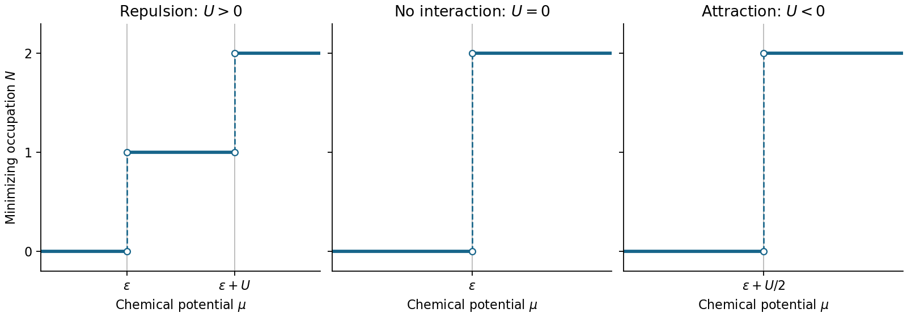

<h1 id="section-a/a5/solution">Solution</h1>

↑ **Parent:** [A5](../a5.md)

The appropriate quantity to minimize is the [energy](../../../../../energy-split.md) including exchange of particles with the [electron](../../../../../electron.md) reservoir, $\mathcal E=E-\mu N$. The [occupation of an interacting localized electron level](../../../../../occupation-of-an-interacting-localized-electron-level.md) follows from

$$
\begin{array}{c|c|c|c}
N&E&\text{number of spin states}&E-\mu N\\\hline
0&0&1&0\\
1&\epsilon&2&\epsilon-\mu\\
2&2\epsilon+U&1&2\epsilon+U-2\mu
\end{array}
$$

**For repulsion $U>0$**, the first [electron](../../../../../electron.md) costs $\epsilon$ and the second costs $\epsilon+U$. Comparing all three grand [energies](../../../../../energy-split.md) gives

$$
\boxed{N(\mu)=\begin{cases}0,&\mu<\epsilon,\\1,&\epsilon<\mu<\epsilon+U,\\2,&\mu>\epsilon+U.\end{cases}}
$$

**For attraction $U<0$**, the singly occupied state never minimizes the grand [energy](../../../../../energy-split.md). At the crossing of the empty and doubly occupied states, $\mu_*=\epsilon+U/2$, its grand [energy](../../../../../energy-split.md) is $-U/2>0$, while both competing states have zero grand [energy](../../../../../energy-split.md). Hence

$$
\boxed{N(\mu)=\begin{cases}0,&\mu<\epsilon+U/2,\\2,&\mu>\epsilon+U/2.\end{cases}}
$$

For $U=0$ the two thresholds coincide at $\mu=\epsilon$, giving a direct $0\to2$ step. At a threshold, distinct occupations are degenerate; zero-[temperature](../../../../../temperature-split.md) minimization alone does not select a unique occupation. A [grand canonical ensemble](../../../../../grand-canonical-ensemble.md) at small positive [temperature](../../../../../temperature-split.md) smooths the steps, with

$$
\Xi=1+2e^{-\beta(\epsilon-\mu)}+e^{-\beta(2\epsilon+U-2\mu)},\qquad
\langle N\rangle=\frac{2e^{-\beta(\epsilon-\mu)}+2e^{-\beta(2\epsilon+U-2\mu)}}{\Xi}.
$$

In particular, the equal-weight empty/pair limit for $U<0$ gives [mean](../../../../../expected-value-split.md) occupation one exactly at its crossing; this is not a finite-width singly occupied plateau.

**[Figure 1](#section-a/a5/image-zero-temperature-occupation-of-a-localized-impurity-level-in-a-crystal-with-repulsive-zero-and-attractive-interaction). Zero-temperature occupation of a localized impurity level in a crystal with repulsive, zero and attractive interaction**. Original plots of the minimizing occupation away from degeneracy points. Dashed vertical lines mark the chemical potentials at which different occupations have equal grand energy. Their vertical segments indicate jumps, not intermediate stable states.

## ↑ Ancestors (14)

1. [A5](../a5.md)
2. [Section A](../../section-a.md)
3. [Paper 2](../../../paper-2-split.md)
4. [2018](../../../split.md)
5. [Past exam of the physics B course of the University of Cambridge](../../../../split.md)
6. [Physics B course of the University of Cambridge](../../../../../physics-b-course-of-the-university-of-cambridge.md)
7. [Physics course of the year 2 of the natural sciences course of the University of Cambridge](../../../../../physics-course-of-the-year-2-of-the-natural-sciences-course-of-the-university-of-cambridge.md)
8. [Year 2 of the natural sciences course of the University of Cambridge](../../../../../year-2-of-the-natural-sciences-course-of-the-university-of-cambridge.md)
9. [Year of the natural sciences course of the University of Cambridge](../../../../../year-of-the-natural-sciences-course-of-the-university-of-cambridge.md)
10. [Natural sciences course of the University of Cambridge](../../../../../natural-sciences-course-of-the-university-of-cambridge.md)
11. [Course of the University of Cambridge](../../../../../course-of-the-university-of-cambridge.md)
12. [University of Cambridge](../../../../../university-of-cambridge-split.md)
13. [List of universities](../../../../../list-of-universities.md)
14. [Codex Wiki](../../../../../split.md)
