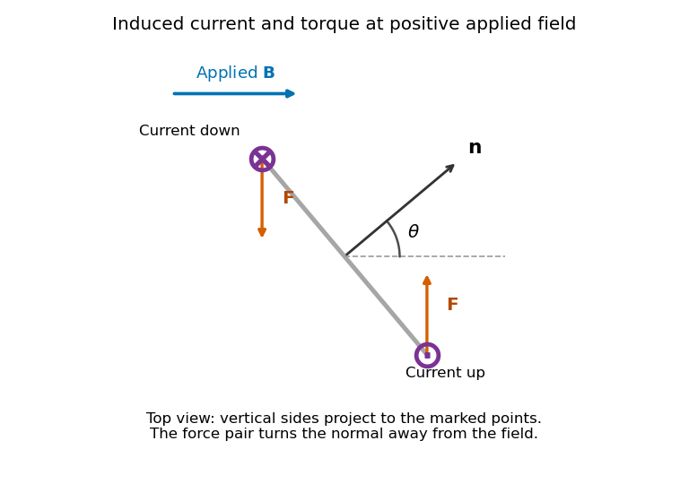

<h1 id="section-b/b6/solution">Solution</h1>

↑ **Parent:** [B6](../b6.md)

**Induction and its sign.** The Maxwell-Faraday equation is $\nabla\times\mathbf E=-\partial_t\mathbf B$. For a fixed loop, [Stokes theorem](../../../../../stokes-theorem.md) gives

$$
\boxed{\mathcal E=\oint\mathbf E\cdot d\boldsymbol\ell
=-\frac{d}{dt}\int\mathbf B\cdot d\mathbf S
=-\frac{d\Phi}{dt}.}
$$

This is [Faraday's law of induction](../../../../../faraday-s-law-of-induction.md). The orientation of the surface normal and positive circulation are linked by the [right-hand rule](../../../../../right-hand-rule.md). The minus sign is [Lenz's law](../../../../../lenz-s-law.md): the induced current's linked flux opposes the imposed flux change, rather than reinforcing it.

**The inductive current.** Let the loop normal make angle $\theta$ with the applied field, with positive current defined by that normal. The external [magnetic flux](../../../../../magnetic-flux.md) is $\Phi_{\rm ext}=AB_0\sin\omega t\cos\theta$. With negligible [electrical resistance](../../../../../electrical-resistance.md), the circuit equation is $L\dot I=-\dot\Phi_{\rm ext}$, so total linked flux $LI+\Phi_{\rm ext}$ is constant. For zero initial trapped flux,

$$
\boxed{I=-\frac{AB_0}{L}\cos\theta\sin\omega t.}
$$

The printed result needs this initial-flux assumption; in general an additional constant current is allowed. The units are amperes because a weber divided by a henry is an ampere.

**Current and forces at one instant.** Take $B>0$ along $+x$ and $0<\theta<\pi/2$, so $I<0$ relative to the chosen normal. The loop [magnetic dipole moment](../../../../../magnetic-dipole-moment.md) $\boldsymbol\mu=IA\mathbf n$ therefore has a component opposite the applied field. Each wire element experiences [Lorentz force](../../../../../lorentz-force.md) $d\mathbf F=I\,d\boldsymbol\ell\times\mathbf B$. Opposite sides have equal and opposite forces, giving zero net force in the uniform field but a nonzero couple.

**[Figure 1](#section-b/b6/image-original-top-view-of-the-loop-s-vertical-sides-at-positive-applied-field-dots-and-crosses-show-vertical-current-and-the-force-pair-increases-the-angle-between-normal-and-field). Original top view of the loop's vertical sides at positive applied field; dots and crosses show vertical current, and the force pair increases the angle between normal and field**.

The horizontal top and bottom wire segments also experience equal and opposite vertical forces. They cancel without adding torque about the vertical rotation axis; the displayed force pair supplies that torque.

**Average torque.** Since $\boldsymbol\tau=\boldsymbol\mu\times\mathbf B$, its generalized component for increasing $\theta$ is $\tau_\theta=-IAB\sin\theta$. Substitution gives

$$
\tau_\theta=\frac{A^2B_0^2}{L}\sin\theta\cos\theta\sin^2\omega t,
$$

and, using $\langle\sin^2\omega t\rangle=1/2$,

$$
\boxed{\langle\tau_\theta\rangle=
\frac{A^2B_0^2}{2L}\sin\theta\cos\theta
=\frac{A^2B_0^2}{4L}\sin2\theta.}
$$

The [orientation torque on a flux-conserving loop](../../../../../orientation-torque-on-a-flux-conserving-loop.md) drives its normal away from the field for the stated initial angle. Its magnitude has units joules, or newton metres.

**Free motion with large inertia.** Write $J$ for the mechanical [moment of inertia](../../../../../moment-of-inertia.md). If its orientation changes little during each field cycle, the slow equation is $J\ddot\theta=\langle\tau_\theta\rangle$, with effective potential

$$
U_{\rm av}=\frac{A^2B_0^2}{4L}\cos^2\theta.
$$

The stable orientation is $\theta=\pi/2$, where the loop plane contains the applied field. Released from rest between $0$ and $\pi/2$, the loop accelerates toward that orientation, overshoots and librates around it. In the leading averaged, undamped model its turning angles are $\theta_i$ and $\pi-\theta_i$. It does not settle without a dissipative mechanism. For small librations the squared [angular frequency](../../../../../angular-frequency.md) is $A^2B_0^2/(2LJ)$.

**Negligible inductance and finite resistance.** Now the current is proportional to the induced electromotive force, not to the flux. Including slow rotation,

$$
I=-\frac1R\frac{d}{dt}(AB\cos\theta)
=-\frac AR\dot B\cos\theta+\frac ARB\sin\theta\,\dot\theta.
$$

The [rotational damping of a resistive loop in an oscillating field](../../../../../rotational-damping-of-a-resistive-loop-in-an-oscillating-field.md) follows from

$$
\tau_\theta=\frac{A^2}{R}B\dot B\sin\theta\cos\theta
-\frac{A^2}{R}B^2\sin^2\theta\,\dot\theta.
$$

At fixed orientation, the first term alternates at $2\omega$ and has zero mean. The loop can therefore rock slightly, but there is no leading mean aligning torque like that in the inductive case. Slow rotation gives

$$
\boxed{\langle\tau_\theta\rangle
=-\frac{A^2B_0^2}{2R}\sin^2\theta\,\dot\theta,}
$$

which opposes motion and produces [Joule heating](../../../../../joule-heating.md). Initial-phase transients can initiate motion, and the instantaneous torque is not zero. This description retains the large-inertia, slow-motion approximation; it does not assert an exact stationary solution at every starting angle.

## ↑ Ancestors (14)

1. [B6](../b6.md)
2. [Section B](../../section-b.md)
3. [Paper 1](../../../paper-1-split.md)
4. [2019](../../../split.md)
5. [Past exam of the physics B course of the University of Cambridge](../../../../split.md)
6. [Physics B course of the University of Cambridge](../../../../../physics-b-course-of-the-university-of-cambridge.md)
7. [Physics course of the year 2 of the natural sciences course of the University of Cambridge](../../../../../physics-course-of-the-year-2-of-the-natural-sciences-course-of-the-university-of-cambridge.md)
8. [Year 2 of the natural sciences course of the University of Cambridge](../../../../../year-2-of-the-natural-sciences-course-of-the-university-of-cambridge.md)
9. [Year of the natural sciences course of the University of Cambridge](../../../../../year-of-the-natural-sciences-course-of-the-university-of-cambridge.md)
10. [Natural sciences course of the University of Cambridge](../../../../../natural-sciences-course-of-the-university-of-cambridge.md)
11. [Course of the University of Cambridge](../../../../../course-of-the-university-of-cambridge.md)
12. [University of Cambridge](../../../../../university-of-cambridge-split.md)
13. [List of universities](../../../../../list-of-universities.md)
14. [Codex Wiki](../../../../../split.md)
