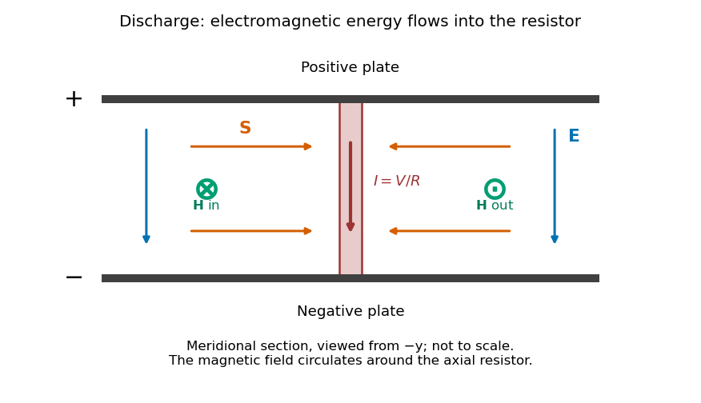

<h1 id="section-b/b7/solution">Solution</h1>

↑ **Parent:** [B7](../b7.md)

**The integral field equation.** The [Ampere-Maxwell law](../../../../../ampere-s-circuital-law.md) is $\nabla\times\mathbf H=\mathbf J+\partial_t\mathbf D$. Apply [Stokes theorem](../../../../../stokes-theorem.md) to any fixed oriented surface bounded by the chosen contour:

$$
\boxed{\oint\mathbf H\cdot d\boldsymbol\ell
=\int\mathbf J\cdot d\mathbf S
+\int\partial_t\mathbf D\cdot d\mathbf S.}
$$

The added [displacement current](../../../../../displacement-current.md) is required for compatibility with [electric charge conservation](../../../../../charge-conservation.md). Taking a divergence and using $\nabla\cdot\mathbf D=\rho_f$ gives $\nabla\cdot\mathbf J+\partial_t\rho_f=0$.

**Field geometry.** Choose the upper plate positive and let $z$ increase upward. In the long-plate, slow-discharge approximation, $\mathbf E=-(V/d)\widehat{\mathbf z}$. Conventional wire current runs downward from the positive plate. The [magnetic field intensity](../../../../../magnetic-field-intensity.md) circulates clockwise as viewed from above. The [Poynting vector](../../../../../poynting-vector.md) $\mathbf S=\mathbf E\times\mathbf H$ points radially toward the resistive wire.

**[Figure 2](#section-b/b7/image-original-meridional-section-of-the-discharging-capacitor-electric-field-and-wire-current-point-down-magnetic-field-circles-the-wire-and-electromagnetic-energy-flows-inward). Original meridional section of the discharging capacitor; electric field and wire current point down, magnetic field circles the wire, and electromagnetic energy flows inward**.

**Wire and displacement currents.** The [capacitance](../../../../../capacitance.md) and discharge law are

$$
C=\frac{\varepsilon_0\pi a^2}{d},\qquad
I=\frac VR=-C\dot V.
$$

Because $V$ decreases, $\partial_t\mathbf D$ points upward, opposing the downward wire current. Through a disk of radius $r$ between the plates its magnitude is

$$
I_D(r)=-\frac{\varepsilon_0\pi r^2}{d}\dot V
=I\frac{r^2}{a^2}.
$$

The effective downward current enclosed by the circular contour is therefore $I-I_D(r)$. The [Ampere-Maxwell law](../../../../../ampere-s-circuital-law.md) gives

$$
2\pi rH=I\left(1-\frac{r^2}{a^2}\right),\qquad
\boxed{H(r)=\frac{V}{2\pi rR}\left(1-\frac{r^2}{a^2}\right).}
$$

This is the magnitude; with the stated coordinates, $\mathbf H=-H\widehat{\boldsymbol\phi}$. The factor $1-r^2/a^2$ expresses cancellation between conduction and displacement currents. The approximation requires distances outside the thin wire and away from detailed electrode-edge fields.

**Energy flux and power.** Since $\widehat{\mathbf z}\times\widehat{\boldsymbol\phi}=-\widehat{\mathbf r}$,

$$
\boxed{\mathbf S(r)=-\frac{V^2}{2\pi rdR}
\left(1-\frac{r^2}{a^2}\right)\widehat{\mathbf r}.}
$$

Its units are watts per square metre. Integrating over the cylinder's side area $2\pi rd$, the signed outward power is negative:

$$
P_{\rm out}(r)=-\frac{V^2}{R}\left(1-\frac{r^2}{a^2}\right),
\qquad
\boxed{P_{\rm in}(r)=\frac{V^2}{R}\left(1-\frac{r^2}{a^2}\right).}
$$

There is no leading axial flux through the cylinder's ends in this ideal field geometry.

**Where the energy goes.** The [Poynting flux in a centrally discharged parallel-plate capacitor](../../../../../poynting-flux-in-a-centrally-discharged-parallel-plate-capacitor.md) carries field energy through the dielectric space into the resistor, where it becomes [Joule heating](../../../../../joule-heating.md) at rate $V^2/R$. Inside radius $r$ the stored electric [energy](../../../../../energy-split.md) is

$$
U_{<r}=\frac{\varepsilon_0\pi r^2V^2}{2d},\qquad
-\frac{dU_{<r}}{dt}=\frac{V^2}{R}\frac{r^2}{a^2}.
$$

Hence

$$
\boxed{P_{\rm in}(r)-\frac{dU_{<r}}{dt}=\frac{V^2}{R}.}
$$

The resistor receives the inward flux from outside that cylinder plus the field energy released inside it. As $r$ approaches the wire radius, essentially all its power arrives as radial electromagnetic flux. Over the whole capacitor, $-d(CV^2/2)/dt=V^2/R$. The [Poynting theorem](../../../../../poynting-theorem.md) thus accounts for the complete discharge without treating energy as transported only along the conducting wire. High resistance makes the quasistatic electric-field approximation and neglect of changing magnetic energy consistent.

## ↑ Ancestors (14)

1. [B7](../b7.md)
2. [Section B](../../section-b.md)
3. [Paper 1](../../../paper-1-split.md)
4. [2019](../../../split.md)
5. [Past exam of the physics B course of the University of Cambridge](../../../../split.md)
6. [Physics B course of the University of Cambridge](../../../../../physics-b-course-of-the-university-of-cambridge.md)
7. [Physics course of the year 2 of the natural sciences course of the University of Cambridge](../../../../../physics-course-of-the-year-2-of-the-natural-sciences-course-of-the-university-of-cambridge.md)
8. [Year 2 of the natural sciences course of the University of Cambridge](../../../../../year-2-of-the-natural-sciences-course-of-the-university-of-cambridge.md)
9. [Year of the natural sciences course of the University of Cambridge](../../../../../year-of-the-natural-sciences-course-of-the-university-of-cambridge.md)
10. [Natural sciences course of the University of Cambridge](../../../../../natural-sciences-course-of-the-university-of-cambridge.md)
11. [Course of the University of Cambridge](../../../../../course-of-the-university-of-cambridge.md)
12. [University of Cambridge](../../../../../university-of-cambridge-split.md)
13. [List of universities](../../../../../list-of-universities.md)
14. [Codex Wiki](../../../../../split.md)
