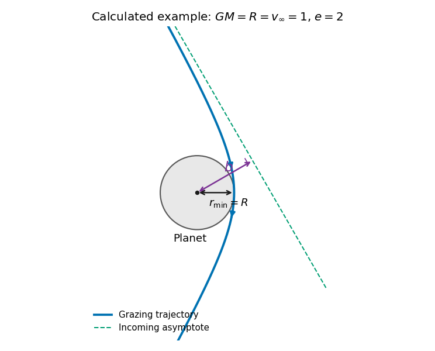

<h1 id="section-c/c10/solution">Solution</h1>

↑ **Parent:** [C10](../c10.md)

**Classification of attractive inverse-square orbits.** Write the [potential energy](../../../../../potential-energy.md) as $U=-\kappa/r$, with $\kappa=GMm>0$ and zero at infinity. For nonzero [angular momentum](../../../../../angular-momentum.md) $J$, the [Kepler orbit](../../../../../kepler-orbit.md) is a conic,

$$
r=\frac{J^2/(m\kappa)}{1+e\cos\phi},\qquad
e^2=1+\frac{2EJ^2}{m\kappa^2}.
$$

Negative total [orbital energy](../../../../../orbital-energy.md) gives an [elliptic orbit](../../../../../elliptic-orbit.md), $0\le e<1$. Its special case $e=0$ is the [circular Kepler orbit](../../../../../circular-kepler-orbit.md), at the minimum [energy](../../../../../energy-split.md) permitted for that $J$, $E=-m\kappa^2/(2J^2)$. Zero energy gives a [parabolic Kepler orbit](../../../../../parabolic-trajectory.md), $e=1$, and positive energy a [hyperbolic Kepler orbit](../../../../../hyperbolic-kepler-orbit.md), $e>1$. For $J=0$, the motion is radial: these are degenerate limiting trajectories and may strike the centre or the finite planetary surface.

**The scattering geometry.** The [impact parameter](../../../../../impact-parameter.md) $b$ is the perpendicular offset of the undeflected incoming asymptote from the centre, not the actual [periapsis](../../../../../periapsis.md) radius $r_{\min}$. Gravity bends the incoming path toward the planet.

**[Figure 4](#section-c/c10/image-original-calculated-grazing-hyperbola-with-its-incoming-asymptote-impact-parameter-and-periapsis-the-planet-and-trajectory-use-a-dimensionless-illustrative-choice). Original calculated grazing hyperbola with its incoming asymptote, impact parameter and periapsis; the planet and trajectory use a dimensionless illustrative choice**.

**The grazing threshold.** At infinity, [conservation of energy](../../../../../conservation-of-energy.md) and [angular momentum](../../../../../angular-momentum.md) give $E=mv_\infty^2/2$ and $J=mbv_\infty$. At closest approach the radial speed is zero, so the velocity is tangential and

$$
J=mr_{\min}v_p,\qquad
\frac12mv_p^2-\frac{GMm}{r_{\min}}=\frac12mv_\infty^2.
$$

Eliminating $v_p$ gives

$$
b^2=r_{\min}^2+\frac{2GM}{v_\infty^2}r_{\min}.
$$

This increases monotonically with $r_{\min}>0$. Setting $r_{\min}=R$ gives the [grazing impact parameter in gravitational focusing](../../../../../grazing-impact-parameter-in-gravitational-focusing.md),

$$
\boxed{b_{\min}=R\sqrt{1+\frac{2GM}{Rv_\infty^2}}
=R\sqrt{1+\frac{v_{\rm esc}^2}{v_\infty^2}}.}
$$

Here $v_{\rm esc}=\sqrt{2GM/R}$ is the surface [escape speed](../../../../../escape-velocity.md). The expression has units of length. Equality is the tangency limit; a strictly noncolliding trajectory requires $b>b_{\min}$. At high speed, $b_{\min}\to R$, while at low speed $b_{\min}\sim\sqrt{2GMR}/v_\infty$. Thus [gravitational focusing](../../../../../gravitational-focusing.md) enlarges the collision cross-section to $\pi b_{\min}^2$.

**Deflection angle.** For this hyperbola,

$$
e=\sqrt{1+\frac{b^2v_\infty^4}{G^2M^2}}.
$$

The asymptotes occur at $\cos\phi_\infty=-1/e$. The change of velocity direction is $\chi=2\phi_\infty-\pi$, giving $\sin(\chi/2)=1/e$. Hence the [gravitational scattering angle](../../../../../gravitational-scattering-angle.md) satisfies

$$
\tan\frac\chi2=\frac1{\sqrt{e^2-1}}=\frac{GM}{bv_\infty^2}.
$$

For the grazing trajectory this is

$$
\boxed{\tan\frac\chi2=\frac{GM}{b_{\min}v_\infty^2}.}
$$

It is the attractive counterpart of the [Rutherford impact-parameter relation](../../../../../rutherford-impact-parameter-relation.md); the sign of the transverse bending changes, but the positive deflection magnitude has this same form.

**Range of angles.** Along the grazing family, varying $v_\infty>0$ gives

$$
\boxed{0<\chi<\pi.}
$$

The limits are $\chi\to0$ as $v_\infty\to\infty$ and $\chi\to\pi$ as $v_\infty\to0^+$. Neither endpoint is reached at finite positive speed. The low-speed limiting orbit still has a finite periapsis, but an increasingly distant incoming asymptote.

## ↑ Ancestors (14)

1. [C10](../c10.md)
2. [Section C](../../section-c.md)
3. [Paper 1](../../../paper-1-split.md)
4. [2019](../../../split.md)
5. [Past exam of the physics B course of the University of Cambridge](../../../../split.md)
6. [Physics B course of the University of Cambridge](../../../../../physics-b-course-of-the-university-of-cambridge.md)
7. [Physics course of the year 2 of the natural sciences course of the University of Cambridge](../../../../../physics-course-of-the-year-2-of-the-natural-sciences-course-of-the-university-of-cambridge.md)
8. [Year 2 of the natural sciences course of the University of Cambridge](../../../../../year-2-of-the-natural-sciences-course-of-the-university-of-cambridge.md)
9. [Year of the natural sciences course of the University of Cambridge](../../../../../year-of-the-natural-sciences-course-of-the-university-of-cambridge.md)
10. [Natural sciences course of the University of Cambridge](../../../../../natural-sciences-course-of-the-university-of-cambridge.md)
11. [Course of the University of Cambridge](../../../../../course-of-the-university-of-cambridge.md)
12. [University of Cambridge](../../../../../university-of-cambridge-split.md)
13. [List of universities](../../../../../list-of-universities.md)
14. [Codex Wiki](../../../../../split.md)
