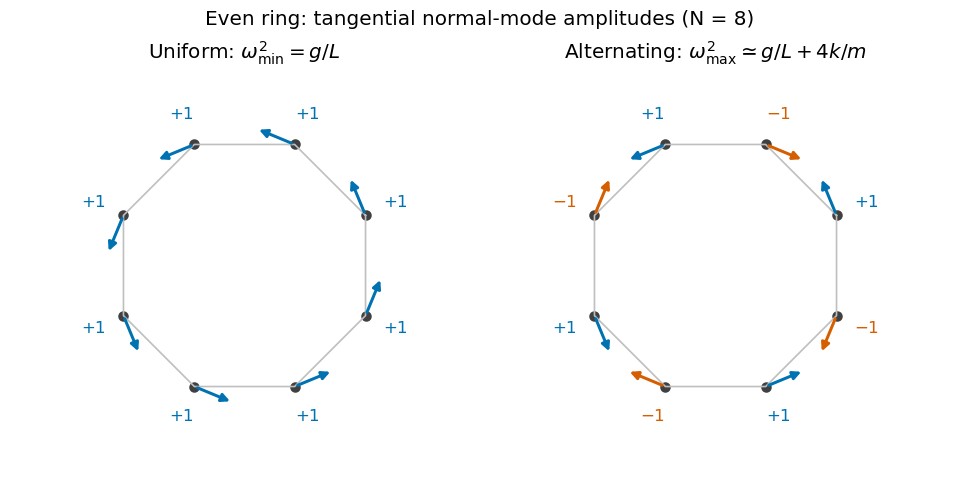

<h1 id="section-c/c11/solution">Solution</h1>

↑ **Parent:** [C11](../c11.md)

**Modes, stability and symmetry.** A [normal mode](../../../../../normal-mode.md) of the linearized system has a fixed displacement pattern multiplied by one temporal oscillation. For $n$ independent [generalized coordinates](../../../../../generalized-coordinate.md), a conservative small-disturbance system has

$$
\mathsf M\ddot{\mathbf q}+\mathsf K\mathbf q=0,\qquad
\mathsf K\mathbf a=\omega^2\mathsf M\mathbf a.
$$

When the mass matrix $\mathsf M$ is positive definite and the stiffness $\mathsf K$ is a [symmetric matrix](../../../../../symmetric-matrix.md), the [generalized eigenvalue problem for small oscillations](../../../../../generalized-eigenvalue-problem-for-small-oscillations.md) has $n$ independent mode directions, counting degeneracy. Positive $\omega^2$ gives stable oscillation, negative $\omega^2$ an exponentially growing and decaying pair, and zero $\omega^2$ a neutral direction whose nonlinear stability needs further analysis. An arbitrary linear motion is a [superposition](../../../../../superposition-principle.md) of these modes.

If a symmetry preserves both kinetic and potential energies, it maps modes to modes of the same frequency. Mode patterns can be classified by that symmetry, for example reflection-even and reflection-odd patterns. Degenerate [eigenspaces](../../../../../eigenspace.md) admit different bases, so a mode shape need not be uniquely selected inside such a subspace.

**Two pendulums free to swing in any direction.** Let $x_j$ be the small horizontal displacement along the line joining the supports and $y_j$ the perpendicular horizontal displacement. Put $\omega_0^2=g/L$ and $\kappa=k/m$. To quadratic order,

$$
T=\frac m2\sum_{j=1}^2(\dot x_j^2+\dot y_j^2),\qquad
V=\frac{m\omega_0^2}{2}\sum_{j=1}^2(x_j^2+y_j^2)
+\frac k2(x_2-x_1)^2.
$$

The spring is unstretched at equilibrium. Its first-order length change is only $x_2-x_1$; a transverse difference changes its length at second order and produces no quadratic transverse restoring energy. Consequently the four modes are

$$
\boxed{\begin{aligned}
&(x_1,x_2)\propto(1,1),\quad y_1=y_2=0:
&&\omega=\omega_0,\\
&(x_1,x_2)\propto(1,-1),\quad y_1=y_2=0:
&&\omega=\sqrt{\omega_0^2+2\kappa},\\
&(y_1,y_2)\propto(1,1)\ \text{or}\ (1,-1),\quad x_1=x_2=0:
&&\omega=\omega_0.
\end{aligned}}
$$

This is the [transverse degeneracy of unstretched spring-coupled pendulums](../../../../../transverse-degeneracy-of-unstretched-spring-coupled-pendulums.md): $\omega_0$ has a three-dimensional [eigenspace](../../../../../eigenspace.md). Independent transverse motions form an equally valid basis for two of those directions. A pre-tensioned spring would change the transverse result.

**The open three-pendulum chain.** Restrict motion to the vertical plane containing the supports, with horizontal coordinates $x_1,x_2,x_3$. There are springs between neighbours and no wall springs. The equations are

$$
\ddot{\mathbf x}+\left[\omega_0^2\mathsf 1+
\kappa\begin{pmatrix}1&-1&0\\-1&2&-1\\0&-1&1\end{pmatrix}\right]\mathbf x=0.
$$

The spring matrix has eigenvalues $0,1,3$, with respective [eigenvectors](../../../../../eigenvector.md) $(1,1,1)$, $(1,0,-1)$ and $(1,-2,1)$. The [normal modes of three freely ended coupled pendulums](../../../../../normal-modes-of-three-freely-ended-coupled-pendulums.md) are therefore

$$
\boxed{\begin{aligned}
(1,1,1):&\quad \omega^2=\omega_0^2,\\
(1,0,-1):&\quad \omega^2=\omega_0^2+\kappa,\\
(1,-2,1):&\quad \omega^2=\omega_0^2+3\kappa.
\end{aligned}}
$$

The lowest mode stretches neither spring. In the middle mode the outer masses oppose each other and the central mass is stationary. The highest mode has the central mass moving oppositely with twice the outer amplitude. Reflection about the middle support makes the first and last patterns even and the middle pattern odd.

**An even ring.** For a large ring, use tangential displacement $x_j$ and periodic indexing $x_{j+N}=x_j$. The locally straight nearest-neighbour equations are

$$
\ddot x_j=-\omega_0^2x_j-\kappa(2x_j-x_{j-1}-x_{j+1}).
$$

Cyclic translation symmetry selects [Fourier modes](../../../../../fourier-mode.md) $x_j\propto e^{i(qj-\omega t)}$, with $q=2\pi s/N$. Hence

$$
\omega_s^2=\omega_0^2+4\kappa\sin^2\frac{\pi s}{N},\qquad s=0,\ldots,N-1.
$$

For even $N$, the lowest pattern has equal tangential displacements, while the highest alternates signs around the ring. Thus

$$
\boxed{\omega_{\min}=\sqrt{\frac gL},\qquad
\omega_{\max}\simeq\sqrt{\frac gL+\frac{4k}{m}}\quad(N\ \text{large}).}
$$

**[Figure 5](#section-c/c11/image-original-amplitude-sketches-for-the-lowest-and-highest-modes-of-an-even-pendulum-ring-arrows-denote-tangential-displacements-not-static-positions). Original amplitude sketches for the lowest and highest modes of an even pendulum ring; arrows denote tangential displacements, not static positions**.

These are the [even and odd pendulum-ring modes](../../../../../even-and-odd-pendulum-ring-modes.md). For exact finite regular-polygon geometry with straight chord springs, the first-order spring extension includes a factor $\cos(\pi/N)$, so its squared contribution is multiplied by $\cos^2(\pi/N)$. That correction tends to one in the requested large-$N$ limit.

**An odd ring.** Perfect alternation cannot close after an odd number of steps. The two highest wave indices are instead $s=(N-1)/2$ and $(N+1)/2$. They give a degenerate pair, represented by real sine and cosine standing patterns, with

$$
\boxed{\omega_{\max}^2\simeq\omega_0^2+4\kappa\cos^2\frac{\pi}{2N}.}
$$

The maximum is slightly below the even-ring limiting value, and the sign pattern must contain a gradual phase mismatch rather than exact alternation. The uniform lowest mode is unchanged, and there are still $N$ independent tangential mode directions.

## ↑ Ancestors (14)

1. [C11](../c11.md)
2. [Section C](../../section-c.md)
3. [Paper 1](../../../paper-1-split.md)
4. [2019](../../../split.md)
5. [Past exam of the physics B course of the University of Cambridge](../../../../split.md)
6. [Physics B course of the University of Cambridge](../../../../../physics-b-course-of-the-university-of-cambridge.md)
7. [Physics course of the year 2 of the natural sciences course of the University of Cambridge](../../../../../physics-course-of-the-year-2-of-the-natural-sciences-course-of-the-university-of-cambridge.md)
8. [Year 2 of the natural sciences course of the University of Cambridge](../../../../../year-2-of-the-natural-sciences-course-of-the-university-of-cambridge.md)
9. [Year of the natural sciences course of the University of Cambridge](../../../../../year-of-the-natural-sciences-course-of-the-university-of-cambridge.md)
10. [Natural sciences course of the University of Cambridge](../../../../../natural-sciences-course-of-the-university-of-cambridge.md)
11. [Course of the University of Cambridge](../../../../../course-of-the-university-of-cambridge.md)
12. [University of Cambridge](../../../../../university-of-cambridge-split.md)
13. [List of universities](../../../../../list-of-universities.md)
14. [Codex Wiki](../../../../../split.md)
