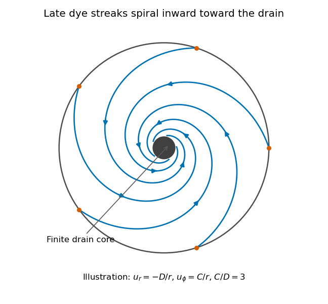

<h1 id="section-c/c12/solution">Solution</h1>

↑ **Parent:** [C12](../c12.md)

**Flow visualization and the idealization.** A [streamline](../../../../../streamline.md) is everywhere tangent to the instantaneous [velocity field](../../../../../velocity-field.md) at one fixed time. A [streakline](../../../../../streakline.md) is the locus, at one observation time, of particles that previously passed through a specified injection point. A marked particle's own trajectory is a [pathline](../../../../../pathline.md). These coincide geometrically in [steady flow](../../../../../steady-flow.md), but need not do so in an unsteady draining flow.

The intended ideal liquid is approximately incompressible and inviscid: [viscosity](../../../../../dynamic-viscosity-split.md) and associated shear stresses are negligible on the scales and times being considered, the [Mach number](../../../../../mach-number.md) is small, and the density is effectively constant. This does not require zero [vorticity](../../../../../vorticity-split.md); the initially rotating state is already a counterexample. It also does not justify ignoring viscosity in an arbitrarily thin boundary layer or at a real drain.

**Spiralling flow and angular momentum.** In an axisymmetric [inviscid flow](../../../../../inviscid-flow.md), pressure and gravity exert no torque about the vertical axis. A parcel therefore conserves axial [specific angular momentum](../../../../../specific-angular-momentum.md),

$$
\frac{D}{Dt}(ru_\phi)=0,\qquad
r^2\omega=r_0^2\omega_0.
$$

The late, shallow remnant in the intended draining picture is supplied by parcels initially near the outer rim, so $r_0\simeq R$. The [slow-drain angular-momentum amplification](../../../../../slow-drain-angular-momentum-amplification.md) then gives

$$
\boxed{\omega(r)\simeq\omega_0\frac{R^2}{r^2},\qquad
u_\phi(r)\simeq\frac{\omega_0R^2}{r}.}
$$

The assumption about the parcels' origin is necessary: torque conservation by itself does not assign $r_0=R$ to every parcel at every time.

**[Figure 6](#section-c/c12/image-original-quasisteady-illustration-of-inward-spiralling-dye-streaks-outside-a-finite-drain-core-the-azimuthal-speed-increases-as-the-radius-decreases). Original quasisteady illustration of inward-spiralling dye streaks outside a finite drain core; the azimuthal speed increases as the radius decreases**.

A continuous dye feed near the outer free surface produces inward spirals that wind increasingly rapidly near the drain. The figure uses a late quasisteady model, $u_r=-D/r$ and $u_\phi=C/r$ with positive constants $D,C$, giving $\phi=\phi_0-(C/D)\ln(r/r_0)$. Its streaklines and streamlines approximately coincide over an observation interval short compared with the overall draining time. Strictly, individually marked particles at the initial surface trace pathlines, not a continuously injected streakline.

**The free-surface depression.** Let $z=H(r)$ be the surface. Slow radial draining makes radial inertial corrections small compared with the azimuthal [centripetal acceleration](../../../../../centripetal-acceleration.md). The radial [Euler equation](../../../../../euler-equations-for-an-inviscid-fluid-split.md) and vertical [hydrostatic equilibrium](../../../../../hydrostatic-equilibrium.md) give

$$
\frac1\rho\frac{\partial p}{\partial r}=\frac{u_\phi^2}{r},
\qquad p(r,z)=p_{\rm atm}+\rho g[H(r)-z].
$$

Thus $gH'(r)=u_\phi^2/r=C^2/r^3$, with $C=\omega_0R^2$. Integrating from $r$ to the rim gives

$$
h=H(R)-H(r)=\frac{C^2}{2g}\left(\frac1{r^2}-\frac1{R^2}\right).
$$

For $r\ll R$ this becomes

$$
\boxed{h\simeq\frac{\omega_0^2R^4}{2gr^2}.}
$$

The surface rises outward because the inward [pressure gradient](../../../../../pressure-gradient.md) force must sustain the circular motion. The dimensions are metres, and the $1/r^2$ profile is not valid inside the finite drain or vortex core.

**The terrestrial estimate.** Use the vertical component of [Earth's rotation](../../../../../earth-s-rotation.md) as the ideal initial angular speed, $\omega_0\simeq\Omega_E\sin\lambda$. At Cambridge, taking $\lambda\simeq52.2^\circ$ and $\Omega_E=7.292\times10^{-5}\ \mathrm{s^{-1}}$, this gives $\omega_0\simeq5.76\times10^{-5}\ \mathrm{s^{-1}}$. Hence, for $R=1\ \mathrm m$, $r=0.01\ \mathrm m$ and $g=9.81\ \mathrm{m\,s^{-2}}$,

$$
\boxed{h\simeq1.7\times10^{-6}\ \mathrm m=1.7\ \mathrm{\mu m}.}
$$

Taking the whole terrestrial angular speed rather than its local vertical projection would give about $2.7\ \mathrm{\mu m}$. The Cambridge estimate uses the projection appropriate to the vertical vortex. This very small head assumes terrestrial rotation supplies the only initial swirl; imposed residual rotation would change it quadratically.

**Curl of the azimuthal velocity.** For axisymmetric $u_\phi=r\omega(r)$ with no vertical dependence, the rotational part of the [vorticity](../../../../../vorticity-split.md) is vertical:

$$
\boldsymbol\zeta=\nabla\times\mathbf u
=\frac1r\frac{d(ru_\phi)}{dr}\widehat{\mathbf z}
=\boxed{\left(2\omega+r\frac{d\omega}{dr}\right)\widehat{\mathbf z}.}
$$

The ideal quasisteady radial sink has no curl outside its core. The source's symbol $\Omega$ denotes this vertical vorticity component, not the fluid's angular velocity. In general its magnitude is the absolute value of the bracket.

**The two limiting states.** For initial uniform rotation, $\omega=\omega_0$, whereas the late approximation has $\omega=C/r^2$. Therefore

$$
\boxed{\Omega_{\rm initial}=2\omega_0,\qquad
\Omega_{\rm late}\simeq0\quad(r\ \text{outside the drain core}).}
$$

The late flow can have large angular velocity and nonzero circulation while being locally irrotational. The drain core is excluded from the domain of the $1/r$ velocity field.

**What is actually conserved.** Inviscid does not mean that each parcel's vorticity magnitude is fixed in three dimensions. For an incompressible barotropic liquid with conservative body forces, the [vorticity equation](../../../../../vorticity-equation.md) is

$$
\frac{D\boldsymbol\zeta}{Dt}=(\boldsymbol\zeta\cdot\nabla)\mathbf u.
$$

Vertical compression of a material column changes its vorticity through [vortex stretching](../../../../../vortex-stretching.md), even while its volume is conserved by horizontal expansion. In the columnar shallow-layer limit, [vorticity dilution in a shallow draining layer](../../../../../vorticity-dilution-in-a-shallow-draining-layer.md) gives

$$
\boxed{\frac{D}{Dt}\left(\frac{\zeta}{H}\right)=0.}
$$

Thus a remnant much shallower than its original column can have much smaller vertical vorticity. At finite depth there is generally a residual value; the exactly irrotational late profile is a leading limiting approximation, not an exact parcelwise conversion of nonzero vorticity to zero in finite time.

[Kelvin's circulation theorem](../../../../../kelvin-s-circulation-theorem.md) conserves circulation around a material loop, not around a fixed spatial circle. A loop whose original radius is near $R$ has circulation about $2\pi\omega_0R^2$, consistent with the late $u_\phi=C/r$ field. Fluid also leaves through the drain, so the remaining tank contents are not a fixed material system. If the calculation is expressed explicitly in the Earth-fixed rotating frame, the corresponding [shallow-water potential vorticity](../../../../../shallow-water-potential-vorticity.md) is $(\zeta+f)/H$, with $f=2\Omega_E\sin\lambda$; the conserved quantity involves [absolute vorticity](../../../../../absolute-vorticity.md).

## ↑ Ancestors (14)

1. [C12](../c12.md)
2. [Section C](../../section-c.md)
3. [Paper 1](../../../paper-1-split.md)
4. [2019](../../../split.md)
5. [Past exam of the physics B course of the University of Cambridge](../../../../split.md)
6. [Physics B course of the University of Cambridge](../../../../../physics-b-course-of-the-university-of-cambridge.md)
7. [Physics course of the year 2 of the natural sciences course of the University of Cambridge](../../../../../physics-course-of-the-year-2-of-the-natural-sciences-course-of-the-university-of-cambridge.md)
8. [Year 2 of the natural sciences course of the University of Cambridge](../../../../../year-2-of-the-natural-sciences-course-of-the-university-of-cambridge.md)
9. [Year of the natural sciences course of the University of Cambridge](../../../../../year-of-the-natural-sciences-course-of-the-university-of-cambridge.md)
10. [Natural sciences course of the University of Cambridge](../../../../../natural-sciences-course-of-the-university-of-cambridge.md)
11. [Course of the University of Cambridge](../../../../../course-of-the-university-of-cambridge.md)
12. [University of Cambridge](../../../../../university-of-cambridge-split.md)
13. [List of universities](../../../../../list-of-universities.md)
14. [Codex Wiki](../../../../../split.md)
