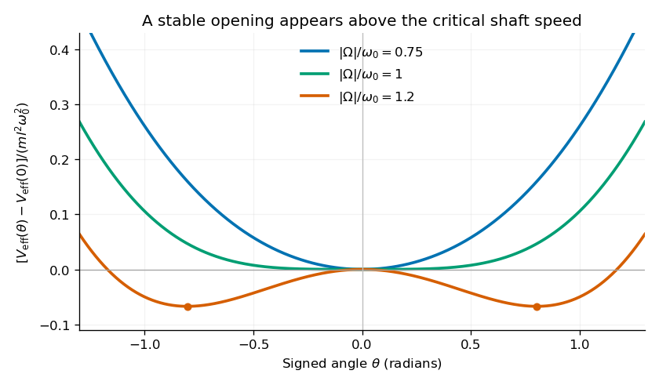

<h1 id="section-c/c9/solution">Solution</h1>

↑ **Parent:** [C9](../c9.md)

**The dynamical method.** In [Lagrangian mechanics](../../../../../lagrangian-mechanics-split.md), choose independent [generalized coordinates](../../../../../generalized-coordinate.md) $q_j$ consistent with the constraints, form the [Lagrangian](../../../../../lagrangian.md) $\mathcal L=T-V$, and solve the [Euler-Lagrange equations](../../../../../euler-lagrange-equation.md),

$$
\frac{d}{dt}\frac{\partial\mathcal L}{\partial\dot q_j}
-\frac{\partial\mathcal L}{\partial q_j}=0.
$$

This form applies to a Newtonian system with ideal constraints, so constraint forces do no allowed [virtual work](../../../../../virtual-work.md), and with the remaining forces derivable from the stated potential. Smooth [holonomic constraints](../../../../../holonomic-constraint.md) can be built into the coordinates. Additional nonconservative [generalized forces](../../../../../generalized-forces.md) would appear on the right. Prescribed shaft rotation is a driven constraint; its constant $\Omega$ is a parameter, not a conserved angular momentum.

**Energy of the two balls.** The diagram labels each ball $m/2$, so their combined mass is $m$. It also shows $\theta$ between an arm and the downward vertical, rather than the full angle between the arms. Each ball has horizontal radius $l\sin\theta$, vertical coordinate $-l\cos\theta$, and squared speed $l^2\dot\theta^2+l^2\Omega^2\sin^2\theta$. Thus

$$
T=\frac12ml^2\dot\theta^2+\frac12ml^2\Omega^2\sin^2\theta,\qquad
V=-mgl\cos\theta,
$$

and

$$
\boxed{\mathcal L=\frac12ml^2\dot\theta^2
+\frac12ml^2\Omega^2\sin^2\theta+mgl\cos\theta.}
$$

The massless connecting rods and sliding collar enforce the geometry but contribute no energy.

**Effective potential.** Define $\omega_0^2=g/l$. At fixed $\Omega$,

$$
\mathcal L=\frac12ml^2\dot\theta^2-V_{\rm eff}(\theta),\qquad
\boxed{\frac{V_{\rm eff}}{ml^2}
=-\frac12\Omega^2\sin^2\theta-\omega_0^2\cos\theta.}
$$

This [effective potential](../../../../../effective-potential.md) determines the reduced $\theta$ dynamics. Its conserved effective energy is not the full lab-frame mechanical energy: the shaft drive can exchange work and angular momentum with the balls.

**The change of stability.** Near $\theta=0$,

$$
\frac{V_{\rm eff}(\theta)-V_{\rm eff}(0)}{ml^2}
=\frac12(\omega_0^2-\Omega^2)\theta^2
+\left(\frac{\Omega^2}{6}-\frac{\omega_0^2}{24}\right)\theta^4+O(\theta^6).
$$

For $|\Omega|<\omega_0$, the downward state is a minimum. At $|\Omega|=\omega_0$, its quadratic stiffness vanishes but the quartic coefficient is $+\omega_0^2/8$. Above that speed, the downward state becomes a maximum and stable nonzero openings appear. This is the [gravity-restored centrifugal governor bifurcation](../../../../../gravity-restored-centrifugal-governor-bifurcation.md).

**[Figure 3](#section-c/c9/image-original-calculated-effective-potentials-below-at-and-above-the-critical-shaft-speed-signed-angles-display-the-symmetric-mathematical-extension-of-the-opening-coordinate). Original calculated effective potentials below, at and above the critical shaft speed; signed angles display the symmetric mathematical extension of the opening coordinate**.

The physical opening is nonnegative; the two minima in the signed extension represent opposite transverse displacements. The stable opening increases continuously from zero toward a right angle as $|\Omega|$ grows. The apparatus is frictionless in the model, so a displaced system oscillates rather than automatically settling at the equilibrium shown by the minima.

**Equilibria.** Differentiation gives

$$
\frac{V_{\rm eff}'}{ml^2}=\sin\theta(\omega_0^2-\Omega^2\cos\theta).
$$

Hence the downward equilibrium is $\theta=0$, and the open equilibria satisfy

$$
\boxed{\cos\theta_{\rm eq}=\frac{\omega_0^2}{\Omega^2},\qquad
\theta_{\rm eq}=\arccos\frac{g}{l\Omega^2},
\quad |\Omega|\ge\sqrt{g/l}.}
$$

The signed extension includes the negative of this angle. Formally $\theta=\pi$ is also stationary, but it is an unstable inverted configuration and lies outside the usual opening range of the mechanism.

**Small oscillations.** Write $\theta=\theta_{\rm eq}+\eta$. The linear equation is $\ddot\eta+\nu^2\eta=0$, where

$$
\nu^2=\frac{V_{\rm eff}''(\theta_{\rm eq})}{ml^2}
=\omega_0^2\cos\theta_{\rm eq}-\Omega^2\cos2\theta_{\rm eq}.
$$

At the downward state and at a nonzero open state, respectively,

$$
\boxed{\nu_0=\sqrt{\omega_0^2-\Omega^2}\quad(|\Omega|<\omega_0),\qquad
\nu_{\rm open}=\sqrt{\Omega^2-\frac{\omega_0^4}{\Omega^2}}
=|\Omega|\sin\theta_{\rm eq}.}
$$

These are [angular frequencies](../../../../../angular-frequency.md) in $\mathrm{s^{-1}}$; ordinary frequencies are $\nu/(2\pi)$. Negative $\nu^2$ indicates exponential instability rather than an oscillation. At $\theta=\pi$, $\nu^2=-\omega_0^2-\Omega^2<0$. At the critical speed, the linear frequency is zero and the positive quartic potential gives amplitude-dependent nonlinear restoring motion.

## ↑ Ancestors (14)

1. [C9](../c9.md)
2. [Section C](../../section-c.md)
3. [Paper 1](../../../paper-1-split.md)
4. [2019](../../../split.md)
5. [Past exam of the physics B course of the University of Cambridge](../../../../split.md)
6. [Physics B course of the University of Cambridge](../../../../../physics-b-course-of-the-university-of-cambridge.md)
7. [Physics course of the year 2 of the natural sciences course of the University of Cambridge](../../../../../physics-course-of-the-year-2-of-the-natural-sciences-course-of-the-university-of-cambridge.md)
8. [Year 2 of the natural sciences course of the University of Cambridge](../../../../../year-2-of-the-natural-sciences-course-of-the-university-of-cambridge.md)
9. [Year of the natural sciences course of the University of Cambridge](../../../../../year-of-the-natural-sciences-course-of-the-university-of-cambridge.md)
10. [Natural sciences course of the University of Cambridge](../../../../../natural-sciences-course-of-the-university-of-cambridge.md)
11. [Course of the University of Cambridge](../../../../../course-of-the-university-of-cambridge.md)
12. [University of Cambridge](../../../../../university-of-cambridge-split.md)
13. [List of universities](../../../../../list-of-universities.md)
14. [Codex Wiki](../../../../../split.md)
