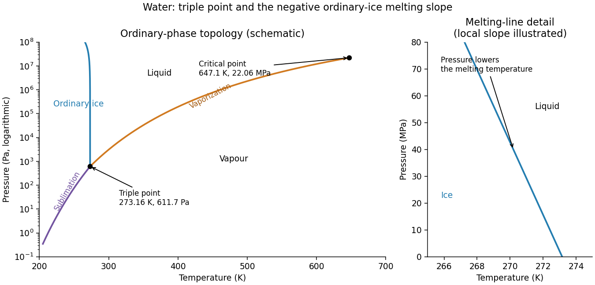

<h1 id="section-a/a2/solution">Solution</h1>

↑ **Parent:** [A2](../a2.md)

Three [phase coexistence curves](../../../../../phase-coexistence-curve.md) meet at the [triple point](../../../../../triple-point.md), where [ice](../../../../../ice.md), [liquid](../../../../../liquid.md) [water](../../../../../water.md) and [water](../../../../../water.md) vapour have equal [chemical potential](../../../../../chemical-potential-split.md). In the ordinary-pressure region, the low-temperature phase is [ice](../../../../../ice.md), the high-pressure moderate-temperature phase is [liquid](../../../../../liquid.md), and the low-pressure high-temperature phase is vapour. The [triple point](../../../../../triple-point.md) is approximately

$$
\boxed{T_t=273.16\,\mathrm K,\qquad p_t=611.7\,\mathrm{Pa}.}
$$

Below $p_t$, warming stable ordinary [ice](../../../../../ice.md) crosses the [sublimation](../../../../../sublimation.md) boundary directly into vapour; there is no intervening stable [liquid](../../../../../liquid.md). Above $p_t$, [melting](../../../../../melting.md) and then boiling can occur. The [liquid](../../../../../liquid.md)–vapour curve terminates at the [liquid-gas critical point](../../../../../liquid-gas-critical-point.md), approximately $647.1\,\mathrm K$ and $22.06\,\mathrm{MPa}$, beyond which there is no [liquid](../../../../../liquid.md)–vapour phase boundary.

The distinctive feature is the negative slope of the ordinary [ice](../../../../../ice.md)–[water](../../../../../water.md) [melting](../../../../../melting.md) line. The [Clapeyron equation](../../../../../clausius-clapeyron-relation.md) gives

$$
\frac{dp}{dT}=\frac{\Delta s}{\Delta v}.
$$

[Melting](../../../../../melting.md) increases [entropy](../../../../../entropy-split.md) but reduces [volume](../../../../../volume-thermodynamics.md) because ordinary [ice](../../../../../ice.md) is less dense than [liquid](../../../../../liquid.md) [water](../../../../../water.md), so $\Delta s>0$ and $\Delta v<0$. Increasing [pressure](../../../../../pressure-split.md) consequently lowers the [melting](../../../../../melting.md) [temperature](../../../../../temperature-split.md) locally. [Sublimation](../../../../../sublimation.md) and [vaporization](../../../../../vaporization.md) both increase [volume](../../../../../volume-thermodynamics.md) and [entropy](../../../../../entropy-split.md), giving positive slopes. The following original schematic shows these signs; it is not a quantitative fit and omits the additional high-pressure [ice](../../../../../ice.md) polymorphs.

**[Figure 1](#section-a/a2/image-schematic-water-pressure-temperature-phase-diagram-with-ordinary-ice-liquid-vapour-triple-point-and-critical-point). Schematic water pressure–temperature phase diagram with ordinary ice, liquid, vapour, triple point and critical point**.

## ↑ Ancestors (14)

1. [A2](../a2.md)
2. [Section A](../../section-a.md)
3. [Paper 2](../../../paper-2-split.md)
4. [2019](../../../split.md)
5. [Past exam of the physics B course of the University of Cambridge](../../../../split.md)
6. [Physics B course of the University of Cambridge](../../../../../physics-b-course-of-the-university-of-cambridge.md)
7. [Physics course of the year 2 of the natural sciences course of the University of Cambridge](../../../../../physics-course-of-the-year-2-of-the-natural-sciences-course-of-the-university-of-cambridge.md)
8. [Year 2 of the natural sciences course of the University of Cambridge](../../../../../year-2-of-the-natural-sciences-course-of-the-university-of-cambridge.md)
9. [Year of the natural sciences course of the University of Cambridge](../../../../../year-of-the-natural-sciences-course-of-the-university-of-cambridge.md)
10. [Natural sciences course of the University of Cambridge](../../../../../natural-sciences-course-of-the-university-of-cambridge.md)
11. [Course of the University of Cambridge](../../../../../course-of-the-university-of-cambridge.md)
12. [University of Cambridge](../../../../../university-of-cambridge-split.md)
13. [List of universities](../../../../../list-of-universities.md)
14. [Codex Wiki](../../../../../split.md)
