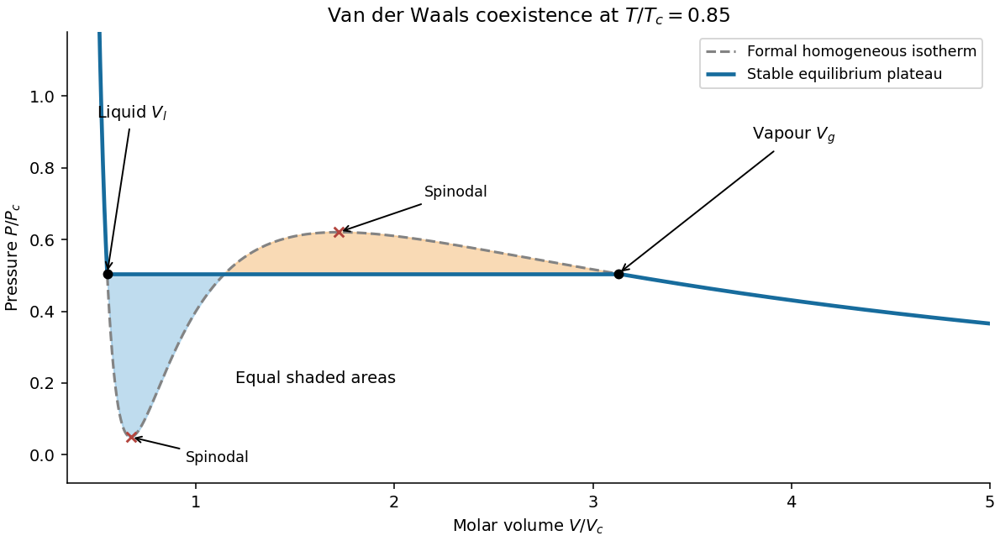

<h1 id="section-c/c10/solution">Solution</h1>

↑ **Parent:** [C10](../c10.md)

**[Pressure](../../../../../pressure-split.md) and its physical terms.** Solving the molar [Van der Waals equation](../../../../../van-der-waals-equation.md) for [pressure](../../../../../pressure-split.md) gives

$$
\boxed{P=\frac{RT}{V-b}-\frac a{V^2},\qquad V>b.}
$$

The excluded-volume parameter $b$ reduces the [volume](../../../../../volume-thermodynamics.md) available for translational motion, raising the kinetic [pressure](../../../../../pressure-split.md) relative to $RT/V$. The attraction parameter $a$ lowers the [pressure](../../../../../pressure-split.md) because attractive interactions reduce the momentum transferred to the boundary. This mean-field model treats $a,b$ as temperature-independent material constants. For one mole, $V$ is the sample [volume](../../../../../volume-thermodynamics.md) with the molar amount already fixed; $b$ has units of that [volume](../../../../../volume-thermodynamics.md) and $a$ of [pressure](../../../../../pressure-split.md) times [volume](../../../../../volume-thermodynamics.md) squared.

**[volume](../../../../../volume-thermodynamics.md) dependence of [entropy](../../../../../entropy-split.md).** The [Helmholtz free energy](../../../../../helmholtz-free-energy.md) has differential $dF=-S\,dT-P\,dV$. Equality of mixed [derivatives](../../../../../derivative.md) yields the [Maxwell relation](../../../../../maxwell-relations.md)

$$
\left(\frac{\partial S}{\partial V}\right)_T
=\left(\frac{\partial P}{\partial T}\right)_V.
$$

For $a=0$ this [derivative](../../../../../derivative.md) is $R/(V-b)$, giving

$$
\boxed{S(V,T)-S(V_*,T)=R\ln\frac{V-b}{V_*-b},\qquad V,V_*>b.}
$$

Equivalently, $S=R\ln(V-b)+f(T)$ with a common reference [volume](../../../../../volume-thermodynamics.md) understood inside the [logarithm](../../../../../logarithm.md). The [equation of state](../../../../../equation-of-state.md) fixes this [volume](../../../../../volume-thermodynamics.md) dependence, not the otherwise unspecified function of [temperature](../../../../../temperature-split.md).

**Excess [entropy](../../../../../entropy-split.md) at fixed [volume](../../../../../volume-thermodynamics.md) and [temperature](../../../../../temperature-split.md).** The [ideal gas](../../../../../ideal-gas-split.md) has $(\partial S_{\mathrm{id}}/\partial V)_T=R/V$. Therefore

$$
\left(\frac{\partial\Delta S^{\mathrm{ex}}}{\partial V}\right)_T
=R\left(\frac1{V-b}-\frac1V\right).
$$

Integrate from infinite [volume](../../../../../volume-thermodynamics.md), where the [entropy](../../../../../entropy-split.md) difference is specified to vanish:

$$
\Delta S^{\mathrm{ex}}(V,T)
=\int_\infty^V R\left(\frac1{v-b}-\frac1v\right)dv
=\boxed{R\ln\left(1-\frac bV\right).}
$$

It is negative because excluding configurations reduces the accessible state count. It tends to zero as $V\to\infty$ and has leading dilute limit $-Rb/V$. This is the [entropy excess of a van der Waals gas](../../../../../entropy-excess-of-a-van-der-waals-gas.md).

**Effect of attraction.** Restoring a temperature-independent $a$ changes the [pressure](../../../../../pressure-split.md) by $-a/V^2$, but not its [derivative](../../../../../derivative.md) with respect to [temperature](../../../../../temperature-split.md). With the same infinite-volume [entropy](../../../../../entropy-split.md) reference, it therefore does not change $\Delta S^{\mathrm{ex}}$ at fixed $V,T$. This can also be seen from

$$
F_{\mathrm{ex}}=-RT\ln(1-b/V)-\frac aV,
\qquad S_{\mathrm{ex}}=-\left(\frac{\partial F_{\mathrm{ex}}}{\partial T}\right)_V.
$$

The attraction affects [internal energy](../../../../../internal-energy-split.md) and the equilibrium [volume](../../../../../volume-thermodynamics.md), so it can affect [entropy](../../../../../entropy-split.md) indirectly when different state points are compared. If $a$ were [temperature](../../../../../temperature-split.md) dependent, its [derivative](../../../../../derivative.md) would contribute directly to the [entropy](../../../../../entropy-split.md); that is outside the stipulated constant-parameter model.

**Coexistence isotherm.** Below the [Van der Waals critical point](../../../../../van-der-waals-critical-point.md), the formal homogeneous isotherm has a local minimum and maximum. Its middle branch has $\partial P/\partial V>0$, hence negative [isothermal compressibility](../../../../../isothermal-compressibility.md), and is mechanically unstable. Portions of the negative-slope branches can be [metastable](../../../../../metastability.md) rather than globally stable. The equilibrium isotherm replaces the loop between [liquid](../../../../../liquid.md) [volume](../../../../../volume-thermodynamics.md) $V_l$ and vapour [volume](../../../../../volume-thermodynamics.md) $V_g$ by a constant saturation [pressure](../../../../../pressure-split.md) $P_s$. The two [volume](../../../../../volume-thermodynamics.md) are fixed by

$$
P(V_l,T)=P(V_g,T)=P_s,
\qquad
\boxed{\int_{V_l}^{V_g}[P(V,T)-P_s]dV=0.}
$$

The [Maxwell equal-area construction](../../../../../maxwell-construction.md) expresses equality of the two phases' chemical potentials. Intermediate total [volume](../../../../../volume-thermodynamics.md) are mixtures: changing the vapour fraction changes total [volume](../../../../../volume-thermodynamics.md) at the same [pressure](../../../../../pressure-split.md), rather than following the unstable homogeneous curve. The [spinodals](../../../../../spinodal.md) are the turning points of the formal isotherm; they are distinct from the coexistence endpoints.

**[Figure 2](#section-c/c10/image-original-subcritical-van-der-waals-isotherm-showing-the-equal-area-plateau-coexistence-volumes-and-spinodals). Original subcritical van der Waals isotherm showing the equal-area plateau, coexistence volumes and spinodals**.

**Dense-phase [volume](../../../../../volume-thermodynamics.md) at low [temperature](../../../../../temperature-split.md).** At a general subcritical [temperature](../../../../../temperature-split.md), the two coexistence equations above must be solved together. For this [equation of state](../../../../../equation-of-state.md) the [area](../../../../../surface-area.md) condition is explicitly

$$
RT\ln\frac{V_g-b}{V_l-b}
+a\left(\frac1{V_g}-\frac1{V_l}\right)
=P_s(V_g-V_l).
$$

This supplies an exact implicit determination of the [liquid](../../../../../liquid.md) [volume](../../../../../volume-thermodynamics.md) even when a simple closed form is unavailable.

For the asymptotically low-temperature limit, put $\tau=RTb/a\ll1$. The [liquid](../../../../../liquid.md) is dense, $V_l\simeq b$, while the vapour is dilute, $P_sV_g\simeq RT$ and $V_g\gg V_l$. The [area](../../../../../surface-area.md) condition then gives

$$
\ln\frac{V_g}{V_l-b}\simeq1+\frac{a}{RTV_l}.
$$

Thus the vapour [volume](../../../../../volume-thermodynamics.md) grows exponentially in $1/\tau$, and the saturation [pressure](../../../../../pressure-split.md) is exponentially small. It is consequently consistent to neglect $P_s$ in the [liquid](../../../../../liquid.md) equation to algebraic order in $\tau$:

$$
0\simeq\frac{RT}{V_l-b}-\frac a{V_l^2}
\quad\Longrightarrow\quad RTV_l^2-aV_l+ab\simeq0.
$$

Choose the root near $b$, not the large-volume zero-pressure root:

$$
\boxed{V_l\simeq\frac a{2RT}\left(1-\sqrt{1-\frac{4RTb}{a}}\right)
=\frac{2b}{1+\sqrt{1-4\tau}}.}
$$

Expanding gives the leading requested dense-phase behavior,

$$
\boxed{V_l=b+\frac{RTb^2}{a}+O(b\tau^2),\qquad T\to0\ \text{within the model}.}
$$

This is the [low-temperature liquid volume of a van der Waals gas](../../../../../low-temperature-liquid-volume-of-a-van-der-waals-gas.md). Setting $P_s=0$ is an asymptotic approximation, not an exact coexistence condition at every [temperature](../../../../../temperature-split.md) below $T_c$. The figure illustrates generic subcritical coexistence; its finite-temperature [liquid](../../../../../liquid.md) [volume](../../../../../volume-thermodynamics.md) is determined by the full equal-area equations. The van der Waals [liquid](../../../../../liquid.md) also ceases to be a realistic description at sufficiently low physical [temperature](../../../../../temperature-split.md), where other phases or quantum effects can matter.

## ↑ Ancestors (14)

1. [C10](../c10.md)
2. [Section C](../../section-c.md)
3. [Paper 2](../../../paper-2-split.md)
4. [2019](../../../split.md)
5. [Past exam of the physics B course of the University of Cambridge](../../../../split.md)
6. [Physics B course of the University of Cambridge](../../../../../physics-b-course-of-the-university-of-cambridge.md)
7. [Physics course of the year 2 of the natural sciences course of the University of Cambridge](../../../../../physics-course-of-the-year-2-of-the-natural-sciences-course-of-the-university-of-cambridge.md)
8. [Year 2 of the natural sciences course of the University of Cambridge](../../../../../year-2-of-the-natural-sciences-course-of-the-university-of-cambridge.md)
9. [Year of the natural sciences course of the University of Cambridge](../../../../../year-of-the-natural-sciences-course-of-the-university-of-cambridge.md)
10. [Natural sciences course of the University of Cambridge](../../../../../natural-sciences-course-of-the-university-of-cambridge.md)
11. [Course of the University of Cambridge](../../../../../course-of-the-university-of-cambridge.md)
12. [University of Cambridge](../../../../../university-of-cambridge-split.md)
13. [List of universities](../../../../../list-of-universities.md)
14. [Codex Wiki](../../../../../split.md)
