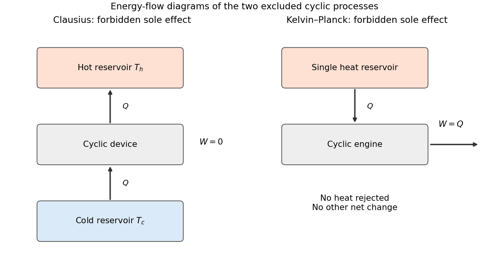

<h1 id="section-c/c11/solution">Solution</h1>

↑ **Parent:** [C11](../c11.md)

**Two equivalent second-law statements.** The [Clausius statement of the second law](../../../../../clausius-statement-of-the-second-law.md) forbids a cyclic device whose sole net effect is transferring [heat](../../../../../heat-split.md) from a colder reservoir to a hotter one. A [refrigerator](../../../../../refrigerator.md) can make that transfer when supplied with [work](../../../../../work.md), so the sole-effect qualification matters. The [Kelvin-Planck statement of the second law](../../../../../kelvin-planck-statement-of-the-second-law.md) forbids a cyclic device whose sole net effect is drawing [heat](../../../../../heat-split.md) from a single reservoir and converting all of it into [work](../../../../../work.md). A [heat engine](../../../../../heat-engine.md) can produce [work](../../../../../work.md) when it also rejects [heat](../../../../../heat-split.md) to a colder reservoir.

The two statements are equivalent by combining a supposed violating device with an ordinary reversible engine or [refrigerator](../../../../../refrigerator.md): one can cancel one reservoir exchange and obtain a violation of the other statement. The following original schematic shows the forbidden sole effects, with arrows indicating [energy](../../../../../energy-split.md) flow.

**[Figure 3](#section-c/c11/image-forbidden-sole-effects-in-the-clausius-and-kelvin-planck-formulations-of-the-second-law). Forbidden sole effects in the Clausius and Kelvin–Planck formulations of the second law**.

**Microscopic fluctuations.** The second law is a macroscopic statistical law. A finite fluctuation can transfer a small [heat](../../../../../heat-split.md) amount $Q$ from cold to hot, with reservoir [entropy](../../../../../entropy-split.md) change $Q/T_h-Q/T_c<0$. Such an individual event does not imply that a cyclic engine can extract systematic useful [work](../../../../../work.md) from equilibrium. Entropy-decreasing trajectories become exceedingly improbable when the [entropy](../../../../../entropy-split.md) involved is large compared with $k_B$. Under suitable microscopic reversibility conditions, fluctuation relations quantify the relative [probabilities](../../../../../probability.md) of positive and negative [entropy](../../../../../entropy-split.md) production and give nonnegative [mean](../../../../../expected-value-split.md) total [entropy](../../../../../entropy-split.md) production. Thus a deterministic no-fluctuation reading has a limit at small scales or short times; the statistical second law remains applicable.

**Maximum heating rate.** Interpret the quoted $0.5\,\mathrm{kW}$ as the maximum work-input rate $\dot W_{\max}$ to an ideal reversible [heat pump](../../../../../heat-pump.md). This interpretation is needed to obtain a heating rate larger than its electrical input; the wording does not explicitly distinguish input [power](../../../../../power.md) from delivered [heat](../../../../../heat-split.md). A reversible cycle satisfies

$$
\frac{\dot Q_h}{T_h}=\frac{\dot Q_c}{T_c},\qquad
\dot W=\dot Q_h-\dot Q_c.
$$

Therefore the heating [coefficient of performance](../../../../../coefficient-of-performance.md) is

$$
\mathrm{COP}_h=\frac{\dot Q_h}{\dot W}=\frac{T_h}{T_h-T_c}.
$$

With $T_h=293\,\mathrm K$ and $T_c=273\,\mathrm K$,

$$
\boxed{\dot Q_{h,\max}=(0.5)\frac{293}{20}=7.325\,\mathrm{kW}\simeq7.33\,\mathrm{kW}.}
$$

The additional [heat](../../../../../heat-split.md) comes from the outdoor reservoir; it is not produced by converting [work](../../../../../work.md) into more [energy](../../../../../energy-split.md) than was supplied.

**Lowest outdoor [temperature](../../../../../temperature-split.md).** Let $\Delta T=T_h-T_c>0$. The largest available heating rate is $\dot W_{\max}T_h/\Delta T$, while the house loses $\lambda\Delta T$. Equilibrium can be maintained when

$$
\lambda\Delta T\leq\frac{\dot W_{\max}T_h}{\Delta T},
\qquad
\Delta T^2\leq\frac{\dot W_{\max}T_h}{\lambda}.
$$

At the limiting outdoor [temperature](../../../../../temperature-split.md),

$$
\Delta T_{\max}=\sqrt{\frac{(0.5\,\mathrm{kW})(293\,\mathrm K)}{0.1\,\mathrm{kW\,K^{-1}}}}
=38.275\,\mathrm K.
$$

Hence

$$
\boxed{T_{c,\min}=254.725\,\mathrm K\simeq255\,\mathrm K
\quad( -18.4\,{}^\circ\mathrm C).}
$$

This is the [indoor-temperature limit of a Carnot heat pump](../../../../../indoor-temperature-limit-of-a-carnot-heat-pump.md). It assumes the ideal pump retains its stated input-power capability over the operating range. Real [heat](../../../../../heat-split.md) exchangers require finite [temperature](../../../../../temperature-split.md) differences and incur irreversibility, so the reversible result is an ideal upper performance bound.

**Conventional heater.** At this limiting outdoor [temperature](../../../../../temperature-split.md), the required delivered heating [power](../../../../../power.md) is simply the house's [heat](../../../../../heat-split.md) loss:

$$
\boxed{\dot Q_{\mathrm{gas}}=\lambda\Delta T_{\max}=3.83\,\mathrm{kW}.}
$$

This is [heat](../../../../../heat-split.md) delivered to the house. The fuel-input [power](../../../../../power.md) would be $3.83/\eta\,\mathrm{kW}$ for heater efficiency $\eta$. At the earlier outdoor [temperature](../../../../../temperature-split.md) of $273\,\mathrm K$, the required delivered [heat](../../../../../heat-split.md) would instead be $0.1(293-273)=2.00\,\mathrm{kW}$; the final question's reference [temperature](../../../../../temperature-split.md) must be kept clear.

If $0.5\,\mathrm{kW}$ is read literally as a maximum delivered [heat](../../../../../heat-split.md) rate rather than a work-input rating, the alternative answers are $\dot Q_{h,\max}=0.5\,\mathrm{kW}$, $T_{c,\min}=293-0.5/0.1=288\,\mathrm K$, and a conventional heater delivering $0.5\,\mathrm{kW}$ at that limit. Such a pump could not balance the stated house loss at $273\,\mathrm K$. Both readings follow consistently once the ambiguous [power](../../../../../power.md) rating is defined; the Carnot calculation above uses the work-input reading.

## ↑ Ancestors (14)

1. [C11](../c11.md)
2. [Section C](../../section-c.md)
3. [Paper 2](../../../paper-2-split.md)
4. [2019](../../../split.md)
5. [Past exam of the physics B course of the University of Cambridge](../../../../split.md)
6. [Physics B course of the University of Cambridge](../../../../../physics-b-course-of-the-university-of-cambridge.md)
7. [Physics course of the year 2 of the natural sciences course of the University of Cambridge](../../../../../physics-course-of-the-year-2-of-the-natural-sciences-course-of-the-university-of-cambridge.md)
8. [Year 2 of the natural sciences course of the University of Cambridge](../../../../../year-2-of-the-natural-sciences-course-of-the-university-of-cambridge.md)
9. [Year of the natural sciences course of the University of Cambridge](../../../../../year-of-the-natural-sciences-course-of-the-university-of-cambridge.md)
10. [Natural sciences course of the University of Cambridge](../../../../../natural-sciences-course-of-the-university-of-cambridge.md)
11. [Course of the University of Cambridge](../../../../../course-of-the-university-of-cambridge.md)
12. [University of Cambridge](../../../../../university-of-cambridge-split.md)
13. [List of universities](../../../../../list-of-universities.md)
14. [Codex Wiki](../../../../../split.md)
