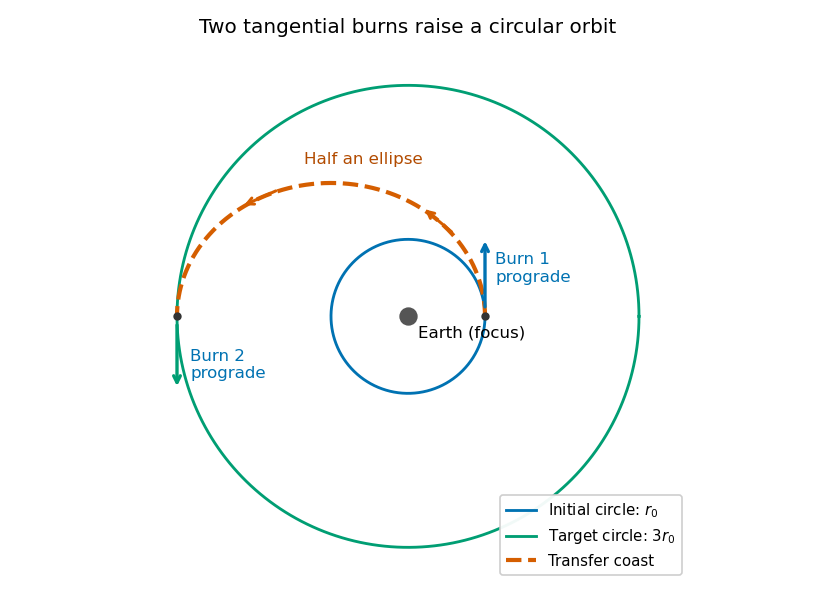
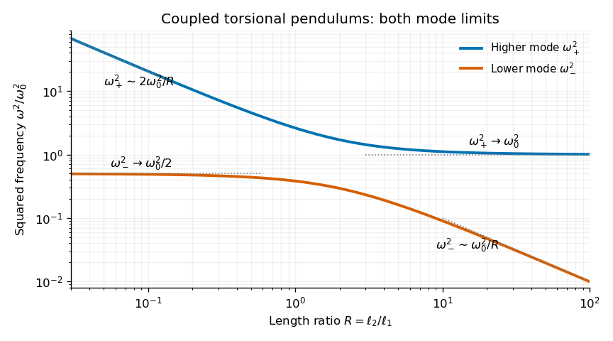

# Paper 1

↑ **Parent:** [2021](../2021.md)

[Original paper, released PDF pages 228–233](https://www.whatdotheyknow.com/request/natural_science_tripos_physics_e/response/2127325/attach/3/FOI%202022%20639%20Sullivan%20materials.pdf?cookie_passthrough=1#page=228)

**Table of contents**

- [Section A](#section-a)
  - [A1](#section-a/a1)
    - [Solution](#section-a/a1/solution)
  - [A2](#section-a/a2)
    - [Solution](#section-a/a2/solution)
  - [A3](#section-a/a3)
    - [Solution](#section-a/a3/solution)
  - [A4](#section-a/a4)
    - [Solution](#section-a/a4/solution)
  - [A5](#section-a/a5)
    - [Solution](#section-a/a5/solution)
- [Section B](#section-b)
  - [B6](#section-b/b6)
    - [a](#section-b/b6/a)
      - [Solution](#section-b/b6/a/solution)
    - [b](#section-b/b6/b)
      - [Solution](#section-b/b6/b/solution)
    - [c](#section-b/b6/c)
      - [Solution](#section-b/b6/c/solution)
    - [d](#section-b/b6/d)
      - [Solution](#section-b/b6/d/solution)
    - [e](#section-b/b6/e)
      - [Solution](#section-b/b6/e/solution)
    - [f](#section-b/b6/f)
      - [Solution](#section-b/b6/f/solution)
  - [B7](#section-b/b7)
    - [a](#section-b/b7/a)
      - [Solution](#section-b/b7/a/solution)
    - [b](#section-b/b7/b)
      - [Solution](#section-b/b7/b/solution)
    - [c](#section-b/b7/c)
      - [Solution](#section-b/b7/c/solution)
    - [d](#section-b/b7/d)
      - [Solution](#section-b/b7/d/solution)
    - [e](#section-b/b7/e)
      - [Solution](#section-b/b7/e/solution)
- [Section C](#section-c)
  - [C8](#section-c/c8)
    - [a](#section-c/c8/a)
      - [Solution](#section-c/c8/a/solution)
    - [b](#section-c/c8/b)
      - [Solution](#section-c/c8/b/solution)
    - [c](#section-c/c8/c)
      - [Solution](#section-c/c8/c/solution)
    - [d](#section-c/c8/d)
      - [Solution](#section-c/c8/d/solution)
    - [e](#section-c/c8/e)
      - [Solution](#section-c/c8/e/solution)
    - [f](#section-c/c8/f)
      - [Solution](#section-c/c8/f/solution)
  - [C9](#section-c/c9)
    - [a](#section-c/c9/a)
      - [Solution](#section-c/c9/a/solution)
    - [b](#section-c/c9/b)
      - [Solution](#section-c/c9/b/solution)
    - [c](#section-c/c9/c)
      - [Solution](#section-c/c9/c/solution)
    - [d](#section-c/c9/d)
      - [Solution](#section-c/c9/d/solution)
    - [e](#section-c/c9/e)
      - [Solution](#section-c/c9/e/solution)
    - [f](#section-c/c9/f)
      - [Solution](#section-c/c9/f/solution)

## Section A

↑ **Parent:** [Paper 1](paper-1.md)

<h3 id="section-a/a1">A1</h3>

↑ **Parent:** [Section A](#section-a)

<h4 id="section-a/a1/solution">Solution</h4>

↑ **Parent:** [A1](#section-a/a1)

For the intended ideal [Venturi effect](../../euler-equations-for-an-inviscid-fluid.md#venturi-effect), take [steady flow](../../fluid-mechanics.md#steady-flow), [incompressible flow](../../fluid-mechanics.md#incompressible-flow), negligible viscous losses, and the same height at the two stations shown. The [Bernoulli equation](../../euler-equations-for-an-inviscid-fluid.md#bernoulli-equation) along a [streamline](../../fluid-mechanics.md#streamline) gives

$$
p_1+\frac12\rho v_1^2=p_2+\frac12\rho v_2^2.
$$

Using water [mass density](../../fluid-mechanics.md#density) $\rho\simeq1000\ \mathrm{kg\,m^{-3}}$,

$$
\boxed{p_2-p_1=\frac12(1000)(2^2-6^2)=-1.60\times10^4\ \mathrm{Pa}.}
$$

Thus the outlet [pressure](../../pressure.md) is lower by $16\ \mathrm{kPa}$. The increased [kinetic energy](../../energy.md#kinetic-energy) per unit volume comes from the drop in [pressure](../../pressure.md).

The source's assumption of [laminar flow](../../fluid-mechanics.md#laminar-flow) alone does not imply negligible [viscosity](../../dynamic-viscosity.md) or losses. The numerical result uses the usual lossless [Bernoulli equation](../../euler-equations-for-an-inviscid-fluid.md#bernoulli-equation) approximation, with the quoted speeds interpreted as representative streamline speeds. A real tube with significant viscous losses requires additional data; in a uniform-velocity energy balance its pressure drop would include an extra positive loss term.

<h3 id="section-a/a2">A2</h3>

↑ **Parent:** [Section A](#section-a)

<h4 id="section-a/a2/solution">Solution</h4>

↑ **Parent:** [A2](#section-a/a2)

The [principal moments of inertia](../../rigid-body-dynamics.md#principal-moment-of-inertia) are the [eigenvalues](../../linear-operator-theory.md#eigenvalue) of the symmetric [inertia tensor](../../rigid-body-dynamics.md#inertia-tensor). In units of $\mathrm{kg\,m^2}$, its characteristic [determinant](../../multilinear-algebra.md#determinant) is

$$
\det(\mathsf I-\lambda\mathsf 1)
=(1-\lambda)[(2-\lambda)^2-1]
=(1-\lambda)^2(3-\lambda).
$$

Therefore the requested algebraic answer is

$$
\boxed{I_1=3\ \mathrm{kg\,m^2},\qquad I_2=I_3=1\ \mathrm{kg\,m^2}.}
$$

An [orthonormal basis](../../inner-product.md#orthonormal-basis) of [principal axes](../../rigid-body-dynamics.md#principal-axis) is $(1,1,0)/\sqrt2$, $(1,-1,0)/\sqrt2$, and $(0,0,1)$; the last two span the degenerate [eigenspace](../../linear-operator-theory.md#eigenspace) and may be replaced by any [orthonormal basis](../../inner-product.md#orthonormal-basis) of it.

There is a physical inconsistency in calling the supplied matrix a rigid body's [inertia tensor](../../rigid-body-dynamics.md#inertia-tensor). The [moment-of-inertia triangle inequalities](../../rigid-body-dynamics.md#moment-of-inertia-triangle-inequalities) require each principal moment to be no greater than the sum of the other two. Here $3>1+1$. In principal coordinates, $I_2+I_3-I_1=2\int x_1^2\,dm$ cannot be negative for a nonnegative [mass distribution](../../classical-mechanics.md#mass-distribution). Thus the eigenvalue calculation is well defined, but no ordinary rigid mass distribution realizes this tensor. The [positive second-moment matrix test for an inertia tensor](../../rigid-body-dynamics.md#positive-second-moment-matrix-test-for-an-inertia-tensor) makes the same obstruction explicit.

<h3 id="section-a/a3">A3</h3>

↑ **Parent:** [Section A](#section-a)

<h4 id="section-a/a3/solution">Solution</h4>

↑ **Parent:** [A3](#section-a/a3)

Use local east, north and upward [unit vectors](../../vector-space.md#unit-vector) at the equator, with [Earth's rotation](../../planetary-science.md#earth-s-rotation) $\boldsymbol\Omega=\Omega_E\widehat{\mathbf n}$. The parcel starts at rest relative to the ground. To first order in $\Omega_E$, its unperturbed vertical [velocity](../../classical-mechanics.md#velocity) is $\dot z=-gt$ and its fall time from height $h$ is

$$
t_f=\sqrt{\frac{2h}{g}}.
$$

The [Coriolis acceleration](../../mathematical-physics.md#coriolis-acceleration) is $-2\boldsymbol\Omega\times\mathbf v$. Since north crossed with downward points west, its negative points east:

$$
\ddot x_E=-2\Omega_E\dot z=2\Omega_Egt.
$$

Integrating with $x_E(0)=\dot x_E(0)=0$ gives the [equatorial Coriolis deflection in free fall](../../newton-s-law-of-universal-gravitation.md#equatorial-coriolis-deflection-in-free-fall),

$$
x_E(t)=\frac13\Omega_Egt^3,\qquad
\boxed{x_E(t_f)=\frac{\Omega_E}{3}\frac{(2h)^{3/2}}{\sqrt g}.}
$$

For $h=200\ \mathrm m$, $g=9.81\ \mathrm{m\,s^{-2}}$ and $\Omega_E=2\pi/(86164\ \mathrm s)=7.2921\times10^{-5}\ \mathrm{s^{-1}}$, $t_f=6.39\ \mathrm s$ and

$$
\boxed{\text{miss distance}\simeq0.0621\ \mathrm m=6.2\ \mathrm{cm},\quad\text{eastward}.}
$$

This neglects air resistance, variation of $g$ over the fall, and terms of order $\Omega_E^2$. The measured local $g$ already includes the background centrifugal correction. “Stationary” is interpreted as hovering above a fixed ground location, not being stationary in an inertial frame.

<h3 id="section-a/a4">A4</h3>

↑ **Parent:** [Section A](#section-a)

<h4 id="section-a/a4/solution">Solution</h4>

↑ **Parent:** [A4](#section-a/a4)

Under a uniform compressive [pressure](../../pressure.md) $p$, each normal [stress](../../continuum-mechanics.md#stress) is $-p$. The isotropic [Hooke's law](../../elasticity-physics.md#hooke-s-law) gives each longitudinal [strain](../../continuum-mechanics.md#strain) as

$$
\varepsilon_x=\varepsilon_y=\varepsilon_z
=\frac{-p-\sigma(-p-p)}E=-\frac{p(1-2\sigma)}E.
$$

Thus $\Delta V/V=-3p(1-2\sigma)/E$. By the definition of [bulk modulus](../../elasticity-physics.md#bulk-modulus), $B=-p/(\Delta V/V)$, so the [isotropic elastic modulus relation](../../elasticity-physics.md#isotropic-elastic-modulus-relation) is

$$
\boxed{B=\frac E{3(1-2\sigma)},\qquad E=3B(1-2\sigma).}
$$

Positive finite [Young's modulus](../../elasticity-physics.md#young-s-modulus) and [bulk modulus](../../elasticity-physics.md#bulk-modulus) require

$$
\boxed{\sigma<\frac12.}
$$

The incompressible limit is $\sigma\to1/2$ with $B\to\infty$ at finite $E$. If positivity of the [shear modulus](../../elasticity-physics.md#shear-modulus) $G_s=E/[2(1+\sigma)]$ is also imposed, the full stable isotropic range is $-1<\sigma<1/2$. Negative [Poisson's ratio](../../elasticity-physics.md#poisson-s-ratio) is not ruled out; the displayed bulk-modulus relation alone supplies the upper bound.

<h3 id="section-a/a5">A5</h3>

↑ **Parent:** [Section A](#section-a)

<h4 id="section-a/a5/solution">Solution</h4>

↑ **Parent:** [A5](#section-a/a5)

For the intended reversible [adiabatic process](../../first-law-of-thermodynamics.md#adiabatic-process), an [ideal gas](../../ideal-gas.md) obeys $TV^{\gamma-1}=\text{constant}$. A [monatomic gas](../../ideal-gas.md#monatomic-gas) has [heat capacity ratio](../../ideal-gas.md#heat-capacity-ratio) $\gamma=5/3$, so

$$
T_f=T_i\left(\frac{V_i}{V_f}\right)^{\gamma-1}
=400\left(\frac18\right)^{2/3},\qquad
\boxed{T_f=100\ \mathrm K.}
$$

The required extra assumption is that “adiabatic” denotes the usual quasistatic [isentropic process](../../first-law-of-thermodynamics.md#isentropic-process). Absence of heat transfer alone would not fix the final [temperature](../../temperature.md): an [ideal gas](../../ideal-gas.md) undergoing [free expansion](../../thermodynamics.md#free-expansion) into vacuum is also adiabatic but leaves its [temperature](../../temperature.md) unchanged.

## Section B

↑ **Parent:** [Paper 1](paper-1.md)

<h3 id="section-b/b6">B6</h3>

↑ **Parent:** [Section B](#section-b)

<h4 id="section-b/b6/a">a</h4>

↑ **Parent:** [B6](#section-b/b6)

<h5 id="section-b/b6/a/solution">Solution</h5>

↑ **Parent:** [A](#section-b/b6/a)

For the two-body approximation with a dominant central mass, [Kepler's laws of planetary motion](../../mathematical-physics.md#kepler-s-laws-of-planetary-motion) are:

- [Kepler's first law](../../mathematical-physics.md#kepler-s-first-law): a bound planetary [orbit](../../dynamical-systems.md#orbit-dynamical-system) is an [ellipse](../../euclidean-geometry.md#ellipse) with the central attracting body at one focus.
- [Kepler's second law](../../mathematical-physics.md#kepler-s-second-law): the line from that focus to the planet sweeps equal areas in equal times, equivalent to constant [areal velocity](../../momentum.md#areal-velocity).
- [Kepler's third law](../../mathematical-physics.md#kepler-s-third-law): the squared [orbital period](../../celestial-mechanics.md#orbital-period) is proportional to the cube of the [semi-major axis](../../celestial-mechanics.md#semi-major-axis), $T^2=4\pi^2a^3/(GM)$ when the orbiting mass is negligible.

The first law includes a [circular Kepler orbit](../../celestial-mechanics.md#circular-kepler-orbit) as a special case. The third-law constant is the same for bodies orbiting the same dominant mass.

<h4 id="section-b/b6/b">b</h4>

↑ **Parent:** [B6](#section-b/b6)

<h5 id="section-b/b6/b/solution">Solution</h5>

↑ **Parent:** [B](#section-b/b6/b)

Choose zero gravitational [potential energy](../../energy.md#potential-energy) at infinite separation. The spacecraft's conserved total [orbital energy](../../celestial-mechanics.md#orbital-energy) is

$$
\boxed{E=\frac12mv_p^2-\frac{GMm}{r_p}
=\frac12mv_a^2-\frac{GMm}{r_a}.}
$$

At [periapsis](../../celestial-mechanics.md#periapsis) and [apoapsis](../../celestial-mechanics.md#apoapsis), the radial [velocity](../../classical-mechanics.md#velocity) vanishes, so the [velocity](../../classical-mechanics.md#velocity) is perpendicular to the radius. The conserved [angular momentum](../../momentum.md#angular-momentum) magnitude is therefore

$$
\boxed{J=mr_pv_p=mr_av_a.}
$$

The [angular momentum](../../momentum.md#angular-momentum) vector is normal to the fixed orbital plane. The respective units are joules and $\mathrm{kg\,m^2\,s^{-1}}$. These expressions use Newtonian [gravity](../../physics.md#gravity) and the approximation $M\gg m$.

<h4 id="section-b/b6/c">c</h4>

↑ **Parent:** [B6](#section-b/b6)

<h5 id="section-b/b6/c/solution">Solution</h5>

↑ **Parent:** [C](#section-b/b6/c)

Eliminate $v_p,v_a$ using the [angular momentum](../../momentum.md#angular-momentum) expressions from part (b):

$$
\frac{J^2}{2mr_p^2}-\frac{GMm}{r_p}
=\frac{J^2}{2mr_a^2}-\frac{GMm}{r_a}.
$$

Hence

$$
\frac{J^2}{2m}\left(\frac1{r_p^2}-\frac1{r_a^2}\right)
=GMm\left(\frac1{r_p}-\frac1{r_a}\right).
$$

For distinct turning radii, factor the difference of squares and cancel the common factor to obtain

$$
\boxed{J^2=\frac{2GMm^2}{1/r_p+1/r_a}
=\frac{2GMm^2r_pr_a}{r_p+r_a}.}
$$

The [circular Kepler orbit](../../celestial-mechanics.md#circular-kepler-orbit) case is recovered continuously by setting $r_p=r_a=r$, giving $J^2=GMm^2r$. Combining this with the energy expression also gives $E=-GMm/(r_p+r_a)$ for the transfer [ellipse](../../euclidean-geometry.md#ellipse).

<h4 id="section-b/b6/d">d</h4>

↑ **Parent:** [B6](#section-b/b6)

<h5 id="section-b/b6/d/solution">Solution</h5>

↑ **Parent:** [D](#section-b/b6/d)

Use a [Hohmann transfer orbit](../../celestial-mechanics.md#hohmann-transfer-orbit). At the initial radius $r_0$, make a short prograde burn parallel to the existing [velocity](../../classical-mechanics.md#velocity). The increased speed changes the [circular Kepler orbit](../../celestial-mechanics.md#circular-kepler-orbit) into an [elliptic orbit](../../celestial-mechanics.md#elliptic-orbit) whose [periapsis](../../celestial-mechanics.md#periapsis) is the burn point and whose [apoapsis](../../celestial-mechanics.md#apoapsis) lies on the desired larger circle. Coast for half the transfer [orbital period](../../celestial-mechanics.md#orbital-period) to [apoapsis](../../celestial-mechanics.md#apoapsis).

At that point the transfer [velocity](../../classical-mechanics.md#velocity) is again tangent to the target circle, but its magnitude is smaller than the circular speed there. A second short prograde burn raises it to the required circular speed. Thus **both burns increase the instantaneous speed and preserve its direction at the burn**, even though the final circular speed is lower than the original one. During the coast the spacecraft loses [kinetic energy](../../energy.md#kinetic-energy) while gaining gravitational [potential energy](../../energy.md#potential-energy).

**[Figure 1](#section-b/b6/d/image-original-transfer-orbit-construction-for-the-later-example-with-outer-radius-three-times-the-inner-radius-arrows-show-the-two-prograde-burns). Original transfer-orbit construction for the later example with outer radius three times the inner radius; arrows show the two prograde burns**.

The figure illustrates $3r_0$ for the subsequent parts, but the same construction works for any larger target radius. The impulsive approximation neglects the distance travelled during each burn and keeps both circles and the transfer [ellipse](../../euclidean-geometry.md#ellipse) coplanar.

<h4 id="section-b/b6/e">e</h4>

↑ **Parent:** [B6](#section-b/b6)

<h5 id="section-b/b6/e/solution">Solution</h5>

↑ **Parent:** [E](#section-b/b6/e)

The original [circular Kepler orbit](../../celestial-mechanics.md#circular-kepler-orbit) has $v_0^2=GM/r_0$. For the transfer [ellipse](../../euclidean-geometry.md#ellipse), set $r_p=r_0$, $r_a=3r_0$ in part (c):

$$
J_t^2=\frac32GMm^2r_0,\qquad
v_p=\frac{J_t}{mr_0}=\sqrt{\frac32}\,v_0.
$$

The first required speed increase is $\Delta v_1=(\sqrt{3/2}-1)v_0$. Under the question's negligible-mass-change fuel model, fuel use is proportional to the magnitude of the [impulse](../../classical-mechanics.md#impulse). Since the full fuel supply corresponds to $mv_0$,

$$
\boxed{f_1=\frac{m\Delta v_1}{mv_0}=\sqrt{\frac32}-1
=0.2247\simeq22.5\%.}
$$

This is the stated “about a quarter” of the original fuel supply. It is an instance of the [Hohmann transfer impulse fractions](../../celestial-mechanics.md#hohmann-transfer-impulse-fractions); no variable-mass rocket model is required under the stipulated assumptions.

<h4 id="section-b/b6/f">f</h4>

↑ **Parent:** [B6](#section-b/b6)

<h5 id="section-b/b6/f/solution">Solution</h5>

↑ **Parent:** [F](#section-b/b6/f)

At transfer [apoapsis](../../celestial-mechanics.md#apoapsis), [angular momentum conservation](../../momentum.md#conservation-of-angular-momentum) gives

$$
v_a=\frac{r_p}{r_a}v_p=\frac13\sqrt{\frac32}\,v_0=\frac{v_0}{\sqrt6}.
$$

The desired [circular Kepler orbit](../../celestial-mechanics.md#circular-kepler-orbit) has speed $v_c=\sqrt{GM/(3r_0)}=v_0/\sqrt3$. Thus

$$
\Delta v_2=v_0\left(\frac1{\sqrt3}-\frac1{\sqrt6}\right),\qquad
\boxed{f_2=\frac{\Delta v_2}{v_0}=0.1691\simeq16.9\%}
$$

of the original fuel supply is used in the second burn. This is about $21.8\%$ of the fuel remaining after the first burn. The total transfer consumes $f_1+f_2\simeq39.4\%$ of the original supply, leaving about $60.6\%$. The two positive [impulse](../../classical-mechanics.md#impulse) magnitudes are added for the fuel budget, even though their directions at opposite ends of the orbit differ.

<h3 id="section-b/b7">B7</h3>

↑ **Parent:** [Section B](#section-b)

<h4 id="section-b/b7/a">a</h4>

↑ **Parent:** [B7](#section-b/b7)

<h5 id="section-b/b7/a/solution">Solution</h5>

↑ **Parent:** [A](#section-b/b7/a)

A [normal mode](../../wave-equation.md#normal-mode) of a linearized mechanical system is a motion in which every generalized displacement oscillates at a single common [angular frequency](../../lagrangian-mechanics.md#angular-frequency), with fixed relative amplitudes and phases. In coordinates $q_j$, an undamped oscillatory mode may be written

$$
\boxed{q_j(t)=A_j\cos(\omega t+\delta),}
$$

where the amplitude [vector](../../vector-space.md#vector) $(A_1,\ldots,A_n)$ is fixed; negative components describe relative phase $\pi$. An arbitrary small motion is a [linear combination](../../vector-space.md#linear-combination) of the [normal modes](../../wave-equation.md#normal-mode) when the mode vectors form a complete [basis](../../vector-space.md#basis).

<h4 id="section-b/b7/b">b</h4>

↑ **Parent:** [B7](#section-b/b7)

<h5 id="section-b/b7/b/solution">Solution</h5>

↑ **Parent:** [B](#section-b/b7/b)

Let $I$ be each sphere's [moment of inertia](../../rigid-body-dynamics.md#moment-of-inertia) about the fibre, and let $K_t$ be the common fibre [filament torsional stiffness](../../elasticity-physics.md#filament-torsional-stiffness), so a length $\ell$ exerts restoring [torque](../../momentum.md#torque) $-K_t\phi/\ell$. The single-sphere [torsion pendulum](../../classical-mechanics.md#torsion-pendulum) obeys

$$
I\ddot\phi=-\frac{K_t}{\ell_1}\phi,\qquad
\omega_0^2=\frac{K_t}{I\ell_1}.
$$

For the two [coupled torsional pendulums](../../classical-mechanics.md#coupled-torsional-pendulums), the upper fibre has twist $\phi_1$ and the joining fibre has relative twist $\phi_2-\phi_1$. The joining fibre exerts equal and opposite [torques](../../momentum.md#torque) on the two spheres:

$$
I\ddot\phi_1=-\frac{K_t}{\ell_1}\phi_1+\frac{K_t}{\ell_2}(\phi_2-\phi_1),\qquad
I\ddot\phi_2=-\frac{K_t}{\ell_2}(\phi_2-\phi_1).
$$

Using the measured $\omega_0$ gives

$$
\boxed{\ddot\phi_1=-\omega_0^2\left[\phi_1-\frac{\ell_1}{\ell_2}(\phi_2-\phi_1)\right],\qquad
\ddot\phi_2=-\omega_0^2\frac{\ell_1}{\ell_2}(\phi_2-\phi_1).}
$$

The fibre's own rotational inertia and damping are neglected, so its twists supply elastic [torques](../../momentum.md#torque) without additional dynamic coordinates.

<h4 id="section-b/b7/c">c</h4>

↑ **Parent:** [B7](#section-b/b7)

<h5 id="section-b/b7/c/solution">Solution</h5>

↑ **Parent:** [C](#section-b/b7/c)

Set $q=\ell_1/\ell_2$ and use [normal mode](../../wave-equation.md#normal-mode) amplitudes $\phi_j=A_je^{i\omega t}$, with real physical displacements obtained at the end. In units of $\omega_0^2$, the stiffness matrix is

$$
\mathsf K=\begin{pmatrix}1+q&-q\\-q&q\end{pmatrix}.
$$

Writing $\lambda=\omega^2/\omega_0^2$, the [eigenvalue](../../linear-operator-theory.md#eigenvalue) condition is

$$
\det(\mathsf K-\lambda\mathsf 1)=(1+q-\lambda)(q-\lambda)-q^2
=\lambda^2-(1+2q)\lambda+q=0.
$$

Therefore

$$
\boxed{\omega_\pm^2=\omega_0^2\left[\frac12+\frac{\ell_1}{\ell_2}
\pm\sqrt{\frac14+\left(\frac{\ell_1}{\ell_2}\right)^2}\right].}
$$

For finite positive fibre lengths both [eigenvalues](../../linear-operator-theory.md#eigenvalue) are positive. The corresponding amplitude ratio is

$$
\frac{A_2}{A_1}=\frac q{q-\lambda}=\frac1{1-R\lambda},\qquad R=\frac{\ell_2}{\ell_1}.
$$

The lower [normal mode](../../wave-equation.md#normal-mode) has the spheres twisting in the same sense, and the higher one has opposite signs of angular displacement.

<h4 id="section-b/b7/d">d</h4>

↑ **Parent:** [B7](#section-b/b7)

<h5 id="section-b/b7/d/solution">Solution</h5>

↑ **Parent:** [D](#section-b/b7/d)

In terms of $R=\ell_2/\ell_1$,

$$
\lambda_\pm(R)=\frac{\omega_\pm^2}{\omega_0^2}
=\frac12+\frac1R\pm\sqrt{\frac14+\frac1{R^2}}.
$$

Both curves decrease monotonically: with $q=1/R$, $d\lambda_\pm/dq=1\pm q/\sqrt{1/4+q^2}>0$, while $dq/dR<0$. The limits, including their leading approach, are

$$
\boxed{\begin{aligned}
R\to0^+:&\quad\lambda_- =\frac12-\frac R8+O(R^3)\to\frac12,\\
&\quad\lambda_+=\frac2R+\frac12+O(R)\to\infty;\\
R\to\infty:&\quad\lambda_-=\frac1R-\frac1{R^2}+O(R^{-4})\to0,\\
&\quad\lambda_+=1+\frac1R+O(R^{-2})\to1.
\end{aligned}}
$$

Thus the limiting squared [angular frequencies](../../lagrangian-mechanics.md#angular-frequency) are $\omega_0^2/2$ and infinity for short joining fibre, and zero and $\omega_0^2$ for very long joining fibre. For orientation, at $R=1$ the values are $(3\pm\sqrt5)\omega_0^2/2$. The high-frequency curve stays above $\omega_0^2$ and the low-frequency curve below $\omega_0^2/2$.

**[Figure 2](#section-b/b7/d/image-calculated-squared-normal-mode-frequencies-versus-fibre-length-ratio-both-axes-are-logarithmic-to-show-all-four-asymptotic-limits). Calculated squared normal-mode frequencies versus fibre-length ratio; both axes are logarithmic to show all four asymptotic limits**.

<h4 id="section-b/b7/e">e</h4>

↑ **Parent:** [B7](#section-b/b7)

<h5 id="section-b/b7/e/solution">Solution</h5>

↑ **Parent:** [E](#section-b/b7/e)

As $R\to0$, the short joining fibre is very stiff and the lower [normal mode](../../wave-equation.md#normal-mode) has $\phi_1\simeq\phi_2$. The spheres therefore behave as one torsional load with combined [moment of inertia](../../rigid-body-dynamics.md#moment-of-inertia) $2I$, suspended by the upper fibre of [torsion constant](../../classical-mechanics.md#torsion-constant) $K_t/\ell_1$. Its [angular frequency](../../lagrangian-mechanics.md#angular-frequency) satisfies

$$
\boxed{\omega_-^2\to\frac{K_t/\ell_1}{2I}=\frac{\omega_0^2}{2}.}
$$

The high-frequency opposite-twist mode costs increasingly large elastic [energy](../../energy.md) and moves to arbitrarily high frequency in the massless-fibre model.

As $R\to\infty$, the joining fibre is very compliant. In the higher [normal mode](../../wave-equation.md#normal-mode) the lower sphere scarcely moves: the amplitude ratio tends to $A_2/A_1\simeq-1/R\to0$. The upper sphere approaches the original single [torsion pendulum](../../classical-mechanics.md#torsion-pendulum), giving

$$
\boxed{\omega_+^2\to\omega_0^2.}
$$

The other mode is then a slow twist of the almost freely suspended lower sphere. These interpretations assume the formal limits do not invalidate the thin massless-fibre approximation.

## Section C

↑ **Parent:** [Paper 1](paper-1.md)

<h3 id="section-c/c8">C8</h3>

↑ **Parent:** [Section C](#section-c)

<h4 id="section-c/c8/a">a</h4>

↑ **Parent:** [C8](#section-c/c8)

<h5 id="section-c/c8/a/solution">Solution</h5>

↑ **Parent:** [A](#section-c/c8/a)

In a linear isotropic [dielectric](../../permittivity.md#dielectric) of [relative permittivity](../../quantum-mechanics.md#relative-permittivity) $\epsilon$, the [electric displacement field](../../electromagnetism.md#electric-displacement-field) and [electric field](../../electric-field.md) satisfy

$$
\boxed{\mathbf D=\epsilon_0\epsilon\mathbf E,\qquad
\nabla\cdot\mathbf D=\rho_f,\qquad\nabla\times\mathbf E=0.}
$$

Here $\rho_f$ denotes the free [charge density](../../electric-charge.md#charge-density) called $\rho$ in the question. For spatially constant $\epsilon$, these also give $\nabla\cdot\mathbf E=\rho_f/(\epsilon_0\epsilon)$. Equivalently, $\mathbf E=-\nabla\varphi$ and $\nabla^2\varphi=-\rho_f/(\epsilon_0\epsilon)$. The [electric displacement field](../../electromagnetism.md#electric-displacement-field) has units $\mathrm{C\,m^{-2}}$ and the [electric field](../../electric-field.md) has units $\mathrm{V\,m^{-1}}$.

The local equations determine the fields once their geometry and [boundary conditions](../../differential-equation.md#boundary-condition) are specified; a density value alone does not determine a unique vector field without that information.

<h4 id="section-c/c8/b">b</h4>

↑ **Parent:** [C8](#section-c/c8)

<h5 id="section-c/c8/b/solution">Solution</h5>

↑ **Parent:** [B](#section-c/c8/b)

Let $\mathbf n$ point from medium 1 to medium 2. Integrate $\nabla\cdot\mathbf D=\rho_f$ over a thin [Gaussian pillbox](../../maxwell-equations.md#gaussian-pillbox) crossing the interface. As its thickness tends to zero, the side contribution vanishes and any free [surface charge density](../../electrostatics.md#surface-charge-density) $\sigma_f$ gives

$$
\boxed{\mathbf n\cdot(\mathbf D_2-\mathbf D_1)=\sigma_f.}
$$

Apply $\oint\mathbf E\cdot d\boldsymbol\ell=0$ to a thin rectangular loop spanning the same interface. Its short sides vanish in the limit, so the tangential [electric field](../../electric-field.md) is continuous:

$$
\boxed{\mathbf n\times(\mathbf E_2-\mathbf E_1)=0.}
$$

For a clean dielectric interface with no free [surface charge density](../../electrostatics.md#surface-charge-density), these [electrostatic interface boundary conditions](../../electrostatics.md#electrostatic-interface-boundary-conditions) reduce to $D_{1n}=D_{2n}$ and $E_{1t}=E_{2t}$. In particular $\epsilon_1E_{1n}=\epsilon_2E_{2n}$; the normal [electric field](../../electric-field.md) itself need not be continuous. Bound polarization charge is already incorporated into $\mathbf D$.

<h4 id="section-c/c8/c">c</h4>

↑ **Parent:** [C8](#section-c/c8)

<h5 id="section-c/c8/c/solution">Solution</h5>

↑ **Parent:** [C](#section-c/c8/c)

Consider a long uniform length $\ell$ of a [coaxial cylindrical capacitor](../../electrostatics.md#coaxial-cylindrical-capacitor), with permittivity $\epsilon_0\epsilon_r$ and inner-cylinder charge per unit length $\lambda$. A cylindrical [Gaussian surface](../../maxwell-equations.md#gaussian-surface) gives

$$
D_r=\frac{\lambda}{2\pi r},\qquad
E_r=\frac{\lambda}{2\pi\epsilon_0\epsilon_r r},\qquad a<r<b.
$$

The [electric potential difference](../../electric-field.md#electric-potential-difference) is

$$
V=\int_a^bE_r\,dr=\frac{\lambda\ln(b/a)}{2\pi\epsilon_0\epsilon_r}.
$$

Thus its [capacitance](../../electromagnetism.md#capacitance) per unit length is $c(\epsilon_r)=2\pi\epsilon_0\epsilon_r/\ln(b/a)$.

In the [partially filled coaxial capacitor](../../electrostatics.md#partially-filled-coaxial-capacitor), the vacuum section of length $L-x$ and the dielectric section of length $x$ share the same two conductors and hence the same [electric potential difference](../../electric-field.md#electric-potential-difference). They are electrically in parallel, not in series. The radial [electric field](../../electric-field.md) is tangent to the axial dielectric interface, consistent with the boundary condition in part (b). Adding their charges gives

$$
\boxed{C=c(1)(L-x)+c(\epsilon)x
=\frac{2\pi\epsilon_0}{\ln(b/a)}[L-x+\epsilon x].}
$$

This is the leading long-capacitor expression, neglecting end and interface-fringing corrections. The stated $x\gg b$ supports a long filled section; treating the other section as uniform also requires it to be well away from the end regions when those corrections matter.

<h4 id="section-c/c8/d">d</h4>

↑ **Parent:** [C8](#section-c/c8)

<h5 id="section-c/c8/d/solution">Solution</h5>

↑ **Parent:** [D](#section-c/c8/d)

Let increasing overlap $x$ mean that the [dielectric](../../permittivity.md#dielectric) moves farther into the capacitor. Its [capacitance](../../electromagnetism.md#capacitance) derivative is

$$
\frac{dC}{dx}=\frac{2\pi\epsilon_0(\epsilon-1)}{\ln(b/a)}.
$$

At fixed [electric potential difference](../../electric-field.md#electric-potential-difference) $V$, the [capacitor energy](../../electromagnetism.md#capacitor-energy) rises by $dU_{\rm field}=V^2dC/2$, but the voltage source supplies electrical [work](../../energy.md#work) $V\,dQ=V^2dC$. The difference is available as mechanical [work](../../energy.md#work) $F_xdx$:

$$
F_xdx=V\,dQ-dU_{\rm field}=\frac12V^2dC.
$$

The [dielectric insertion force at fixed voltage](../../electromagnetism.md#dielectric-insertion-force-at-fixed-voltage) is therefore

$$
\boxed{F_x=\frac12V^2\frac{dC}{dx}
=\frac{\pi\epsilon_0(\epsilon-1)V^2}{\ln(b/a)}.}
$$

For the usual $\epsilon>1$, it pulls the dielectric inward, increasing $x$; its magnitude is constant within the long-overlap approximation. In the original longitudinal diagram this is to the left. The units are newtons, since $V^2dC/dx$ is energy per length. Differentiating the field energy alone with a minus sign at fixed $V$ would miss the source contribution; the correct [fixed-voltage capacitor energy balance](../../electromagnetism.md#fixed-voltage-capacitor-energy-balance) is essential.

<h4 id="section-c/c8/e">e</h4>

↑ **Parent:** [C8](#section-c/c8)

<h5 id="section-c/c8/e/solution">Solution</h5>

↑ **Parent:** [E](#section-c/c8/e)

Use $Q=CV$ for the magnitude of charge on either plate. The fully filled [capacitance](../../electromagnetism.md#capacitance) is $C_f=2\pi\epsilon_0\epsilon L/\ln(b/a)$, while the initial value is given in part (c). At the same fixed [electric potential difference](../../electric-field.md#electric-potential-difference),

$$
\boxed{\Delta Q=V(C_f-C_i)
=\frac{2\pi\epsilon_0(\epsilon-1)V(L-x)}{\ln(b/a)}.}
$$

For $\epsilon>1$ and positive $V$, this is an increase in the positive plate's [electric charge](../../electric-charge.md) magnitude, supplied by the voltage source; the negative plate acquires an equal opposite change. The net free charge of the two-plate capacitor remains zero. Thus “charge on the capacitor” has its usual circuit meaning, not the algebraic sum over both plates.

<h4 id="section-c/c8/f">f</h4>

↑ **Parent:** [C8](#section-c/c8)

<h5 id="section-c/c8/f/solution">Solution</h5>

↑ **Parent:** [F](#section-c/c8/f)

The [electric field](../../electric-field.md) is approximately radial in the long interior, but near an electrode end its lines spread into a [fringing field of a capacitor](../../electromagnetism.md#fringing-field-of-a-capacitor). The [electric field](../../electric-field.md) magnitude falls on moving outward through that end region. The dielectric's induced [electric dipoles](../../electrostatics.md#electric-dipole) experience a net [force](../../force.md) toward the stronger field, pulling the material into the capacitor. For a weakly perturbing polarizable element this is expressed by $\mathbf F=\tfrac12\alpha\nabla E^2$, with positive [electric polarizability](../../electrostatics.md#electric-polarizability) $\alpha$.

**[Figure 3](#section-c/c8/f/image-local-schematic-of-field-lines-at-an-electrode-end-and-dielectric-insertion-this-illustrates-the-fringe-rather-than-the-full-coaxial-geometry). Local schematic of field lines at an electrode end and dielectric insertion; this illustrates the fringe rather than the full coaxial geometry**.

In the sketch the field lines run from the positive electrode to the negative one, curving outward near their ends. The material is attracted toward the interior where the field is stronger. A perfectly uniform interior field by itself would not give a longitudinal dipole-gradient [force](../../force.md); the end region is essential to the local explanation. Neglecting its small contribution to the total [capacitance](../../electromagnetism.md#capacitance) does not justify omitting the finite insertion force that it transmits. The energy argument of part (d) gives that force without needing the detailed fringe solution.

<h3 id="section-c/c9">C9</h3>

↑ **Parent:** [Section C](#section-c)

<h4 id="section-c/c9/a">a</h4>

↑ **Parent:** [C9](#section-c/c9)

<h5 id="section-c/c9/a/solution">Solution</h5>

↑ **Parent:** [A](#section-c/c9/a)

For a steady filamentary [electric current](../../electric-charge.md#electric-current) $I$ in vacuum, the [Biot-Savart law](../../electromagnetism.md#biot-savart-law) is

$$
\boxed{\mathbf B(\mathbf r)=\frac{\mu_0 I}{4\pi}
\int\frac{d\boldsymbol\ell'\times(\mathbf r-\mathbf r')}{|\mathbf r-\mathbf r'|^3}.}
$$

The line element points with conventional [electric current](../../electric-charge.md#electric-current), and the [cross product](../../vector-space.md#cross-product) fixes the [magnetic flux density](../../magnetic-field.md) direction by the [right-hand rule](../../electromagnetism.md#right-hand-rule).

As an application, an infinitely long straight wire has circular symmetry about its axis. At perpendicular distance $s$,

$$
B_\phi(s)=\frac{\mu_0I}{4\pi}\int_{-\infty}^\infty
\frac{s\,dz'}{(s^2+z'^2)^{3/2}}
=\boxed{\frac{\mu_0I}{2\pi s}.}
$$

Its direction follows the [right-hand rule](../../electromagnetism.md#right-hand-rule). The following part applies the same law to a circular current loop.

<h4 id="section-c/c9/b">b</h4>

↑ **Parent:** [C9](#section-c/c9)

<h5 id="section-c/c9/b/solution">Solution</h5>

↑ **Parent:** [B](#section-c/c9/b)

Parameterize the loop by $\mathbf r'=(a\cos\phi,a\sin\phi,0)$ and choose positive [electric current](../../electric-charge.md#electric-current) counterclockwise as seen from $+z$. At the observation point $\mathbf r=(0,0,z)$,

$$
d\boldsymbol\ell'=(-a\sin\phi,a\cos\phi,0)\,d\phi,\qquad
\mathbf r-\mathbf r'=(-a\cos\phi,-a\sin\phi,z).
$$

The numerator of the [Biot-Savart law](../../electromagnetism.md#biot-savart-law) is

$$
d\boldsymbol\ell'\times(\mathbf r-\mathbf r')
=(az\cos\phi,az\sin\phi,a^2)\,d\phi.
$$

The distance $\sqrt{a^2+z^2}$ is constant round the loop. The transverse terms integrate to zero, while the axial term integrates to $2\pi a^2$. Hence

$$
\boxed{\mathbf B(0,0,z)=\frac{\mu_0a^2I}{2(a^2+z^2)^{3/2}}\widehat{\mathbf z}.}
$$

For use below, define the undisturbed [magnetic field intensity](../../electromagnetism.md#magnetic-field-intensity) $H_0(z)=B_0(z)/\mu_0=a^2I/[2(a^2+z^2)^{3/2}]$. This distinguishes the applied field from the internal field after adding the magnetic sample.

<h4 id="section-c/c9/c">c</h4>

↑ **Parent:** [C9](#section-c/c9)

<h5 id="section-c/c9/c/solution">Solution</h5>

↑ **Parent:** [C](#section-c/c9/c)

The printed formula has a physical problem for the specified geometry. Let $\chi=\mu-1$ be the linear [magnetic susceptibility](../../statistical-physics.md#magnetic-susceptibility), where $\mu$ is the source's relative [magnetic permeability](../../maxwell-equations.md#permeability-electromagnetism). The [constitutive equation](../../continuum-mechanics.md#constitutive-equation) is $M=\chi H_{\rm in}$, not in general $\chi H_0/\mu$.

For a small [uniformly magnetized ellipsoid](../../statistical-physics.md#uniformly-magnetized-ellipsoid) with its principal axis along the applied field, include its [demagnetizing field](../../statistical-physics.md#demagnetizing-field) through the SI [demagnetizing factor](../../statistical-physics.md#demagnetizing-factor) $N_d$:

$$
H_{\rm in}=H_0-N_dM,\qquad M=\chi H_{\rm in}.
$$

Solving gives

$$
\boxed{M=\frac{\mu-1}{1+N_d(\mu-1)}H_0
=\frac{(\mu-1)a^2I}{2[1+N_d(\mu-1)](a^2+z^2)^{3/2}}.}
$$

A slender rod aligned along the field has $N_d\to0$ as its aspect ratio grows. Its ideal slender-rod limit at fixed $\mu$ is therefore

$$
\boxed{M_{\rm rod}\simeq(\mu-1)H_0
=\frac{(\mu-1)a^2I}{2(a^2+z^2)^{3/2}},}
$$

provided $N_d|\mu-1|\ll1$. A finite cylinder generally has nonuniform magnetization, so an ellipsoidal shape factor is an approximation, and its aspect ratio is needed for a more precise correction. Small sample length compared with the field-variation scale makes $H_0$ approximately uniform across it; that condition does not set the [demagnetizing factor](../../statistical-physics.md#demagnetizing-factor) to one.

The source's displayed $M=(\mu-1)H_0/\mu$ instead follows from $N_d=1$, the thin-plate limit with field normal to the plate. It can also be obtained by imposing $B_{\rm in}=B_0$, but that identification is not justified for a thin rod parallel to the field. Consequently the requested extra $1/\mu$ cannot honestly be derived from the stated rod geometry. The next part gives both the shape-consistent result and the force conditional on using the printed magnetisation.

<h4 id="section-c/c9/d">d</h4>

↑ **Parent:** [C9](#section-c/c9)

<h5 id="section-c/c9/d/solution">Solution</h5>

↑ **Parent:** [D](#section-c/c9/d)

In the small-body approximation, write $\chi_{\rm eff}=\chi/(1+N_d\chi)$, with $\chi=\mu-1$. The [induced magnetic dipole](../../electromagnetism.md#induced-magnetic-dipole) moment is $\mathbf m=VM\widehat{\mathbf z}=V\chi_{\rm eff}H_0\widehat{\mathbf z}$. Its effective interaction [potential energy](../../energy.md#potential-energy) at fixed source current is

$$
U_{\rm eff}(z)=-\frac12\mu_0V\chi_{\rm eff}H_0(z)^2.
$$

The factor $1/2$ accounts for inducing the moment: differentiating $-m(z)B_0(z)$ as if the moment were permanent would double the force. Equivalently, the instantaneous dipole force is $F_z=m\,dB_0/dz$. Thus the [force on a small linearly magnetizable body](../../electromagnetism.md#force-on-a-small-linearly-magnetizable-body) is

$$
F_z=\mu_0V\chi_{\rm eff}H_0\frac{dH_0}{dz}.
$$

From part (b), $dH_0/dz=-3a^2Iz/[2(a^2+z^2)^{5/2}]$. Hence

$$
\boxed{\mathbf F=-\frac{3\mu_0V\chi_{\rm eff}a^4I^2z}{4(a^2+z^2)^4}\widehat{\mathbf z}.}
$$

For the ideal slender rod, $\chi_{\rm eff}\simeq\mu-1$. If the source's printed magnetisation is imposed instead, its corresponding conditional answer is

$$
\boxed{\mathbf F_{\rm printed}=-\frac{3\mu_0V(\mu-1)a^4I^2z}
{4\mu(a^2+z^2)^4}\widehat{\mathbf z}.}
$$

For $\mu>1$ and $z>0$, both expressions point toward the loop, where the applied [magnetic field](../../magnetic-field.md) is stronger; for $z<0$ the direction reverses toward the loop plane. A material with [diamagnetism](../../electromagnetism.md#diamagnetism), $\chi_{\rm eff}<0$, reverses this attraction. The force is in newtons, since a [magnetic dipole moment](../../electromagnetism.md#magnetic-dipole-moment) times a field gradient has units $\mathrm{A\,m^2\,T\,m^{-1}}$. Both formulas assume [linear response](../../statistical-physics.md#linear-response-theory), negligible saturation and approximately uniform applied field across the sample.

<h4 id="section-c/c9/e">e</h4>

↑ **Parent:** [C9](#section-c/c9)

<h5 id="section-c/c9/e/solution">Solution</h5>

↑ **Parent:** [E](#section-c/c9/e)

For a linear induced response, reversing $I$ reverses $H_0$ and the sample [magnetization](../../electromagnetism.md#magnetization), while also reversing the field gradient. Their product in $F_z=\mu_0V\chi_{\rm eff}H_0H'_0$ therefore keeps the same sign and magnitude:

$$
\boxed{\mathbf F(-I)=\mathbf F(I).}
$$

This is also explicit in the $I^2$ dependence in part (d), for both the shape-consistent and printed alternatives. The conclusion assumes no independent permanent moment, remanence or [hysteresis](../../critical-phenomenon.md#hysteresis); those would require a different response model.

<h4 id="section-c/c9/f">f</h4>

↑ **Parent:** [C9](#section-c/c9)

<h5 id="section-c/c9/f/solution">Solution</h5>

↑ **Parent:** [F](#section-c/c9/f)

Changing shape changes the [demagnetizing field](../../statistical-physics.md#demagnetizing-field), and hence the [magnetization](../../electromagnetism.md#magnetization) induced by the same applied [magnetic field intensity](../../electromagnetism.md#magnetic-field-intensity). For a small linear sample in the ellipsoid approximation, the force magnitude scales with

$$
\chi_{\rm eff}=\frac{\mu-1}{1+N_d(\mu-1)}.
$$

For $\mu>1$, a more elongated body aligned with the field has smaller $N_d$ and a stronger response. A sphere has $N_d=1/3$, giving $\chi_{\rm eff}=3(\mu-1)/(\mu+2)$; a very thin plate with field normal to it has $N_d\to1$, giving $(\mu-1)/\mu$. Thus **an axially slender rod generally experiences a stronger attraction than a sphere or a transverse thin plate of the same material and volume**, within the linear uniform-applied-field approximation.

The shape response is precisely why the $1/\mu$ factor in part (c) cannot apply universally to every small magnetic body. Orientation also matters through the appropriate principal [demagnetizing factor](../../statistical-physics.md#demagnetizing-factor); for general nonellipsoidal bodies the internal field is not uniform and a single scalar correction need not be exact.

## ↑ Ancestors (11)

1. [2021](../2021.md)
2. [Past exam of the physics B course of the University of Cambridge](../../past-exam-of-the-physics-b-course-of-the-university-of-cambridge.md)
3. [Physics B course of the University of Cambridge](../../university-of-cambridge.md#physics-b-course-of-the-university-of-cambridge)
4. [Physics course of the year 2 of the natural sciences course of the University of Cambridge](../../university-of-cambridge.md#physics-course-of-the-year-2-of-the-natural-sciences-course-of-the-university-of-cambridge)
5. [Year 2 of the natural sciences course of the University of Cambridge](../../university-of-cambridge.md#year-2-of-the-natural-sciences-course-of-the-university-of-cambridge)
6. [Year of the natural sciences course of the University of Cambridge](../../university-of-cambridge.md#year-of-the-natural-sciences-course-of-the-university-of-cambridge)
7. [Natural sciences course of the University of Cambridge](../../university-of-cambridge.md#natural-sciences-course-of-the-university-of-cambridge)
8. [Course of the University of Cambridge](../../university-of-cambridge.md#course-of-the-university-of-cambridge)
9. [University of Cambridge](../../university-of-cambridge.md)
10. [List of universities](../../README.md#list-of-universities)
11. [Codex Wiki](../../README.md)
