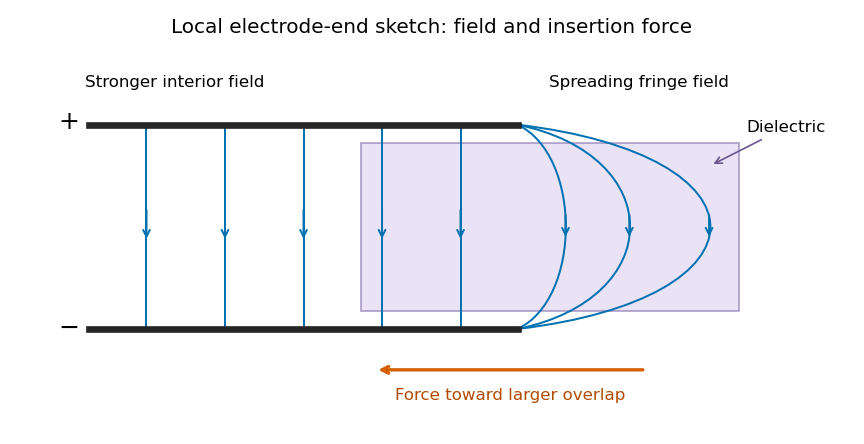

<h1 id="section-c/c8/f/solution">Solution</h1>

↑ **Parent:** [F](../f.md)

The [electric field](../../../../../../electric-field-split.md) is approximately radial in the long interior, but near an electrode end its lines spread into a [fringing field of a capacitor](../../../../../../fringing-field-of-a-capacitor.md). The [electric field](../../../../../../electric-field-split.md) magnitude falls on moving outward through that end region. The dielectric's induced [electric dipoles](../../../../../../electric-dipole.md) experience a net [force](../../../../../../force-split.md) toward the stronger field, pulling the material into the capacitor. For a weakly perturbing polarizable element this is expressed by $\mathbf F=\tfrac12\alpha\nabla E^2$, with positive [electric polarizability](../../../../../../electric-polarizability.md) $\alpha$.

**[Figure 3](#section-c/c8/f/image-local-schematic-of-field-lines-at-an-electrode-end-and-dielectric-insertion-this-illustrates-the-fringe-rather-than-the-full-coaxial-geometry). Local schematic of field lines at an electrode end and dielectric insertion; this illustrates the fringe rather than the full coaxial geometry**.

In the sketch the field lines run from the positive electrode to the negative one, curving outward near their ends. The material is attracted toward the interior where the field is stronger. A perfectly uniform interior field by itself would not give a longitudinal dipole-gradient [force](../../../../../../force-split.md); the end region is essential to the local explanation. Neglecting its small contribution to the total [capacitance](../../../../../../capacitance.md) does not justify omitting the finite insertion force that it transmits. The energy argument of part (d) gives that force without needing the detailed fringe solution.

## ↑ Ancestors (15)

1. [F](../f.md)
2. [C8](../../c8.md)
3. [Section C](../../../section-c.md)
4. [Paper 1](../../../../paper-1-split.md)
5. [2021](../../../../split.md)
6. [Past exam of the physics B course of the University of Cambridge](../../../../../split.md)
7. [Physics B course of the University of Cambridge](../../../../../../physics-b-course-of-the-university-of-cambridge.md)
8. [Physics course of the year 2 of the natural sciences course of the University of Cambridge](../../../../../../physics-course-of-the-year-2-of-the-natural-sciences-course-of-the-university-of-cambridge.md)
9. [Year 2 of the natural sciences course of the University of Cambridge](../../../../../../year-2-of-the-natural-sciences-course-of-the-university-of-cambridge.md)
10. [Year of the natural sciences course of the University of Cambridge](../../../../../../year-of-the-natural-sciences-course-of-the-university-of-cambridge.md)
11. [Natural sciences course of the University of Cambridge](../../../../../../natural-sciences-course-of-the-university-of-cambridge.md)
12. [Course of the University of Cambridge](../../../../../../course-of-the-university-of-cambridge.md)
13. [University of Cambridge](../../../../../../university-of-cambridge-split.md)
14. [List of universities](../../../../../../list-of-universities.md)
15. [Codex Wiki](../../../../../../split.md)
