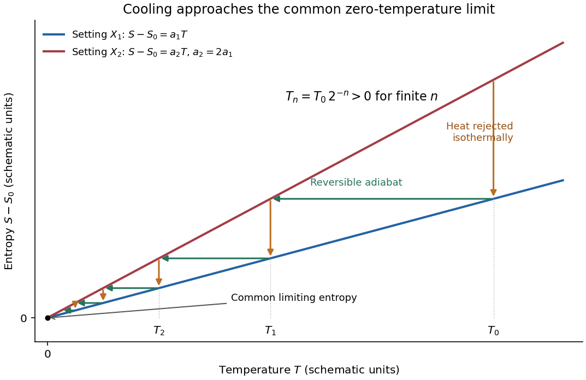

# Paper 2

↑ **Parent:** [2021](../2021.md)

[Original paper, released PDF pages 234–238](https://www.whatdotheyknow.com/request/natural_science_tripos_physics_e/response/2127325/attach/3/FOI%202022%20639%20Sullivan%20materials.pdf?cookie_passthrough=1#page=234)

**Table of contents**

- [Section A](#section-a)
  - [A1](#section-a/a1)
    - [Solution](#section-a/a1/solution)
  - [A2](#section-a/a2)
    - [Solution](#section-a/a2/solution)
  - [A3](#section-a/a3)
    - [Solution](#section-a/a3/solution)
  - [A4](#section-a/a4)
    - [Solution](#section-a/a4/solution)
  - [A5](#section-a/a5)
    - [Solution](#section-a/a5/solution)
- [Section B](#section-b)
  - [B6](#section-b/b6)
    - [a](#section-b/b6/a)
      - [Solution](#section-b/b6/a/solution)
    - [b](#section-b/b6/b)
      - [Solution](#section-b/b6/b/solution)
    - [c](#section-b/b6/c)
      - [Solution](#section-b/b6/c/solution)
    - [d](#section-b/b6/d)
      - [Solution](#section-b/b6/d/solution)
  - [B7](#section-b/b7)
    - [Solution](#section-b/b7/solution)
- [Section C](#section-c)
  - [C8](#section-c/c8)
    - [a](#section-c/c8/a)
      - [Solution](#section-c/c8/a/solution)
    - [b](#section-c/c8/b)
      - [Solution](#section-c/c8/b/solution)
    - [c](#section-c/c8/c)
      - [Solution](#section-c/c8/c/solution)
    - [d](#section-c/c8/d)
      - [Solution](#section-c/c8/d/solution)
    - [e](#section-c/c8/e)
      - [Solution](#section-c/c8/e/solution)
  - [C9](#section-c/c9)
    - [a](#section-c/c9/a)
      - [Solution](#section-c/c9/a/solution)
    - [b](#section-c/c9/b)
      - [Solution](#section-c/c9/b/solution)
    - [c](#section-c/c9/c)
      - [Solution](#section-c/c9/c/solution)
    - [d](#section-c/c9/d)
      - [Solution](#section-c/c9/d/solution)
    - [e](#section-c/c9/e)
      - [Solution](#section-c/c9/e/solution)

## Section A

↑ **Parent:** [Paper 2](paper-2.md)

<h3 id="section-a/a1">A1</h3>

↑ **Parent:** [Section A](#section-a)

<h4 id="section-a/a1/solution">Solution</h4>

↑ **Parent:** [A1](#section-a/a1)

This is the one-mole, or equivalently [molar volume](../../thermodynamics.md#molar-volume), form of the [Van der Waals equation](../../pressure.md#van-der-waals-equation), an approximate [equation of state](../../pressure.md#equation-of-state) for a [real gas](../../thermodynamics.md#real-gas):

$$
p=\frac{RT}{V-b}-\frac{a}{V^2}.
$$

Here $p$ is the gas [pressure](../../pressure.md), $T$ its absolute [temperature](../../temperature.md), $R$ the [molar gas constant](../../ideal-gas.md#molar-gas-constant), and $V$ the [volume](../../geometry-and-topology.md#volume) occupied by one mole. If $V$ denotes [molar volume](../../thermodynamics.md#molar-volume) explicitly, its units are $\mathrm{m^3\,mol^{-1}}$.

The positive parameter $b$ represents [excluded volume](../../statistical-physics.md#excluded-volume) arising from the finite size and short-range repulsion of the [molecules](../../molecule.md). The [volume](../../geometry-and-topology.md#volume) available for translational motion is reduced from $V$ to $V-b$. This is an effective [excluded volume](../../statistical-physics.md#excluded-volume), not simply the sum of the [molecules](../../molecule.md)' geometric [volumes](../../geometry-and-topology.md#volume). Its molar units are $\mathrm{m^3\,mol^{-1}}$.

The positive parameter $a$ measures intermolecular attraction in a [mean-field approximation](../../critical-phenomenon.md#mean-field-approximation). Attractions reduce the [force](../../force.md) exerted on the walls, lowering the measured [pressure](../../pressure.md) by $a/V^2$ relative to the repulsion-only expression. Thus $p+a/V^2$ is the [pressure](../../pressure.md) corrected for this attraction. The squared inverse-volume dependence reflects a contribution proportional to the square of the molecular [number density](../../statistical-physics.md#number-density). The molar units of $a$ are $\mathrm{Pa\,m^6\,mol^{-2}}$.

For an arbitrary amount $n$ measured in moles, with total container [volume](../../geometry-and-topology.md#volume) $V_{\rm tot}$, the corresponding formula is

$$
\boxed{\left(p+\frac{an^2}{V_{\rm tot}^2}\right)(V_{\rm tot}-nb)=nRT.}
$$

At low [density](../../fluid-mechanics.md#density), when $b\ll V$ and $a/V^2\ll RT/V$, it reduces to the [ideal gas law](../../ideal-gas.md#ideal-gas-law). The model captures qualitative attraction, repulsion and liquid-gas behavior, but does not supply an exact [equation of state](../../pressure.md#equation-of-state) for every material.

<h3 id="section-a/a2">A2</h3>

↑ **Parent:** [Section A](#section-a)

<h4 id="section-a/a2/solution">Solution</h4>

↑ **Parent:** [A2](#section-a/a2)

The [third law of thermodynamics](../../thermodynamics.md#third-law-of-thermodynamics), in its perfect-crystal form, states that the [entropy](../../entropy.md) of a pure, perfectly ordered [crystal](../../thermodynamics.md#crystal) with a unique [ground state](../../quantum-mechanics.md#ground-state) tends to zero as $T\to0$. Its more general entropy-difference formulation says that the [entropy](../../entropy.md) difference between equilibrium states related by a finite change of a regular external control parameter tends to zero at [absolute zero](../../temperature.md#absolute-zero):

$$
\lim_{T\to0}\left[S(T,X_2)-S(T,X_1)\right]=0.
$$

The common limiting [entropy](../../entropy.md) is independent of $X$. Ground-state degeneracy or frozen disorder can produce [residual entropy](../../entropy.md#residual-entropy), so zero [entropy](../../entropy.md) is not an unconditional assertion about every sample.

In the usual regular thermodynamic setting, [absolute zero](../../temperature.md#absolute-zero) cannot be attained from positive [temperature](../../temperature.md) by a finite sequence of cooling operations with finite resources. An entropy-temperature plot shows why a finite reversible adiabatic step cannot reach the common zero-temperature endpoint from a state with positive [entropy](../../entropy.md) above that endpoint: an [isentropic process](../../first-law-of-thermodynamics.md#isentropic-process) follows a horizontal line, while all the regular [entropy](../../entropy.md) curves meet only at $T=0$.

**[Figure 1](#section-a/a2/image-entropy-curves-and-a-cooling-staircase-approaching-absolute-zero). Entropy curves and a cooling staircase approaching absolute zero**.

The figure illustrates this with two possible settings having $S-S_0=a_1T$ and $S-S_0=a_2T$, where $0<a_1<a_2$. First change the setting isothermally from the upper to the lower curve, rejecting [heat](../../heat.md); then change it reversibly and adiabatically back to the upper curve. [Entropy](../../entropy.md) conservation on the latter step gives

$$
a_1T_n=a_2T_{n+1},\qquad T_{n+1}=\frac{a_1}{a_2}T_n,
\qquad T_n=T_0\left(\frac{a_1}{a_2}\right)^n>0
$$

for every finite $n$. The staircase approaches the origin but reaches it only after infinitely many such stages. Irreversibility generates [entropy](../../entropy.md) and cannot improve on the reversible endpoint.

This is a thermodynamic illustration of [unattainability of absolute zero](../../thermodynamics.md#unattainability-of-absolute-zero), not a claim that every cooling apparatus has this particular linear [entropy](../../entropy.md) law. Its conclusion presumes regular equilibrium states and bounded control parameters; dynamical statements about finite cooling time additionally require physical assumptions about the available interactions and cooling rates.

<h3 id="section-a/a3">A3</h3>

↑ **Parent:** [Section A](#section-a)

<h4 id="section-a/a3/solution">Solution</h4>

↑ **Parent:** [A3](#section-a/a3)

Assume a hollow, perfectly conducting [rectangular electromagnetic waveguide](../../electromagnetic-wave.md#rectangular-electromagnetic-waveguide) filled with air approximated by vacuum. Let its wider side be $a=0.040\,\mathrm m$ and its narrower side $b=0.020\,\mathrm m$. The longitudinal propagation constant of a mode is

$$
k_z^2=\frac{\omega^2}{c^2}-\left(\frac{m\pi}{a}\right)^2-\left(\frac{n\pi}{b}\right)^2,
$$

so the [waveguide cutoff frequency](../../electromagnetic-wave.md#waveguide-cutoff-frequency) is

$$
f_{c,mn}=\frac c2\sqrt{\left(\frac ma\right)^2+\left(\frac nb\right)^2}.
$$

For a mode with [transverse electric polarization](../../electromagnetic-wave.md#transverse-electric-polarization), one of $m,n$ may vanish, but they cannot both vanish. For a mode with [transverse magnetic polarization](../../electromagnetic-wave.md#transverse-magnetic-polarization), both must be positive. A single hollow conducting guide has no [transverse electromagnetic mode](../../electromagnetic-wave.md#transverse-electromagnetic-mode) with zero cutoff.

The lowest cutoff therefore belongs to the $\mathrm{TE}_{10}$ mode, varying across the wider side:

$$
\boxed{f_c=\frac{c}{2a}=\frac{2.998\times10^8\,\mathrm{m\,s^{-1}}}{0.080\,\mathrm m}=3.75\times10^9\,\mathrm{Hz}\simeq3.75\,\mathrm{GHz}.}
$$

Strictly, a traveling mode transporting [energy](../../energy.md) down the guide requires $f>f_c$. At exactly $f_c$, $k_z=0$ and the axial [group velocity](../../dispersion-relation.md#group-velocity) vanishes. Below cutoff the field is evanescent. A different [dielectric](../../permittivity.md#dielectric) filling would replace $c$ by the [wave speed](../../wave-equation.md#wave-speed) in that material.

<h3 id="section-a/a4">A4</h3>

↑ **Parent:** [Section A](#section-a)

<h4 id="section-a/a4/solution">Solution</h4>

↑ **Parent:** [A4](#section-a/a4)

For a fixed [magnetic dipole moment](../../electromagnetism.md#magnetic-dipole-moment) in an externally imposed uniform [magnetic field](../../magnetic-field.md), the [torque](../../momentum.md#torque) is $\boldsymbol\tau=\mathbf m\times\mathbf B$. Its component in the direction of increasing $\theta$ is $-mB\sin\theta$. Since $\tau_\theta=-dU/d\theta$, integration gives

$$
\boxed{U(\theta)=-\mathbf m\cdot\mathbf B=-mB\cos\theta,}
$$

where the arbitrary additive constant has been chosen so that $U=0$ at $\theta=\pi/2$.

**[Figure 2](#section-a/a4/image-potential-energy-of-a-permanent-magnetic-dipole-in-a-uniform-magnetic-field). Potential energy of a permanent magnetic dipole in a uniform magnetic field**.

The aligned orientation $\theta=0$ has the minimum $U=-mB$ and is stable against small rotations; the anti-aligned orientation $\theta=\pi$ has the maximum $U=+mB$ and is unstable. The graph repeats every $2\pi$. Rotating quasistatically from alignment to anti-alignment requires external work $\Delta U=2mB$.

<h3 id="section-a/a5">A5</h3>

↑ **Parent:** [Section A](#section-a)

<h4 id="section-a/a5/solution">Solution</h4>

↑ **Parent:** [A5](#section-a/a5)

For [charge sharing between distant connected spheres](../../electrostatics.md#charge-sharing-between-distant-connected-spheres), use the standard approximation that the spheres are sufficiently far apart for mutual electrostatic effects to be negligible, and that the wire adds negligible [capacitance](../../electromagnetism.md#capacitance). The [capacitance of an isolated conducting sphere](../../electromagnetism.md#capacitance-of-an-isolated-conducting-sphere) is $C=4\pi\epsilon_0r$. Thus

$$
C_1=5.56\,\mathrm{pF},\qquad C_2=11.1\,\mathrm{pF}=2C_1.
$$

The initial charges are $Q_i=C_iV_i$. Connecting the spheres allows charge to flow until their potentials are equal. [Charge conservation](../../electric-charge.md#charge-conservation) gives

$$
V_f=\frac{C_1V_1+C_2V_2}{C_1+C_2}
=\frac{(2\,\mathrm{kV})+2(4\,\mathrm{kV})}{3}
=3.333\,\mathrm{kV}.
$$

The initial and final [electrostatic energies](../../electrostatics.md#electrostatic-energy) are $U_i=\tfrac12C_1V_1^2+\tfrac12C_2V_2^2$ and $U_f=\tfrac12(C_1+C_2)V_f^2$. Their difference becomes [Joule heating](../../electric-charge.md#joule-heating) in the resistive wire:

$$
Q_{\rm heat}=U_i-U_f=\frac12\frac{C_1C_2}{C_1+C_2}(V_1-V_2)^2.
$$

Numerically,

$$
\boxed{Q_{\rm heat}=\frac12\left(3.71\times10^{-12}\,\mathrm F\right)(2000\,\mathrm V)^2=7.42\times10^{-6}\,\mathrm J=7.42\,\mu\mathrm J.}
$$

The resistance determines how fast this happens, not the final [energy](../../energy.md) difference. Sufficient damping suppresses sustained charge-current oscillations; the calculation also neglects [energy](../../energy.md) radiated away. At finite sphere separation the [capacitance matrix](../../electromagnetism.md#capacitance-matrix) would be needed, and the radii and initial potentials alone would not specify an exact correction.

## Section B

↑ **Parent:** [Paper 2](paper-2.md)

<h3 id="section-b/b6">B6</h3>

↑ **Parent:** [Section B](#section-b)

The examination requires three notes. All four options are developed here for completeness.

<h4 id="section-b/b6/a">a</h4>

↑ **Parent:** [B6](#section-b/b6)

<h5 id="section-b/b6/a/solution">Solution</h5>

↑ **Parent:** [A](#section-b/b6/a)

For [torque-free precession of a symmetric top](../../rigid-body-dynamics.md#torque-free-precession-of-a-symmetric-top), take principal [moments of inertia](../../rigid-body-dynamics.md#moment-of-inertia) $I_1=I_2=I_\perp$ and $I_3=I_\parallel$, with no external [torque](../../momentum.md#torque). In an [inertial frame](../../mathematical-physics.md#inertial-frame) moving with its [centre of mass](../../classical-mechanics.md#center-of-mass), its [angular momentum](../../momentum.md#angular-momentum) $\mathbf L$ is constant in an [inertial frame](../../mathematical-physics.md#inertial-frame), and its [rotational kinetic energy](../../energy.md#rotational-kinetic-energy) is conserved.

In the principal body axes, [Euler equations for a torque-free rigid body](../../rigid-body-dynamics.md#euler-equations-for-a-torque-free-rigid-body) reduce to

$$
I_\perp\dot\omega_1+(I_\parallel-I_\perp)\omega_2\omega_3=0,\qquad
I_\perp\dot\omega_2-(I_\parallel-I_\perp)\omega_3\omega_1=0,\qquad
I_\parallel\dot\omega_3=0.
$$

Therefore $\omega_3$ is constant and

$$
\omega_1+i\omega_2=\omega_\perp e^{i(\Omega_bt+\alpha)},\qquad
\boxed{\Omega_b=\frac{I_\parallel-I_\perp}{I_\perp}\,\omega_3.}
$$

Thus the transverse [angular velocity](../../rigid-body-dynamics.md#angular-velocity) rotates uniformly in the body frame; its signed rate reverses between oblate and prolate inertia tensors. This body-frame wobble rate should be distinguished from the space-frame [precession](../../rigid-body-dynamics.md#precession) of the symmetry axis.

Let $\mathbf e_3$ be the body's symmetry axis. Since

$$
\mathbf L=I_\perp\boldsymbol\omega+(I_\parallel-I_\perp)\omega_3\mathbf e_3,
$$

its angle $\theta$ to $\mathbf L$ is constant, with $\cos\theta=I_\parallel\omega_3/L$, and

$$
\dot{\mathbf e}_3=\boldsymbol\omega\times\mathbf e_3
=\frac{\mathbf L}{I_\perp}\times\mathbf e_3.
$$

Hence the symmetry axis describes a cone about fixed $\mathbf L$ at the space-frame [precession](../../rigid-body-dynamics.md#precession) rate

$$
\boxed{\dot\phi=\frac L{I_\perp}.}
$$

There is no [nutation](../../rigid-body-dynamics.md#nutation) of this angle for torque-free motion of an exactly [symmetric top](../../rigid-body-dynamics.md#symmetric-top). In the usual [Euler angles](../../rigid-body-dynamics.md#euler-angles), $\omega_3=\dot\psi+\dot\phi\cos\theta$, so $\dot\psi=-\Omega_b$. Both rates describe the same motion in different axes. A freely tossed axisymmetric disc illustrates the effect; a top supported at a point under gravity is a different, externally torqued problem.

<h4 id="section-b/b6/b">b</h4>

↑ **Parent:** [B6](#section-b/b6)

<h5 id="section-b/b6/b/solution">Solution</h5>

↑ **Parent:** [B](#section-b/b6/b)

[Lagrangian mechanics](../../lagrangian-mechanics.md) expresses dynamics through [generalized coordinates](../../lagrangian-mechanics.md#generalized-coordinate) $q_i$ that respect the constraints. For a system with conservative, velocity-independent [forces](../../force.md) and standard [kinetic energy](../../energy.md#kinetic-energy), the [Lagrangian](../../calculus-of-variations.md#lagrangian) is $L=T-V$. Its equations follow from the [principle of stationary action](../../lagrangian-mechanics.md#principle-of-stationary-action):

$$
\mathcal S[q]=\int_{t_1}^{t_2}L(q,\dot q,t)\,dt,\qquad \delta\mathcal S=0
$$

for variations that vanish at the endpoints. Varying the [integral](../../integral.md) and integrating the $\delta\dot q_i$ term by parts gives

$$
\delta\mathcal S=\int_{t_1}^{t_2}\sum_i\left[\frac{\partial L}{\partial q_i}-\frac d{dt}\frac{\partial L}{\partial\dot q_i}\right]\delta q_i\,dt.
$$

Independent variations therefore yield the [Euler-Lagrange equations](../../analysis.md#euler-lagrange-equation):

$$
\boxed{\frac d{dt}\frac{\partial L}{\partial\dot q_i}-\frac{\partial L}{\partial q_i}=0.}
$$

Additional nonconservative [generalized forces](../../classical-mechanics.md#generalized-forces) appear on the right-hand side as $Q_i$. The [action](../../lagrangian-mechanics.md#action) is stationary, not necessarily a minimum. For ideal [holonomic constraints](../../classical-mechanics.md#holonomic-constraint), using suitable [generalized coordinates](../../lagrangian-mechanics.md#generalized-coordinate) removes the need to solve explicitly for constraint [forces](../../force.md).

The [conjugate momentum](../../hamiltonian-mechanics.md#canonical-momentum) is $p_i=\partial L/\partial\dot q_i$. If a coordinate is cyclic, $\partial L/\partial q_i=0$ and its [conjugate momentum](../../hamiltonian-mechanics.md#canonical-momentum) is conserved. If $L$ has no explicit time dependence, the [energy](../../energy.md) function

$$
E=\sum_i\dot q_ip_i-L
$$

is conserved. It equals $T+V$ for the usual quadratic [kinetic energy](../../energy.md#kinetic-energy) with time-independent geometry, but that identification is not universal for every [Lagrangian](../../calculus-of-variations.md#lagrangian) or constraint.

For example, a [simple pendulum](../../simple-pendulum.md) with angle $\theta$, length $\ell$ and bob mass $m$ has

$$
L=\frac12m\ell^2\dot\theta^2+mg\ell\cos\theta,
\qquad \ddot\theta+\frac g\ell\sin\theta=0.
$$

The [tension](../../force.md#tension) does no [virtual work](../../classical-mechanics.md#virtual-work) in the allowed angular displacement and never needs to be calculated to obtain the angular equation. The method scales naturally to coupled systems and coordinates with complicated geometry.

<h4 id="section-b/b6/c">c</h4>

↑ **Parent:** [B6](#section-b/b6)

<h5 id="section-b/b6/c/solution">Solution</h5>

↑ **Parent:** [C](#section-b/b6/c)

For a slender [elastic beam](../../elasticity-physics.md#elastic-beam), the [Euler-Bernoulli beam equation](../../elasticity-physics.md#euler-bernoulli-beam-equation) assumes small [strain](../../continuum-mechanics.md#strain), small deflection slopes and cross-sections that remain plane and normal to the deflected centreline. A fibre at signed distance $y$ from the [neutral axis](../../elasticity-physics.md#neutral-axis) has longitudinal [strain](../../continuum-mechanics.md#strain) $\epsilon_{xx}=-y\kappa$, where $\kappa$ is the centreline [curvature](../../differential-geometry.md#curvature). [Hooke's law](../../elasticity-physics.md#hooke-s-law) gives $\sigma_{xx}=-Ey\kappa$, with [Young's modulus](../../elasticity-physics.md#young-s-modulus) $E$.

Choose the internal bending-moment sign so that $M=-\int y\sigma_{xx}\,dA$. Then

$$
\boxed{M=EI_A\kappa,\qquad I_A=\int_Ay^2\,dA.}
$$

Here $I_A$ is the [second moment of area](../../elasticity-physics.md#second-moment-of-area), with units $\mathrm{m^4}$, not the mass [moment of inertia](../../rigid-body-dynamics.md#moment-of-inertia) of a rotating body. For a uniform material under pure bending, zero axial resultant places the [neutral axis](../../elasticity-physics.md#neutral-axis) through the section's [centroid](../../euclidean-geometry.md#centroid).

For small slopes, $\kappa\simeq w''(x)$. Combining the moment-curvature relation with transverse [force](../../force.md) and moment balance gives, with a consistent load sign convention,

$$
\boxed{\frac{d^2}{dx^2}\left(EI_A\frac{d^2w}{dx^2}\right)=q(x).}
$$

For constant stiffness this becomes $EI_Aw^{(4)}=q$. The [bending stiffness](../../elasticity-physics.md#bending-stiffness) $EI_A$ has units $\mathrm{N\,m^2}$. [Boundary conditions](../../differential-equation.md#boundary-condition) specify displacement and slope at a clamped end, or [bending moment](../../elasticity-physics.md#bending-moment) and shear [force](../../force.md) at a free end.

For a cantilever of length $\ell$ carrying a transverse end load $F$, take deflection positive towards the load. The moment magnitude is $M(x)=F(\ell-x)$, and integration with $w(0)=w'(0)=0$ gives

$$
w(x)=\frac{Fx^2(3\ell-x)}{6EI_A},\qquad
\boxed{w(\ell)=\frac{F\ell^3}{3EI_A}.}
$$

The free-end moment vanishes and the tip shear supplies the applied load. For a rectangular section of width $b$ and bending thickness $h$, $I_A=bh^3/12$, so increasing thickness strongly increases bending resistance. The model ceases to be reliable for large deflections, plastic [strains](../../continuum-mechanics.md#strain) or short thick beams where shear deformation matters.

<h4 id="section-b/b6/d">d</h4>

↑ **Parent:** [B6](#section-b/b6)

<h5 id="section-b/b6/d/solution">Solution</h5>

↑ **Parent:** [D](#section-b/b6/d)

The [Magnus effect](../../fluid-mechanics.md#magnus-effect) is the transverse [force](../../force.md) produced when a spinning body moves relative to a [fluid](../../fluid-mechanics.md#fluid). Rotation changes the flow and [circulation](../../vorticity.md#circulation-physics) around the body; the resulting asymmetric [pressure](../../pressure.md) and wake deflect the [fluid](../../fluid-mechanics.md#fluid), with the opposite transverse [force](../../force.md) on the body. Examples include the curved flight of spinning balls and the lift of rotating-cylinder sails.

A useful quantitative model is steady two-dimensional [incompressible flow](../../fluid-mechanics.md#incompressible-flow) past a cylinder of radius $a$, with [fluid](../../fluid-mechanics.md#fluid) [velocity](../../classical-mechanics.md#velocity) $\mathbf U=U\hat{\mathbf x}$ far away. Let [circulation](../../vorticity.md#circulation-physics) $\Gamma$ be positive anticlockwise as viewed from $+z$. The potential-flow [velocity](../../classical-mechanics.md#velocity) at the cylinder surface is

$$
v_\theta(a,\theta)=-2U\sin\theta+\frac{\Gamma}{2\pi a}.
$$

The [Bernoulli equation](../../euler-equations-for-an-inviscid-fluid.md#bernoulli-equation) outside the [boundary layer](../../continuum-mechanics.md#boundary-layer) gives

$$
p(\theta)=p_\infty+\frac\rho2\left(U^2-v_\theta^2\right).
$$

Integrating the [pressure](../../pressure.md) [force](../../force.md) around the cylinder, per unit span, yields

$$
F_y'=-a\int_0^{2\pi}p(\theta)\sin\theta\,d\theta=-\rho U\Gamma.
$$

Thus the [Kutta–Joukowski theorem](../../fluid-mechanics.md#kutta-joukowski-theorem) gives

$$
\boxed{\mathbf F'=\rho\mathbf U\times(\Gamma\hat{\mathbf z}),\qquad |\mathbf F'|=\rho U|\Gamma|.}
$$

The sign here refers to the [fluid](../../fluid-mechanics.md#fluid) [velocity](../../classical-mechanics.md#velocity) relative to the cylinder. For a body moving through otherwise stationary [fluid](../../fluid-mechanics.md#fluid), that relative [fluid](../../fluid-mechanics.md#fluid) [velocity](../../classical-mechanics.md#velocity) points opposite to the body's translational [velocity](../../classical-mechanics.md#velocity).

Real [viscosity](../../dynamic-viscosity.md) and the [no-slip boundary condition](../../viscous-fluid-flow.md#no-slip-boundary-condition) transmit the surface rotation to the [fluid](../../fluid-mechanics.md#fluid) and help set the [circulation](../../vorticity.md#circulation-physics) and separation pattern. Pure inviscid flow with only an impermeability condition does not determine $\Gamma$ from the cylinder's [angular speed](../../rigid-body-dynamics.md#angular-speed). Therefore the [circulation](../../vorticity.md#circulation-physics) must not be assigned a universal spin-rate formula without additional assumptions. The cylinder result illustrates the lift mechanism; quantitative [forces](../../force.md) on a finite spinning ball also depend on its geometry, [Reynolds number](../../dynamic-viscosity.md#reynolds-number), rotation rate, surface roughness and wake.

<h3 id="section-b/b7">B7</h3>

↑ **Parent:** [Section B](#section-b)

<h4 id="section-b/b7/solution">Solution</h4>

↑ **Parent:** [B7](#section-b/b7)

[Electromagnetic waves](../../electromagnetic-wave.md) drive mobile charges in a conducting medium. Their current changes both the phase and attenuation of the wave. A description in terms of a real, frequency-independent [refractive index](../../electromagnetic-wave.md#refractive-index) is therefore generally insufficient: the material response and the propagation constant are complex and frequency dependent.

Use [phasors](../../wave.md#phasor) proportional to $e^{i(kz-\omega t)}$, with $k=k'+ik''$ and $k''\geq0$ for a passive medium. In a homogeneous, [isotropic](../../continuum-mechanics.md#isotropy), linear material, let $\epsilon_b$ represent the [permittivity](../../permittivity.md) associated with bound-charge [electric polarization](../../electromagnetism.md#polarization-density), $\mu$ the [magnetic permeability](../../maxwell-equations.md#permeability-electromagnetism) and $\sigma(\omega)$ the mobile-charge conductivity. The macroscopic [Maxwell equations](../../maxwell-equations.md) give

$$
\nabla\times\mathbf E=i\omega\mathbf B,\qquad
\nabla\times\mathbf H=(\sigma-i\omega\epsilon_b)\mathbf E.
$$

For a transverse plane wave, taking another curl yields

$$
\boxed{k^2=\mu\epsilon_b\omega^2+i\mu\sigma(\omega)\omega
=\mu\omega^2\epsilon_{\rm eff}(\omega),\qquad
\epsilon_{\rm eff}=\epsilon_b+\frac{i\sigma(\omega)}\omega.}
$$

This division of the response avoids counting mobile [electrons](../../physics.md#electron) both in $\epsilon_b$ and in $\sigma$. Define the [complex refractive index](../../electromagnetic-wave.md#complex-refractive-index) $\widetilde n=ck/\omega=n+i\kappa$. For a nonmagnetic medium, $\widetilde n^2=\epsilon_{\rm eff}/\epsilon_0$. Its real part determines the phase variation, while the positive [optical extinction coefficient](../../electromagnetic-wave.md#optical-extinction-coefficient) $\kappa$ gives amplitude attenuation $e^{-\omega\kappa z/c}$ and intensity attenuation $e^{-2\omega\kappa z/c}$. The amplitude penetration length is

$$
\delta=\frac1{k''}=\frac c{\omega\kappa}.
$$

A simple microscopic explanation comes from the [Drude model](../../electric-charge.md#drude-model). Let [electrons](../../physics.md#electron) of charge $-e$, mass $m$ and [number density](../../statistical-physics.md#number-density) $n_e$ move against an effectively stationary positive background. Collisions relax their mean [velocity](../../classical-mechanics.md#velocity) at rate $\nu$:

$$
m(\dot{\mathbf v}+\nu\mathbf v)=-e\mathbf E,\qquad
\mathbf J=-n_ee\mathbf v.
$$

Consequently

$$
\boxed{\sigma(\omega)=\frac{n_ee^2}{m(\nu-i\omega)}
=\frac{\epsilon_0\omega_p^2}{\nu-i\omega},\qquad
\omega_p^2=\frac{n_ee^2}{m\epsilon_0}.}
$$

With a vacuum-like bound-charge background, this gives

$$
\frac{\epsilon_{\rm eff}}{\epsilon_0}
=1-\frac{\omega_p^2}{\omega(\omega+i\nu)}.
$$

Its imaginary part is positive for positive $\omega,\nu$, consistent with dissipation under the chosen [phasor](../../wave.md#phasor) convention. Real materials can require an effective [electron](../../physics.md#electron) mass, a nontrivial bound-charge response, or additional absorption associated with the [electronic band structure](../../bloch-s-theorem.md#electronic-band-structure).

A [plasma](../../physics.md#plasma-physics) is a conducting ionized medium with mobile [electrons](../../physics.md#electron) and [ions](../../chemistry.md#ion), approximately neutral on large scales because of [plasma screening](../../physics.md#plasma-screening). For the electron-frequency transverse waves considered here, the heavy [ions](../../chemistry.md#ion) can often be treated as stationary. In a dilute weakly collisional [plasma](../../physics.md#plasma-physics), $\nu\ll\omega$, so

$$
\boxed{n^2=1-\frac{\omega_p^2}{\omega^2},\qquad
\omega^2=\omega_p^2+c^2k^2.}
$$

For $\omega>\omega_p$, $k$ is real in this collisionless model and the wave propagates. Its [phase velocity](../../dispersion-relation.md#phase-velocity) is $v_{\rm ph}=c/n>c$, while its [group velocity](../../dispersion-relation.md#group-velocity) is $v_g=cn<c$; their product is $c^2$. A phase crest exceeding $c$ does not imply superluminal information transport. For $\omega<\omega_p$, the refractive-index square is negative and

$$
k=i\frac{\sqrt{\omega_p^2-\omega^2}}c,
\qquad \delta=\frac c{\sqrt{\omega_p^2-\omega^2}}.
$$

The transmitted field is evanescent rather than a traveling bulk wave. A sufficiently thick collisionless [plasma](../../physics.md#plasma-physics) reflects such radiation without Ohmic absorption. Collisions make the response complex and permit absorption. This accounts for a [plasma](../../physics.md#plasma-physics) cutoff and, qualitatively, the reflection of some radio frequencies by ionized atmospheric layers. The simple model describes transverse waves; [plasmas](../../physics.md#plasma-physics) also support longitudinal collective modes.

In a [metal](../../chemical-substance.md#metal), positive [ions](../../chemistry.md#ion) usually form a [crystal](../../thermodynamics.md#crystal) lattice. Mobile conduction [electrons](../../physics.md#electron) occupy states described by the [electronic band structure](../../bloch-s-theorem.md#electronic-band-structure) and normally form a degenerate [Fermi gas](../../quantum-ideal-gas-statistics.md#fermi-gas). The conduction-electron [density](../../fluid-mechanics.md#density) is usually much higher than in a dilute gas [plasma](../../physics.md#plasma-physics). Thus its [plasma frequency](../../physics.md#plasma-frequency) is commonly in the optical or [ultraviolet](../../optics.md#ultraviolet) range, rather than the lower radio-frequency values possible in dilute [plasmas](../../physics.md#plasma-physics). [Electron](../../physics.md#electron) scattering from the lattice, defects and other excitations gives a finite relaxation rate. The distinction is not that every [plasma](../../physics.md#plasma-physics) is collisionless and every [metal](../../chemical-substance.md#metal) collisional: the controlling ratio for either material is $\omega/\nu$, together with its carrier [density](../../fluid-mechanics.md#density) and bound-charge response.

At sufficiently low frequency, $\omega\ll\nu$, the [metal](../../chemical-substance.md#metal)'s conductivity is approximately real, $\sigma_0=n_ee^2/(m\nu)$. In a good conductor the conduction current dominates the displacement current, $\sigma_0\gg\omega\epsilon_b$. The wave equation then gives

$$
k^2\simeq i\mu\sigma_0\omega,\qquad
\boxed{k\simeq(1+i)\sqrt{\frac{\mu\sigma_0\omega}{2}}=\frac{1+i}{\delta},
\quad\delta=\sqrt{\frac{2}{\mu\sigma_0\omega}}.}
$$

For example, a tangential electric field varies as

$$
E(z,t)=E_0e^{-z/\delta}\cos\left(\frac z\delta-\omega t\right).
$$

The current $\mathbf J=\sigma_0\mathbf E$ is therefore concentrated within a few skin depths of the surface: this is the [skin effect](../../electric-charge.md#skin-effect). As frequency increases within this regime, $\delta\propto\omega^{-1/2}$. In a wire whose radius greatly exceeds $\delta$, only a thin outer region carries appreciable alternating current, increasing the effective resistance. In a conducting shield, the same penetration suppresses the field transmitted through a sufficiently thick wall.

The [Poynting theorem](../../electromagnetic-wave.md#poynting-theorem) identifies the loss as [Joule heating](../../electric-charge.md#joule-heating). The cycle-averaged heating [density](../../fluid-mechanics.md#density) for a complex conductivity is

$$
\langle\mathbf J\cdot\mathbf E\rangle=\frac12\operatorname{Re}\sigma\,|\mathbf E|^2.
$$

The [wave impedance](../../electromagnetic-wave.md#wave-impedance) is $Z=\mu\omega/k$. For incidence from vacuum at normal incidence, the electric reflection amplitude is $r=(Z-Z_0)/(Z+Z_0)$, where $Z_0=\sqrt{\mu_0/\epsilon_0}$. A good conductor has small $|Z|$ and therefore strong reflection, while the part of the incident power entering it is dissipated over the [skin depth](../../electric-charge.md#skin-depth).

At high enough frequency that $\omega\gg\nu$, a [metal](../../chemical-substance.md#metal)'s free-electron response also approaches the collisionless [plasma](../../physics.md#plasma-physics) form. The low-frequency formula $\delta\propto\omega^{-1/2}$ must not simply be extrapolated into that regime. Real optical behavior additionally depends on the [electronic band structure](../../bloch-s-theorem.md#electronic-band-structure) and transitions between bands. Both [plasmas](../../physics.md#plasma-physics) and [metals](../../chemical-substance.md#metal) are therefore described by the same electromagnetic response framework, but their relevant densities, scattering rates and frequency regimes differ.

## Section C

↑ **Parent:** [Paper 2](paper-2.md)

<h3 id="section-c/c8">C8</h3>

↑ **Parent:** [Section C](#section-c)

<h4 id="section-c/c8/a">a</h4>

↑ **Parent:** [C8](#section-c/c8)

<h5 id="section-c/c8/a/solution">Solution</h5>

↑ **Parent:** [A](#section-c/c8/a)

The relation describes the slope of the [phase coexistence curve](../../thermodynamic-potential.md#phase-coexistence-curve) of a pure substance in the pressure-temperature plane:

$$
\boxed{\frac{dp}{dT}=\frac{L}{T\Delta V}.}
$$

Here $p(T)$ is the common equilibrium [pressure](../../pressure.md) of the two phases, $T$ is their common absolute [temperature](../../temperature.md) in kelvins, and the [derivative](../../calculus.md#derivative) is taken along their coexistence curve. Choose a direction of transformation from phase 1 to phase 2. Then $L$ is the reversible [latent heat](../../thermodynamic-potential.md#latent-heat) for that transformation and $\Delta V=V_2-V_1$ is the corresponding [volume](../../geometry-and-topology.md#volume) change, using the same [amount of substance](../../physics.md#amount-of-substance) for both quantities.

In the molar convention used below, $L=h_{m,2}-h_{m,1}$ has units $\mathrm{J\,mol^{-1}}$ and $\Delta V=v_{m,2}-v_{m,1}$ has units $\mathrm{m^3\,mol^{-1}}$, so the right-hand side has units $\mathrm{Pa\,K^{-1}}$. For vaporization, both $L$ and $\Delta V$ are positive. The displayed general relation is also called the [Clapeyron equation](../../thermodynamic-potential.md#clausius-clapeyron-relation); the ideal-vapor approximation used in (c) gives its usual Clausius form.

<h4 id="section-c/c8/b">b</h4>

↑ **Parent:** [C8](#section-c/c8)

<h5 id="section-c/c8/b/solution">Solution</h5>

↑ **Parent:** [B](#section-c/c8/b)

At coexistence, the two phases of a pure substance have equal [chemical potential](../../chemical-potential.md), or equivalently equal molar [Gibbs free energy](../../thermodynamic-potential.md#gibbs-free-energy):

$$
\mu_1(T,p)=\mu_2(T,p).
$$

For either phase, $d\mu=-s_m\,dT+v_m\,dp$. Move an infinitesimal distance along the coexistence curve, where the equality must remain true. Subtracting the two differentials gives

$$
0=-\left(s_{m,2}-s_{m,1}\right)dT+\left(v_{m,2}-v_{m,1}\right)dp,
\qquad \frac{dp}{dT}=\frac{\Delta s_m}{\Delta v_m}.
$$

A reversible transformation at this common [temperature](../../temperature.md) absorbs [latent heat](../../thermodynamic-potential.md#latent-heat) $L=T\Delta s_m$. Thus

$$
\boxed{\frac{dp}{dT}=\frac{\Delta s_m}{\Delta v_m}=\frac{L}{T\Delta v_m}.}
$$

The derivation assumes [thermodynamic equilibrium](../../thermodynamics.md#thermodynamic-equilibrium) between two bulk phases of a single pure substance, with the same [temperature](../../temperature.md) and [pressure](../../pressure.md), and only ordinary pressure-volume work. Surface-curvature shifts, additional external-field work and composition changes are omitted. It applies to a first-order [phase boundary](../../geophysics.md#phase-boundary) where the [latent heat](../../thermodynamic-potential.md#latent-heat) and [volume](../../geometry-and-topology.md#volume) discontinuity are defined. No ideal-gas assumption and no constant-$L$ assumption are needed for this differential relation. At the critical endpoint both discontinuities vanish, so their ratio requires a limiting treatment rather than direct substitution of two zeros.

<h4 id="section-c/c8/c">c</h4>

↑ **Parent:** [C8](#section-c/c8)

<h5 id="section-c/c8/c/solution">Solution</h5>

↑ **Parent:** [C](#section-c/c8/c)

For liquid-vapor equilibrium, use molar quantities. At low vapor [pressure](../../pressure.md) the gas is dilute, approximately ideal, and has a much larger [molar volume](../../thermodynamics.md#molar-volume) than the liquid. Hence

$$
\Delta v_m=v_{m,g}-v_{m,l}\simeq v_{m,g}\simeq\frac{RT}{p}.
$$

Substitution into the [Clapeyron equation](../../thermodynamic-potential.md#clausius-clapeyron-relation) gives

$$
\frac{dp}{dT}\simeq\frac{Lp}{RT^2},\qquad
\frac{d\ln p}{dT}\simeq\frac{L}{RT^2}.
$$

If the molar [latent heat](../../thermodynamic-potential.md#latent-heat) varies sufficiently slowly to be treated as constant over the [temperature](../../temperature.md) interval, integration gives

$$
\ln p=\text{constant}-\frac{L}{RT},\qquad
\boxed{p=p_0\exp\left(-\frac{L}{RT}\right).}
$$

The positive constant $p_0$ has [pressure](../../pressure.md) units and is an integration constant. It is not necessarily a real infinite-temperature [pressure](../../pressure.md), since the approximations fail before that limit.

For [mercury](../../chemical-substance.md#mercury-element) between $300$ and $500\,\mathrm K$, the original plot places this range above the [triple point](../../thermodynamic-potential.md#triple-point) and below the normal boiling and critical [temperatures](../../temperature.md). Its vapor [pressure](../../pressure.md) is low relative to the critical [pressure](../../pressure.md), making a dilute-gas description reasonable; the vapor's [molar volume](../../thermodynamics.md#molar-volume) greatly exceeds that of the dense liquid. The interval is also far from the critical region where $L$ tends to zero, so a roughly constant [latent heat](../../thermodynamic-potential.md#latent-heat) is a useful first approximation. The approximations are not exact: [Kirchhoff's law of thermochemistry](../../chemistry.md#kirchhoff-s-law-of-thermochemistry) gives, at fixed [pressure](../../pressure.md), the [temperature](../../temperature.md) [derivative](../../calculus.md#derivative) of a transformation enthalpy as the difference between the two molar [heat capacities](../../heat.md#heat-capacity), so a precise fit over a wide interval would allow $L$ to vary.

<h4 id="section-c/c8/d">d</h4>

↑ **Parent:** [C8](#section-c/c8)

<h5 id="section-c/c8/d/solution">Solution</h5>

↑ **Parent:** [D](#section-c/c8/d)

Taking a [derivative](../../calculus.md#derivative) of the logarithmic form gives a direct way to use the plot's base-ten vertical axis:

$$
\boxed{L\simeq R\ln10\,T^2\frac{d\log_{10}(p/\mathrm{Pa})}{dT}.}
$$

Alternatively, use two nearby readings and eliminate the unknown $p_0$:

$$
L\simeq R\ln10\,
\frac{\log_{10}(p_b/\mathrm{Pa})-\log_{10}(p_a/\mathrm{Pa})}{T_a^{-1}-T_b^{-1}}.
$$

Reading the original PDF graph approximately gives $\log_{10}(p/\mathrm{Pa})\simeq-0.6$ at $300\,\mathrm K$ and $\simeq3.8$ at $500\,\mathrm K$. These bracket the requested [temperature](../../temperature.md) and give an average [latent heat](../../thermodynamic-potential.md#latent-heat) near $400\,\mathrm K$:

$$
L\simeq(8.31\,\mathrm{J\,K^{-1}\,mol^{-1}})(2.3026)
\frac{4.4}{1/300-1/500}\,\mathrm K
\simeq6.3\times10^4\,\mathrm{J\,mol^{-1}}.
$$

Thus a suitable graph-based estimate is

$$
\boxed{L(400\,\mathrm K)\approx6\times10^4\,\mathrm{J\,mol^{-1}}\quad\text{(roughly }60\text{--}65\,\mathrm{kJ\,mol^{-1}}\text{).}}
$$

The graph does not warrant several significant figures; a local tangent or different reasonable nearby readings give a comparable estimate. The factor $\ln10$ is essential when using a base-ten logarithmic axis.

<h4 id="section-c/c8/e">e</h4>

↑ **Parent:** [C8](#section-c/c8)

<h5 id="section-c/c8/e/solution">Solution</h5>

↑ **Parent:** [E](#section-c/c8/e)

The [phase diagram](../../thermodynamic-potential.md#phase-diagram) must contain three coexistence curves meeting at the [triple point](../../thermodynamic-potential.md#triple-point): a solid-gas sublimation curve, a solid-liquid melting curve and a liquid-gas vaporization curve. The vaporization curve ends at a [liquid-gas critical point](../../critical-phenomenon.md#liquid-gas-critical-point); beyond it liquid and gas are continuously connected as a [supercritical fluid](../../critical-phenomenon.md#supercritical-fluid).

**[Figure 3](#section-c/c8/e/image-schematic-pressure-temperature-phase-diagram-of-mercury-with-positive-melting-line-slope). Schematic pressure-temperature phase diagram of mercury with positive melting-line slope**.

The imposed contraction on freezing means $v_{m,s}<v_{m,l}$. Melting therefore has $\Delta v_m=v_{m,l}-v_{m,s}>0$ and $L_{\rm fusion}>0$. The [Clapeyron equation](../../thermodynamic-potential.md#clausius-clapeyron-relation) then requires

$$
\boxed{\left(\frac{dp}{dT}\right)_{\rm melting}=\frac{L_{\rm fusion}}{T(v_{m,l}-v_{m,s})}>0.}
$$

Thus raising the [pressure](../../pressure.md) raises the melting [temperature](../../temperature.md). The liquid-gas and solid-gas slopes are also positive because the transformations into gas increase both [entropy](../../entropy.md) and [volume](../../geometry-and-topology.md#volume). The liquid region lies between the positively sloping melting line and the vaporization curve, while gas occupies the low-pressure side. The figure is a qualitative solution sketch, not a reproduction or fit of the paper's vapor-pressure measurements; its axes are schematic.

<h3 id="section-c/c9">C9</h3>

↑ **Parent:** [Section C](#section-c)

<h4 id="section-c/c9/a">a</h4>

↑ **Parent:** [C9](#section-c/c9)

<h5 id="section-c/c9/a/solution">Solution</h5>

↑ **Parent:** [A](#section-c/c9/a)

The expression is the [canonical partition function](../../canonical-ensemble.md#canonical-partition-function) for a system in [thermal equilibrium](../../thermal-equilibrium.md) with a large [heat bath](../../thermal-equilibrium.md#heat-bath) at fixed [temperature](../../temperature.md) $T$. The system exchanges [energy](../../energy.md) with the bath, while its particle number and external mechanical parameters, such as [volume](../../geometry-and-topology.md#volume), are fixed. The bath is large enough that its [temperature](../../temperature.md) is not appreciably changed by this exchange.

The system has allowed [energy levels](../../quantum-mechanics.md#energy-level) $\epsilon_j$. The index $j$ labels distinct [energy](../../energy.md) values, and the integer [degeneracy factor](../../statistical-physics.md#degeneracy-factor) $g_j$ counts distinct [quantum states](../../quantum-system.md#quantum-state) with that same [energy](../../energy.md). $k_B$ is the [Boltzmann constant](../../thermodynamics.md#boltzmann-constant), and $\exp[-\epsilon_j/(k_BT)]$ is a state's [Boltzmann factor](../../canonical-ensemble.md#boltzmann-factor). The dimensionless sum $Z$ normalizes the probabilities:

$$
\boxed{P(\text{one state at }\epsilon_j)=\frac{e^{-\epsilon_j/(k_BT)}}Z,\qquad
P(\text{level }j)=\frac{g_je^{-\epsilon_j/(k_BT)}}Z.}
$$

Thus the degeneracy multiplies the probability of occupying the level, not the probability assigned to each individual state within it.

The canonical model is not restricted to a classical [ideal gas](../../ideal-gas.md). It applies to a quantum rotor, for example, provided the sum counts all of that system's allowed states with their proper degeneracies. For a many-particle system, $\epsilon_j$ would be the [energy](../../energy.md) of a many-particle state, with any quantum-statistical restrictions already built into the state count.

<h4 id="section-c/c9/b">b</h4>

↑ **Parent:** [C9](#section-c/c9)

<h5 id="section-c/c9/b/solution">Solution</h5>

↑ **Parent:** [B](#section-c/c9/b)

The [internal energy](../../internal-energy.md) is the canonical mean of the [energy](../../energy.md):

$$
U_{\rm sys}=\sum_j\epsilon_j\,\frac{g_je^{-\beta\epsilon_j}}Z.
$$

Holding the external mechanical parameters fixed, so that the spectrum and degeneracies do not change when differentiating with respect to $\beta$, gives

$$
\frac{\partial Z}{\partial\beta}=-\sum_jg_j\epsilon_je^{-\beta\epsilon_j}.
$$

Comparison yields

$$
\boxed{U_{\rm sys}=-\frac1Z\frac{\partial Z}{\partial\beta}=-\frac{\partial\ln Z}{\partial\beta},\qquad \beta=\frac1{k_BT}.}
$$

An explicitly temperature-dependent effective Hamiltonian would require care: differentiating its partition sum would also differentiate the assigned [energy levels](../../quantum-mechanics.md#energy-level). The stated result uses the fixed physical spectrum of the canonical system.

<h4 id="section-c/c9/c">c</h4>

↑ **Parent:** [C9](#section-c/c9)

<h5 id="section-c/c9/c/solution">Solution</h5>

↑ **Parent:** [C](#section-c/c9/c)

For the supplied [linear rigid rotor](../../molecule.md#linear-rigid-rotor) spectrum, sum over every nonnegative integer $J$ and include all $2J+1$ magnetic substates:

$$
\boxed{Z_{\rm rot}=\sum_{J=0}^{\infty}(2J+1)
\exp\left[-\frac{\hbar^2J(J+1)}{2Ik_BT}\right].}
$$

It is convenient to introduce the [rotational temperature](../../molecule.md#rotational-temperature)

$$
\theta_r=\frac{\hbar^2}{2Ik_B},
$$

so that the first terms are $Z_{\rm rot}=1+3e^{-2\theta_r/T}+5e^{-6\theta_r/T}+\cdots$. Here $I$ is the [moment of inertia](../../rigid-body-dynamics.md#moment-of-inertia) and $\hbar$ is the [reduced Planck constant](../../quantum-mechanics.md#reduced-planck-constant), as confirmed in the original PDF. The stipulated degeneracies are used as given, without adding nuclear-spin weights or omitting selected $J$ values.

<h4 id="section-c/c9/d">d</h4>

↑ **Parent:** [C9](#section-c/c9)

<h5 id="section-c/c9/d/solution">Solution</h5>

↑ **Parent:** [D](#section-c/c9/d)

At low [temperature](../../temperature.md), $T\ll\theta_r$, retain the ground level and the first excited level. Their [energies](../../energy.md) are $0$ and $\hbar^2/I$, with degeneracies $1$ and $3$. Therefore

$$
Z_{\rm rot}=1+3e^{-\hbar^2/(Ik_BT)}+O\left(e^{-3\hbar^2/(Ik_BT)}\right),
$$

so in the notation of the question,

$$
\boxed{A=3,\qquad B=\frac{\hbar^2}{Ik_B}=2\theta_r.}
$$

$A$ is dimensionless and $B$ has units of kelvins. The first omitted level has three times the first excitation [energy](../../energy.md), explaining the exponent in the error term.

At high [temperature](../../temperature.md), $T\gg\theta_r$, many rotational levels are occupied and the sum can be replaced to leading order by an [integral](../../integral.md):

$$
Z_{\rm rot}\simeq\int_0^\infty(2J+1)e^{-(\theta_r/T)J(J+1)}\,dJ.
$$

Set $u=J(J+1)$, so that $du=(2J+1)dJ$. Then

$$
Z_{\rm rot}\simeq\int_0^\infty e^{-(\theta_r/T)u}\,du=\frac T{\theta_r}
=\frac{2Ik_B}{\hbar^2}T.
$$

Thus

$$
\boxed{C=\frac{2Ik_B}{\hbar^2}=\frac1{\theta_r},\qquad [C]=\mathrm{K^{-1}}.}
$$

The high-temperature approximation here concerns the rotational spectrum. For a real [molecule](../../molecule.md) it should still be used below [temperatures](../../temperature.md) where neglected vibrational excitation or dissociation invalidates the rigid-rotor model.

<h4 id="section-c/c9/e">e</h4>

↑ **Parent:** [C9](#section-c/c9)

<h5 id="section-c/c9/e/solution">Solution</h5>

↑ **Parent:** [E](#section-c/c9/e)

Using $Z_{\rm rot}\simeq CT=C/(k_B\beta)$ gives

$$
\ln Z_{\rm rot}=\ln\left(\frac{C}{k_B\beta}\right).
$$

The internal-energy identity from (b), followed by [differentiation](../../calculus.md#differentiation) with respect to [temperature](../../temperature.md) at fixed [moment of inertia](../../rigid-body-dynamics.md#moment-of-inertia), yields

$$
\boxed{U_{\rm rot}\simeq\frac1\beta=k_BT,\qquad C_{V,\rm rot}=\left(\frac{\partial U_{\rm rot}}{\partial T}\right)_I\simeq k_B.}
$$

For one mole of independent rotors, the rotational [energy](../../energy.md) is $RT$ and the rotational molar [heat capacity](../../heat.md#heat-capacity) is $R\simeq8.31\,\mathrm{J\,mol^{-1}\,K^{-1}}$.

This agrees with the [equipartition theorem](../../canonical-ensemble.md#equipartition-theorem). The given spectrum describes a linear rotor with two independent rotational [degrees of freedom](../../classical-mechanics.md#degree-of-freedom), each contributing $k_BT/2$ to the high-temperature mean [energy](../../energy.md). Rotation about the molecular axis is not an additional [degree of freedom](../../classical-mechanics.md#degree-of-freedom) of this ideal linear-rotor model, so the result is $k_B$ rather than $3k_B/2$ per rotor. These are rotational contributions alone; translational and vibrational [heat capacities](../../heat.md#heat-capacity) have not been included. At low [temperature](../../temperature.md) the discrete excitation gap freezes rotational excitation out, so the rotational [heat capacity](../../heat.md#heat-capacity) tends to zero instead of remaining at its classical value.

## ↑ Ancestors (11)

1. [2021](../2021.md)
2. [Past exam of the physics B course of the University of Cambridge](../../past-exam-of-the-physics-b-course-of-the-university-of-cambridge.md)
3. [Physics B course of the University of Cambridge](../../university-of-cambridge.md#physics-b-course-of-the-university-of-cambridge)
4. [Physics course of the year 2 of the natural sciences course of the University of Cambridge](../../university-of-cambridge.md#physics-course-of-the-year-2-of-the-natural-sciences-course-of-the-university-of-cambridge)
5. [Year 2 of the natural sciences course of the University of Cambridge](../../university-of-cambridge.md#year-2-of-the-natural-sciences-course-of-the-university-of-cambridge)
6. [Year of the natural sciences course of the University of Cambridge](../../university-of-cambridge.md#year-of-the-natural-sciences-course-of-the-university-of-cambridge)
7. [Natural sciences course of the University of Cambridge](../../university-of-cambridge.md#natural-sciences-course-of-the-university-of-cambridge)
8. [Course of the University of Cambridge](../../university-of-cambridge.md#course-of-the-university-of-cambridge)
9. [University of Cambridge](../../university-of-cambridge.md)
10. [List of universities](../../README.md#list-of-universities)
11. [Codex Wiki](../../README.md)
