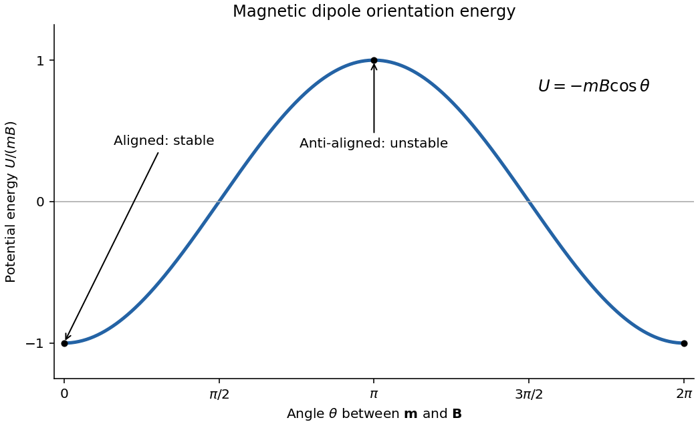

<h1 id="section-a/a4/solution">Solution</h1>

↑ **Parent:** [A4](../a4.md)

For a fixed [magnetic dipole moment](../../../../../magnetic-dipole-moment.md) in an externally imposed uniform [magnetic field](../../../../../magnetic-field-split.md), the [torque](../../../../../torque.md) is $\boldsymbol\tau=\mathbf m\times\mathbf B$. Its component in the direction of increasing $\theta$ is $-mB\sin\theta$. Since $\tau_\theta=-dU/d\theta$, integration gives

$$
\boxed{U(\theta)=-\mathbf m\cdot\mathbf B=-mB\cos\theta,}
$$

where the arbitrary additive constant has been chosen so that $U=0$ at $\theta=\pi/2$.

**[Figure 2](#section-a/a4/image-potential-energy-of-a-permanent-magnetic-dipole-in-a-uniform-magnetic-field). Potential energy of a permanent magnetic dipole in a uniform magnetic field**.

The aligned orientation $\theta=0$ has the minimum $U=-mB$ and is stable against small rotations; the anti-aligned orientation $\theta=\pi$ has the maximum $U=+mB$ and is unstable. The graph repeats every $2\pi$. Rotating quasistatically from alignment to anti-alignment requires external work $\Delta U=2mB$.

## ↑ Ancestors (14)

1. [A4](../a4.md)
2. [Section A](../../section-a.md)
3. [Paper 2](../../../paper-2-split.md)
4. [2021](../../../split.md)
5. [Past exam of the physics B course of the University of Cambridge](../../../../split.md)
6. [Physics B course of the University of Cambridge](../../../../../physics-b-course-of-the-university-of-cambridge.md)
7. [Physics course of the year 2 of the natural sciences course of the University of Cambridge](../../../../../physics-course-of-the-year-2-of-the-natural-sciences-course-of-the-university-of-cambridge.md)
8. [Year 2 of the natural sciences course of the University of Cambridge](../../../../../year-2-of-the-natural-sciences-course-of-the-university-of-cambridge.md)
9. [Year of the natural sciences course of the University of Cambridge](../../../../../year-of-the-natural-sciences-course-of-the-university-of-cambridge.md)
10. [Natural sciences course of the University of Cambridge](../../../../../natural-sciences-course-of-the-university-of-cambridge.md)
11. [Course of the University of Cambridge](../../../../../course-of-the-university-of-cambridge.md)
12. [University of Cambridge](../../../../../university-of-cambridge-split.md)
13. [List of universities](../../../../../list-of-universities.md)
14. [Codex Wiki](../../../../../split.md)
