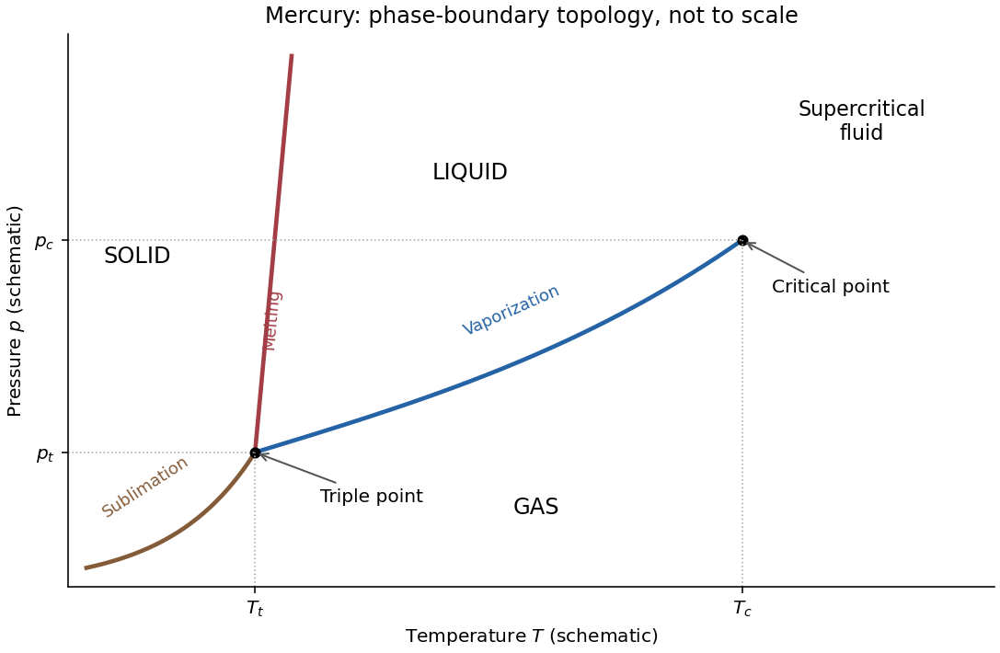

<h1 id="section-c/c8/e/solution">Solution</h1>

↑ **Parent:** [E](../e.md)

The [phase diagram](../../../../../../phase-diagram.md) must contain three coexistence curves meeting at the [triple point](../../../../../../triple-point.md): a solid-gas sublimation curve, a solid-liquid melting curve and a liquid-gas vaporization curve. The vaporization curve ends at a [liquid-gas critical point](../../../../../../liquid-gas-critical-point.md); beyond it liquid and gas are continuously connected as a [supercritical fluid](../../../../../../supercritical-fluid.md).

**[Figure 3](#section-c/c8/e/image-schematic-pressure-temperature-phase-diagram-of-mercury-with-positive-melting-line-slope). Schematic pressure-temperature phase diagram of mercury with positive melting-line slope**.

The imposed contraction on freezing means $v_{m,s}<v_{m,l}$. Melting therefore has $\Delta v_m=v_{m,l}-v_{m,s}>0$ and $L_{\rm fusion}>0$. The [Clapeyron equation](../../../../../../clausius-clapeyron-relation.md) then requires

$$
\boxed{\left(\frac{dp}{dT}\right)_{\rm melting}=\frac{L_{\rm fusion}}{T(v_{m,l}-v_{m,s})}>0.}
$$

Thus raising the [pressure](../../../../../../pressure-split.md) raises the melting [temperature](../../../../../../temperature-split.md). The liquid-gas and solid-gas slopes are also positive because the transformations into gas increase both [entropy](../../../../../../entropy-split.md) and [volume](../../../../../../volume.md). The liquid region lies between the positively sloping melting line and the vaporization curve, while gas occupies the low-pressure side. The figure is a qualitative solution sketch, not a reproduction or fit of the paper's vapor-pressure measurements; its axes are schematic.

## ↑ Ancestors (15)

1. [E](../e.md)
2. [C8](../../c8.md)
3. [Section C](../../../section-c.md)
4. [Paper 2](../../../../paper-2-split.md)
5. [2021](../../../../split.md)
6. [Past exam of the physics B course of the University of Cambridge](../../../../../split.md)
7. [Physics B course of the University of Cambridge](../../../../../../physics-b-course-of-the-university-of-cambridge.md)
8. [Physics course of the year 2 of the natural sciences course of the University of Cambridge](../../../../../../physics-course-of-the-year-2-of-the-natural-sciences-course-of-the-university-of-cambridge.md)
9. [Year 2 of the natural sciences course of the University of Cambridge](../../../../../../year-2-of-the-natural-sciences-course-of-the-university-of-cambridge.md)
10. [Year of the natural sciences course of the University of Cambridge](../../../../../../year-of-the-natural-sciences-course-of-the-university-of-cambridge.md)
11. [Natural sciences course of the University of Cambridge](../../../../../../natural-sciences-course-of-the-university-of-cambridge.md)
12. [Course of the University of Cambridge](../../../../../../course-of-the-university-of-cambridge.md)
13. [University of Cambridge](../../../../../../university-of-cambridge-split.md)
14. [List of universities](../../../../../../list-of-universities.md)
15. [Codex Wiki](../../../../../../split.md)
