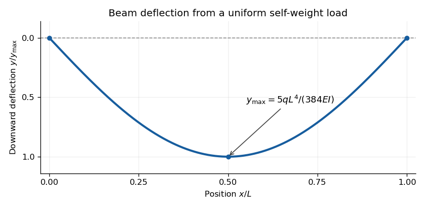

<h1 id="section-b/b7/e/solution">Solution</h1>

↑ **Parent:** [E](../e.md)

Take downward deflection $y(x)$ positive, with the support level $y=0$. The [rectangular section second moment of area](../../../../../../rectangular-section-second-moment-of-area.md) about the horizontal [neutral axis](../../../../../../neutral-axis.md) is

$$
I=a\int_{-b/2}^{b/2}z^2\,dz=\frac{ab^3}{12}.
$$

For small slopes the [curvature](../../../../../../curvature.md) relation from part (b), with the stated sign convention, is

$$
EIy''=-\frac q2x(L-x).
$$

Integrating twice gives

$$
EIy'=-\frac{qLx^2}{4}+\frac{qx^3}{6}+C_1,\qquad
EIy=-\frac{qLx^3}{12}+\frac{qx^4}{24}+C_1x+C_2.
$$

The support [boundary conditions](../../../../../../boundary-condition.md) $y(0)=y(L)=0$ give $C_2=0$ and $C_1=qL^3/24$. Hence

$$
\boxed{y(x)=\frac{q}{24EI}\left(x^4-2Lx^3+L^3x\right)
=\frac{\rho g}{2Eb^2}\left(x^4-2Lx^3+L^3x\right),\quad0\le x\le L.}
$$

This is a downward displacement; its upward component is $-y(x)$. As checks, reflection [symmetry](../../../../../../symmetry-physics.md) gives $y'(L/2)=0$, and the maximum downward deflection is

$$
\boxed{y_{\max}=y(L/2)=\frac{5qL^4}{384EI}=\frac{5\rho gL^4}{32Eb^2}.}
$$

The units are length: $\rho g/(Eb^2)$ has units $\mathrm{m^{-3}}$. The width $a$ cancels because both weight and bending resistance scale with it. The small-slope approximation requires $\rho gL^3/(Eb^2)\ll1$; [shear strain](../../../../../../shear-strain.md) is also neglected, as appropriate for a slender [elastic beam](../../../../../../elastic-beam.md).

**[Figure 1](#section-b/b7/e/image-calculated-deflection-of-a-simply-supported-beam-under-its-own-weight-downward-displacement-is-positive). Calculated deflection of a simply supported beam under its own weight; downward displacement is positive**.

## ↑ Ancestors (15)

1. [E](../e.md)
2. [B7](../../b7.md)
3. [Section B](../../../section-b.md)
4. [Paper 1](../../../../paper-1-split.md)
5. [2022](../../../../split.md)
6. [Past exam of the physics B course of the University of Cambridge](../../../../../split.md)
7. [Physics B course of the University of Cambridge](../../../../../../physics-b-course-of-the-university-of-cambridge.md)
8. [Physics course of the year 2 of the natural sciences course of the University of Cambridge](../../../../../../physics-course-of-the-year-2-of-the-natural-sciences-course-of-the-university-of-cambridge.md)
9. [Year 2 of the natural sciences course of the University of Cambridge](../../../../../../year-2-of-the-natural-sciences-course-of-the-university-of-cambridge.md)
10. [Year of the natural sciences course of the University of Cambridge](../../../../../../year-of-the-natural-sciences-course-of-the-university-of-cambridge.md)
11. [Natural sciences course of the University of Cambridge](../../../../../../natural-sciences-course-of-the-university-of-cambridge.md)
12. [Course of the University of Cambridge](../../../../../../course-of-the-university-of-cambridge.md)
13. [University of Cambridge](../../../../../../university-of-cambridge-split.md)
14. [List of universities](../../../../../../list-of-universities.md)
15. [Codex Wiki](../../../../../../split.md)
