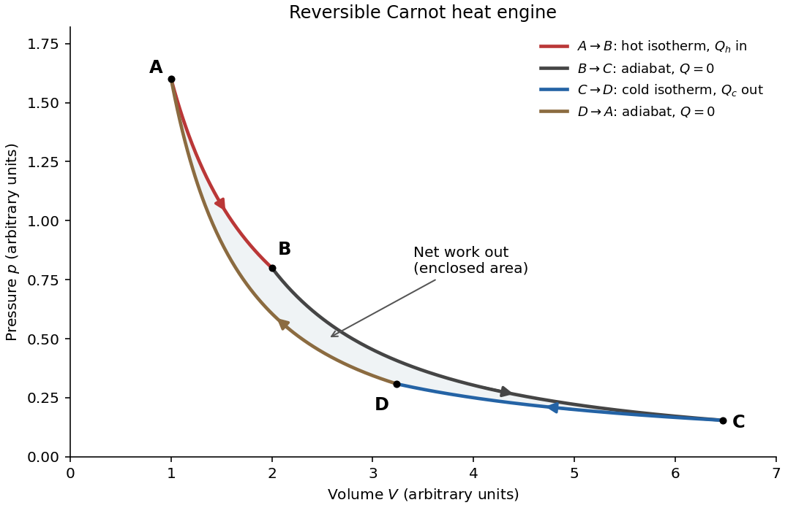

<h1 id="section-c/c8/a/solution">Solution</h1>

↑ **Parent:** [A](../a.md)

Use an [ideal gas](../../../../../../ideal-gas-split.md) to illustrate the [Carnot cycle](../../../../../../carnot-cycle.md), with hot and cold [heat baths](../../../../../../heat-bath.md) at $T_h=T_2$ and $T_c=T_1$. The four processes are all [reversible thermodynamic processes](../../../../../../reversible-thermodynamic-process.md). Lettered states below belong only to this illustration; the engine later in the question uses numbered states.

**[Figure 1](#section-c/c8/a/image-an-ideal-gas-carnot-cycle-two-isotherms-joined-by-two-reversible-adiabats). An ideal-gas Carnot cycle: two isotherms joined by two reversible adiabats**.

Starting at $A$, perform the following four stages:

- $A\to B$: [isothermal expansion](../../../../../../isothermal-expansion.md) at $T_h$. The gas absorbs [heat](../../../../../../heat-split.md) $Q_h$ from the hot [heat bath](../../../../../../heat-bath.md) and does [work](../../../../../../work.md). Its [internal energy](../../../../../../internal-energy-split.md) is unchanged, so $Q_h=W_{AB}=nRT_h\ln(V_B/V_A)$.
- $B\to C$: [reversible ideal-gas adiabat](../../../../../../reversible-ideal-gas-adiabat.md) during expansion. Insulation prevents [heat transfer](../../../../../../heat-transfer.md); [work](../../../../../../work.md) done by the gas reduces its [internal energy](../../../../../../internal-energy-split.md) and lowers its [temperature](../../../../../../temperature-split.md) from $T_h$ to $T_c$.
- $C\to D$: [isothermal compression](../../../../../../isothermal-compression.md) at $T_c$. [Work](../../../../../../work.md) done on the gas is rejected as [heat](../../../../../../heat-split.md) $Q_c$ to the cold [heat bath](../../../../../../heat-bath.md), with $Q_c=nRT_c\ln(V_C/V_D)>0$.
- $D\to A$: insulated [adiabatic compression](../../../../../../adiabatic-compression.md), performed reversibly, raises the [temperature](../../../../../../temperature-split.md) back to $T_h$ and closes the cycle.

The clockwise enclosed area in the [pressure](../../../../../../pressure-split.md)-[volume](../../../../../../volume.md) diagram is the positive net [work](../../../../../../work.md) per cycle, $W=\oint p\,dV=Q_h-Q_c$.

## ↑ Ancestors (15)

1. [A](../a.md)
2. [C8](../../c8.md)
3. [Section C](../../../section-c.md)
4. [Paper 2](../../../../paper-2-split.md)
5. [2022](../../../../split.md)
6. [Past exam of the physics B course of the University of Cambridge](../../../../../split.md)
7. [Physics B course of the University of Cambridge](../../../../../../physics-b-course-of-the-university-of-cambridge.md)
8. [Physics course of the year 2 of the natural sciences course of the University of Cambridge](../../../../../../physics-course-of-the-year-2-of-the-natural-sciences-course-of-the-university-of-cambridge.md)
9. [Year 2 of the natural sciences course of the University of Cambridge](../../../../../../year-2-of-the-natural-sciences-course-of-the-university-of-cambridge.md)
10. [Year of the natural sciences course of the University of Cambridge](../../../../../../year-of-the-natural-sciences-course-of-the-university-of-cambridge.md)
11. [Natural sciences course of the University of Cambridge](../../../../../../natural-sciences-course-of-the-university-of-cambridge.md)
12. [Course of the University of Cambridge](../../../../../../course-of-the-university-of-cambridge.md)
13. [University of Cambridge](../../../../../../university-of-cambridge-split.md)
14. [List of universities](../../../../../../list-of-universities.md)
15. [Codex Wiki](../../../../../../split.md)
