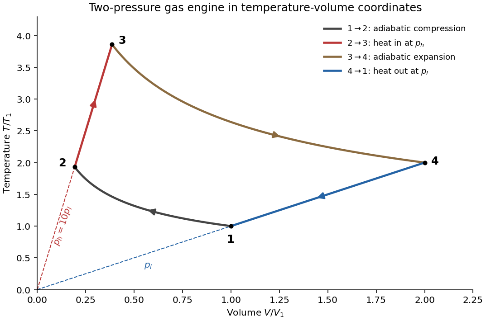

<h1 id="section-c/c8/d/solution">Solution</h1>

↑ **Parent:** [D](../d.md)

For the numbered engine, denote the low and high [pressures](../../../../../../pressure-split.md) by $p_1=p_4=p_l$ and $p_2=p_3=p_h$. Let $R_g$ denote the [molar gas constant](../../../../../../molar-gas-constant.md). The [ideal gas law](../../../../../../ideal-gas-law.md) makes the constant-pressure branches straight rays in a [temperature](../../../../../../temperature-split.md)-[volume](../../../../../../volume.md) diagram:

$$
T=\frac{p_h}{nR_g}V\quad(2\to3),\qquad
T=\frac{p_l}{nR_g}V\quad(4\to1).
$$

The high-pressure ray is steeper. For a constant [heat capacity ratio](../../../../../../heat-capacity-ratio.md) $\gamma$, each [reversible ideal-gas adiabat](../../../../../../reversible-ideal-gas-adiabat.md) obeys

$$
TV^{\gamma-1}=\text{constant}.
$$

Consequently $1\to2$ curves upward and left during compression; $2\to3$ goes upward and right along the steeper ray; $3\to4$ curves downward and right during expansion; and $4\to1$ goes downward and left along the shallower ray.

**[Figure 2](#section-c/c8/d/image-temperature-volume-solution-sketch-for-the-two-pressure-gas-engine-cycle). Temperature-volume solution sketch for the two-pressure gas-engine cycle**.

The plot is an original calculation for $\gamma=7/5$, $p_h/p_l=10$ and $V_3/V_2=2$; its state directions follow the original paper. The dashed extensions identify the two constant-pressure rays, not additional stages of the cycle.

## ↑ Ancestors (15)

1. [D](../d.md)
2. [C8](../../c8.md)
3. [Section C](../../../section-c.md)
4. [Paper 2](../../../../paper-2-split.md)
5. [2022](../../../../split.md)
6. [Past exam of the physics B course of the University of Cambridge](../../../../../split.md)
7. [Physics B course of the University of Cambridge](../../../../../../physics-b-course-of-the-university-of-cambridge.md)
8. [Physics course of the year 2 of the natural sciences course of the University of Cambridge](../../../../../../physics-course-of-the-year-2-of-the-natural-sciences-course-of-the-university-of-cambridge.md)
9. [Year 2 of the natural sciences course of the University of Cambridge](../../../../../../year-2-of-the-natural-sciences-course-of-the-university-of-cambridge.md)
10. [Year of the natural sciences course of the University of Cambridge](../../../../../../year-of-the-natural-sciences-course-of-the-university-of-cambridge.md)
11. [Natural sciences course of the University of Cambridge](../../../../../../natural-sciences-course-of-the-university-of-cambridge.md)
12. [Course of the University of Cambridge](../../../../../../course-of-the-university-of-cambridge.md)
13. [University of Cambridge](../../../../../../university-of-cambridge-split.md)
14. [List of universities](../../../../../../list-of-universities.md)
15. [Codex Wiki](../../../../../../split.md)
