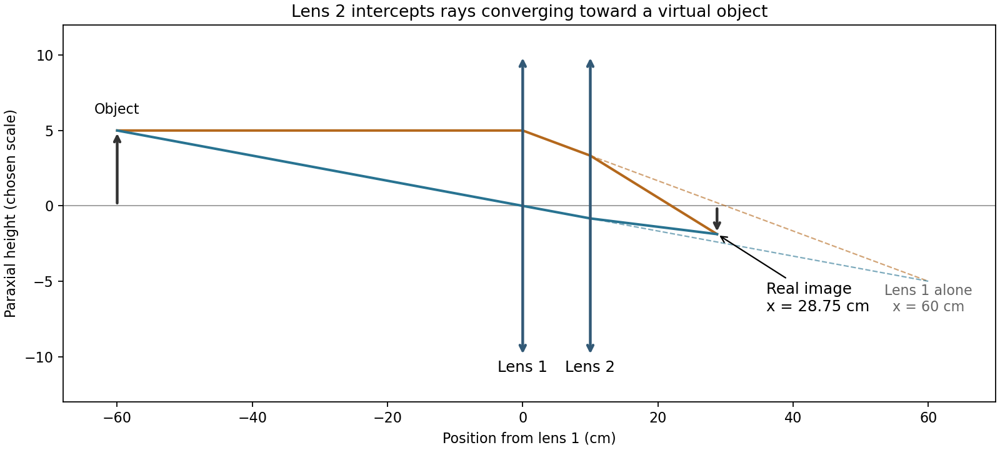
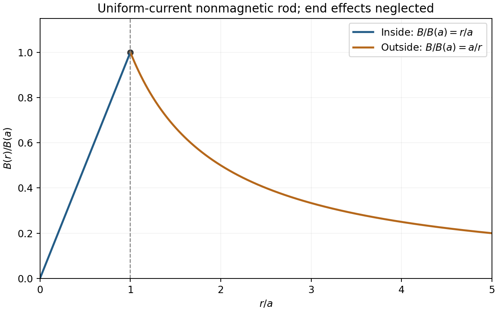
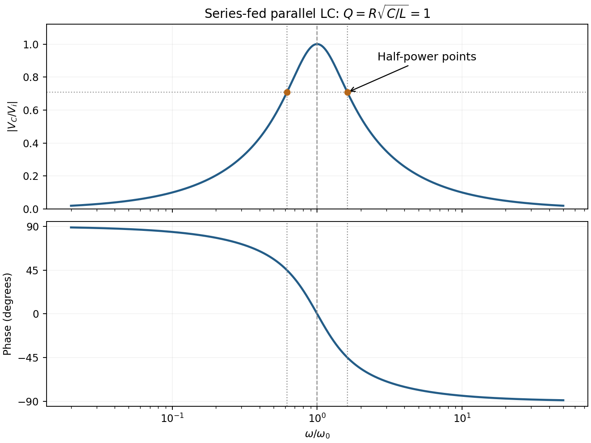
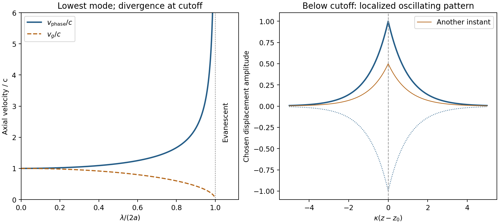
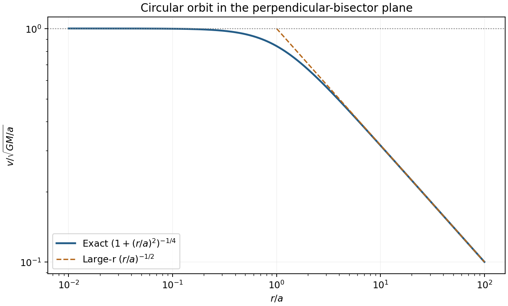

# Paper 1

↑ **Parent:** [2010](../2010.md)

Original paper: [Public original PDF, physical pages 1–9; cover page 1, intentional blank page 2, questions on pages 3–9](https://www.whatdotheyknow.com/request/part_ia_nst_physics_exam_papers/response/2118876/attach/3/FOI%202022%20597%20McGill%20materials.pdf?cookie_passthrough=1#page=1).

**Table of contents**

- [Section A](#section-a)
  - [1](#section-a/1)
    - [Solution](#section-a/1/solution)
  - [2](#section-a/2)
    - [Solution](#section-a/2/solution)
  - [3](#section-a/3)
    - [Solution](#section-a/3/solution)
  - [4](#section-a/4)
    - [Solution](#section-a/4/solution)
  - [5](#section-a/5)
    - [Solution](#section-a/5/solution)
  - [6](#section-a/6)
    - [Solution](#section-a/6/solution)
- [Section B](#section-b)
  - [B7](#section-b/b7)
    - [Solution](#section-b/b7/solution)
  - [B8](#section-b/b8)
    - [Solution](#section-b/b8/solution)
  - [B9](#section-b/b9)
    - [Solution](#section-b/b9/solution)
- [Section C](#section-c)
  - [C10](#section-c/c10)
    - [Solution](#section-c/c10/solution)
  - [C11](#section-c/c11)
    - [Solution](#section-c/c11/solution)
- [Section D](#section-d)
  - [D12](#section-d/d12)
    - [Solution](#section-d/d12/solution)
  - [D13](#section-d/d13)
    - [Solution](#section-d/d13/solution)
- [Section E](#section-e)
  - [E14](#section-e/e14)
    - [Solution](#section-e/e14/solution)
  - [E15](#section-e/e15)
    - [Solution](#section-e/e15/solution)

## Section A

↑ **Parent:** [Paper 1](paper-1.md)

<h3 id="section-a/1">1</h3>

↑ **Parent:** [Section A](#section-a)

<h4 id="section-a/1/solution">Solution</h4>

↑ **Parent:** [1](#section-a/1)

For [two equal lenses with a virtual intermediate object](../../geometrical-optics.md#two-equal-lenses-with-a-virtual-intermediate-object), use positive distances for real objects on a lens's incident side and [real images](../../optics.md#real-image) on its outgoing side. The first lens gives $1/v_1=1/f-1/u_1=1/30-1/60$, hence $v_1=60\,\mathrm{cm}$. At the second lens these rays are already converging toward a point $50\,\mathrm{cm}$ to its right: its object distance is therefore $u_2=-50\,\mathrm{cm}$.

$$
\frac1{v_2}=\frac1{30}-\frac1{-50}=\frac4{75}\,\mathrm{cm^{-1}},\qquad
\boxed{v_2=18.75\,\mathrm{cm}\text{ to the right of lens 2}.}
$$

Thus **the final image is real**, $28.75\,\mathrm{cm}$ to the right of lens 1. Its [transverse magnification](../../optics.md#transverse-magnification) is $(-60/60)(-18.75/[-50])=-3/8$: it is inverted. The intermediate focus is not a real object placed before lens 2.

**[Figure 1](#section-a/1/image-two-converging-lenses-and-a-real-image). Two converging lenses and a real image**. Original paraxial ray construction with an arbitrary small object height. Two rays meet at the calculated inverted final image; dashed continuations show where lens 1 alone would have focused them.

<h3 id="section-a/2">2</h3>

↑ **Parent:** [Section A](#section-a)

<h4 id="section-a/2/solution">Solution</h4>

↑ **Parent:** [2](#section-a/2)

For [prism sweep under different rotation conventions](../../euclidean-geometry.md#prism-sweep-under-different-rotation-conventions), let the apex angle be $A=60^\circ$. Snell's law at both faces gives

$$
r_1=\arcsin(\sin i/1.5),\qquad r_2=A-r_1,\qquad e=\arcsin(1.5\sin r_2),\qquad D=i+e-A.
$$

Here $e$ is measured from the second face's outward normal, whereas $D$ is the deviation from the incident direction. The two settings give

$$
\begin{array}{c|cc}
i&e&D\\\hline
50^\circ&47.2093^\circ&37.2093^\circ\\
60^\circ&38.8768^\circ&38.8768^\circ
\end{array}
$$

For a fixed laser and rotating prism, the outgoing beam therefore sweeps

$$
\boxed{|\Delta D|=1.6675^\circ\approx1.67^\circ.}
$$

If instead the prism stays fixed and the input beam is steered, its exit-face normal stays fixed and the answer is **$|\Delta e|=8.3325^\circ$**. The source does not explicitly say which component moves, so the laboratory-angle convention matters. Both settings transmit through the second face; total internal reflection does not occur.

<h3 id="section-a/3">3</h3>

↑ **Parent:** [Section A](#section-a)

<h4 id="section-a/3/solution">Solution</h4>

↑ **Parent:** [3](#section-a/3)

Apply [Ampère's law](../../maxwell-equations.md#ampere-s-circuital-law) on a concentric circle. Uniform [current density](../../electric-charge.md#current-density) is $J=I/(\pi a^2)$, so the enclosed current is $Ir^2/a^2$ inside and $I$ outside. With permeability $\mu_0$,

$$
\boxed{B(r)=\begin{cases}\mu_0Ir/(2\pi a^2),&0\le r\le a,\\\mu_0I/(2\pi r),&r\ge a.\end{cases}}
$$

The field circulates azimuthally by the [right-hand rule](../../electromagnetism.md#right-hand-rule). Its magnitude rises linearly from zero, is continuous and maximal at the surface, then falls as $1/r$. End effects are neglected.

**[Figure 2](#section-a/3/image-magnetic-field-of-a-uniform-current-rod). Magnetic field of a uniform-current rod**. Original dimensionless Ampere-law field curve: B divided by its surface value versus radius divided by rod radius, with the surface and the change of radial slope marked.

<h3 id="section-a/4">4</h3>

↑ **Parent:** [Section A](#section-a)

<h4 id="section-a/4/solution">Solution</h4>

↑ **Parent:** [4](#section-a/4)

In SI base dimensions,

$$
[e]=IT,\quad[\epsilon_0]=I^2T^4M^{-1}L^{-3},\quad[m]=M,\quad[h]=ML^2T^{-1}.
$$

Equating current, time, [mass](../../classical-mechanics.md#mass) and [length](../../physics.md#length) powers respectively yields

$$
\alpha+2\beta=0,\quad\alpha+4\beta-\delta=0,\quad-\beta+\gamma+\delta=0,\quad-3\beta+2\delta=1.
$$

Thus

$$
\boxed{\alpha=-2,\quad\beta=1,\quad\gamma=-1,\quad\delta=2,\qquad a_0\propto\frac{\epsilon_0h^2}{me^2}.}
$$

[Dimensional analysis](../../mathematical-physics.md#dimensional-analysis) cannot determine the dimensionless proportionality constant.

<h3 id="section-a/5">5</h3>

↑ **Parent:** [Section A](#section-a)

<h4 id="section-a/5/solution">Solution</h4>

↑ **Parent:** [5](#section-a/5)

For a [proper lifetime inferred from a delayed decay flash](../../special-relativity.md#proper-lifetime-inferred-from-a-delayed-decay-flash), the measured interval ends when the light returns to the detector, not when the [muon](../../standard-model.md#muon) decays. Put passage at $(t,x)=(0,0)$ in the detector frame. If decay occurs at $t_d$, its distance is $vt_d$, and the backwards [photon](../../quantum-mechanics.md#photon) takes another $vt_d/c$ to arrive. Therefore

$$
t_{\rm record}=t_d(1+v/c),\qquad t_d=\frac{10\,\mathrm{ns}}{1+1/2}=\frac{20}{3}\,\mathrm{ns}.
$$

The [muon](../../standard-model.md#muon)'s proper elapsed time is

$$
\boxed{\Delta\tau=t_d\sqrt{1-v^2/c^2}
=10\,\mathrm{ns}\sqrt{\frac{1-v/c}{1+v/c}}
=\frac{10}{\sqrt3}\,\mathrm{ns}\approx5.77\,\mathrm{ns}.}
$$

Applying [time dilation](../../special-relativity.md#time-dilation) directly to the 10 ns reception interval would transform the wrong pair of events.

<h3 id="section-a/6">6</h3>

↑ **Parent:** [Section A](#section-a)

<h4 id="section-a/6/solution">Solution</h4>

↑ **Parent:** [6](#section-a/6)

For [background-subtracted radiative temperature uncertainty](../../wave-equation.md#background-subtracted-radiative-temperature-uncertainty), assume the two quoted precisions are independent [standard uncertainties](../../physics.md#standard-uncertainty), and treat the radiative proportionality factor as known. Write $P_B=B$ and $P_T=10B$. Then $P_S=9B$, while both absolute input uncertainties equal $0.5B$. Consequently

$$
\sigma_S=\sqrt{(0.05\times10B)^2+(0.50B)^2}=\frac{B}{\sqrt2},\qquad
\frac{\sigma_T}{T}=\frac14\frac{\sigma_S}{P_S}.
$$

Thus **the [temperature](../../temperature.md) precision is about $1.96\%$, or $2\%$**. Subtraction amplifies fractional uncertainty even though $P_T$ itself is precise.

Independence is a measurement assumption, not a consequence of the two percentages. For [correlation](../../variance.md#pearson-correlation-coefficient) coefficient $r_c$, the result is $\sigma_T/T=\sqrt{2(1-r_c)}/72$. If the percentages are strict error bounds combined pessimistically, the corresponding bound is $2.78\%$. Unknown calibration [correlations](../../variance.md#pearson-correlation-coefficient) cannot be inferred from the source.

## Section B

↑ **Parent:** [Paper 1](paper-1.md)

<h3 id="section-b/b7">B7</h3>

↑ **Parent:** [Section B](#section-b)

<h4 id="section-b/b7/solution">Solution</h4>

↑ **Parent:** [B7](#section-b/b7)

For the [edge-hinged cube with a central spherical cavity](../../mathematical-physics.md#edge-hinged-cube-with-a-central-spherical-cavity), use the parallel-axis theorem: for a parallel axis at perpendicular distance $d$ from the centre-of-mass axis, $I=I_C+Md^2$. Let $M=\rho a^3$. The centre lies $d=a/\sqrt2$ from the edge hinge, so

$$
\boxed{I_h=Ma^2/6+M(a/\sqrt2)^2=\frac23Ma^2=\frac23\rho a^5.}
$$

At equilibrium the centre is vertically below the hinge. Its gravitational [torque](../../momentum.md#torque) at angular displacement $\theta$ is $-Mgd\sin\theta$. Therefore the small-angle equation is $I_h\ddot\theta+Mgd\theta=0$, with

$$
\boxed{\omega^2=\frac{Mgd}{I_h}=\frac{3g}{2\sqrt2a}.}
$$

The removed [sphere](../../euclidean-geometry.md#sphere) has [mass](../../classical-mechanics.md#mass) $M_s=\pi M/6$ and the same centre. Its hinge inertia is

$$
I_{s,h}=M_s\left[\frac25(a/2)^2+(a/\sqrt2)^2\right]=\frac35M_sa^2=\frac\pi{10}Ma^2.
$$

[Superposition](../../vector-space.md#superposition-principle) leaves the centre at the same location but changes both inertia and weight:

$$
\boxed{I_{\rm hollow}=Ma^2\left(\frac23-\frac\pi{10}\right),\qquad
\Omega=\omega\sqrt{\frac{1-\pi/6}{1-3\pi/20}}\approx0.9492\omega.}
$$

The [frequency](../../wave.md#frequency) decreases: the removed central material contributes less hinge inertia per unit [mass](../../classical-mechanics.md#mass) than the original cube average.

<h3 id="section-b/b8">B8</h3>

↑ **Parent:** [Section B](#section-b)

<h4 id="section-b/b8/solution">Solution</h4>

↑ **Parent:** [B8](#section-b/b8)

Integrating coaxial cylindrical shells gives

$$
I=\int_0^a r^2\frac{2m r}{a^2}\,dr=\frac12ma^2.
$$

[Rolling without slipping](../../rigid-body-dynamics.md#rolling-without-slipping) has spin [speed](../../classical-mechanics.md#speed) $u/a$, so **$K=mu^2/2+Iu^2/(2a^2)=3mu^2/4$**.

For the [rolling-cylinder loop contact threshold](../../rigid-body-dynamics.md#rolling-cylinder-loop-contact-threshold), set $\ell=R-a$, the [radius](../../topology.md#radius) of the centre's circular path, and let $\theta$ run from the loop bottom. The centre starts $h$ above its lowest centre position. Its height gain from the bottom is $\ell(1-\cos\theta)$. [Energy](../../energy.md) conservation gives

$$
u^2=\frac43g[h-\ell(1-\cos\theta)].
$$

At the top, contact requires $N=m(u_t^2/\ell-g)\ge0$, hence $u_t^2\ge g\ell$. Inserting the [energy](../../energy.md) relation proves the limiting condition

$$
\boxed{h\ge\frac{11}{4}\ell=\frac{11(R-a)}4.}
$$

The same condition keeps $N\ge0$ elsewhere on the circle, since

$$
\frac{N}{mg}=\frac43(h/\ell-1)+\frac73\cos\theta
$$

is smallest at the top.

For the centre's [acceleration](../../classical-mechanics.md#acceleration), the inward normal component is $u^2/\ell$ and the tangential component is $-(2g/3)\sin\theta$. If $A=h/\ell-1\ge7/4$ and $x=\cos\theta$,

$$
|\mathbf a_C|^2=\frac{4g^2}{9}[4A^2+8Ax+3x^2+1].
$$

This convex quadratic has its largest endpoint value at $x=1$. **The maximum on the circular loop is at the bottom, directed vertically upward.** For the limiting release height,

$$
\boxed{a_{C,\max}=u_b^2/\ell=\frac{11g}{3}\approx36.0\,\mathrm{m\,s^{-2}}.}
$$

The approach track's curvature is unspecified, so a global bound for an arbitrary approach shape cannot be proved from the sketch alone; the result above concerns the specified circular part and the usual smooth approach interpretation.

The [finite-friction qualification of a marginal rolling loop](../../rigid-body-dynamics.md#finite-friction-qualification-of-a-marginal-rolling-loop) also matters: the contact threshold presumes the stated no-slip idealization. At equality, near the top, required tangential [friction](../../newtonian-mechanics.md#friction) vanishes linearly with angular distance from the top but $N$ vanishes quadratically. Thus any finite coefficient of [static friction](../../force.md#static-friction) requires a release height above this limiting bound to maintain rolling everywhere; no coefficient is provided. This does not change the requested ideal contact criterion.

<h3 id="section-b/b9">B9</h3>

↑ **Parent:** [Section B](#section-b)

<h4 id="section-b/b9/solution">Solution</h4>

↑ **Parent:** [B9](#section-b/b9)

For [collinear inelastic capture followed by two photons](../../special-relativity.md#collinear-inelastic-capture-followed-by-two-photons), each particle has $\mathbf p=\gamma m\mathbf u$ and $E=\gamma mc^2$, with $\gamma=(1-u^2/c^2)^{-1/2}$. An isolated collision conserves the vector sum of [momentum](../../momentum.md) and total [energy](../../energy.md), including [rest energy](../../special-relativity.md#rest-energy), internal excitation and radiation. It need not conserve the sum of individual [rest masses](../../special-relativity.md#invariant-mass). At low [speed](../../classical-mechanics.md#speed),

$$
E=mc^2+\tfrac12mu^2+O(mu^4/c^2),
$$

recovering the classical [kinetic energy](../../energy.md#kinetic-energy) after subtracting $mc^2$.

Here the incoming [Lorentz factors](../../special-relativity.md#lorentz-factor) are $5/3$ and $5/4$, so

$$
E_1=E_2=5mc^2,\qquad p_{1x}=4mc,\quad p_{2x}=-3mc.
$$

The composite therefore has

$$
\boxed{v=\frac{pc^2}{E}=\frac c{10}\text{ in the }+x\text{ direction},\qquad
M=\frac{\sqrt{E^2-p^2c^2}}{c^2}=\sqrt{99}\,m=3\sqrt{11}\,m.}
$$

Its [rest mass](../../special-relativity.md#invariant-mass) exceeds $7m$ because relative [kinetic energy](../../energy.md#kinetic-energy) has become internal [rest energy](../../special-relativity.md#rest-energy).

For the subsequent collinear [photon](../../quantum-mechanics.md#photon) pair, $E_++E_-=10mc^2$ and $(E_+-E_-)/c=mc$. Thus $E_+=11mc^2/2$, $E_-=9mc^2/2$, and

$$
\boxed{\nu_+/\nu_-=11/9.}
$$

The positive-$x$ [photon](../../quantum-mechanics.md#photon) is the higher-frequency one.

## Section C

↑ **Parent:** [Paper 1](paper-1.md)

<h3 id="section-c/c10">C10</h3>

↑ **Parent:** [Section C](#section-c)

<h4 id="section-c/c10/solution">Solution</h4>

↑ **Parent:** [C10](#section-c/c10)

In the [uniform-Earth chord oscillator](../../mathematical-physics.md#uniform-earth-chord-oscillator), neglect the [mass](../../classical-mechanics.md#mass) removed by the narrow tunnel and any rotation of the [Earth](../../planetary-science.md#earth). Inside a uniform [sphere](../../euclidean-geometry.md#sphere), the [shell theorem](../../mathematical-physics.md#spherical-shell-theorem) gives $\mathbf F=-(4\pi G\rho m/3)\mathbf r$. On the constrained chord $\mathbf r=(d,y)$, its along-tunnel component is

$$
\boxed{F_y=-m\omega_0^2y,\qquad\omega_0^2=\frac{4\pi G\rho}{3}.}
$$

The transverse component is balanced by the tunnel constraint. With release from $y_s=\sqrt{R^2-d^2}$ at rest,

$$
\ddot y+\omega_0^2y=0,\qquad \boxed{y(t)=y_s\cos\omega_0t.}
$$

The far end is $-y_s$, so **$t_{\rm transit}=\pi/\omega_0\approx2530\,\mathrm s=42.2\,\mathrm{min}$**, independent of chord offset in this ideal model. Here $\rho=5515\,\mathrm{kg\,m^{-3}}$ and $G=6.67430\times10^{-11}\,\mathrm{m^3\,kg^{-1}\,s^{-2}}$ give $\omega_0=1.24171\times10^{-3}\,\mathrm{s^{-1}}$.

With linear drag, $\ddot y+(b/m)\dot y+\omega_0^2y=0$. Inserting a [complex exponential](../../calculus.md#complex-exponential-function) $e^{-(\gamma+i\omega)t}$ gives

$$
\gamma^2-\omega^2-\frac bm\gamma+\omega_0^2+i\omega(2\gamma-b/m)=0,
$$

so in the [underdamped](../../wave-equation.md#underdamping) regime

$$
\boxed{\gamma=\frac b{2m},\qquad\omega=\sqrt{\omega_0^2-\gamma^2}.}
$$

Real physical solutions combine conjugate modes. Release from rest specifically gives $y=y_se^{-\gamma t}[\cos\omega t+(\gamma/\omega)\sin\omega t]$; a lone exponential with prefactor $y_s$ does not impose that initial [velocity](../../classical-mechanics.md#velocity).

The [critical gravity-tunnel settling time](../../mathematical-physics.md#critical-gravity-tunnel-settling-time) follows from critical damping, the fastest non-oscillatory release:

$$
\boxed{b_c=2m\omega_0,\qquad b_c/m=2.48342\times10^{-3}\,\mathrm{s^{-1}},\qquad
y(t)=y_s(1+\omega_0t)e^{-\omega_0t}.}
$$

Interpret the 1% tolerance relative to the initial displacement from equilibrium. With $s=\omega_0t$, $(1+s)e^{-s}=0.01$ has $s=6.63835$. Hence

$$
\boxed{t_{1\%}=6.63835/\omega_0\approx5346\,\mathrm s=89.1\,\mathrm{min}.}
$$

The equilibrium is reached only asymptotically; using a pure $e^{-\omega_0t}$ would miss the critical-damping polynomial factor and underestimate this time.

<h3 id="section-c/c11">C11</h3>

↑ **Parent:** [Section C](#section-c)

<h4 id="section-c/c11/solution">Solution</h4>

↑ **Parent:** [C11](#section-c/c11)

For the [series-fed parallel LC voltage response](../../electrical-circuit.md#series-fed-parallel-lc-voltage-response), use [phasors](../../wave.md#phasor) with time dependence $e^{i\omega t}$. The parallel branch has impedance $iX$, where $X=\omega L/(1-\omega^2LC)$. Therefore

$$
\boxed{Z=R+iX,\quad|Z|=\sqrt{R^2+X^2},\quad\arg Z=\operatorname{atan2}(X,R).}
$$

At the ideal parallel [resonance](../../dynamical-systems.md#resonance) $\omega_0=1/\sqrt{LC}$ its input impedance diverges. The input-current phase changes sign on crossing this pole; expressions there are interpreted by limits.

The [capacitor](../../electromagnetism.md#capacitor) [voltage](../../random-walk.md#voltage) equals the parallel-branch [voltage](../../random-walk.md#voltage). Define $q=R(1-\omega^2LC)/(\omega L)$. Then

$$
\boxed{H(\omega)=\frac{V_C}{V_i}=\frac{iX}{R+iX}=\frac1{1-iq},\quad
|H|=(1+q^2)^{-1/2},\quad\arg H=\arctan q.}
$$

At low [frequency](../../wave.md#frequency) $H\sim i\omega L/R$; at high [frequency](../../wave.md#frequency) $H\sim-i/(\omega RC)$; at [resonance](../../dynamical-systems.md#resonance) $H=1$. Thus it is a **band-pass [voltage](../../random-walk.md#voltage) filter or [resonant frequency](../../dynamical-systems.md#resonant-frequency) selector**. Its phase decreases continuously from $+\pi/2$ through zero to $-\pi/2$. Half-power points satisfy $|q|=1$ and

$$
\omega_\pm=\frac{\sqrt{(RC)^{-2}+4/(LC)}\pm(RC)^{-1}}2,\qquad
\omega_+-\omega_-=\frac1{RC}.
$$

**[Figure 3](#section-c/c11/image-voltage-response-of-a-parallel-resonator). Voltage response of a parallel resonator**. Original transfer amplitude and phase for the stated series-fed parallel LC circuit. The example has R sqrt(C/L)=1; resonance and both half-power points are marked, with asymptotic phases shown.

For the supplied component values and $\omega=2\pi(50)\,\mathrm{s^{-1}}$, $X=421.745\,\Omega$ and $V_{C,\rm pk}=99.3046\,\mathrm V$. The element peak currents are

$$
\boxed{I_{R,\rm pk}=\frac{100}{\sqrt{50^2+421.745^2}}=0.23546\,\mathrm A,\quad
I_{L,\rm pk}=\frac{99.3046}{\omega(0.150)}=2.10731\,\mathrm A,\quad
I_{C,\rm pk}=\omega(60\times10^{-6})(99.3046)=1.87185\,\mathrm A.}
$$

[Inductor](../../electromagnetism.md#inductor) and [capacitor](../../electromagnetism.md#capacitor) currents are opposite [phasors](../../wave.md#phasor); their magnitudes subtract here rather than add. The [resistor](../../electric-charge.md#resistor) carries the input current, with

$$
\boxed{I_{\rm rms}=I_{R,\rm pk}/\sqrt2=0.16650\,\mathrm A.}
$$

These results assume ideal components and sinusoidal [steady state](../../dynamical-systems.md#steady-state).

## Section D

↑ **Parent:** [Paper 1](paper-1.md)

<h3 id="section-d/d12">D12</h3>

↑ **Parent:** [Section D](#section-d)

<h4 id="section-d/d12/solution">Solution</h4>

↑ **Parent:** [D12](#section-d/d12)

The displacement is along $x$, transverse to propagation in the membrane's $yz$ plane. Write $A=|A|e^{i\phi}$; then $d=|A|\cos(\omega t-k_yy-k_zz+\phi)$. Here $|A|$ is the displacement [amplitude](../../wave.md#wave-amplitude), $\phi$ the initial phase, $\omega$ the [angular frequency](../../lagrangian-mechanics.md#angular-frequency) and $\mathbf k$ the [wavevector](../../elasticity-physics.md#wavevector) normal to constant-phase lines. Its magnitude is $2\pi/\lambda$, and its direction specifies phase propagation for the chosen sign convention.

For [equal-phase two-wave membrane modes](../../elasticity-physics.md#equal-phase-two-wave-membrane-modes), two equal [complex amplitudes](../../wave.md#complex-amplitude) with opposite $k_y$ sum to

$$
d=2\operatorname{Re}\{A\cos(k_yy)e^{i(\omega t-k_zz)}\}.
$$

The edge condition gives $\cos(k_ya/2)=0$, hence $k_y=(2j+1)\pi/a$, $j=0,1,\ldots$, for this even-in-$y$ family. Opposite relative phase gives the [sine](../../geometry-and-topology.md#sine) family; together they yield all Dirichlet transverse modes $k_y=n\pi/a$, $n\ge1$. For the equal-phase family,

$$
\boxed{k_z=\sqrt{(\omega/c)^2-[(2j+1)\pi/a]^2}.}
$$

The lowest mode has $k_y=\pi/a$. Therefore

$$
\boxed{v_z=\frac\omega{k_z}=\frac c{\sqrt{1-(\lambda/2a)^2}},\qquad0<\lambda<2a.}
$$

It approaches $c$ for $\lambda\to0$ and diverges as $\lambda\to2a^-$; there is no real travelling-mode $k_z$ beyond the cutoff. This is an axial [phase velocity](../../dispersion-relation.md#phase-velocity), not the [group velocity](../../dispersion-relation.md#group-velocity): $v_g=c\sqrt{1-(\lambda/2a)^2}<c$. Here $c$ denotes the membrane wave [speed](../../classical-mechanics.md#speed), not the [speed of light](../../special-relativity.md#speed-of-light).

**[Figure 4](#section-d/d12/image-membrane-cutoff-and-evanescent-response). Membrane cutoff and evanescent response**. Original lowest-mode phase-velocity curve, with group velocity distinguished, and a schematic below-cutoff displacement envelope of exponential form. All lengths and amplitudes are dimensionless choices; no source apparatus drawing is copied.

For the [evanescent membrane response below cutoff](../../elasticity-physics.md#evanescent-membrane-response-below-cutoff), below $f_c=c/(2a)$, put $k_z=-i\kappa$ for decay along positive $z$, with $\kappa=\sqrt{(\pi/a)^2-(\omega/c)^2}$. A localized central drive creates an evanescent, sinusoidally oscillating deformation decaying away in both axial directions. Far enough from the drive the leading profile is proportional to $\cos(\pi y/a)e^{-\kappa|z-z_0|}\cos(\omega t+\phi_0)$. Higher evanescent modes contribute near the point source. The pattern has no steadily advancing axial phase front or far-field propagating wave; decreasing [frequency](../../wave.md#frequency) increases its spatial localization.

<h3 id="section-d/d13">D13</h3>

↑ **Parent:** [Section D](#section-d)

<h4 id="section-d/d13/solution">Solution</h4>

↑ **Parent:** [D13](#section-d/d13)

Direct differentiation gives $\psi''/\psi=x^2/a^4-1/a^2$. Inserting this into the [Schrödinger equation](../../mathematical-physics.md#schrodinger-equation) and separately matching the $x^2$ and constant terms yields

$$
\boxed{a^4=\frac{\hbar^2}{2mV_0},\qquad a^2=\frac{\hbar}{\sqrt{2mV_0}},\qquad E=\frac{\hbar^2}{2ma^2}.}
$$

For $V_0=m\omega_0^2/2$, **$a^2=\hbar/(m\omega_0)$ and $E=\hbar\omega_0/2$**. The [normalizable](../../wave-function.md#normalizable-wavefunction) [Gaussian](../../probability-distribution.md#normal-distribution) has no [nodes](../../dynamical-systems.md#node-dynamical-systems), as expected for the nondegenerate one-dimensional [ground state](../../quantum-mechanics.md#ground-state) of this confining potential.

The normalization integral is $|C|^2a\sqrt\pi=1$. Choose its irrelevant [global phase](../../quantum-system.md#global-phase) so that

$$
\boxed{C=(\pi a^2)^{-1/4},\qquad dP=\frac1{\sqrt\pi a}e^{-x^2/a^2}\,dx.}
$$

For the [oscillator ground-state density in a comparison wavelength](../../quantum-harmonic-oscillator.md#oscillator-ground-state-density-in-a-comparison-wavelength), choose a free comparison particle with the same total [energy](../../energy.md). It has $p=\sqrt{2mE}=\hbar/a$, hence comparison [wavelength](../../wave-equation.md#wavelength) $\lambda=h/p=2\pi a$. Consequently

$$
\boxed{dP=\frac{2\sqrt\pi}{\lambda}\exp\!\left(-\frac{4\pi^2x^2}{\lambda^2}\right)dx.}
$$

The bound density is localized on scale $a=\lambda/(2\pi)$, with [standard deviation](../../variance.md#standard-deviation) $\lambda/(2\pi\sqrt2)$, rather than being spatially uniform like the density of a single free [plane wave](../../wave-function.md#plane-wave). The comparison does not assign constant free-particle [momentum](../../momentum.md) to the [bound state](../../quantum-system.md#bound-state); its total [energy](../../energy.md) also includes [potential energy](../../energy.md#potential-energy).

## Section E

↑ **Parent:** [Paper 1](paper-1.md)

<h3 id="section-e/e14">E14</h3>

↑ **Parent:** [Section E](#section-e)

<h4 id="section-e/e14/solution">Solution</h4>

↑ **Parent:** [E14](#section-e/e14)

The closed surface integral sums the outward electric [flux](../../mathematical-physics.md#flux): $\mathbf E$ is the [electric field](../../electric-field.md), $d\mathbf S$ its outward vector [area](../../differential-geometry.md#surface-area), $Q$ the total enclosed charge and $\epsilon_0$ the [vacuum](../../physics.md#vacuum) permittivity. [Gauss's law](../../maxwell-equations.md#gauss-s-law) relates that [flux](../../mathematical-physics.md#flux) to enclosed charge for any closed surface. High [symmetry](../../physics.md#symmetry-physics) can make the field's magnitude constant on a suitable [Gaussian surface](../../maxwell-equations.md#gaussian-surface) and fix its direction; without [symmetry](../../physics.md#symmetry-physics), [flux](../../mathematical-physics.md#flux) alone does not determine the local field.

For an isolated conducting [sphere](../../euclidean-geometry.md#sphere), charges reside at its surface and the exterior field is radial. Thus

$$
\boxed{\mathbf E(r)=\frac{Q}{4\pi\epsilon_0r^2}\widehat{\mathbf r}\quad(r>a),\qquad
V(a)=\int_a^\infty E(r)\,dr=\frac{Q}{4\pi\epsilon_0a},\qquad C=4\pi\epsilon_0a.}
$$

The conductor has zero interior field. Integrating exterior field [energy](../../energy.md) gives

$$
U=\int_a^\infty\frac12\epsilon_0\left(\frac{Q}{4\pi\epsilon_0r^2}\right)^2 4\pi r^2dr
=\boxed{\frac{Q^2}{8\pi\epsilon_0a}}.
$$

Let the initial charge per drop be $q=4\pi\epsilon_0aV_1$. After disconnecting the charging supply, charge is conserved. [Volume](../../geometry-and-topology.md#volume) conservation gives final [radius](../../topology.md#radius) $A=2^{1/3}a$, total charge $2q$ and

$$
\boxed{V_f=\frac{2q}{4\pi\epsilon_0A}=2^{2/3}V_1.}
$$

Initial mutual [energy](../../energy.md) is negligible at the stipulated large separation. Hence

$$
U_i=\frac{q^2}{4\pi\epsilon_0a},\qquad
U_f=\frac{4q^2}{8\pi\epsilon_0\,2^{1/3}a}=2^{2/3}U_i,\qquad
\boxed{U_i/U_f=2^{-2/3}.}
$$

**The [electrostatic energy increase on equal-drop coalescence](../../electromagnetism.md#electrostatic-energy-increase-on-equal-drop-coalescence) is positive.** It can be supplied by the decrease in surface [energy](../../energy.md) during coalescence and/or by external mechanical work bringing like charges together. Remaining [energy](../../energy.md) can become motion and heat. If the charge is too large, surface-energy release alone need not suffice to make merging spontaneous; conservation does not assert that it will. Keeping the drops connected to a [voltage](../../random-walk.md#voltage) supply would instead be a different charge-balance problem.

<h3 id="section-e/e15">E15</h3>

↑ **Parent:** [Section E](#section-e)

<h4 id="section-e/e15/solution">Solution</h4>

↑ **Parent:** [E15](#section-e/e15)

For [point masses](../../classical-mechanics.md#point-mass), Newton's [force](../../force.md) is attractive along their separation with magnitude $Gm_1m_2/r^2$. Treat the narrow rod as uniform, with [linear mass density](../../fluid-mechanics.md#linear-mass-density) $\mu=M/(2a)$; a [mass](../../classical-mechanics.md#mass) profile would otherwise be needed beyond total [mass](../../classical-mechanics.md#mass) and [length](../../physics.md#length).

For [axial and transverse gravity of a uniform rod](../../newton-s-law-of-universal-gravitation.md#axial-and-transverse-gravity-of-a-uniform-rod), on the axis at $b>a$, integrating the element [force](../../force.md) gives

$$
\boxed{F_1=Gm\mu\int_{-a}^a\frac{dx}{(b-x)^2}=\frac{GMm}{b^2-a^2},}
$$

directed toward the rod. On the perpendicular bisector, axial components cancel and transverse components add:

$$
\boxed{F_2=Gm\mu r\int_{-a}^a\frac{dx}{(x^2+r^2)^{3/2}}=\frac{GMm}{r\sqrt{r^2+a^2}}.}
$$

At $r=b\gg a$,

$$
F_1=\frac{GMm}{b^2}\left[1+\frac{a^2}{b^2}+O(a^4/b^4)\right],\quad
F_2=\frac{GMm}{b^2}\left[1-\frac{a^2}{2b^2}+O(a^4/b^4)\right].
$$

Both approach the point-mass [force](../../force.md), but $F_1/F_2=1+3a^2/(2b^2)+O(a^4/b^4)$, so the axial attraction is slightly larger.

For a [circular orbit perpendicular to a uniform rod](../../newton-s-law-of-universal-gravitation.md#circular-orbit-perpendicular-to-a-uniform-rod), rotational [symmetry](../../physics.md#symmetry-physics) about the rod makes a centred [circular orbit](../../classical-mechanics.md#circular-orbit) possible in its perpendicular-bisector plane. With $m\ll M$, centrifugal balance gives

$$
\boxed{v(r)=\sqrt{\frac{GM}{\sqrt{r^2+a^2}}}
=\sqrt{\frac{GM}{a}}[1+(r/a)^2]^{-1/4}.}
$$

For $r\gg a$, it is Keplerian, $v\sim\sqrt{GM/r}$. For rod thickness $\ll r\ll a$, the [force](../../force.md) approximates that of an infinite line and **$v\to\sqrt{GM/a}$**, a flat [speed](../../classical-mechanics.md#speed) limit rather than a divergence.

**[Figure 5](#section-e/e15/image-circular-speed-around-a-uniform-rod). Circular speed around a uniform rod**. Original orbital speed normalized by sqrt(GM/a), against perpendicular orbit radius divided by the rod half-length. The small-radius plateau and large-radius Kepler asymptote are marked; the zero-thickness rod approximation requires orbit radius larger than the physical rod thickness.

## ↑ Ancestors (10)

1. [2010](../2010.md)
2. [Past exam of the physics course of the year 1 of the natural sciences course of the University of Cambridge](../../past-exam-of-the-physics-course-of-the-year-1-of-the-natural-sciences-course-of-the-university-of-cambridge.md)
3. [Physics course of the year 1 of the natural sciences course of the University of Cambridge](../../university-of-cambridge.md#physics-course-of-the-year-1-of-the-natural-sciences-course-of-the-university-of-cambridge)
4. [Year 1 of the natural sciences course of the University of Cambridge](../../university-of-cambridge.md#year-1-of-the-natural-sciences-course-of-the-university-of-cambridge)
5. [Year of the natural sciences course of the University of Cambridge](../../university-of-cambridge.md#year-of-the-natural-sciences-course-of-the-university-of-cambridge)
6. [Natural sciences course of the University of Cambridge](../../university-of-cambridge.md#natural-sciences-course-of-the-university-of-cambridge)
7. [Course of the University of Cambridge](../../university-of-cambridge.md#course-of-the-university-of-cambridge)
8. [University of Cambridge](../../university-of-cambridge.md)
9. [List of universities](../../README.md#list-of-universities)
10. [Codex Wiki](../../README.md)
