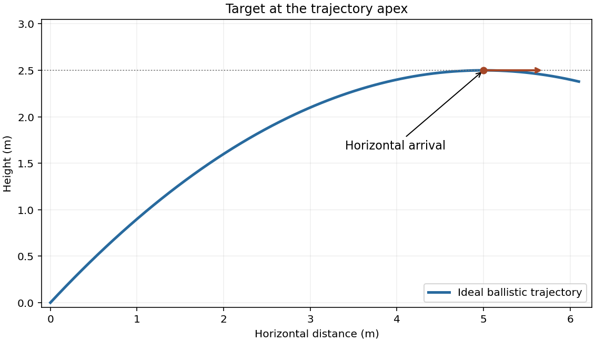

<h1 id="section-b/b7/solution">Solution</h1>

↑ **Parent:** [B7](../b7.md)

For a steady uniform jet, the mass flow rate is $\dot m=\rho Au$. The transported [momentum flux](../../../../../momentum-flux.md) and [kinetic energy flux of a uniform jet](../../../../../kinetic-energy-flux-of-a-uniform-jet.md) are

$$
\boxed{\dot p=\rho Au^2,\qquad\dot K=\frac12\rho Au^3.}
$$

Incompressibility gives piston speed $v_p=Au/S$. Equating piston power $Fv_p$ to the jet's kinetic power gives

$$
\boxed{F=\frac12\rho Su^2.}
$$

This ideal result neglects losses and the kinetic energy of fluid moving slowly inside the large cylinder. Retaining an inlet speed correction would multiply the pressure expression by $1-(A/S)^2$.

A horizontal impact occurs at the projectile apex. Write $u_x=u\cos\theta$ and $u_y=u\sin\theta$. At its height h, $u_y^2=2gh$ and the flight time is $t=u_y/g$, so

$$
u_y=\sqrt{2gh},\qquad u_x=w\sqrt{\frac g{2h}},\qquad
\boxed{u=9.90\,\mathrm{m\,s^{-1}},\quad\theta=45^\circ,\quad F=4.91\,\mathrm N.}
$$

Here $g=9.81\,\mathrm{m\,s^{-2}}$ and $u_x=u_y=7.00\,\mathrm{m\,s^{-1}}$. The [apex-target condition for a ballistic jet](../../../../../apex-target-condition-for-a-ballistic-jet.md) fixes both launch speed and angle.

If the target stops the horizontal momentum of the arriving water, the force is

$$
F_{\rm hit}=\dot m\,u_x=\rho A u u_x=0.277\,\mathrm N,
\qquad \mu m_tg=0.147\,\mathrm N.
$$

**This exceeds the limiting friction, so the target can be dislodged** in the ideal stopping-impact model. The [jet-area adjustment during ballistic slowing](../../../../../jet-area-adjustment-during-ballistic-slowing.md) matters: the nozzle area sets $\dot m$; replacing u by $u_x$ in that mass-flow factor would incorrectly assume unchanged jet area during deceleration. Reflection or a specified deflection would change the transferred momentum. Air drag, breakup and splash losses are excluded from the ballistic estimate.

**[Figure 1](#section-b/b7/image-ballistic-jet-apex). Ballistic jet apex**. [Source](paper-1-ia2011-jet-apex.py).

## ↑ Ancestors (13)

1. [B7](../b7.md)
2. [Section B](../../section-b.md)
3. [Paper 1](../../../paper-1-split.md)
4. [2011](../../../split.md)
5. [Past exam of the physics course of the year 1 of the natural sciences course of the University of Cambridge](../../../../split.md)
6. [Physics course of the year 1 of the natural sciences course of the University of Cambridge](../../../../../physics-course-of-the-year-1-of-the-natural-sciences-course-of-the-university-of-cambridge.md)
7. [Year 1 of the natural sciences course of the University of Cambridge](../../../../../year-1-of-the-natural-sciences-course-of-the-university-of-cambridge.md)
8. [Year of the natural sciences course of the University of Cambridge](../../../../../year-of-the-natural-sciences-course-of-the-university-of-cambridge.md)
9. [Natural sciences course of the University of Cambridge](../../../../../natural-sciences-course-of-the-university-of-cambridge.md)
10. [Course of the University of Cambridge](../../../../../course-of-the-university-of-cambridge.md)
11. [University of Cambridge](../../../../../university-of-cambridge-split.md)
12. [List of universities](../../../../../list-of-universities.md)
13. [Codex Wiki](../../../../../split.md)
