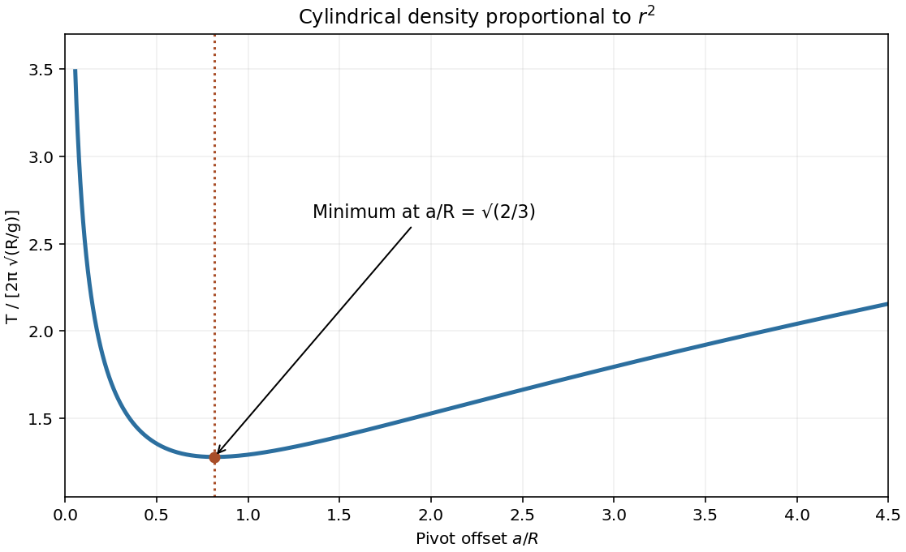

<h1 id="section-b/b8/solution">Solution</h1>

↑ **Parent:** [B8](../b8.md)

The [moment of inertia](../../../../../moment-of-inertia.md) about an axis is $I=\int r_\perp^2\,dm$. The [parallel axis theorem](../../../../../parallel-axis-theorem.md) states $I=I_{\rm CM}+Ma^2$, where a is the perpendicular separation from a parallel axis through the centre of mass, and M is total mass.

Since $\rho=kr^2$, the density coefficient has units $\mathrm{kg\,m^{-5}}$. The [density-power cylindrical moment of inertia](../../../../../density-power-cylindrical-moment-of-inertia.md) follows from cylindrical shells:

$$
M=\int_0^R2\pi Lkr^3\,dr=\frac{\pi kLR^4}{2},\qquad
I_{\rm CM}=\int_0^R2\pi Lkr^5\,dr=\frac{\pi kLR^6}{3}
=\boxed{\frac23MR^2}.
$$

For an offset pivot, the [physical pendulum](../../../../../physical-pendulum.md) equation is $(I_{\rm CM}+Ma^2)\ddot\theta=-Mga\sin\theta$. At small amplitude,

$$
\boxed{T=2\pi\sqrt{\frac{a^2+2R^2/3}{ga}}.}
$$

For the [minimum-period offset of a physical pendulum](../../../../../minimum-period-offset-of-a-physical-pendulum.md), minimizing $T^2$ is equivalent to minimizing $a+2R^2/(3a)$. Its derivative vanishes at

$$
\boxed{a_{\min}=R\sqrt{2/3},\qquad
T_{\min}=2\pi\sqrt{\frac{2R\sqrt{2/3}}g}.}
$$

The second derivative is positive. The period diverges as $a^{-1/2}$ near zero and grows as $a^{1/2}$ for large offset, giving one minimum. This assumes the stated ideal pivot can pass inside the body; an externally constrained pivot would restrict the allowable a. [§15.4, physical-pendulum torque equation and period](../../../../../university-physics-volume-1-by-william-moebs-and-others.md)

**[Figure 2](#section-b/b8/image-pendulum-pivot-offset). Pendulum pivot offset**. [Source](paper-1-ia2011-pendulum-offset.py).

## ↑ Ancestors (13)

1. [B8](../b8.md)
2. [Section B](../../section-b.md)
3. [Paper 1](../../../paper-1-split.md)
4. [2011](../../../split.md)
5. [Past exam of the physics course of the year 1 of the natural sciences course of the University of Cambridge](../../../../split.md)
6. [Physics course of the year 1 of the natural sciences course of the University of Cambridge](../../../../../physics-course-of-the-year-1-of-the-natural-sciences-course-of-the-university-of-cambridge.md)
7. [Year 1 of the natural sciences course of the University of Cambridge](../../../../../year-1-of-the-natural-sciences-course-of-the-university-of-cambridge.md)
8. [Year of the natural sciences course of the University of Cambridge](../../../../../year-of-the-natural-sciences-course-of-the-university-of-cambridge.md)
9. [Natural sciences course of the University of Cambridge](../../../../../natural-sciences-course-of-the-university-of-cambridge.md)
10. [Course of the University of Cambridge](../../../../../course-of-the-university-of-cambridge.md)
11. [University of Cambridge](../../../../../university-of-cambridge-split.md)
12. [List of universities](../../../../../list-of-universities.md)
13. [Codex Wiki](../../../../../split.md)
