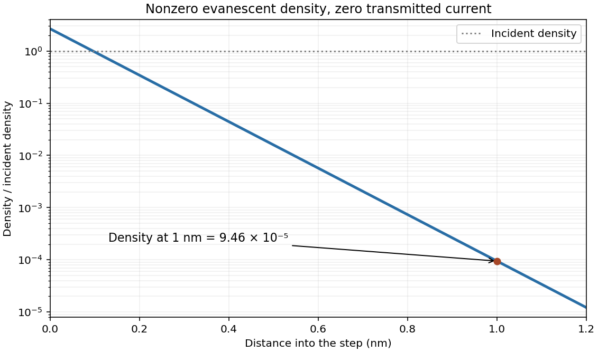

<h1 id="section-d/d13/solution">Solution</h1>

↑ **Parent:** [D13](../d13.md)

In the time-independent [Schrödinger equation](../../../../../schrodinger-equation.md), $-\hbar^2\psi''/(2m)$ is the kinetic-energy operator acting on the state, $V\psi$ its potential-energy contribution and $E\psi$ the energy-eigenvalue term. The complex [wave function](../../../../../wave-function-split.md) is a probability amplitude: the [Born rule](../../../../../born-rule.md) assigns density $|\psi|^2$ for a normalized single-particle state. A plane-wave beam uses an incident-amplitude or flux normalization instead of a unit-integral wavefunction.

For a free plane wave, $\psi''=-k^2\psi$, so $\boxed{E=\hbar^2k^2/(2m)}$ and its time factor obeys $\hbar\omega=E$. Above the upward [potential step](../../../../../step-potential.md), the bounded subthreshold solution has decay constant

$$
\boxed{\alpha=\frac{\sqrt{2m(V_0-E)}}\hbar.}
$$

For the PDF's unit incident amplitude, write $\psi=e^{ikx}+Re^{-ikx}$ on the left and $\psi=Te^{-\alpha x}$ on the right, omitting their common time phase. Continuity of both $\psi$ and $\psi'$ at this finite step gives

$$
1+R=T,\qquad ik(1-R)=-\alpha T,\qquad
R=\frac{k-i\alpha}{k+i\alpha},\quad T=\frac{2k}{k+i\alpha}.
$$

Consequently

$$
\boxed{|R|^2=1,\qquad |T|^2=\frac{4k^2}{k^2+\alpha^2}=\frac{4E}{V_0}.}
$$

The [evanescent amplitude versus transmitted current](../../../../../evanescent-amplitude-versus-transmitted-current.md) distinction matters: the second quantity is a squared amplitude, **not a transmitted-flux probability**. The decaying tail has zero [probability current](../../../../../probability-current.md), despite nonzero density and the possible value $|T|^2>1$.

Using $\hbar=1.05457\times10^{-34}\,\mathrm{J\,s}$ and the electron mass and elementary charge specified above, the energy difference1eV gives $\alpha=5.12\,\mathrm{nm^{-1}}$. Thus at the stated position

$$
\boxed{|\psi_t(1\,\mathrm{nm})|^2=\frac83e^{-2(5.123)(1)}\simeq9.46\times10^{-5}.}
$$

This is relative to the unit incident density in the source figure, not an absolute normalized probability per metre. [Reduced Planck constant, electron mass and electron volt conversion](../../../../../codata-recommended-values-of-the-fundamental-physical-constants-2022-by-national-institute-of-standards-and-technology.md)

**[Figure 3](#section-d/d13/image-evanescent-step-density). Evanescent step density**. [Source](paper-1-ia2011-step-density.py).

## ↑ Ancestors (13)

1. [D13](../d13.md)
2. [Section D](../../section-d.md)
3. [Paper 1](../../../paper-1-split.md)
4. [2011](../../../split.md)
5. [Past exam of the physics course of the year 1 of the natural sciences course of the University of Cambridge](../../../../split.md)
6. [Physics course of the year 1 of the natural sciences course of the University of Cambridge](../../../../../physics-course-of-the-year-1-of-the-natural-sciences-course-of-the-university-of-cambridge.md)
7. [Year 1 of the natural sciences course of the University of Cambridge](../../../../../year-1-of-the-natural-sciences-course-of-the-university-of-cambridge.md)
8. [Year of the natural sciences course of the University of Cambridge](../../../../../year-of-the-natural-sciences-course-of-the-university-of-cambridge.md)
9. [Natural sciences course of the University of Cambridge](../../../../../natural-sciences-course-of-the-university-of-cambridge.md)
10. [Course of the University of Cambridge](../../../../../course-of-the-university-of-cambridge.md)
11. [University of Cambridge](../../../../../university-of-cambridge-split.md)
12. [List of universities](../../../../../list-of-universities.md)
13. [Codex Wiki](../../../../../split.md)
