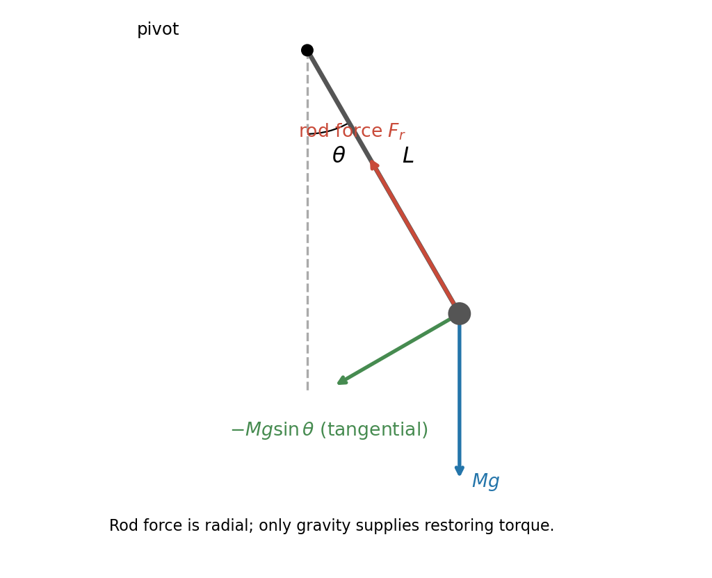
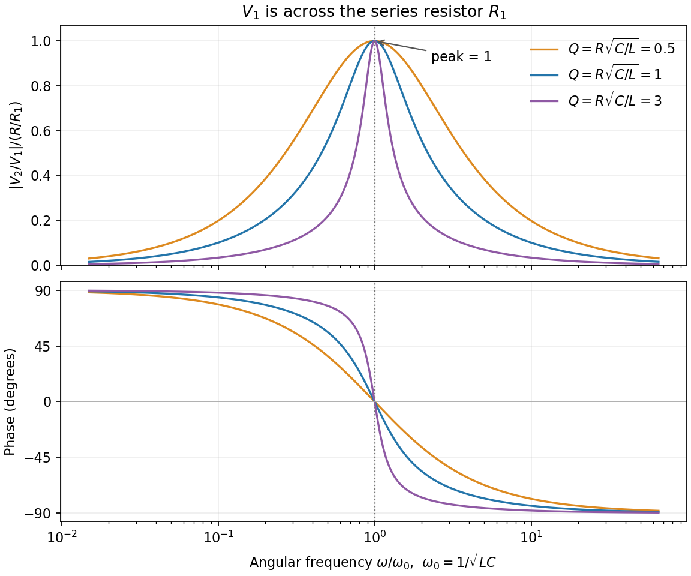
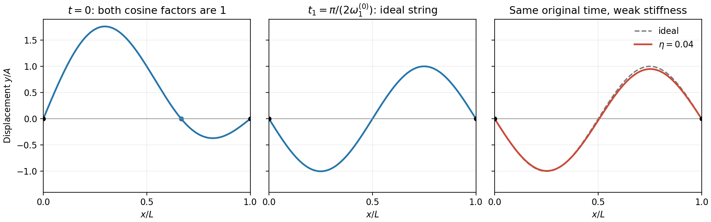
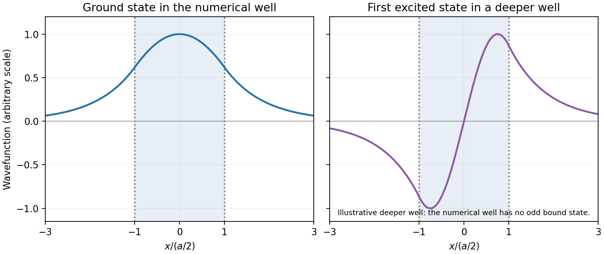
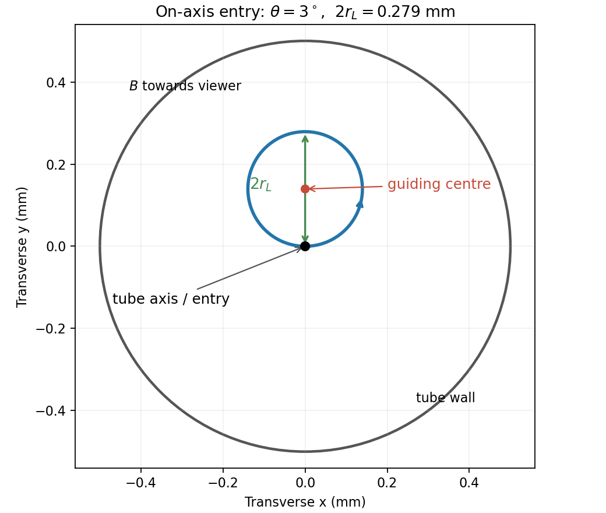

# Paper 1

↑ **Parent:** [2012](../2012.md)

Original paper: [Public original PDF, physical pages 1–10; cover on page 1, blank page 2, questions on pages 3–10](https://www.whatdotheyknow.com/request/natural_science_tripos_physics_e_2/response/2340776/attach/2/FOI%202023%20399%20Zahid%20materials.pdf?cookie_passthrough=1#page=1).

**Table of contents**

- [Section A](#section-a)
  - [1](#section-a/1)
    - [Solution](#section-a/1/solution)
  - [2](#section-a/2)
    - [Solution](#section-a/2/solution)
  - [3](#section-a/3)
    - [Solution](#section-a/3/solution)
  - [4](#section-a/4)
    - [Solution](#section-a/4/solution)
  - [5](#section-a/5)
    - [Solution](#section-a/5/solution)
  - [6](#section-a/6)
    - [Solution](#section-a/6/solution)
- [Section B](#section-b)
  - [B7](#section-b/b7)
    - [Solution](#section-b/b7/solution)
  - [B8](#section-b/b8)
    - [Solution](#section-b/b8/solution)
  - [B9](#section-b/b9)
    - [Solution](#section-b/b9/solution)
- [Section C](#section-c)
  - [C10](#section-c/c10)
    - [Solution](#section-c/c10/solution)
  - [C11](#section-c/c11)
    - [a](#section-c/c11/a)
      - [Solution](#section-c/c11/a/solution)
    - [b](#section-c/c11/b)
      - [Solution](#section-c/c11/b/solution)
- [Section D](#section-d)
  - [D12](#section-d/d12)
    - [Solution](#section-d/d12/solution)
  - [D13](#section-d/d13)
    - [Solution](#section-d/d13/solution)
- [Section E](#section-e)
  - [E14](#section-e/e14)
    - [Solution](#section-e/e14/solution)
  - [E15](#section-e/e15)
    - [a](#section-e/e15/a)
      - [Solution](#section-e/e15/a/solution)
    - [b](#section-e/e15/b)
      - [Solution](#section-e/e15/b/solution)
    - [c](#section-e/e15/c)
      - [Solution](#section-e/e15/c/solution)
    - [d](#section-e/e15/d)
      - [Solution](#section-e/e15/d/solution)

## Section A

↑ **Parent:** [Paper 1](paper-1.md)

<h3 id="section-a/1">1</h3>

↑ **Parent:** [Section A](#section-a)

<h4 id="section-a/1/solution">Solution</h4>

↑ **Parent:** [1](#section-a/1)

The [shell theorem](../../mathematical-physics.md#spherical-shell-theorem) gives the [gravity of a concentric hollow sphere](../../mathematical-physics.md#gravity-of-a-concentric-hollow-sphere) as $\mathbf g(r)=-GM(<r)\widehat{\mathbf r}/r^2$. There is no enclosed [mass](../../classical-mechanics.md#mass) at the cavity boundary, whereas the entire shell has [mass](../../classical-mechanics.md#mass) $M=\tfrac{4\pi\rho}{3}[(2a)^3-a^3]=\tfrac{28\pi}{3}\rho a^3$. Thus

$$
\boxed{\mathbf g(a)=0,\qquad
\mathbf g(2a)=-\frac{7\pi G\rho a}{3}\widehat{\mathbf r},\qquad
\mathbf g(4a)=-\frac{7\pi G\rho a}{12}\widehat{\mathbf r}.}
$$

Both nonzero fields point towards the centre. The field is continuous at each boundary; there is no surface [mass](../../classical-mechanics.md#mass) sheet.

<h3 id="section-a/2">2</h3>

↑ **Parent:** [Section A](#section-a)

<h4 id="section-a/2/solution">Solution</h4>

↑ **Parent:** [2](#section-a/2)

For [drum-frequency dimensional scaling](../../mathematical-physics.md#drum-frequency-dimensional-scaling), let $f\propto r^p\sigma^qT^s$, where $\sigma$ is [surface mass density](../../fluid-mechanics.md#projected-surface-mass-density). The dimensions are $[\sigma]=ML^{-2}$ and $[T]=MT^{-2}$, so matching [powers](../../energy.md#power) gives $s=1/2$, $q=-1/2$ and $p=-1$:

$$
f=C\frac1r\sqrt{\frac T\sigma},\qquad
\boxed{\frac{f_{\rm new}}f=\frac{\sqrt2}{2}=\frac1{\sqrt2}.}
$$

The dimensionless [normal mode](../../wave-equation.md#normal-mode) constant $C$ is unchanged for the same circular shape and [boundary condition](../../differential-equation.md#boundary-condition). The doubled [tension](../../force.md#tension) does not offset the doubled [radius](../../topology.md#radius).

<h3 id="section-a/3">3</h3>

↑ **Parent:** [Section A](#section-a)

<h4 id="section-a/3/solution">Solution</h4>

↑ **Parent:** [3](#section-a/3)

For a [mass change in a viscously damped spring oscillator](../../analysis.md#mass-change-in-a-viscously-damped-spring-oscillator), use linear [viscous damping](../../wave-equation.md#viscous-damping) $m\ddot x+b\dot x+kx=mg$, holding the [spring constant](../../elasticity-physics.md#spring-constant) $k$ and [damping](../../wave-equation.md#damping) coefficient $b$ fixed. Measuring $x$ from $mg/k$ removes the constant [force](../../force.md). The envelope is $e^{-\gamma t}$, where

$$
\gamma=\frac b{2m}=\frac{\ln100}{30\,\mathrm s}=0.15351\,\mathrm{s^{-1}},\qquad
\omega_d=\sqrt{\frac km-\gamma^2}=\pi\,\mathrm{s^{-1}}.
$$

Doubling $m$ halves both $k/m$ and $\gamma$. Therefore

$$
\omega_{d,\rm new}^2=\frac{\omega_d^2}{2}+\frac{\gamma^2}{4},\qquad
\boxed{f_{\rm new}=0.35376\,\mathrm{Hz}\simeq0.354\,\mathrm{Hz},\qquad t_{1\%,\rm new}=60\,\mathrm s.}
$$

Neglecting [damping](../../wave-equation.md#damping) in the [frequency](../../wave.md#frequency) gives $0.5/\sqrt2=0.35355\,\mathrm{Hz}$, indistinguishable at the supplied precision. The release condition sets the [phase](../../wave.md#phase-waves) and new initial [amplitude](../../wave.md#wave-amplitude), not these envelope ratios. A different mass-dependent drag law would require its [damping](../../wave-equation.md#damping) coefficient to be specified.

<h3 id="section-a/4">4</h3>

↑ **Parent:** [Section A](#section-a)

<h4 id="section-a/4/solution">Solution</h4>

↑ **Parent:** [4](#section-a/4)

To find the [magnitude uncertainty of a series RL impedance](../../wave-equation.md#magnitude-uncertainty-of-a-series-rl-impedance), put $X=\omega L$. Then $z=|Z|=\sqrt{R^2+X^2}=168.003\,\Omega$ and

$$
dz=\frac Rz\,dR+\frac Xz\,dX.
$$

If the quoted errors are [independent](../../random-variable.md#independent-random-variables) [standard uncertainties](../../physics.md#standard-uncertainty), $\sigma_R=1\,\Omega$ and $\sigma_X=6\,\Omega$ give

$$
\sigma_z=\frac{\sqrt{R^2\sigma_R^2+X^2\sigma_X^2}}z=4.86\,\Omega,\qquad
\boxed{|Z|\simeq(168\pm5)\,\Omega.}
$$

If they denote strict bounds instead, the first-order bound is $(R\Delta R+X\Delta X)/z=5.42\,\Omega$. The source does not specify their statistical interpretation, so these two error conventions should not be conflated.

<h3 id="section-a/5">5</h3>

↑ **Parent:** [Section A](#section-a)

<h4 id="section-a/5/solution">Solution</h4>

↑ **Parent:** [5](#section-a/5)

The [phase](../../wave.md#phase-waves) step between adjacent slits is

$$
\delta=\frac{2\pi d\sin\theta}{\lambda}\simeq\frac\pi3.
$$

For equal [amplitudes](../../wave.md#wave-amplitude) $a_0$, the six unmodified contributions form a closed [regular hexagon](../../euclidean-geometry.md#regular-hexagon) in the [complex plane](../../complex-analysis.md#complex-plane):

$$
S_0=a_0\sum_{j=0}^{5}e^{ij\pi/3}=0.
$$

[Reversing one slit at an array minimum](../../physical-optics.md#reversing-one-slit-at-an-array-minimum) replaces slit $j$'s contribution by its negative, so $S=S_0-2a_0e^{ij\pi/3}$. Consequently

$$
\boxed{I_{\rm screen}=|S|^2=4|a_0|^2=4I.}
$$

This is independent of which slit is reversed. The result uses the far-field, narrow-slit and [small-angle approximations](../../geometry-and-topology.md#small-angle-approximation); retaining $\sin\theta$ changes the [phase](../../wave.md#phase-waves) step only by about $7\times10^{-7}$ radians.

<h3 id="section-a/6">6</h3>

↑ **Parent:** [Section A](#section-a)

<h4 id="section-a/6/solution">Solution</h4>

↑ **Parent:** [6](#section-a/6)

The [breakdown-limited parallel-plate charge](../../permittivity.md#breakdown-limited-parallel-plate-charge) follows from the ideal [parallel-plate capacitor](../../electromagnetism.md#parallel-plate-capacitor) relation $Q=CV=(\epsilon_0A/d)(Ed)=\epsilon_0AE$. [Dielectric breakdown](../../permittivity.md#dielectric-breakdown) limits the [electric field](../../electric-field.md) rather than the [voltage](../../random-walk.md#voltage) independently of separation:

$$
\boxed{Q_{\max}=\epsilon_0(4.0\times10^{-6}\,\mathrm{m^2})(3.0\times10^6\,\mathrm{V\,m^{-1}})
=1.06\times10^{-10}\,\mathrm C\simeq106\,\mathrm{pC}.}
$$

This is the magnitude on either plate, not the sum of both magnitudes. Edge enhancement and fringing are neglected, as in the stated parallel-plate model.

## Section B

↑ **Parent:** [Paper 1](paper-1.md)

<h3 id="section-b/b7">B7</h3>

↑ **Parent:** [Section B](#section-b)

<h4 id="section-b/b7/solution">Solution</h4>

↑ **Parent:** [B7](#section-b/b7)

Let $s$ increase down the ramp. On a plane, [static friction](../../force.md#static-friction) $F$ acts uphill. Translation and rotation give

$$
m\ddot s=mg\sin\theta-F,\qquad
Fa=I\dot\omega,\qquad \dot\omega=\ddot s/a.
$$

With $I=2ma^2/5$, elimination yields **$\ddot s=(5/7)g\sin\theta$**. [Static friction](../../force.md#static-friction) does no work at the stationary contact point.

For a [sphere rolling in a symmetric groove](../../classical-mechanics.md#sphere-rolling-in-a-symmetric-groove), the distance from the centre to the instantaneous contact axis AB is $h=a\sin(\phi/2)$, so $v=h\omega$. The [kinetic energy](../../energy.md#kinetic-energy) and work-energy equation are

$$
K=\frac12\left(m+\frac I{h^2}\right)\dot s^2,\qquad
\left(m+\frac I{h^2}\right)\ddot s=mg\sin\theta.
$$

Hence

$$
\boxed{\ddot s=\frac{5g\sin\theta}{5+2/\sin^2(\phi/2)}.}
$$

For the stated angles this is $5g/18$. Using $g=9.81\,\mathrm{m\,s^{-2}}$ and a one-second descent,

$$
\boxed{v_g=2.725\,\mathrm{m\,s^{-1}},\qquad
K_g=\frac12mv_g^2\left(1+\frac{2}{5\sin^2 45^\circ}\right)=33.4\,\mathrm J.}
$$

On the level floor the rolling [radius](../../topology.md#radius) becomes $a$, so an [energy-preserving change of rolling radius](../../classical-mechanics.md#energy-preserving-change-of-rolling-radius) gives $K_g=\tfrac7{10}mv_f^2$. Therefore

$$
v_f=\sqrt{\frac97}\,v_g=3.090\,\mathrm{m\,s^{-1}},\qquad
\boxed{t_{\rm pins}=\frac{20\,\mathrm m}{v_f}=6.47\,\mathrm s.}
$$

The floor [speed](../../classical-mechanics.md#speed) exceeds the groove [speed](../../classical-mechanics.md#speed) because less of the same total [kinetic energy](../../energy.md#kinetic-energy) is rotational. Holding the translational [speed](../../classical-mechanics.md#speed) fixed at the transition would violate the stipulated [energy](../../energy.md) balance with the new no-slip constraint.

<h3 id="section-b/b8">B8</h3>

↑ **Parent:** [Section B](#section-b)

<h4 id="section-b/b8/solution">Solution</h4>

↑ **Parent:** [B8](#section-b/b8)

For $m>0$, $E=\gamma_u mc^2$ and $\mathbf p=\gamma_um\mathbf u$, with $\gamma_u=(1-u^2/c^2)^{-1/2}$. Thus

$$
E^2-p^2c^2=\gamma_u^2m^2c^4(1-u^2/c^2)=m^2c^4.
$$

A [photon](../../quantum-mechanics.md#photon) obeys **$E=pc$**; $E=hf$ and $p=h/\lambda$ agree because $f\lambda=c$ in vacuum.

Take the incident [photon](../../quantum-mechanics.md#photon) along $+x$, and write $\beta=v/c$ for the boost. In the boosted frame the initial momenta are

$$
p'_{\gamma x}=mc\sqrt{\frac{1-\beta}{1+\beta}}=\gamma_vmc(1-\beta),\qquad
p'_{ex}=-\gamma_vm\beta c.
$$

Their sum vanishes when $1-2\beta=0$, giving **$v_{\rm ZM}=c/2$** and $\gamma_v=2/\sqrt3$. The initial [photon energy](../../quantum-mechanics.md#photon-energy) there is $mc^2/\sqrt3$, and total [energy](../../energy.md) is $\sqrt3mc^2$.

For [right-angle Compton scattering in the centre-of-momentum frame](../../special-relativity.md#right-angle-compton-scattering-in-the-centre-of-momentum-frame), choose the outgoing ZM [photon](../../quantum-mechanics.md#photon) along $+y$. The [electron](../../physics.md#electron) has the opposite [momentum](../../momentum.md) $-p'\widehat{\mathbf y}$. [Conservation of energy](../../mathematical-physics.md#conservation-of-energy) determines its magnitude:

$$
p'c+\sqrt{m^2c^4+p'^2c^2}=\sqrt3mc^2
\quad\Longrightarrow\quad
p'=\frac{mc}{\sqrt3},\qquad E'_e=\frac{2mc^2}{\sqrt3}.
$$

Thus **$\mathbf u'_e=-(c/2)\widehat{\mathbf y}$**. Inverting the [velocity](../../classical-mechanics.md#velocity) transformation gives

$$
u_{ex}=\frac{u'_{ex}+v}{1+u'_{ex}v/c^2}=\frac c2,\qquad
u_{ey}=\frac{u'_{ey}}{\gamma_v(1+u'_{ex}v/c^2)}=-\frac{\sqrt3c}{4}.
$$

Consequently

$$
\boxed{u_e=\frac{\sqrt7}{4}c=0.6614c,\qquad
\theta_e=-\tan^{-1}\!\left(\frac{\sqrt3}{2}\right)=-40.9^\circ.}
$$

The [electron](../../physics.md#electron) recoils below the incident direction for our choice of [photon](../../quantum-mechanics.md#photon) scattering above it; the reflected configuration reverses both transverse signs. Finally,

$$
\boxed{E_{\gamma,\rm lab}=\gamma_v(E'_\gamma+vp'_{\gamma x})=\frac23mc^2\simeq341\,\mathrm{keV}.}
$$

As a check, $E_{e,\rm lab}=4mc^2/3$, so the final energies sum to the initial $2mc^2$. The outgoing laboratory [photon](../../quantum-mechanics.md#photon) makes $60^\circ$ with $+x$.

<h3 id="section-b/b9">B9</h3>

↑ **Parent:** [Section B](#section-b)

<h4 id="section-b/b9/solution">Solution</h4>

↑ **Parent:** [B9](#section-b/b9)

For a fixed set of bodies in an [inertial frame](../../mathematical-physics.md#inertial-frame), total [linear momentum](../../momentum.md) is constant if the resultant external [force](../../force.md) vanishes. Summing [Newton's second law](../../force.md#newton-s-second-law) cancels internal [force](../../force.md) pairs by [Newton's third law](../../force.md#newton-s-third-law). For an open subsystem, [momentum](../../momentum.md) carried across its boundary must also be included.

For an [equal-intake-fuel mass-loading rocket](../../momentum.md#equal-intake-fuel-mass-loading-rocket), enclose the original craft and the stationary material collected during $dt$. Its initial [momentum](../../momentum.md) is $mu$. At the end, the craft has [mass](../../classical-mechanics.md#mass) $m-\mu\,dt$ and the exhaust has [mass](../../classical-mechanics.md#mass) $2\mu\,dt$. To first order,

$$
mu=(m-\mu\,dt)(u+du)+2\mu\,dt(u-u_0),
\qquad
\boxed{m\frac{du}{dt}=2\mu u_0-\mu u.}
$$

The first term is [rocket thrust](../../momentum.md#rocket-thrust); the second is the [momentum](../../momentum.md) cost of collecting stationary matter. It vanishes in the conventional [rocket equation](../../momentum.md#rocket-equation), which therefore has no analogous fixed exhaust-speed ceiling in [Newtonian mechanics](../../newtonian-mechanics.md). Here the [acceleration](../../classical-mechanics.md#acceleration) vanishes at **$u_{\max}=2u_0$**; from rest it stays positive below that value while fuel remains. Relativistic limits are outside this model.

For constant $\mu$, [mass conservation](../../continuum-mechanics.md#mass-conservation) gives $m=m_i-\mu t$. Separating variables,

$$
\int_0^u\frac{dw}{2u_0-w}=\int_0^t\frac{\mu\,d\tau}{m_i-\mu\tau}
\quad\Longrightarrow\quad
\frac{2u_0-u}{2u_0}=\frac{m_i-\mu t}{m_i}.
$$

Therefore

$$
\boxed{u(t)=\frac{2\mu u_0}{m_i}t,\qquad \dot u=\frac{2\mu u_0}{m_i}.}
$$

The formal limiting [speed](../../classical-mechanics.md#speed) would require $t=m_i/\mu$ and zero remaining craft [mass](../../classical-mechanics.md#mass). A positive [rocket dry mass](../../momentum.md#rocket-dry-mass) and finite carried fuel terminate the burn earlier. Maintaining nonzero collection rate even at rest is an idealization explicitly prescribed by the problem.

## Section C

↑ **Parent:** [Paper 1](paper-1.md)

<h3 id="section-c/c10">C10</h3>

↑ **Parent:** [Section C](#section-c)

<h4 id="section-c/c10/solution">Solution</h4>

↑ **Parent:** [C10](#section-c/c10)

The bob experiences weight $Mg$ vertically downward and a rod [force](../../force.md) towards the pivot. The tangential component of weight is $-Mg\sin\theta$, so

$$
ML\ddot\theta=-Mg\sin\theta\simeq-Mg\theta,\qquad
\boxed{\omega_0^2=g/L,\qquad T_0=2\pi\sqrt{L/g}.}
$$

The rod [force](../../force.md) supplies the radial [acceleration](../../classical-mechanics.md#acceleration) and contributes no tangential [torque](../../momentum.md#torque) about the pivot.

**[Figure 1](#section-c/c10/image-original-force-diagram-for-a-displaced-pendulum-with-radial-and-tangential-directions). Original force diagram for a displaced pendulum, with radial and tangential directions**.

To the same small-angle order, writing $\chi=\omega_0t+\phi$,

$$
U=MgL(1-\cos\theta)\simeq\frac12MgL\theta_0^2\cos^2\chi,\qquad
K=\frac12ML^2\dot\theta^2=\frac12MgL\theta_0^2\sin^2\chi.
$$

Thus **$K+U=MgL\theta_0^2/2$** is constant. Put $b=\dot\theta(0)$, a signed [angular velocity](../../rigid-body-dynamics.md#angular-velocity). Then

$$
\boxed{\theta_0=\sqrt{\alpha^2+b^2/\omega_0^2},\qquad
\phi=\operatorname{atan2}(-b/\omega_0,\alpha)\pmod{2\pi}.}
$$

If the printed [angular speed](../../rigid-body-dynamics.md#angular-speed) $\beta$ is intended as the signed rate, set $b=\beta$. If it means magnitude only, $b=\pm\beta$ gives two possible [phases](../../wave.md#phase-waves); the [amplitude](../../wave.md#wave-amplitude) is unique. At zero [amplitude](../../wave.md#wave-amplitude) the [phase](../../wave.md#phase-waves) is arbitrary.

For a [finite-radius spherical pendulum bob](../../mathematical-physics.md#finite-radius-spherical-pendulum-bob), the PDF dimension $L$ runs from pivot to [centre of mass](../../classical-mechanics.md#center-of-mass). The [parallel axis theorem](../../rigid-body-dynamics.md#parallel-axis-theorem) gives $I_P=ML^2+2Ma^2/5$. The restoring [torque](../../momentum.md#torque) remains $-MgL\theta$, hence

$$
T=2\pi\sqrt{\frac{ML^2+2Ma^2/5}{MgL}}
=T_0\sqrt{1+\frac{2a^2}{5L^2}}
\simeq T_0\left(1+\frac{a^2}{5L^2}\right).
$$

With $a=[3M/(4\pi\rho)]^{1/3}=0.02605\,\mathrm m$,

$$
\boxed{100\frac{T-T_0}{T_0}=0.01357\%\simeq0.0136\%.}
$$

The finite bob increases the inertia without changing the gravitational lever arm.

<h3 id="section-c/c11">C11</h3>

↑ **Parent:** [Section C](#section-c)

<h4 id="section-c/c11/a">a</h4>

↑ **Parent:** [C11](#section-c/c11)

<h5 id="section-c/c11/a/solution">Solution</h5>

↑ **Parent:** [A](#section-c/c11/a)

In sinusoidal [steady state](../../dynamical-systems.md#steady-state), [complex impedance](../../electrical-circuit.md#electrical-impedance) is the [voltage](../../random-walk.md#voltage) [phasor](../../wave.md#phasor) divided by the current [phasor](../../wave.md#phasor). Its [modulus](../../complex-analysis.md#modulus) is the [amplitude](../../wave.md#wave-amplitude) ratio and its [argument](../../complex-analysis.md#argument-complex-analysis) is the [voltage](../../random-walk.md#voltage) lead. With the $e^{i\omega t}$ convention, $I=dq/dt=i\omega CV$, so **$Z_C=1/(i\omega C)$**.

The PDF labels $V_1$ across $R_1$, not across the complete driven network. If $I$ is the current through $R_1$, then $V_1=IR_1$ and $I=Y_pV_2$, where

$$
Y_p=\frac1R+i\left(\omega C-\frac1{\omega L}\right).
$$

The [resistor-referenced parallel-resonator response](../../electrical-circuit.md#resistor-referenced-parallel-resonator-response) is

$$
\boxed{H(\omega)=\frac{V_2}{V_1}=\frac{R/R_1}{1+iR(\omega C-1/(\omega L))}.}
$$

Writing $b(\omega)=\omega C-1/(\omega L)$,

$$
|H|=\frac{R/R_1}{\sqrt{1+R^2b^2}},\qquad
\arg H=-\tan^{-1}(Rb).
$$

The maximum occurs at $\omega_0=1/\sqrt{LC}$, where **$|H|=R/R_1$ and the [phase](../../wave.md#phase-waves) is zero**. Below [resonance](../../dynamical-systems.md#resonance) the [phase](../../wave.md#phase-waves) is positive, tending to $+\pi/2$; above it the [phase](../../wave.md#phase-waves) is negative, tending to $-\pi/2$. The [amplitude](../../wave.md#wave-amplitude) tends to zero at both extremes: the [inductor](../../electromagnetism.md#inductor) shorts the parallel network at low [frequency](../../wave.md#frequency), and the [capacitor](../../electromagnetism.md#capacitor) does so at high [frequency](../../wave.md#frequency). At [resonance](../../dynamical-systems.md#resonance) their reactive currents cancel, leaving only the [resistor](../../electric-charge.md#resistor) current.

**[Figure 2](#section-c/c11/a/image-resistor-referenced-parallel-resonator-amplitude-and-phase-normalized-without-choosing-circuit-component-values). Resistor-referenced parallel-resonator amplitude and phase, normalized without choosing circuit component values**.

If instead $V_{\rm in}$ denotes the [voltage](../../random-walk.md#voltage) across the complete circuit, its different transfer ratio is $V_2/V_{\rm in}=1/[1+R_1/R+iR_1b]$, with peak $R/(R+R_1)$. This distinction follows directly from the printed [voltage](../../random-walk.md#voltage) endpoints.

<h4 id="section-c/c11/b">b</h4>

↑ **Parent:** [C11](#section-c/c11)

<h5 id="section-c/c11/b/solution">Solution</h5>

↑ **Parent:** [B](#section-c/c11/b)

For [free parallel RLC voltage decay](../../electrical-circuit.md#free-parallel-rlc-voltage-decay), measure $V=V_A-V_B$ and branch currents from A to B. Then

$$
I_C=C\dot V,\qquad I_R=V/R,\qquad
I_L(t)=I_L(0)+\frac1L\int_0^tV(s)\,ds.
$$

There is no external current, so [Kirchhoff's current law](../../random-walk.md#kirchhoff-node-law) gives $I_C+I_R+I_L=0$. Differentiating yields

$$
\boxed{C\ddot V+\frac1R\dot V+\frac1LV=0.}
$$

For $V\propto e^{st}$ the [characteristic equation](../../linear-ordinary-differential-equation.md#characteristic-equation-of-a-constant-coefficient-differential-equation) is $Cs^2+s/R+1/L=0$. Its [underdamped](../../wave-equation.md#underdamping) roots give

$$
\boxed{\gamma=\frac1{2RC},\qquad
\omega=\sqrt{\frac1{LC}-\frac1{4R^2C^2}}.}
$$

The supplied inequality makes $\omega$ real. A real physical [voltage](../../random-walk.md#voltage) has the general form $V=Ae^{-\gamma t}\cos(\omega t+\phi)$, the [real part](../../complex-analysis.md#real-part) of the printed complex expression. A general complex-valued solution uses both roots, $e^{-\gamma t}(C_+e^{i\omega t}+C_-e^{-i\omega t})$. The [inductor](../../electromagnetism.md#inductor)'s initial current is fixed consistently by the undifferentiated current balance; it is not an arbitrary additional voltage-mode constant.

## Section D

↑ **Parent:** [Paper 1](paper-1.md)

<h3 id="section-d/d12">D12</h3>

↑ **Parent:** [Section D](#section-d)

<h4 id="section-d/d12/solution">Solution</h4>

↑ **Parent:** [D12](#section-d/d12)

Fixed endpoints require $k_n=n\pi/L$, with $n=1,2,\ldots$. Writing $c_s=\sqrt{T/\rho}$,

$$
\boxed{\omega_1=\frac{\pi c_s}{L},\qquad\omega_2=\frac{2\pi c_s}{L}.}
$$

For equal [amplitudes](../../wave.md#wave-amplitude) $A$, the two requested profiles are

$$
y(x,0)=A[\sin(\pi x/L)+\sin(2\pi x/L)],\qquad
y(x,t_1)=-A\sin(2\pi x/L).
$$

The first is asymmetric, with an interior zero at $x=2L/3$; the second has its interior [node](../../dynamical-systems.md#node-dynamical-systems) at $L/2$. For [two-mode string recurrence](../../mathematical-physics.md#two-mode-string-recurrence), [orthogonality](../../inner-product.md#orthogonal-vectors) means the whole initial profile recurs only when both [cosine](../../geometry-and-topology.md#cosine) coefficients equal one. Since $\omega_2=2\omega_1$,

$$
\boxed{t=\frac{2\pi n}{\omega_1},\qquad n=0,1,2,\ldots.}
$$

**[Figure 3](#section-d/d12/image-two-mode-string-profiles-and-the-small-change-produced-by-weak-positive-dispersion-at-the-original-quarter-period). Two-mode string profiles and the small change produced by weak positive dispersion at the original quarter-period**.

The [weak-stiffness string frequency shift](../../dispersion-relation.md#weak-stiffness-string-frequency-shift) follows by expanding the supplied [dispersion relation](../../dispersion-relation.md):

$$
\omega(k)=c_sk\left(1+\frac{\alpha k^2}{2c_s^2}\right)+O(\alpha^2),\qquad [\alpha]=\mathrm{m^4\,s^{-2}}.
$$

Higher [normal modes](../../wave-equation.md#normal-mode) acquire larger fractional [frequency](../../wave.md#frequency) shifts. Let $\eta=\alpha k_1^2/c_s^2\ll1$ and retain $\omega_1^{(0)}=c_sk_1$ for the original ideal [frequency](../../wave.md#frequency). At the originally defined time $t_1=\pi/(2\omega_1^{(0)})$,

$$
\cos(\omega_1t_1)=-\frac{\pi\eta}{4}+O(\eta^2),\qquad
\cos(\omega_2t_1)=-1+O(\eta^2).
$$

Thus the $t=0$ sketch is unchanged, whereas the original quarter-period sketch gains a small negative fundamental component. If $t_1$ is redefined using the new fundamental [frequency](../../wave.md#frequency), its fundamental component is exactly zero and the second-mode change there is only second order. Both conventions agree that generic later shapes change because of relative [phase](../../wave.md#phase-waves) drift.

The new [frequency](../../wave.md#frequency) ratio is

$$
r=\frac{\omega_2}{\omega_1}=2\sqrt{\frac{1+4\eta}{1+\eta}}=2+3\eta+O(\eta^2).
$$

An exact recurrence now requires $\omega_1t=2\pi q$ and $\omega_2t=2\pi p$ for integers $p,q$. **If $r=p/q$ in lowest terms, the first recurrence is $2\pi q/\omega_1$; for irrational $r$ there is no exact finite recurrence.** Near-recurrences remain possible. Positive stiffness alone does not prove that the ratio is irrational.

<h3 id="section-d/d13">D13</h3>

↑ **Parent:** [Section D](#section-d)

<h4 id="section-d/d13/solution">Solution</h4>

↑ **Parent:** [D13](#section-d/d13)

Here $V(x)$ is [potential energy](../../energy.md#potential-energy), $E$ is the stationary-state total [energy eigenvalue](../../energy-eigenvalue.md), and $\psi(x)$ is its spatial [wavefunction](../../wave-function.md). [Wavefunction normalization](../../wave-function.md#wavefunction-normalization) gives $\int|\psi|^2dx=1$, and $|\psi|^2dx$ is the [probability](../../probability-theory.md#probability) of finding the particle in $dx$.

A [bound state](../../quantum-system.md#bound-state) requires $-V_0<E<0$. Inside the well the equation is $\psi''=-k^2\psi$, whereas outside it is $\psi''=q^2\psi$, with

$$
\boxed{k=\frac{\sqrt{2m(E+V_0)}}\hbar,\qquad q=\frac{\sqrt{-2mE}}\hbar.}
$$

The [ground state](../../quantum-mechanics.md#ground-state) is even and has no [node](../../dynamical-systems.md#node-dynamical-systems), selecting $\cos(kx)$ inside. Normalizability selects decaying, not growing, exterior exponentials. Continuity of $\psi$ and $\psi'$ gives

$$
A\cos(ka/2)=Ce^{-qa/2},\qquad k\tan(ka/2)=q.
$$

The first [excited state](../../energy-eigenvalue.md#excited-state), if present, is odd: a [sine](../../geometry-and-topology.md#sine) inside and opposite-sign decaying tails outside. Matching gives $-k_1\cot(k_1a/2)=q_1>0$. On its first odd branch, $\pi/2<k_1a/2<\pi$, hence $k_1a>\pi$. Since $k_1^2<2mV_0/\hbar^2$, existence requires

$$
\boxed{V_0>\frac{\pi^2\hbar^2}{2ma^2}.}
$$

This is the [first odd bound-state threshold of a square well](../../quantum-mechanics.md#first-odd-bound-state-threshold-of-a-square-well). There is no excited [bound state](../../quantum-system.md#bound-state) below that threshold; equality gives a non-normalizable zero-energy limiting state, not an extra [bound state](../../quantum-system.md#bound-state).

**[Figure 4](#section-d/d13/image-original-finite-well-wavefunctions-an-even-nodeless-ground-state-and-an-odd-excited-state-in-a-deeper-illustrative-well). Original finite-well wavefunctions: an even nodeless ground state and an odd excited state in a deeper illustrative well**.

For the numerical well,

$$
V_0=\frac{\hbar^2(k^2+q^2)}{2m}=8.04\,\mathrm{eV}\simeq8.0\,\mathrm{eV},\qquad
\boxed{E=-\frac{\hbar^2q^2}{2m}=-4.95\,\mathrm{eV}.}
$$

The [exterior probability of a symmetric finite-well state](../../quantum-mechanics.md#exterior-probability-of-a-symmetric-finite-well-state) includes both tails:

$$
\boxed{P_{\rm out}=2\int_{a/2}^{\infty}C^2e^{-2qx}\,dx
=\frac{C^2}{q}e^{-qa}=0.178\simeq17.8\%.}
$$

The threshold is $9.40\,\mathrm{eV}$, exceeding the well depth, so **there is no excited [bound state](../../quantum-system.md#bound-state)**. The rounded supplied coefficients integrate to $0.9973$ rather than exactly one; this rounding does not change the quoted [probability](../../probability-theory.md#probability) precision materially.

## Section E

↑ **Parent:** [Paper 1](paper-1.md)

<h3 id="section-e/e14">E14</h3>

↑ **Parent:** [Section E](#section-e)

<h4 id="section-e/e14/solution">Solution</h4>

↑ **Parent:** [E14](#section-e/e14)

For steady currents in vacuum, [Ampère's law](../../maxwell-equations.md#ampere-s-circuital-law) is $\oint\mathbf B\cdot d\mathbf l=\mu_0I_{\rm enclosed}$. A rectangular loop with one long side inside an ideal long [solenoid](../../magnetic-field.md#solenoid) and the other outside gives $B\ell=\mu_0(n\ell)I$, because the exterior field is negligible and the perpendicular sides contribute zero. Thus **$B=\mu_0nI$**, approximately uniform away from the ends.

Write the [electron](../../physics.md#electron) [electric charge](../../electric-charge.md) as $q_e=-e$, with $e>0$. The [Lorentz force](../../relativistic-electromagnetism.md#lorentz-force) is $\mathbf F=-e\mathbf v\times\mathbf B$; it does no work. For perpendicular motion, $mv^2/r_L=evB$ gives

$$
\boxed{\omega_c=\frac{eB}{m},\qquad r_L=\frac{mv}{eB}.}
$$

Here $\omega_c$ is the positive [angular speed](../../rigid-body-dynamics.md#angular-speed); the rotation sense is determined by the negative [electron](../../physics.md#electron) [electric charge](../../electric-charge.md).

The parallel [velocity](../../classical-mechanics.md#velocity) is unaffected, while the perpendicular component rotates. Hence the path is a [helix](../../topology.md#helix) with $v_\parallel=v\cos\theta$ and $r_L=mv\sin\theta/(eB)$. For [on-axis entry into a solenoidal tube](../../electromagnetism.md#on-axis-entry-into-a-solenoidal-tube), the transverse circle passes through that axis: its [guiding centre](../../electromagnetism.md#guiding-center) is displaced by $r_L$, and its maximum distance from the tube axis is **$2r_L$**, not $r_L$.

**[Figure 5](#section-e/e14/image-end-on-electron-orbit-the-circle-passes-through-the-tube-axis-and-reaches-twice-its-larmor-radius-from-it). End-on electron orbit: the circle passes through the tube axis and reaches twice its Larmor radius from it**.

Using the nonrelativistic approximation appropriate to $1\,\mathrm{keV}$,

$$
v=\sqrt{\frac{2E_0}{m}}=1.876\times10^7\,\mathrm{m\,s^{-1}},\qquad
\boxed{t=\frac{l}{v\cos3^\circ}=4.27\,\mathrm{ns}.}
$$

The [cyclotron period](../../quantum-theory.md#cyclotron-period) is $2\pi/\omega_c=0.893\,\mathrm{ns}$, so the flight lasts $4.783$ revolutions. The [electron](../../physics.md#electron) therefore crosses the axis again **four times** before leaving. At $3^\circ$, $2r_L=0.279\,\mathrm{mm}<a$. Wall clearance requires $2mv\sin\theta/(eB)\le a$, giving

$$
\boxed{\theta_m=\sin^{-1}\!\left(\frac{eBa}{2mv}\right)=5.38^\circ.}
$$

The transit is longer than a full orbit, so the maximum transverse excursion really is sampled before exit.

For the [solenoidal time-of-flight energy window](../../electromagnetism.md#solenoidal-time-of-flight-energy-window), the prescribed time fixes $v_\parallel=l/t_0=v_0=\sqrt{2E_0/m}$, while $0\le v_\perp\le eBa/(2m)$. Therefore

$$
\boxed{E_{\min}=E_0=1.000\,\mathrm{keV},\qquad
E_{\max}=E_0+\frac{e^2B^2a^2}{8m}=1.0088\,\mathrm{keV}.}
$$

These are total [kinetic energies](../../energy.md#kinetic-energy). The upper value is the ideal grazing limit; if touching the wall counts as rejection, it is a [supremum](../../real-analysis.md#supremum) approached from below.

<h3 id="section-e/e15">E15</h3>

↑ **Parent:** [Section E](#section-e)

<h4 id="section-e/e15/a">a</h4>

↑ **Parent:** [E15](#section-e/e15)

<h5 id="section-e/e15/a/solution">Solution</h5>

↑ **Parent:** [A](#section-e/e15/a)

An [electric dipole](../../electrostatics.md#electric-dipole) consists of opposite charges separated by a small displacement, with [electric dipole moment](../../electrostatics.md#electric-dipole-moment) $\mathbf p=q\mathbf d$ directed from negative to positive. At distances large compared with its size,

$$
\Phi=\frac{\mathbf p\cdot\widehat{\mathbf r}}{4\pi\epsilon_0r^2},\qquad
\mathbf E=\frac{3(\mathbf p\cdot\widehat{\mathbf r})\widehat{\mathbf r}-\mathbf p}{4\pi\epsilon_0r^3}.
$$

The net charge term vanishes; the field decays faster than a monopole field. In an imposed slowly varying [electric field](../../electric-field.md),

$$
\boldsymbol\tau=\mathbf p\times\mathbf E,\qquad U=-\mathbf p\cdot\mathbf E,\qquad
\mathbf F=\nabla(\mathbf p\cdot\mathbf E)
$$

for a permanent fixed dipole. A uniform field produces a [torque](../../momentum.md#torque) but no net [force](../../force.md). For a linear induced dipole $\mathbf p=\alpha\mathbf E$, the interaction [energy](../../energy.md) is instead $-\alpha E^2/2$, because building the dipole also costs [energy](../../energy.md).

A small planar [current loop](../../electromagnetism.md#current-loop) has [magnetic dipole moment](../../electromagnetism.md#magnetic-dipole-moment) $\boldsymbol\mu=IA\widehat{\mathbf n}$, with the normal fixed by the [right-hand rule](../../electromagnetism.md#right-hand-rule). Outside the source,

$$
\mathbf B=\frac{\mu_0}{4\pi r^3}[3(\boldsymbol\mu\cdot\widehat{\mathbf r})\widehat{\mathbf r}-\boldsymbol\mu],\qquad
\boldsymbol\tau=\boldsymbol\mu\times\mathbf B,\qquad U=-\boldsymbol\mu\cdot\mathbf B.
$$

[Magnetic field](../../magnetic-field.md) lines form closed loops; a current-loop dipole does not require [magnetic monopoles](../../mathematical-physics.md#magnetic-monopole). **Dipole moments describe the leading directional field of a neutral localized source**, and their [torques](../../momentum.md#torque) explain alignment in external fields.

<h4 id="section-e/e15/b">b</h4>

↑ **Parent:** [E15](#section-e/e15)

<h5 id="section-e/e15/b/solution">Solution</h5>

↑ **Parent:** [B](#section-e/e15/b)

For two isolated [point masses](../../classical-mechanics.md#point-mass), introduce total [mass](../../classical-mechanics.md#mass) $M_T=M+m$, [reduced mass](../../classical-mechanics.md#reduced-mass) $\mu=Mm/M_T$ and relative separation $r$. The relative [acceleration](../../classical-mechanics.md#acceleration) is $\ddot{\mathbf r}=-GM_T\mathbf r/r^3$. Conserved [specific angular momentum](../../celestial-mechanics.md#specific-angular-momentum) $h=|\mathbf r\times\dot{\mathbf r}|$ fixes a plane and a constant areal [velocity](../../classical-mechanics.md#velocity) $h/2$. The [specific orbital energy](../../celestial-mechanics.md#specific-orbital-energy) is

$$
\varepsilon=\frac{\dot r^2}{2}+\frac{h^2}{2r^2}-\frac{GM_T}{r}.
$$

For $h\ne0$, the trajectory is a conic:

$$
\boxed{r(\varphi)=\frac{h^2/(GM_T)}{1+e\cos(\varphi-\varphi_0)},\qquad
e^2=1+\frac{2\varepsilon h^2}{G^2M_T^2}.}
$$

Negative [energy](../../energy.md) gives an [ellipse](../../euclidean-geometry.md#ellipse), including the circular limit $e=0$; zero [energy](../../energy.md) gives a [parabola](../../euclidean-geometry.md#parabola); positive [energy](../../energy.md) gives a [hyperbola](../../euclidean-geometry.md#hyperbola). Bound [ellipses](../../euclidean-geometry.md#ellipse) obey $\varepsilon=-GM_T/(2a_o)$ and

$$
T^2=\frac{4\pi^2a_o^3}{GM_T}.
$$

Thus [Kepler's laws of planetary motion](../../mathematical-physics.md#kepler-s-laws-of-planetary-motion) follow from [angular momentum conservation](../../momentum.md#conservation-of-angular-momentum) and the [inverse-square force](../../classical-mechanics.md#inverse-square-force). For a [circular orbit](../../classical-mechanics.md#circular-orbit) of [radius](../../topology.md#radius) $r$, $v_c=\sqrt{GM_T/r}$, while escape from that [radius](../../topology.md#radius) requires $v_{\rm esc}=\sqrt{2GM_T/r}$. **[Energy](../../energy.md) determines whether the orbit is bound; [angular momentum](../../momentum.md#angular-momentum) also determines its shape.** These ideal results neglect extended-body perturbations, drag and relativistic corrections.

<h4 id="section-e/e15/c">c</h4>

↑ **Parent:** [E15](#section-e/e15)

<h5 id="section-e/e15/c/solution">Solution</h5>

↑ **Parent:** [C](#section-e/e15/c)

In [electrostatic equilibrium](../../electrostatics.md#electrostatic-equilibrium) a conductor has $\mathbf E=0$ throughout its bulk and constant [electric potential](../../electric-field.md#electric-potential) on each connected component. Otherwise free charge would continue moving. [Gauss's law](../../maxwell-equations.md#gauss-s-law) then excludes bulk excess charge; it resides on surfaces. Just outside a conductor the tangential field vanishes and the normal jump is

$$
\boxed{\mathbf E_{\rm out}=\frac{\sigma}{\epsilon_0}\widehat{\mathbf n}}
$$

for a vacuum interface with outward normal $\widehat{\mathbf n}$. Surface charge rearranges in an external field to enforce these [boundary conditions](../../differential-equation.md#boundary-condition). Greater curvature often concentrates charge, but the actual distribution is a global boundary-value problem.

An empty closed cavity inside a conductor has constant potential and zero field, even in an external electrostatic field. If a charge $q$ is placed in the cavity, a [Gaussian surface](../../maxwell-equations.md#gaussian-surface) in the metal shows that the cavity wall carries total induced charge $-q$; its detailed distribution depends on geometry. An initially neutral isolated conductor then has $+q$ on its exterior surface. A grounded conductor can exchange charge with [Earth](../../planetary-science.md#earth), so this isolation condition no longer applies.

A useful example is a charge $q$ at height $d$ above an infinite grounded plane. In the physical half-space, the [method of images](../../mathematics.md#method-of-images) replaces the induced charges by an image $-q$ at height $-d$, giving the attractive [force](../../force.md) $q^2/(16\pi\epsilon_0d^2)$. The image is a mathematical construction, not an actual charge behind the conductor. **Equipotential surfaces and [charge conservation](../../electric-charge.md#charge-conservation) determine conductor fields together.**

<h4 id="section-e/e15/d">d</h4>

↑ **Parent:** [E15](#section-e/e15)

<h5 id="section-e/e15/d/solution">Solution</h5>

↑ **Parent:** [D](#section-e/e15/d)

In vacuum, [Maxwell's equations](../../maxwell-equations.md) in SI units are

$$
\nabla\cdot\mathbf E=\rho_q/\epsilon_0,\qquad
\nabla\cdot\mathbf B=0,\qquad
\nabla\times\mathbf E=-\partial_t\mathbf B,\qquad
\nabla\times\mathbf B=\mu_0\mathbf J+\mu_0\epsilon_0\partial_t\mathbf E.
$$

The [displacement current](../../maxwell-equations.md#displacement-current) term makes the last equation consistent with the [charge continuity equation](../../maxwell-equations.md#charge-continuity-equation). In a source-free region, take the curl of [Faraday's law](../../maxwell-equations.md#faraday-s-law-of-induction) and use $\nabla\times(\nabla\times\mathbf E)=\nabla(\nabla\cdot\mathbf E)-\nabla^2\mathbf E$. This gives

$$
\nabla^2\mathbf E=\mu_0\epsilon_0\partial_t^2\mathbf E,
\qquad \nabla^2\mathbf B=\mu_0\epsilon_0\partial_t^2\mathbf B.
$$

A [plane electromagnetic wave](../../electromagnetic-wave.md#plane-electromagnetic-wave) therefore propagates at **$c=1/\sqrt{\mu_0\epsilon_0}$**. The divergence equations make both fields transverse; the curl equations give

$$
\mathbf B=\frac1c\widehat{\mathbf k}\times\mathbf E.
$$

The [electric fields](../../electric-field.md) and [magnetic fields](../../magnetic-field.md) are in [phase](../../wave.md#phase-waves) and perpendicular to one another and to the propagation direction. Their [energy densities](../../statistical-physics.md#energy-density) are equal:

$$
u=\frac12\epsilon_0E^2+\frac{B^2}{2\mu_0}=\epsilon_0E^2,\qquad
\mathbf S=\frac1{\mu_0}\mathbf E\times\mathbf B=uc\widehat{\mathbf k}.
$$

For electric-field peak [amplitude](../../wave.md#wave-amplitude) $E_a$, the time-averaged [intensity](../../wave.md#intensity-physics) is $\langle S\rangle=\epsilon_0cE_a^2/2$. **Mutually coupled changing [electric fields](../../electric-field.md) and [magnetic fields](../../magnetic-field.md) transport [energy](../../energy.md) through vacuum**, even where no charges or conduction currents are present.

## ↑ Ancestors (10)

1. [2012](../2012.md)
2. [Past exam of the physics course of the year 1 of the natural sciences course of the University of Cambridge](../../past-exam-of-the-physics-course-of-the-year-1-of-the-natural-sciences-course-of-the-university-of-cambridge.md)
3. [Physics course of the year 1 of the natural sciences course of the University of Cambridge](../../university-of-cambridge.md#physics-course-of-the-year-1-of-the-natural-sciences-course-of-the-university-of-cambridge)
4. [Year 1 of the natural sciences course of the University of Cambridge](../../university-of-cambridge.md#year-1-of-the-natural-sciences-course-of-the-university-of-cambridge)
5. [Year of the natural sciences course of the University of Cambridge](../../university-of-cambridge.md#year-of-the-natural-sciences-course-of-the-university-of-cambridge)
6. [Natural sciences course of the University of Cambridge](../../university-of-cambridge.md#natural-sciences-course-of-the-university-of-cambridge)
7. [Course of the University of Cambridge](../../university-of-cambridge.md#course-of-the-university-of-cambridge)
8. [University of Cambridge](../../university-of-cambridge.md)
9. [List of universities](../../README.md#list-of-universities)
10. [Codex Wiki](../../README.md)
