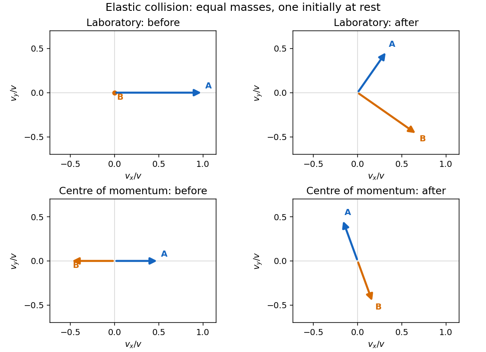
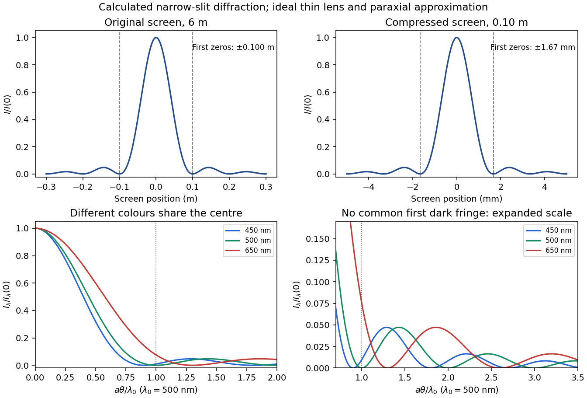
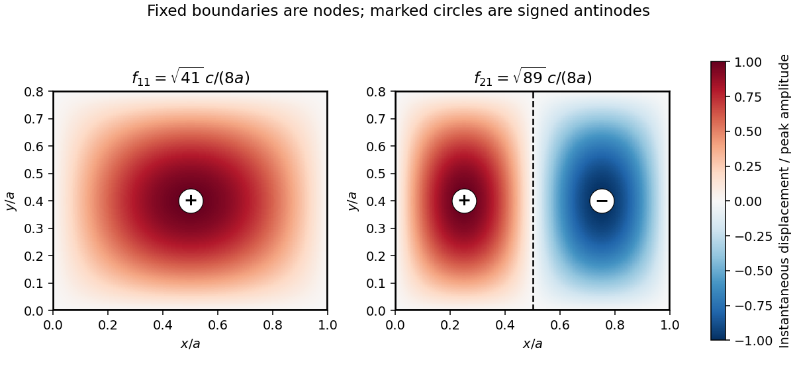

# Paper 1

↑ **Parent:** [2013](../2013.md)

Original paper: [Public original PDF, physical pages 11–22; cover on page 11, blank page 12, questions on pages 13–22](https://www.whatdotheyknow.com/request/natural_science_tripos_physics_e_2/response/2340776/attach/2/FOI%202023%20399%20Zahid%20materials.pdf?cookie_passthrough=1#page=11).

**Table of contents**

- [Section A](#section-a)
  - [1](#section-a/1)
    - [a](#section-a/1/a)
      - [Solution](#section-a/1/a/solution)
    - [b](#section-a/1/b)
      - [Solution](#section-a/1/b/solution)
  - [2](#section-a/2)
    - [Solution](#section-a/2/solution)
  - [3](#section-a/3)
    - [Solution](#section-a/3/solution)
  - [4](#section-a/4)
    - [Solution](#section-a/4/solution)
  - [5](#section-a/5)
    - [Solution](#section-a/5/solution)
  - [6](#section-a/6)
    - [a](#section-a/6/a)
      - [Solution](#section-a/6/a/solution)
    - [b](#section-a/6/b)
      - [Solution](#section-a/6/b/solution)
- [Section B](#section-b)
  - [B7](#section-b/b7)
    - [Solution](#section-b/b7/solution)
  - [B8](#section-b/b8)
    - [Solution](#section-b/b8/solution)
    - [a](#section-b/b8/a)
      - [Solution](#section-b/b8/a/solution)
    - [b](#section-b/b8/b)
      - [Solution](#section-b/b8/b/solution)
  - [B9](#section-b/b9)
    - [Solution](#section-b/b9/solution)
- [Section C](#section-c)
  - [C10](#section-c/c10)
    - [Solution](#section-c/c10/solution)
  - [C11](#section-c/c11)
    - [Solution](#section-c/c11/solution)
- [Section D](#section-d)
  - [D12](#section-d/d12)
    - [Solution](#section-d/d12/solution)
    - [a](#section-d/d12/a)
      - [Solution](#section-d/d12/a/solution)
    - [b](#section-d/d12/b)
      - [Solution](#section-d/d12/b/solution)
    - [c](#section-d/d12/c)
      - [Solution](#section-d/d12/c/solution)
  - [D13](#section-d/d13)
    - [Solution](#section-d/d13/solution)
- [Section E](#section-e)
  - [E14](#section-e/e14)
    - [Solution](#section-e/e14/solution)
  - [E15](#section-e/e15)
    - [a](#section-e/e15/a)
      - [Solution](#section-e/e15/a/solution)
    - [b](#section-e/e15/b)
      - [Solution](#section-e/e15/b/solution)
    - [c](#section-e/e15/c)
      - [Solution](#section-e/e15/c/solution)

## Section A

↑ **Parent:** [Paper 1](paper-1.md)

<h3 id="section-a/1">1</h3>

↑ **Parent:** [Section A](#section-a)

<h4 id="section-a/1/a">a</h4>

↑ **Parent:** [1](#section-a/1)

<h5 id="section-a/1/a/solution">Solution</h5>

↑ **Parent:** [A](#section-a/1/a)

For a [photon](../../quantum-mechanics.md#photon), $E=pc$ and $p=h/\lambda$. Therefore

$$
\boxed{E_\gamma=\frac{hc}{\lambda}=2.48\times10^4\,\mathrm{eV}=24.8\,\mathrm{keV}.}
$$

<h4 id="section-a/1/b">b</h4>

↑ **Parent:** [1](#section-a/1)

<h5 id="section-a/1/b/solution">Solution</h5>

↑ **Parent:** [B](#section-a/1/b)

The [de Broglie wavelength](../../wave-function.md#de-broglie-wavelength) fixes the same [momentum](../../momentum.md) $p=h/\lambda$, but the nonrelativistic [electron](../../physics.md#electron) has $K=p^2/(2m_e)$:

$$
\boxed{K_e=\frac{h^2}{2m_e\lambda^2}=6.02\times10^2\,\mathrm{eV}.}
$$

Here $K_e/(m_ec^2)\simeq0.00118$, consistent with the stated nonrelativistic approximation. The [photon energy](../../quantum-mechanics.md#photon-energy) and [electron](../../physics.md#electron) [kinetic energy](../../energy.md#kinetic-energy) are not interchangeable.

<h3 id="section-a/2">2</h3>

↑ **Parent:** [Section A](#section-a)

<h4 id="section-a/2/solution">Solution</h4>

↑ **Parent:** [2](#section-a/2)

For equal mean [mass densities](../../fluid-mechanics.md#density), $M_a/M_E=(r/R_E)^3$. Thus the asteroid's surface gravitational [acceleration](../../classical-mechanics.md#acceleration) is $g_a=g_Er/R_E$ and its [escape speed](../../energy.md#escape-velocity) is

$$
v_{\rm esc}^2=\frac{2GM_a}{r}=\frac{2g_Er^2}{R_E},\qquad
\boxed{r_{\max}=v_J\sqrt{\frac{R_E}{2g_E}}.}
$$

An explicit estimate of jumping ability is an [Earth](../../planetary-science.md#earth) jump height $H=0.50\,\mathrm m$, giving $v_J=\sqrt{2g_EH}\simeq3.1\,\mathrm{m\,s^{-1}}$. Consequently

$$
\boxed{r_{\max}=\sqrt{R_EH}\simeq1.8\,\mathrm{km}.}
$$

This is an order-of-magnitude estimate, scaling with assumed take-off [speed](../../classical-mechanics.md#speed); no unique human jump [speed](../../classical-mechanics.md#speed) is supplied. A spherical nonrotating asteroid and negligible atmosphere are assumed.

<h3 id="section-a/3">3</h3>

↑ **Parent:** [Section A](#section-a)

<h4 id="section-a/3/solution">Solution</h4>

↑ **Parent:** [3](#section-a/3)

Convert both radii to metres before evaluating the [moment of inertia](../../rigid-body-dynamics.md#moment-of-inertia):

$$
I=\tfrac12m(a^2+b^2)=1.1770375\times10^{-3}\,\mathrm{kg\,m^2}.
$$

Its linear differential is

$$
dI=\tfrac12(a^2+b^2)\,dm+ma\,da+mb\,db.
$$

For [independent](../../random-variable.md#independent-random-variables) [standard uncertainties](../../physics.md#standard-uncertainty), add the three contributions in quadrature:

$$
\sigma_I=\sqrt{[\tfrac12(a^2+b^2)\sigma_m]^2+(ma\sigma_a)^2+(mb\sigma_b)^2}
=2.81\times10^{-5}\,\mathrm{kg\,m^2},
\qquad
\boxed{I=(1.177\pm0.028)\times10^{-3}\,\mathrm{kg\,m^2}.}
$$

If the quoted errors are instead bounds, their first-order absolute contributions add, giving **$I\simeq(1.177\pm0.042)\times10^{-3}\,\mathrm{kg\,m^2}$**. Their statistical interpretation is not specified; the two conventions should remain distinct.

<h3 id="section-a/4">4</h3>

↑ **Parent:** [Section A](#section-a)

<h4 id="section-a/4/solution">Solution</h4>

↑ **Parent:** [4](#section-a/4)

Spherical symmetry makes the [electric field](../../electric-field.md) radial and constant in magnitude on each concentric [Gaussian surface](../../maxwell-equations.md#gaussian-surface). The enclosed charge is

$$
Q(r)=4\pi\int_0^r(as)s^2\,ds=\pi ar^4.
$$

[Gauss's law](../../maxwell-equations.md#gauss-s-law) therefore gives

$$
\boxed{\mathbf E(r)=\frac{ar^2}{4\epsilon_0}\,\widehat{\mathbf r},\qquad
|\mathbf E|=\frac{|a|r^2}{4\epsilon_0}.}
$$

The direction is outward for $a>0$ and inward for $a<0$; the field vanishes at the centre. No exterior [boundary condition](../../differential-equation.md#boundary-condition) changes this spherically symmetric interior result.

<h3 id="section-a/5">5</h3>

↑ **Parent:** [Section A](#section-a)

<h4 id="section-a/5/solution">Solution</h4>

↑ **Parent:** [5](#section-a/5)

Write $K\propto m^\alpha R^\beta h^\delta$. Matching dimensions to $ML^2T^{-2}$ gives

$$
\delta=2,\qquad\alpha=-1,\qquad\beta=-2,
\qquad K=C\frac{h^2}{mR^2}.
$$

The dimensionless factor $C$ cancels when the same confinement geometry and state are scaled. Hence

$$
K_p=K_e\frac{m_e}{m_p}\left(\frac{R_e}{R_p}\right)^2,
\qquad
\boxed{K_p\simeq8.3\,\mathrm{MeV}.}
$$

Using $m_p/m_e\simeq1836$ gives this value. It remains small compared with the [proton](../../physics.md#proton) [rest energy](../../special-relativity.md#rest-energy), so the nonrelativistic mass-radius scaling is self-consistent.

<h3 id="section-a/6">6</h3>

↑ **Parent:** [Section A](#section-a)

<h4 id="section-a/6/a">a</h4>

↑ **Parent:** [6](#section-a/6)

<h5 id="section-a/6/a/solution">Solution</h5>

↑ **Parent:** [A](#section-a/6/a)

Use the [pion](../../standard-model.md#pion) [rest energy](../../special-relativity.md#rest-energy) supplied through its electron-mass ratio:

$$
m_\pi c^2=273(0.51\,\mathrm{MeV})=139.23\,\mathrm{MeV},\qquad
\gamma=1+\frac{K}{m_\pi c^2}=1.71824.
$$

Thus

$$
\boxed{v=c\sqrt{1-\gamma^{-2}}=0.813c\simeq2.44\times10^8\,\mathrm{m\,s^{-1}}.}
$$

<h4 id="section-a/6/b">b</h4>

↑ **Parent:** [6](#section-a/6)

<h5 id="section-a/6/b/solution">Solution</h5>

↑ **Parent:** [B](#section-a/6/b)

The laboratory [mean lifetime](../../relativistic-quantum-field.md#mean-lifetime-physics) is dilated to $\gamma\tau_0=44.7\,\mathrm{ns}$. Multiplying by the laboratory [speed](../../classical-mechanics.md#speed) gives

$$
\boxed{\langle\ell\rangle=v\gamma\tau_0\simeq10.9\,\mathrm m.}
$$

This is the mean of the exponential decay-distance distribution, not a fixed distance travelled by every [pion](../../standard-model.md#pion).

## Section B

↑ **Parent:** [Paper 1](paper-1.md)

<h3 id="section-b/b7">B7</h3>

↑ **Parent:** [Section B](#section-b)

<h4 id="section-b/b7/solution">Solution</h4>

↑ **Parent:** [B7](#section-b/b7)

In the [centre-of-momentum frame](../../special-relativity.md#center-of-momentum-frame) the two equal [masses](../../classical-mechanics.md#mass) have opposite [velocities](../../classical-mechanics.md#velocity). Conservation of [kinetic energy](../../energy.md#kinetic-energy) in an elastic collision fixes their common [speed](../../classical-mechanics.md#speed), so scattering changes their directions only. For incoming laboratory [velocities](../../classical-mechanics.md#velocity) $\mathbf v$ and $\mathbf0$, the frame [velocity](../../classical-mechanics.md#velocity) is $\mathbf V=\mathbf v/2$ and the incoming relative [velocities](../../classical-mechanics.md#velocity) are $\pm\mathbf v/2$. If the outgoing relative [velocities](../../classical-mechanics.md#velocity) are $\pm\mathbf w$, then $|\mathbf w|=v/2$ and the laboratory [velocities](../../classical-mechanics.md#velocity) are $\mathbf V\pm\mathbf w$. Their dot product is zero: **nonzero outgoing laboratory [velocities](../../classical-mechanics.md#velocity) are perpendicular**.

For this [smooth equal-disc oblique collision](../../classical-mechanics.md#smooth-equal-disc-oblique-collision), let $\mathbf n$ point from A to B at contact. The [impulse](../../classical-mechanics.md#impulse) acts only along $\mathbf n$; the tangential [velocity](../../classical-mechanics.md#velocity) of A is unchanged. With $\mathbf v\cdot\mathbf n=v\cos\theta$, equal [masses](../../classical-mechanics.md#mass) exchange their normal [velocity](../../classical-mechanics.md#velocity) components:

$$
\mathbf v_{Af}=\mathbf v-v\cos\theta\,\mathbf n,\qquad
\mathbf v_{Bf}=v\cos\theta\,\mathbf n.
$$

Therefore

$$
\boxed{v_{Af}=v\sin\theta,\qquad\angle(\mathbf v,\mathbf v_{Af})=\frac\pi2-\theta.}
$$

No rotation about a disc centre is generated by these central [impulses](../../classical-mechanics.md#impulse). At exactly head-on impact A stops, so its outgoing direction is undefined; the angle formula then denotes a limiting direction.

**[Figure 1](#section-b/b7/image-original-velocity-vector-construction-for-an-equal-mass-elastic-collision-before-and-after-impact-in-the-laboratory-and-centre-of-momentum-frames). Original velocity-vector construction for an equal-mass elastic collision, before and after impact in the laboratory and centre-of-momentum frames**.

For this [adhesive collision of two equal discs](../../classical-mechanics.md#adhesive-collision-of-two-equal-discs), use the [parallel axis theorem](../../rigid-body-dynamics.md#parallel-axis-theorem) about the midpoint of the touching centres:

$$
I_{\rm pair}=2(\tfrac12ma^2+ma^2)=3ma^2,\qquad
\mathbf L_{\rm CM}=(-a\mathbf n)\mathbin\times m\mathbf v.
$$

Its magnitude is $mav\sin\theta$. Linear and [angular momentum](../../momentum.md#angular-momentum) conservation give

$$
\boxed{\mathbf V_{\rm CM}=\frac{\mathbf v}{2},\qquad
|\Omega|=\frac{v\sin\theta}{3a},\qquad
K_f=mv^2\left(\frac14+\frac{\sin^2\theta}{6}\right).}
$$

The rotation has the sign of $\mathbf L_{\rm CM}$, clockwise for the printed geometry. The [energy](../../energy.md) loss is $mv^2(1/4-\sin^2\theta/6)>0$. After impact the midpoint translates uniformly and the rigid pair rotates uniformly about it: there are no external horizontal [forces](../../force.md) or axial [torques](../../momentum.md#torque).

Rough unglued edges can transmit a tangential [impulse](../../classical-mechanics.md#impulse) and generate [angular momentum](../../momentum.md#angular-momentum) about the individual disc centres. The centre-of-mass [velocity](../../classical-mechanics.md#velocity) and total [angular momentum](../../momentum.md#angular-momentum) still have the values above, but individual translational [speeds](../../classical-mechanics.md#speed), [angular velocities](../../rigid-body-dynamics.md#angular-velocity) and [energy](../../energy.md) loss require a [friction](../../newtonian-mechanics.md#friction)/contact law and normal restitution. **Roughness alone does not imply permanent sticking or the adhesive result.**

<h3 id="section-b/b8">B8</h3>

↑ **Parent:** [Section B](#section-b)

<h4 id="section-b/b8/solution">Solution</h4>

↑ **Parent:** [B8](#section-b/b8)

Take inertial axes parallel, with frame $S'$ moving at $+v\widehat{\mathbf x}$ relative to $S$ and origins coincident at zero time. The [Lorentz factor](../../special-relativity.md#lorentz-factor) is $\gamma_v=(1-v^2/c^2)^{-1/2}$; $\Delta x,\Delta y,\Delta t$ are separations of the same pair of events in $S$, and primed quantities are their separations in $S'$. The transverse coordinates are unchanged. For two events on an inertial clock's worldline,

$$
c^2\Delta\tau^2=c^2\Delta t^2-|\Delta\mathbf r|^2.
$$

The [proper time](../../special-relativity.md#proper-time) $\Delta\tau$ is that clock's elapsed time; uniform [speed](../../classical-mechanics.md#speed) $w$ gives $\Delta t=\gamma_w\Delta\tau$. Coordinate intervals between spatially separated events must instead be Lorentz-transformed with their spatial separation included.

For the round trip in the station frame, the rendezvous distance is $ut_{\rm out}$, and the return has the same [speed](../../classical-mechanics.md#speed) and distance. Thus $t_{\rm round}=2t_{\rm out}=10a/(\sqrt7c)$. Its departure and arrival both occur at the station, so $\Delta x=0$ for these endpoints:

$$
\boxed{\Delta t_{S,\rm round}=\frac{10}{\sqrt7}\,\mathrm{days}=3.780\,\mathrm{days},\qquad
\Delta t_{B,\rm round}=\gamma_v\Delta t_{S,\rm round}
=\frac{25}{2\sqrt7}\,\mathrm{days}=4.725\,\mathrm{days}.}
$$

This uses the return [speed](../../classical-mechanics.md#speed) as measured by the station. The elapsed time aboard A, apart from an ideal instantaneous turn, would be $\Delta t_{S,\rm round}/\gamma_u$.

For the crash, A's station-frame [velocity](../../classical-mechanics.md#velocity) components are $(3c/5,\sqrt7c/5)$, while B's are $(3c/5,0)$. Here $\gamma_u=5/3$ and $\gamma_v=5/4$. [Four-momentum conservation](../../special-relativity.md#four-momentum-conservation), with no separately escaping radiation, gives the wreckage totals in the station frame:

$$
\boxed{\mathbf P_S=mc\left(\frac74\widehat{\mathbf x}+\frac{\sqrt7}{3}\widehat{\mathbf y}\right),\qquad
E_S=\frac{35}{12}mc^2.}
$$

In B's original [inertial frame](../../mathematical-physics.md#inertial-frame) the same totals are

$$
\boxed{\mathbf P_B=\frac{\sqrt7}{3}mc\,\widehat{\mathbf y},\qquad E_B=\frac73mc^2.}
$$

The invariant wreckage [mass](../../classical-mechanics.md#mass) is $m\sqrt{14/3}$, exceeding $2m$ because [internal energy](../../internal-energy.md) remains in the wreckage. Its [momentum](../../momentum.md) cannot be specified without naming a frame; both natural frames have been given.

<h4 id="section-b/b8/a">a</h4>

↑ **Parent:** [B8](#section-b/b8)

<h5 id="section-b/b8/a/solution">Solution</h5>

↑ **Parent:** [A](#section-b/b8/a)

Put the station at $(0,0)$ and take B's initial position to be $(0,a)$. Interception after time $t$ requires A to cover displacement $(vt,a)$ at [speed](../../classical-mechanics.md#speed) $u$:

$$
u^2t^2=v^2t^2+a^2,\qquad
\boxed{t_{\rm out}=\frac{a}{\sqrt{u^2-v^2}}=\frac{5a}{\sqrt7c}=1.890\,\mathrm{days}.}
$$

The required launch components are $u_x=v=3c/5$ and $u_y=\sqrt{u^2-v^2}=\sqrt7c/5$.

<h4 id="section-b/b8/b">b</h4>

↑ **Parent:** [B8](#section-b/b8)

<h5 id="section-b/b8/b/solution">Solution</h5>

↑ **Parent:** [B](#section-b/b8/b)

Between launch and interception, $\Delta x=vt_{\rm out}$. The time-coordinate [Lorentz transformation](../../special-relativity.md#lorentz-transformation) therefore gives

$$
\Delta t_B=\gamma_v\left(t_{\rm out}-\frac{v^2t_{\rm out}}{c^2}\right)
=\frac{t_{\rm out}}{\gamma_v},\qquad
\boxed{\Delta t_B=\frac{4a}{\sqrt7c}=1.512\,\mathrm{days}.}
$$

This is an elapsed coordinate time in B's [inertial frame](../../mathematical-physics.md#inertial-frame), not the travel time on A's clock. The latter would be $t_{\rm out}/\gamma_u=3a/(\sqrt7c)$.

<h3 id="section-b/b9">B9</h3>

↑ **Parent:** [Section B](#section-b)

<h4 id="section-b/b9/solution">Solution</h4>

↑ **Parent:** [B9](#section-b/b9)

For a fixed rotation axis with constant [moment of inertia](../../rigid-body-dynamics.md#moment-of-inertia), the axial [torque](../../momentum.md#torque) obeys $\tau=I\ddot\theta$, with $\tau=\sum(\mathbf r\times\mathbf F)\cdot\widehat{\mathbf e}_{\rm axis}$. For a [point mass](../../classical-mechanics.md#point-mass) at radius $l$, the tangential equation is $F_t=ml\ddot\theta$; multiplying by $l$ gives $lF_t=ml^2\ddot\theta$, as required. Radial [forces](../../force.md) have zero moment about the axis.

Take increasing $\theta$ in the direction of the clapper's initial fall and let the contact [force](../../force.md) $N$ oppose that tangential motion. Initial equilibrium of the clapper gives

$$
Nl=mgl\sin\beta,\qquad\boxed{N_{\rm initial}=mg\sin\beta.}
$$

While contact persists the bell and clapper rotate together. Their respective offsets from the upward vertical are $\theta-\beta$ and $\theta$. Summing external gravitational moments eliminates their internal contact [force](../../force.md):

$$
\boxed{\ddot\theta=\frac{Mgh\sin(\theta-\beta)+mgl\sin\theta}{Mk^2+ml^2}.}
$$

The clapper alone satisfies $ml^2\ddot\theta=mgl\sin\theta-Nl$. Hence for $m\ll M$,

$$
\boxed{N\simeq mg\left[\sin\theta-\frac{lh}{k^2}\sin(\theta-\beta)\right].}
$$

A nonadhesive contact cannot exert tension. The first zero of this expression on the released trajectory is the loss-of-contact angle. Write $q=lh/k^2=0.9375$. Then

$$
(1-q\cos\beta)\sin\theta_0+q\sin\beta\cos\theta_0=0,
\qquad
\boxed{\theta_0=111.9^\circ.}
$$

The second-quadrant root is reached from $\theta=\beta=30^\circ$; selecting the principal negative arctangent would choose the wrong branch. Indeed the exact contact [force](../../force.md) before taking $m/M\to0$ is $mMg[k^2\sin\theta-lh\sin(\theta-\beta)]/(Mk^2+ml^2)$, so its zero is unchanged.

## Section C

↑ **Parent:** [Paper 1](paper-1.md)

<h3 id="section-c/c10">C10</h3>

↑ **Parent:** [Section C](#section-c)

<h4 id="section-c/c10/solution">Solution</h4>

↑ **Parent:** [C10](#section-c/c10)

Measure $x$ from the static equilibrium position, so the constant gravitational [force](../../force.md) has already cancelled the equilibrium [spring](../../elasticity-physics.md#spring) [force](../../force.md). With stationary oil, [Newton's second law](../../force.md#newton-s-second-law) gives $m\ddot x=-b\dot x-kx$. The characteristic exponents are $-\gamma\pm i\omega_1$, where

$$
\boxed{\gamma=\frac{b}{2m},\qquad\omega_1=\sqrt{\frac{k}{m}-\frac{b^2}{4m^2}},\qquad b^2<4mk.}
$$

For the stipulated [phase](../../wave.md#phase-waves) of the damped cosine,

$$
U(t)=\frac12kA^2e^{-2\gamma t}\cos^2(\omega_1t),\qquad
K(t)=\frac12mA^2e^{-2\gamma t}[\gamma\cos(\omega_1t)+\omega_1\sin(\omega_1t)]^2.
$$

At $t_n=2\pi n/\omega_1$, the [velocity](../../classical-mechanics.md#velocity) is not zero: $\dot x=-\gamma Ae^{-\gamma t_n}$. Thus

$$
E_n=\tfrac12(k+m\gamma^2)A^2e^{-2\gamma t_n},\qquad
\boxed{\frac{E_{n+1}}{E_n}=e^{-4\pi\gamma/\omega_1},\quad
\frac{E_n-E_{n+1}}{E_n}=1-e^{-4\pi\gamma/\omega_1}.}
$$

Expanding $e^{-z}$ at small $z=4\pi\gamma/\omega_1$ gives the requested light-damping loss $z$. The exact instantaneous [energy](../../energy.md) also satisfies $dE/dt=-b\dot x^2\leq0$.

From the static extension, $k=mg/(0.20\,\mathrm m)=44.145\,\mathrm{N\,m^{-1}}$; the instantaneous drag measurement gives $b=0.10\,\mathrm{N\,s\,m^{-1}}$. Consequently $\gamma=0.05556\,\mathrm{s^{-1}}$ and $\omega_1=7.003\,\mathrm{s^{-1}}$. Two successive downward equilibrium crossings are one damped period apart, so the same [energy](../../energy.md) ratio applies. At the first crossing $E=mv^2/2=1.125\times10^{-3}\,\mathrm J$. Therefore

$$
\boxed{\Delta E=1.07\times10^{-4}\,\mathrm J,\qquad
v_{\rm next}=v e^{-2\pi\gamma/\omega_1}=0.04757\,\mathrm{m\,s^{-1}}.}
$$

The [speed](../../classical-mechanics.md#speed) has **decreased by $2.43\times10^{-3}\,\mathrm{m\,s^{-1}}=0.243\,\mathrm{cm\,s^{-1}}$**. These values use the exact decay factor, not the first-order approximation.

<h3 id="section-c/c11">C11</h3>

↑ **Parent:** [Section C](#section-c)

<h4 id="section-c/c11/solution">Solution</h4>

↑ **Parent:** [C11](#section-c/c11)

In series the same current passes through both [resistors](../../electric-charge.md#resistor), while their [voltage](../../random-walk.md#voltage) drops add: $V=I(R_1+R_2)$. In parallel the same [voltage](../../random-walk.md#voltage) drives currents $V/R_1$ and $V/R_2$, which add. Thus $R_s=R_1+R_2$ and $R_p^{-1}=R_1^{-1}+R_2^{-1}$.

Use [phasors](../../wave.md#phasor) proportional to $e^{i\omega t}$. Then $Z_L=i\omega L$ and $Z_C=1/(i\omega C)$. The printed diagram places C in parallel with the series RL branch, so the input admittance is

$$
Y=\frac1Z=i\omega C+\frac1{R+i\omega L},\qquad
\operatorname{Re}Y=\frac{R}{R^2+\omega^2L^2},\quad
\operatorname{Im}Y=\omega\left(C-\frac{L}{R^2+\omega^2L^2}\right).
$$

Its nonzero zero-phase [frequency](../../wave.md#frequency) exists for $R^2<L/C$:

$$
\boxed{\omega_1=\sqrt{\frac1{LC}-\frac{R^2}{L^2}}.}
$$

At zero [frequency](../../wave.md#frequency), $|Y|=1/R$ and $I_0=V_0/R$. At $\omega_1$, $R^2+\omega_1^2L^2=L/C$, giving

$$
\boxed{|Y(\omega_1)|=\frac{RC}{L},\qquad I_0(\omega_1)=\frac{V_0RC}{L}.}
$$

For $0<\omega<\omega_1$, $\operatorname{Im}Y<0$, so current lags [voltage](../../random-walk.md#voltage). At very high [frequency](../../wave.md#frequency), $Y\sim i\omega C$, so current leads by $\pi/2$. Zero [phase](../../wave.md#phase-waves) need not coincide exactly with the minimum current magnitude in this lossy network.

The three measured limits determine the components in order:

$$
R=\frac{V_0}{I_{\rm DC}}=100\,\Omega,\qquad
C=\frac{\alpha}{V_0}=2.50\times10^{-7}\,\mathrm F,\qquad
L=\frac{V_0RC}{I_0(\omega_1)}=0.100\,\mathrm H,
$$

$$
\boxed{\omega_1=6.245\times10^3\,\mathrm{rad\,s^{-1}}.}
$$

For the changed resistance, the quoted $0.6\,\mathrm{kHz}$ is an ordinary [frequency](../../wave.md#frequency), so $\omega'=2\pi(600\,\mathrm{s^{-1}})$. Keeping L and C fixed gives

$$
\boxed{R'=\sqrt{\frac LC-\omega'^2L^2}=5.08\times10^2\,\Omega.}
$$

## Section D

↑ **Parent:** [Paper 1](paper-1.md)

<h3 id="section-d/d12">D12</h3>

↑ **Parent:** [Section D](#section-d)

<h4 id="section-d/d12/solution">Solution</h4>

↑ **Parent:** [D12](#section-d/d12)

Across a uniformly illuminated slit, the [phase difference](../../wave.md#phase-difference) between its edges is $2\pi a\sin\theta/\lambda$. Integrating the complex [amplitude](../../wave.md#wave-amplitude) across the slit gives the single-slit [diffraction](../../quantum-scattering.md#diffraction) factor

$$
\frac{I(\theta)}{I(0)}=\left[\frac{\sin q}{q}\right]^2,\qquad q=\frac{\pi a\sin\theta}{\lambda}\simeq\frac{\pi a\theta}{\lambda}.
$$

Thus $\beta=\pi a/\lambda$ in the small-angle [amplitude](../../wave.md#wave-amplitude) expression. The first noncentral zero has $q=\pi$, so $\theta_0\simeq\lambda/a$. At the stated approximate subsidiary maximum,

$$
\boxed{\frac{I(1.5\lambda/a)}{I(0)}\simeq\frac4{9\pi^2}=0.0450.}
$$

The exact first side maximum solves $\tan q=q$, giving $q\simeq4.493$ and [intensity](../../wave.md#intensity-physics) ratio $0.0472$; the requested approximation need not be mistaken for the exact maximum.

A [virtual object](../../geometrical-optics.md#virtual-object) is a point toward which incident rays are already converging and would meet if the lens were removed. With real-is-positive object/image distances it has $u<0$. The thin-lens equation gives $1/v=1/f-1/u$; as $u\to-\infty$, **$v\to f$**, so a distant [virtual object](../../geometrical-optics.md#virtual-object) images in the rear focal plane.

Without the lens, $y\simeq L\theta$ puts the central maximum at zero and the first dark fringes at $y=\pm L\lambda_0/a=\pm0.100\,\mathrm m$. Subsequent zeros are integer multiples, and weaker subsidiary maxima lie between them.

For the finite-distance pattern compression, take the old screen as the prospective image plane at $L=6\,\mathrm m$, with $u=-L$, and the new screen at $d=0.10\,\mathrm m$. Then

$$
\frac1f=\frac1d-\frac1L,\qquad
f=\frac{Ld}{L-d}=0.101695\,\mathrm m,\qquad
\boxed{R=(n-1)f=0.0610\,\mathrm m.}
$$

The plane surface has infinite [radius of curvature](../../differential-geometry.md#radius-of-curvature). The transverse scale is $d/L=1/60$, yielding

$$
\boxed{y_{0,\rm new}=\frac dL y_{0,\rm old}=\frac{d\lambda_0}{a}=1.67\,\mathrm{mm}.}
$$

The finite-distance scaling can also be checked without treating an [intensity](../../wave.md#intensity-physics) pattern as a collection of geometrical point objects: the slit-to-screen Fresnel integral after a [thin lens](../../geometrical-optics.md#thin-lens) has quadratic coefficient $1/d-1/f=1/L$ and linear term $-y/d$. It therefore reproduces the old [diffraction](../../quantum-scattering.md#diffraction) pattern at transverse coordinate $Y=Ly/d$, up to an overall [amplitude](../../wave.md#wave-amplitude) and [phase](../../wave.md#phase-waves). If the old far-field plane is treated as infinitely distant, the equally useful leading approximation is $f=d$, $R=6.0\,\mathrm{cm}$; the finite-distance correction is only $1.7\%$.

**[Figure 2](#section-d/d12/image-original-single-slit-intensity-plots-at-the-original-and-compressed-screens-and-wavelength-dependent-angular-patterns-for-three-representative-visible-colours). Original single-slit intensity plots at the original and compressed screens, and wavelength-dependent angular patterns for three representative visible colours**.

The colour discussion below assumes a smooth white incident spectrum and neglects lens dispersion when comparing the ideal [diffraction](../../quantum-scattering.md#diffraction) patterns.

<h4 id="section-d/d12/a">a</h4>

↑ **Parent:** [D12](#section-d/d12)

<h5 id="section-d/d12/a/solution">Solution</h5>

↑ **Parent:** [A](#section-d/d12/a)

At zero angle every slit element is in [phase](../../wave.md#phase-waves) for every [wavelength](../../wave-equation.md#wavelength). Their central maxima coincide, so **the centre is bright white**. Shorter [wavelengths](../../wave-equation.md#wavelength) have narrower central maxima; farther from the axis their contributions fade sooner, giving the central band reddish outer edges for a smooth white spectrum.

<h4 id="section-d/d12/b">b</h4>

↑ **Parent:** [D12](#section-d/d12)

<h5 id="section-d/d12/b/solution">Solution</h5>

↑ **Parent:** [B](#section-d/d12/b)

The first zero of each colour is at $\theta=\lambda/a$. Blue therefore reaches its first zero closer to the axis than the reference green [wavelength](../../wave-equation.md#wavelength), and red reaches it farther away. At $\theta=\lambda_0/a$ the reference colour is absent, while other [wavelengths](../../wave-equation.md#wavelength) remain: **there is no common black first minimum in white [light](../../optics.md#light)**. Adjacent regions change hue as different colour minima pass through them; [wavelengths](../../wave-equation.md#wavelength) longer than the reference are still in their central maxima and tend to dominate near its first zero. The exact hue depends on the incident spectrum and spectral response.

<h4 id="section-d/d12/c">c</h4>

↑ **Parent:** [D12](#section-d/d12)

<h5 id="section-d/d12/c/solution">Solution</h5>

↑ **Parent:** [C](#section-d/d12/c)

Farther out, successive maxima and zeros occur at different angles for each [wavelength](../../wave-equation.md#wavelength). Many colour bands overlap, so **the pattern becomes faint with increasingly washed-out colour contrast**, rather than retaining a single sharp monochromatic fringe system. The overall single-slit [intensity](../../wave.md#intensity-physics) falls with an approximately inverse-square angular envelope.

<h3 id="section-d/d13">D13</h3>

↑ **Parent:** [Section D](#section-d)

<h4 id="section-d/d13/solution">Solution</h4>

↑ **Parent:** [D13](#section-d/d13)

Substitution into the [wave equation](../../wave-equation.md) gives $\partial_x^2\psi+\partial_y^2\psi=-(k_x^2+k_y^2)\psi$ and $\partial_t^2\psi=-\omega^2\psi$. Therefore $\omega^2=c^2(k_x^2+k_y^2)$. The fixed edges at zero are automatically satisfied by the sine factors; the opposite edges require

$$
k_x=\frac{p\pi}{a},\quad k_y=\frac{q\pi}{b},\quad p,q=1,2,\ldots,\qquad
\boxed{f_{pq}=\frac c2\sqrt{\frac{p^2}{a^2}+\frac{q^2}{b^2}}.}
$$

Neither integer may vanish, because that would make the entire displacement zero.

The element's [mass](../../classical-mechanics.md#mass) is $\rho\,dx\,dy$, and its [speed](../../classical-mechanics.md#speed) is $-\omega A\sin(k_xx)\sin(k_yy)\sin(\omega t)$. Squaring and multiplying by half its [mass](../../classical-mechanics.md#mass) gives the requested [energy](../../energy.md) [density](../../fluid-mechanics.md#density). The two sine-squared spatial integrals are $a/2$ and $b/2$, so

$$
\boxed{K(t)=\frac{\rho ab\omega^2A^2}{8}\sin^2(\omega t),\qquad
\overline K=\frac{\rho ab\omega^2A^2}{16}.}
$$

There is no [dissipation](../../thermodynamics.md#dissipation). The total [mechanical energy](../../energy.md#mechanical-energy) equals the maximum [kinetic energy](../../energy.md#kinetic-energy), giving

$$
\boxed{U(t)=\frac{\rho ab\omega^2A^2}{8}\cos^2(\omega t).}
$$

Equivalently, integrate the small-slope tension [energy](../../energy.md) $\rho c^2|\nabla\psi|^2/2$ and use the [dispersion relation](../../dispersion-relation.md).

For $b=4a/5$, the two lowest [modes](../../probability-and-statistics.md#mode-statistics) are $(p,q)=(1,1)$ and $(2,1)$:

$$
\boxed{f_{11}=\frac{\sqrt{41}\,c}{8a},\qquad
f_{21}=\frac{\sqrt{89}\,c}{8a}.}
$$

The fundamental has one [antinode](../../wave-equation.md#antinode) at $(a/2,b/2)$ and no interior nodal line. The next [mode](../../probability-and-statistics.md#mode-statistics) has a [node](../../dynamical-systems.md#node-dynamical-systems) along $x=a/2$ and opposite-sign [antinodes](../../wave-equation.md#antinode) at $(a/4,b/2)$ and $(3a/4,b/2)$. Every boundary is a [node](../../dynamical-systems.md#node-dynamical-systems).

**[Figure 3](#section-d/d13/image-original-displacement-maps-for-the-two-lowest-modes-of-a-rectangular-membrane-showing-nodal-lines-and-signed-antinodes). Original displacement maps for the two lowest modes of a rectangular membrane, showing nodal lines and signed antinodes**.

The square fundamental has $f=c\sqrt2/(2\beta a)$. Equating it to $f_{11}$ gives

$$
\boxed{\beta=\sqrt{\frac{32}{41}}=0.88345.}
$$

At the same peak displacement [amplitude](../../wave.md#wave-amplitude) and [frequency](../../wave.md#frequency), time-averaged [kinetic energy](../../energy.md#kinetic-energy) is proportional to membrane area. Therefore

$$
\boxed{\frac{\overline K_{\rm square}}{\overline K_{\rm rectangle}}
=\frac{\beta^2a^2}{a(0.8a)}=\frac{40}{41}.}
$$

The reciprocal ratio is $41/40$ if the rectangle is placed first.

## Section E

↑ **Parent:** [Paper 1](paper-1.md)

<h3 id="section-e/e14">E14</h3>

↑ **Parent:** [Section E](#section-e)

<h4 id="section-e/e14/solution">Solution</h4>

↑ **Parent:** [E14](#section-e/e14)

In [magnetostatics](../../electromagnetism.md#magnetostatics) [Ampère's circuital law](../../maxwell-equations.md#ampere-s-circuital-law) is $\oint\mathbf B\cdot d\mathbf l=\mu_0I_{\rm enc}$. Its general vacuum version adds $\mu_0\epsilon_0\,d\Phi_E/dt$ on the right. [Faraday's law](../../maxwell-equations.md#faraday-s-law-of-induction) is $\mathcal E=\oint\mathbf E\cdot d\mathbf l=-d\Phi_B/dt$ for a fixed loop. A circular Amperian path around a long straight wire gives

$$
\boxed{B(r)=\frac{\mu_0 I}{2\pi r},}
$$

with direction given by the right-hand rule. The [force](../../force.md) on a wire element is $d\mathbf F=I\,d\mathbf l\times\mathbf B$; its magnitude is $I B\,dl\sin\chi$ and its direction follows this cross product.

Choose the straight-wire current rightward and the square below it, as printed. Its positive [magnetic field](../../magnetic-field.md) there is into the page. With an into-page loop normal, the [magnetic flux linkage](../../electromagnetism.md#magnetic-flux-linkage) is

$$
\Lambda=N\int_s^{s+a}\frac{\mu_0I}{2\pi r}a\,dr=\mathcal M I,
\qquad
\boxed{\mathcal M=\frac{\mu_0Na}{2\pi}\ln\frac{s+a}{s}.}
$$

Here $\mathcal M$ denotes [mutual inductance](../../electromagnetism.md#mutual-inductance), not a [mass](../../classical-mechanics.md#mass). Choose positive coil current to produce an out-of-page field. Then its induced current in the resistance-dominated approximation is

$$
\boxed{i(t)=\frac{\mathcal M}{R}\frac{dI}{dt}
=\frac{\mu_0\omega NaI_0}{2\pi R}\ln\frac{s+a}{s}\cos(\omega t).}
$$

This reproduces the specified sign with the declared orientation. It neglects coil [self-inductance](../../electromagnetism.md#self-inductance), requiring $\omega L_{\rm coil}\ll R$, as implicit in the requested expression.

The nearest side contains N parallel current segments and is at a uniform distance $s$, so its [force](../../force.md) magnitude is

$$
\boxed{F_{\rm near}=\frac{\mu_0Na}{2\pi s}|I(t)i(t)|.}
$$

The two sides perpendicular to the wire have opposite currents and equal [magnetic fields](../../magnetic-field.md) at corresponding distances; their [forces](../../force.md) cancel pairwise. The far side opposes the near-side [force](../../force.md) and has the smaller field. Thus

$$
\boxed{F_{\rm total}=\frac{\mu_0Na}{2\pi}|I(t)i(t)|
\left(\frac1s-\frac1{s+a}\right).}
$$

When $I$ and $i$ have the same sign under the chosen conventions, the near-side coil current opposes the straight-wire current and the total [force](../../force.md) is away from the wire; otherwise it is toward it. In particular the signed [force](../../force.md) alternates with $\sin(\omega t)\cos(\omega t)$. The coil is fixed, so these [forces](../../force.md) do no mechanical work on it. The mean [Joule heating](../../electric-charge.md#joule-heating) is

$$
\boxed{\overline P=R\overline{i^2}=\frac{\mathcal M^2\omega^2I_0^2}{2R}.}
$$

<h3 id="section-e/e15">E15</h3>

↑ **Parent:** [Section E](#section-e)

<h4 id="section-e/e15/a">a</h4>

↑ **Parent:** [E15](#section-e/e15)

<h5 id="section-e/e15/a/solution">Solution</h5>

↑ **Parent:** [A](#section-e/e15/a)

A [gravitational field](../../physics.md#gravitational-field) is [force](../../force.md) per unit test [mass](../../classical-mechanics.md#mass), $\mathbf g=\mathbf F/m$. [Newton's law of universal gravitation](../../newton-s-law-of-universal-gravitation.md) gives the field of a [point mass](../../classical-mechanics.md#point-mass) M:

$$
\boxed{\mathbf g=-\frac{GM}{r^2}\widehat{\mathbf r},\qquad
\Phi=-\frac{GM}{r},\qquad\mathbf g=-\nabla\Phi.}
$$

The potential is [potential energy](../../energy.md#potential-energy) per unit [mass](../../classical-mechanics.md#mass), with zero at infinity for an isolated [mass](../../classical-mechanics.md#mass). Fields and potentials superpose. The potential difference fixes the work per unit [mass](../../classical-mechanics.md#mass), and a conservative [gravitational field](../../physics.md#gravitational-field) has zero circulation around a closed path.

For a continuous [mass distribution](../../classical-mechanics.md#mass-distribution), the gravitational Gauss law is $\oint\mathbf g\cdot d\mathbf S=-4\pi GM_{\rm enc}$. A spherical body therefore has the same exterior field as a [point mass](../../classical-mechanics.md#point-mass) at its centre. Inside a uniform sphere of [density](../../fluid-mechanics.md#density) $\rho$,

$$
\mathbf g=-\frac{4\pi G\rho}{3}\mathbf r.
$$

The field is continuous at its surface and vanishes at its centre. An empty spherical shell has zero interior field but a nonzero constant interior potential. Near a small region of [Earth](../../planetary-science.md#earth)'s surface one may approximate $\mathbf g$ as uniform and the potential change as $g\Delta h$. Farther away its spatial [gradient](../../multivariable-calculus.md#gradient) produces tidal relative [accelerations](../../classical-mechanics.md#acceleration). Escape to infinity from radius R requires [speed](../../classical-mechanics.md#speed) $\sqrt{2GM/R}$ when rotation and other bodies are neglected.

<h4 id="section-e/e15/b">b</h4>

↑ **Parent:** [E15](#section-e/e15)

<h5 id="section-e/e15/b/solution">Solution</h5>

↑ **Parent:** [B](#section-e/e15/b)

The [Lorentz force](../../relativistic-electromagnetism.md#lorentz-force) determines the trajectory:

$$
\boxed{\frac{d\mathbf p}{dt}=q(\mathbf E+\mathbf v\times\mathbf B),\qquad
\frac{dE}{dt}=q\mathbf E\cdot\mathbf v.}
$$

Thus a [magnetic field](../../magnetic-field.md) changes [momentum](../../momentum.md) direction but does no work; an [electric field](../../electric-field.md) can change the particle's [kinetic energy](../../energy.md#kinetic-energy). In a uniform [electric field](../../electric-field.md) with negligible [magnetic field](../../magnetic-field.md) and nonrelativistic [speed](../../classical-mechanics.md#speed), $\mathbf a=q\mathbf E/m$ is constant. A transverse initial [velocity](../../classical-mechanics.md#velocity) then gives a [parabola](../../euclidean-geometry.md#parabola).

In a uniform [magnetic field](../../magnetic-field.md), the parallel [velocity](../../classical-mechanics.md#velocity) is unchanged and the perpendicular motion is circular. Nonrelativistically,

$$
r_L=\frac{mv_\perp}{|q|B},\qquad\omega_c=\frac{|q|B}{m};
$$

the combined trajectory is a helix, with circulation reversed when the charge sign reverses. Relativistically $r_L=p_\perp/(|q|B)$ and the gyrofrequency is $|q|B/(\gamma m)$.

For perpendicular uniform fields in the magnetic-dominated case, the drift [velocity](../../classical-mechanics.md#velocity) is $\mathbf v_d=\mathbf E\times\mathbf B/B^2$, which obeys $\mathbf E+\mathbf v_d\times\mathbf B=0$. A particle at this [velocity](../../classical-mechanics.md#velocity) is undeflected: the crossed-field [velocity selector](../../relativistic-electromagnetism.md#velocity-selector) selects [speed](../../classical-mechanics.md#speed) $E/B$ in the appropriate direction, [independent](../../random-variable.md#independent-random-variables) of [mass](../../classical-mechanics.md#mass) and charge. Radiation reaction and collisions are neglected in these ideal trajectories.

<h4 id="section-e/e15/c">c</h4>

↑ **Parent:** [E15](#section-e/e15)

<h5 id="section-e/e15/c/solution">Solution</h5>

↑ **Parent:** [C](#section-e/e15/c)

In vacuum the electric and [magnetic field](../../magnetic-field.md) [energy](../../energy.md) [densities](../../fluid-mechanics.md#density) are

$$
\boxed{u_E=\frac{\epsilon_0E^2}{2},\qquad u_B=\frac{B^2}{2\mu_0}.}
$$

For example, charging a [capacitor](../../electromagnetism.md#capacitor) requires $U=\int_0^Q(q/C)\,dq=Q^2/(2C)=CV^2/2$. A [parallel-plate capacitor](../../electromagnetism.md#parallel-plate-capacitor) with $C=\epsilon_0A/d$ and $E=V/d$ then gives $U=\epsilon_0E^2Ad/2$, identifying the [electric field](../../electric-field.md) [energy](../../energy.md) [density](../../fluid-mechanics.md#density). Similarly an [inductor](../../electromagnetism.md#inductor) stores $LI^2/2$; applying this to a long [solenoid](../../magnetic-field.md#solenoid) yields $B^2/(2\mu_0)$ times its interior [volume](../../geometry-and-topology.md#volume).

Electromagnetic [energy](../../energy.md) is transported by the [Poynting vector](../../electromagnetic-wave.md#poynting-vector) $\mathbf S=\mathbf E\times\mathbf B/\mu_0$. Poynting's theorem,

$$
\frac{\partial(u_E+u_B)}{\partial t}+\nabla\cdot\mathbf S=-\mathbf J\cdot\mathbf E,
$$

expresses local [energy](../../energy.md) conservation and transfer to matter. In a vacuum [plane wave](../../wave-function.md#plane-wave) $E=cB$, so the two [energy](../../energy.md) [densities](../../fluid-mechanics.md#density) are equal and the [energy](../../energy.md) [flux](../../mathematical-physics.md#flux) has magnitude $c(u_E+u_B)$. For nondispersive linear media the corresponding reversible expressions are $\mathbf E\cdot\mathbf D/2$ and $\mathbf B\cdot\mathbf H/2$; they must not be applied unchanged to arbitrary dispersive or hysteretic materials.

## ↑ Ancestors (10)

1. [2013](../2013.md)
2. [Past exam of the physics course of the year 1 of the natural sciences course of the University of Cambridge](../../past-exam-of-the-physics-course-of-the-year-1-of-the-natural-sciences-course-of-the-university-of-cambridge.md)
3. [Physics course of the year 1 of the natural sciences course of the University of Cambridge](../../university-of-cambridge.md#physics-course-of-the-year-1-of-the-natural-sciences-course-of-the-university-of-cambridge)
4. [Year 1 of the natural sciences course of the University of Cambridge](../../university-of-cambridge.md#year-1-of-the-natural-sciences-course-of-the-university-of-cambridge)
5. [Year of the natural sciences course of the University of Cambridge](../../university-of-cambridge.md#year-of-the-natural-sciences-course-of-the-university-of-cambridge)
6. [Natural sciences course of the University of Cambridge](../../university-of-cambridge.md#natural-sciences-course-of-the-university-of-cambridge)
7. [Course of the University of Cambridge](../../university-of-cambridge.md#course-of-the-university-of-cambridge)
8. [University of Cambridge](../../university-of-cambridge.md)
9. [List of universities](../../README.md#list-of-universities)
10. [Codex Wiki](../../README.md)
