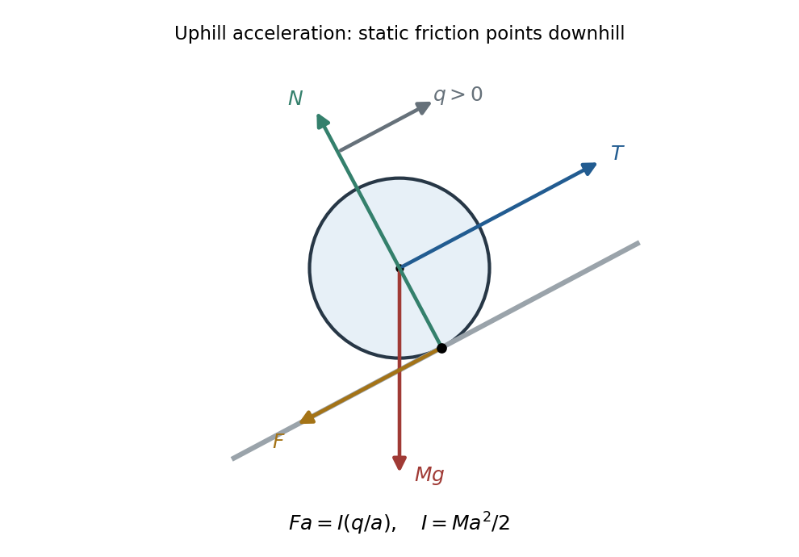

<h1 id="b7/solution">Solution</h1>

↑ **Parent:** [B7](../b7.md)

Take $q=\ddot x$ positive when the hanging [mass](../../../../mass.md) descends and the other [mass](../../../../mass.md) moves uphill. For the sliding block, [Newton's second law](../../../../newton-s-second-law.md) gives $mg-T=mq$ and $T-Mg\sin\theta=Mq$. Therefore

$$
\boxed{q=\frac{g(m-M\sin\theta)}{m+M},\qquad
T=\frac{mMg(1+\sin\theta)}{m+M}.}
$$

For the [pulley coupled to a rolling disc](../../../../pulley-coupled-to-a-rolling-disc.md), tension and weight act through its centre; the contact normal is perpendicular to the slope. [Static friction](../../../../static-friction.md) provides the [torque](../../../../torque.md) required for [rolling without slipping](../../../../rolling-without-slipping.md). Define signed $F$ down the slope, so $F>0$ for uphill [acceleration](../../../../acceleration.md).

**[Figure 1](#b7/image-original-force-diagram-for-an-uphill-accelerating-disc-centre-applied-tension-and-weight-contact-normal-and-downslope-static-friction). Original force diagram for an uphill-accelerating disc: centre-applied tension and weight, contact normal and downslope static friction**.

The rotational equation and rolling constraint give $Fa=I q/a$, hence $F=Mq/2$. The translational equations become $T-Mg\sin\theta-F=Mq$ and $mg-T=mq$, giving

$$
\boxed{q=\frac{2g(m-M\sin\theta)}{2m+3M},\qquad
T=\frac{mMg(3+2\sin\theta)}{2m+3M},\qquad
F=\frac{Mg(m-M\sin\theta)}{2m+3M}.}
$$

Thus **the threshold remains $m>M\sin\theta$**: the [moment of inertia](../../../../moment-of-inertia.md) increases the effective [mass](../../../../mass.md) but does not change the sign of the driving [force](../../../../force-split.md). For downhill [acceleration](../../../../acceleration.md) $F$ reverses. The [normal force](../../../../normal-force.md) is $Mg\cos\theta$; [static friction](../../../../static-friction.md) does no work at the stationary contact point and sufficient roughness is assumed.

## ↑ Ancestors (12)

1. [B7](../b7.md)
2. [Paper 1](../../paper-1-split.md)
3. [2014](../../split.md)
4. [Past exam of the physics course of the year 1 of the natural sciences course of the University of Cambridge](../../../split.md)
5. [Physics course of the year 1 of the natural sciences course of the University of Cambridge](../../../../physics-course-of-the-year-1-of-the-natural-sciences-course-of-the-university-of-cambridge.md)
6. [Year 1 of the natural sciences course of the University of Cambridge](../../../../year-1-of-the-natural-sciences-course-of-the-university-of-cambridge.md)
7. [Year of the natural sciences course of the University of Cambridge](../../../../year-of-the-natural-sciences-course-of-the-university-of-cambridge.md)
8. [Natural sciences course of the University of Cambridge](../../../../natural-sciences-course-of-the-university-of-cambridge.md)
9. [Course of the University of Cambridge](../../../../course-of-the-university-of-cambridge.md)
10. [University of Cambridge](../../../../university-of-cambridge-split.md)
11. [List of universities](../../../../list-of-universities.md)
12. [Codex Wiki](../../../../split.md)
