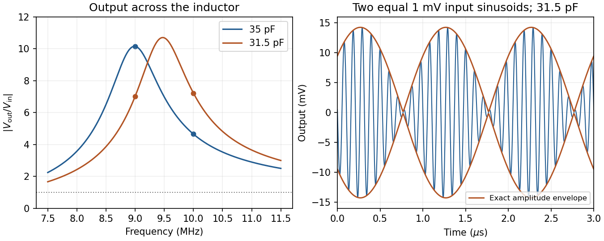

<h1 id="c10/solution">Solution</h1>

↑ **Parent:** [C10](../c10.md)

For sinusoidal [steady state](../../../../steady-state.md) with convention $e^{i\omega t}$, [complex impedance](../../../../electrical-impedance.md) is the [voltage](../../../../voltage.md) [phasor](../../../../phasor.md) divided by the current [phasor](../../../../phasor.md). Its modulus is the [amplitude](../../../../wave-amplitude.md) ratio and its argument is the voltage-current [phase difference](../../../../phase-difference.md). Since $V_L=L\,dI/dt$,

$$
Z_L=i\omega L,\qquad Z_C=\frac1{i\omega C},\qquad Z_R=R.
$$

The original circuit is a [series RLC circuit](../../../../series-rlc-circuit.md) with output across the [inductor](../../../../inductor.md). Its transfer function is

$$
\boxed{H(\omega)=\frac{V_2}{V_1}
=\frac{i\omega L}{R+i(\omega L-1/(\omega C))},\qquad
|V_2|=\frac{|V_1|\omega L}{\sqrt{R^2+(\omega L-1/(\omega C))^2}}.}
$$

For the original [capacitance](../../../../capacitance.md), the outputs are **$10.15\,\mathrm{mV}$ at $9\,\mathrm{MHz}$ and $4.65\,\mathrm{mV}$ at $10\,\mathrm{MHz}$**, a ratio $0.458$. The current [resonance](../../../../resonance.md) is $f_0=1/(2\pi\sqrt{LC})=8.967\,\mathrm{MHz}$, so the circuit favors the first transmitter.

The [resistor](../../../../resistor.md) [voltage](../../../../voltage.md) is in [phase](../../../../phase-waves.md) with the current; the [inductor](../../../../inductor.md) [voltage](../../../../voltage.md) leads it by $\pi/2$ and the [capacitor](../../../../capacitor.md) [voltage](../../../../voltage.md) lags by $\pi/2$. Large reactive [voltages](../../../../voltage.md) therefore nearly cancel in their [phasor](../../../../phasor.md) sum. A large [inductor](../../../../inductor.md) [voltage](../../../../voltage.md) is consistent with a small supply [voltage](../../../../voltage.md): it is **[inductor voltage magnification](../../../../inductor-voltage-magnification-in-a-series-rlc-circuit.md), not [power gain](../../../../power-gain.md)** in a passive circuit.

Reducing the [capacitance](../../../../capacitance.md) raises $f_0$ to $9.452\,\mathrm{MHz}$, between the two transmitters. Direct evaluation gives **$7.02\,\mathrm{mV}$ and $7.22\,\mathrm{mV}$**, respectively. Their similar detunings give approximately equal [amplitudes](../../../../wave-amplitude.md); they are not exactly equal, partly because the numerator of $H$ also depends on [frequency](../../../../frequency.md).

The [two-tone output of a linear resonant circuit](../../../../two-tone-output-of-a-linear-resonant-circuit.md), for coherent monochromatic sources of equal input [amplitude](../../../../wave-amplitude.md) and arbitrary fixed input [phases](../../../../phase-waves.md), is

$$
V_{\rm out}(t)=A\cos(2\pi f_A t+\phi_A)+B\cos(2\pi f_B t+\phi_B).
$$

With $A\simeq B=V_o$, this is approximately

$$
\boxed{V_{\rm out}\simeq2V_o
\cos\!\left[\pi(f_B-f_A)t+\frac{\phi_B-\phi_A}{2}\right]
\cos\!\left[2\pi\frac{f_A+f_B}{2}t+\frac{\phi_A+\phi_B}{2}\right].}
$$

Thus a $9.5\,\mathrm{MHz}$ rapid [oscillation](../../../../oscillation.md) has a [beat](../../../../beat.md) envelope repeating in magnitude at $1\,\mathrm{MHz}$. The signed envelope cosine has [frequency](../../../../frequency.md) $0.5\,\mathrm{MHz}$. Unequal [amplitudes](../../../../wave-amplitude.md) leave a small nonzero envelope minimum; independently drifting transmitter [phases](../../../../phase-waves.md) make the beating drift. No new [frequency](../../../../frequency.md) is generated by this ideal linear circuit.

**[Figure 2](#c10/image-original-calculated-inductor-voltage-gains-and-illustrative-two-tone-output-including-the-circuit-s-frequency-dependent-phase-shifts). Original calculated inductor-voltage gains and illustrative two-tone output, including the circuit's frequency-dependent phase shifts**.

## ↑ Ancestors (12)

1. [C10](../c10.md)
2. [Paper 1](../../paper-1-split.md)
3. [2014](../../split.md)
4. [Past exam of the physics course of the year 1 of the natural sciences course of the University of Cambridge](../../../split.md)
5. [Physics course of the year 1 of the natural sciences course of the University of Cambridge](../../../../physics-course-of-the-year-1-of-the-natural-sciences-course-of-the-university-of-cambridge.md)
6. [Year 1 of the natural sciences course of the University of Cambridge](../../../../year-1-of-the-natural-sciences-course-of-the-university-of-cambridge.md)
7. [Year of the natural sciences course of the University of Cambridge](../../../../year-of-the-natural-sciences-course-of-the-university-of-cambridge.md)
8. [Natural sciences course of the University of Cambridge](../../../../natural-sciences-course-of-the-university-of-cambridge.md)
9. [Course of the University of Cambridge](../../../../course-of-the-university-of-cambridge.md)
10. [University of Cambridge](../../../../university-of-cambridge-split.md)
11. [List of universities](../../../../list-of-universities.md)
12. [Codex Wiki](../../../../split.md)
