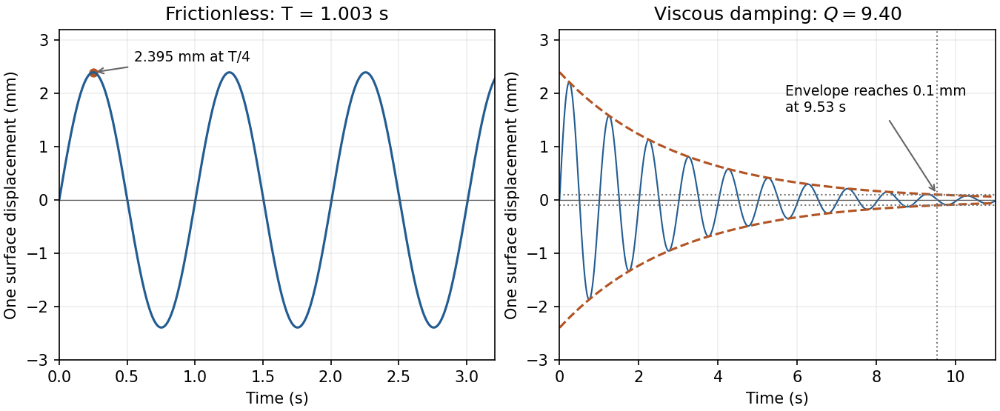

<h1 id="c11/solution">Solution</h1>

↑ **Parent:** [C11](../c11.md)

For the [spring](../../../../spring.md) oscillator,

$$
\frac{d}{dt}\left(\frac12m\dot x^2+\frac12kx^2\right)
=\dot x(m\ddot x+kx)=0,
$$

so **the total [mechanical energy](../../../../mechanical-energy.md) is conserved**.

For [U-tube liquid oscillation](../../../../u-tube-liquid-oscillation.md), define positive $y$ as the fall of the left surface, equal to the rise of the right surface. The hydrostatic height difference is $2y$. Moving a volume $A\,dy$ against this height difference gives $dU=2\rho gAy\,dy$, hence

$$
\boxed{U=\rho gAy^2,\qquad K=\frac12\rho Al\dot y^2.}
$$

[Energy](../../../../energy-split.md) conservation yields $\rho Al\dot y(\ddot y+2gy/l)=0$. Equivalently the net pressure [force](../../../../force-split.md) is $-2\rho gAy$, so the equation holds also at turning points:

$$
\boxed{\ddot y+\omega_0^2 y=0,\qquad
\omega_0=\sqrt{\frac{2g}{l}},\qquad
f_0=\frac1{2\pi}\sqrt{\frac{2g}{l}}.}
$$

With negligible added volume, $y(0)=0$, $\dot y(0)=0.015\,\mathrm{m\,s^{-1}}$. Thus

$$
\boxed{y(t)=(2.395\,\mathrm{mm})\sin[(6.264\,\mathrm{s^{-1}})t],\qquad
f_0=0.997\,\mathrm{Hz},\quad T=1.003\,\mathrm s.}
$$

The graph starts at zero with positive slope and first reaches its maximum after $T/4$.

**[Figure 3](#c11/image-original-u-tube-displacement-solutions-the-requested-frictionless-oscillation-and-the-viscously-damped-response-with-exponential-envelopes). Original U-tube displacement solutions: the requested frictionless oscillation and the viscously damped response with exponential envelopes**.

For [viscously damped U-tube oscillation](../../../../viscously-damped-u-tube-oscillation.md), the total [damping](../../../../damping.md) [force](../../../../force-split.md) is $-\beta l\dot y$, not $-\beta\dot y$. Consequently

$$
\ddot y+\Gamma\dot y+\omega_0^2y=0,\qquad
\Gamma=\frac{\beta}{\rho A}=0.6667\,\mathrm{s^{-1}},\qquad
\boxed{Q=\frac{\omega_0}{\Gamma}=9.40.}
$$

The underdamped initial-value solution is $y=(v_0/\omega_d)e^{-\Gamma t/2}\sin\omega_dt$, where $\omega_d=\sqrt{\omega_0^2-\Gamma^2/4}=6.255\,\mathrm{s^{-1}}$. Setting its [amplitude](../../../../wave-amplitude.md) envelope equal to $0.1\,\mathrm{mm}$ gives

$$
\boxed{t=\frac2\Gamma\ln\!\left(\frac{v_0/\omega_d}{0.1\,\mathrm{mm}}\right)=9.53\,\mathrm s.}
$$

This is the decay of the envelope, not the first time the instantaneous displacement passes through $0.1\,\mathrm{mm}$.

## ↑ Ancestors (12)

1. [C11](../c11.md)
2. [Paper 1](../../paper-1-split.md)
3. [2014](../../split.md)
4. [Past exam of the physics course of the year 1 of the natural sciences course of the University of Cambridge](../../../split.md)
5. [Physics course of the year 1 of the natural sciences course of the University of Cambridge](../../../../physics-course-of-the-year-1-of-the-natural-sciences-course-of-the-university-of-cambridge.md)
6. [Year 1 of the natural sciences course of the University of Cambridge](../../../../year-1-of-the-natural-sciences-course-of-the-university-of-cambridge.md)
7. [Year of the natural sciences course of the University of Cambridge](../../../../year-of-the-natural-sciences-course-of-the-university-of-cambridge.md)
8. [Natural sciences course of the University of Cambridge](../../../../natural-sciences-course-of-the-university-of-cambridge.md)
9. [Course of the University of Cambridge](../../../../course-of-the-university-of-cambridge.md)
10. [University of Cambridge](../../../../university-of-cambridge-split.md)
11. [List of universities](../../../../list-of-universities.md)
12. [Codex Wiki](../../../../split.md)
