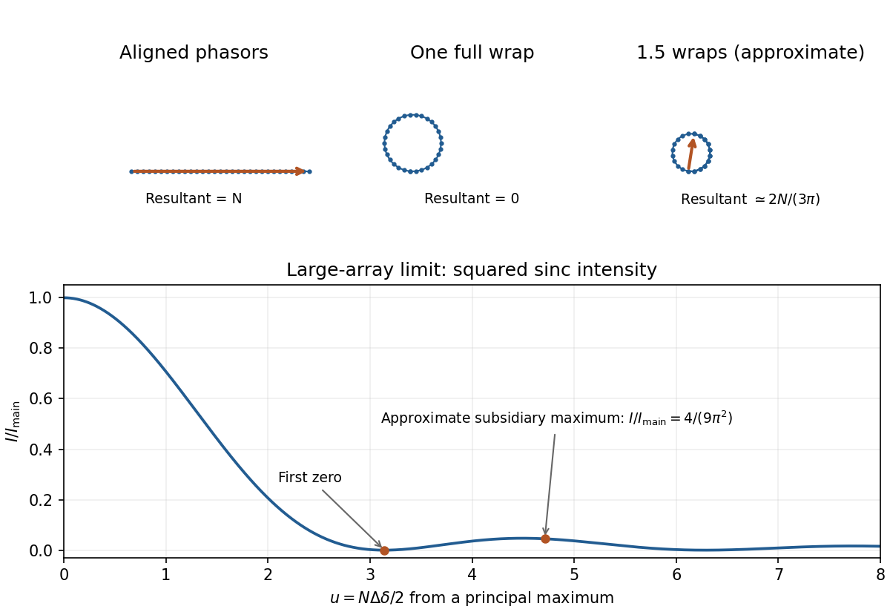

<h1 id="d13/solution">Solution</h1>

↑ **Parent:** [D13](../d13.md)

Represent each wave by a complex [phasor](../../../../phasor.md). Add [phasors](../../../../phasor.md) before squaring: two [amplitudes](../../../../wave-amplitude.md) give $I\propto|A_1+A_2e^{i\delta}|^2=A_1^2+A_2^2+2A_1A_2\cos\delta$. For $N$ equally illuminated narrow slits, adjacent [phasors](../../../../phasor.md) differ by $\delta=2\pi d\sin\theta/\lambda$, so

$$
S_N=\sum_{n=0}^{N-1}e^{in\delta}
=e^{i(N-1)\delta/2}\frac{\sin(N\delta/2)}{\sin(\delta/2)}.
$$

All [phasors](../../../../phasor.md) align when $\delta=2\pi m$, giving the [grating equation](../../../../grating-equation.md)

$$
\boxed{d\sin\theta_m=m\lambda,\qquad I_{\rm principal}=N^2I_1.}
$$

The nearest zero has adjacent-phase increment $2\pi/N$: the [phasor](../../../../phasor.md) polygon closes once. Thus $d\cos\theta_m\Delta\theta\simeq\lambda/N$, giving

$$
\boxed{\Delta\theta\simeq\frac{\lambda}{Nd\cos\theta_m}=\frac{\lambda}{W\cos\theta_m}.}
$$

The angular linearization is valid away from grazing directions; the underlying exact first-zero condition is $d(\sin\theta_{\rm zero}-\sin\theta_m)=\pm\lambda/N$.

For the [first subsidiary maximum of a large slit array](../../../../first-subsidiary-maximum-of-a-large-slit-array.md), use the stipulated $1.5$ [phasor](../../../../phasor.md) wraps: $N\delta/2\simeq3\pi/2$ relative to a principal maximum. Its [amplitude](../../../../wave-amplitude.md) is approximately $2N/(3\pi)$ times one slit's [amplitude](../../../../wave-amplitude.md). Therefore

$$
\boxed{\frac{I_{\rm principal}}{I_{\rm subsidiary}}\simeq\frac{9\pi^2}{4}=22.2.}
$$

This uses the question's approximate maximum position, not the exact extremum of the slit-array [intensity](../../../../intensity-physics.md).

**[Figure 4](#d13/image-original-phasor-sums-for-a-principal-maximum-the-adjacent-zero-and-the-approximate-first-subsidiary-maximum-calculated-large-array-intensity-shown-below). Original phasor sums for a principal maximum, the adjacent zero and the approximate first subsidiary maximum; calculated large-array intensity shown below**.

The [Rayleigh criterion](../../../../rayleigh-criterion.md) places one line's principal maximum at the other's first minimum. [Grating dispersion](../../../../grating-dispersion.md) then gives $|m|N\gtrsim\lambda/\delta\lambda=1.674\times10^6$. Combining with normal incidence, $|m|\lambda=d|\sin\theta|$, gives the [normal-incidence grating width bound](../../../../normal-incidence-grating-width-bound.md):

$$
\boxed{W\gtrsim\frac{\lambda^2}{\delta\lambda\,|\sin\theta|}
\ge\frac{\lambda^2}{\delta\lambda}=1.289\,\mathrm m.}
$$

The $1.29\,\mathrm m$ value is an ideal lower bound approached near grazing diffraction. A usable finite angle needs greater width; for example $\theta=60^\circ$ requires about $1.49\,\mathrm m$. The exact sine first-zero relation still gives the lower bound when the local angular approximation fails near grazing.

Such a coherently illuminated grating is very large and needs accurate groove placement and suitable collection optics; an unaided far-field screen would require distances much greater than $W^2/\lambda\sim2\times10^6\,\mathrm m$. Focusing optics avoid that screen distance but not the required [resolving power of a diffraction grating](../../../../resolving-power-of-a-diffraction-grating.md). Real linewidth, slit width and aberrations can require more resolution. The unequal [isotope](../../../../isotope.md) abundances also make this ideal Rayleigh estimate less decisive than for equally bright lines.

## ↑ Ancestors (12)

1. [D13](../d13.md)
2. [Paper 1](../../paper-1-split.md)
3. [2014](../../split.md)
4. [Past exam of the physics course of the year 1 of the natural sciences course of the University of Cambridge](../../../split.md)
5. [Physics course of the year 1 of the natural sciences course of the University of Cambridge](../../../../physics-course-of-the-year-1-of-the-natural-sciences-course-of-the-university-of-cambridge.md)
6. [Year 1 of the natural sciences course of the University of Cambridge](../../../../year-1-of-the-natural-sciences-course-of-the-university-of-cambridge.md)
7. [Year of the natural sciences course of the University of Cambridge](../../../../year-of-the-natural-sciences-course-of-the-university-of-cambridge.md)
8. [Natural sciences course of the University of Cambridge](../../../../natural-sciences-course-of-the-university-of-cambridge.md)
9. [Course of the University of Cambridge](../../../../course-of-the-university-of-cambridge.md)
10. [University of Cambridge](../../../../university-of-cambridge-split.md)
11. [List of universities](../../../../list-of-universities.md)
12. [Codex Wiki](../../../../split.md)
