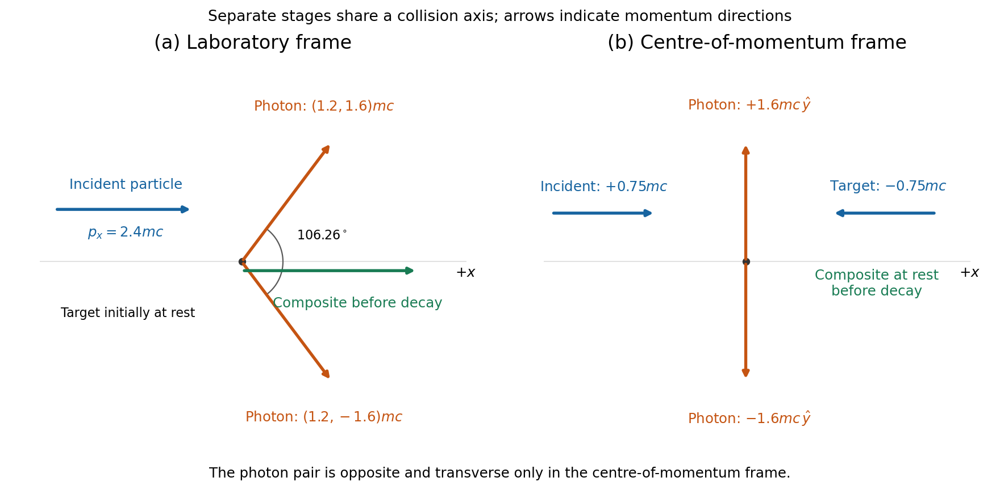
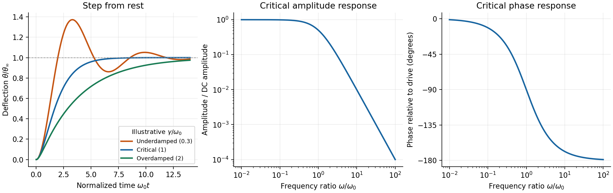
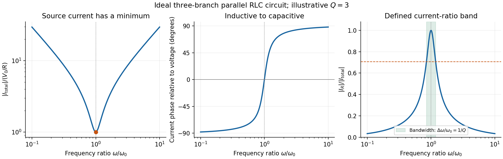

# Paper 1

↑ **Parent:** [2015](../2015.md)

Original solutions to the released 2015 paper. [Original public PDF, physical pages 34–46; the blank second side is retained in this physical numbering](https://www.whatdotheyknow.com/request/natural_science_tripos_physics_e_2/response/2340776/attach/2/FOI%202023%20399%20Zahid%20materials.pdf?cookie_passthrough=1#page=34)

**Table of contents**

- [Section A](#section-a)
  - [A1](#section-a/a1)
    - [Solution](#section-a/a1/solution)
  - [A2](#section-a/a2)
    - [Solution](#section-a/a2/solution)
  - [A3](#section-a/a3)
    - [Solution](#section-a/a3/solution)
  - [A4](#section-a/a4)
    - [Solution](#section-a/a4/solution)
  - [A5](#section-a/a5)
    - [Solution](#section-a/a5/solution)
  - [A6](#section-a/a6)
    - [Solution](#section-a/a6/solution)
- [Section B](#section-b)
  - [B7](#section-b/b7)
    - [Solution](#section-b/b7/solution)
  - [B8](#section-b/b8)
    - [Solution](#section-b/b8/solution)
  - [B9](#section-b/b9)
    - [Solution](#section-b/b9/solution)
    - [a](#section-b/b9/a)
      - [Solution](#section-b/b9/a/solution)
    - [b](#section-b/b9/b)
      - [Solution](#section-b/b9/b/solution)
- [Section C](#section-c)
  - [C10](#section-c/c10)
    - [Solution](#section-c/c10/solution)
  - [C11](#section-c/c11)
    - [Solution](#section-c/c11/solution)
- [Section D](#section-d)
  - [D12](#section-d/d12)
    - [Solution](#section-d/d12/solution)
  - [D13](#section-d/d13)
    - [Solution](#section-d/d13/solution)
- [Section E](#section-e)
  - [E14](#section-e/e14)
    - [Solution](#section-e/e14/solution)
  - [E15](#section-e/e15)
    - [a](#section-e/e15/a)
      - [Solution](#section-e/e15/a/solution)
    - [b](#section-e/e15/b)
      - [Solution](#section-e/e15/b/solution)
    - [c](#section-e/e15/c)
      - [Solution](#section-e/e15/c/solution)
    - [d](#section-e/e15/d)
      - [Solution](#section-e/e15/d/solution)

## Section A

↑ **Parent:** [Paper 1](paper-1.md)

<h3 id="section-a/a1">A1</h3>

↑ **Parent:** [Section A](#section-a)

<h4 id="section-a/a1/solution">Solution</h4>

↑ **Parent:** [A1](#section-a/a1)

Measure [displacement](../../classical-mechanics.md#displacement) from each arrangement's gravitational [equilibrium](../../dynamical-systems.md#equilibrium-point-of-a-dynamical-system). The [series and parallel spring stiffness](../../elasticity-physics.md#series-and-parallel-spring-stiffness) follows by adding [forces](../../force.md) or extensions. In the parallel arrangement the two [spring](../../elasticity-physics.md#spring) [forces](../../force.md) change by $kx$ each, giving equivalent stiffness $2k$. In series the common [force](../../force.md) $F$ extends each [spring](../../elasticity-physics.md#spring) by $F/k$, so total extension is $2F/k$ and the equivalent stiffness is $k/2$. Hence

$$
\boxed{f_{\parallel}=\frac1{2\pi}\sqrt{\frac{2k}{m}},\qquad f_{\rm series}=\frac1{2\pi}\sqrt{\frac{k}{2m}},\qquad\frac{f_{\parallel}}{f_{\rm series}}=2.}
$$

The corresponding [angular frequencies](../../lagrangian-mechanics.md#angular-frequency) are $2\pi f$. [gravity](../../physics.md#gravity) shifts the [equilibrium](../../dynamical-systems.md#equilibrium-point-of-a-dynamical-system) extensions but does not alter the small-oscillation stiffness of these ideal linear, massless [springs](../../elasticity-physics.md#spring).

<h3 id="section-a/a2">A2</h3>

↑ **Parent:** [Section A](#section-a)

<h4 id="section-a/a2/solution">Solution</h4>

↑ **Parent:** [A2](#section-a/a2)

For a [circular orbit](../../classical-mechanics.md#circular-orbit), $v^2/r=GM/r^2$. The relation for [circular orbital speed from surface gravity](../../classical-mechanics.md#circular-orbital-speed-from-surface-gravity) eliminates the planet's [gravitational parameter](../../newton-s-law-of-universal-gravitation.md#standard-gravitational-parameter): $GM=gR^2$. The orbital radius is $r=R+h=7.4\times10^6$ m, so

$$
\boxed{v=\sqrt{\frac{gR^2}{R+h}}=\sqrt{\frac{10(6.4\times10^6)^2}{7.4\times10^6}}\simeq7.44\times10^3\,\mathrm{m\,s^{-1}}.}
$$

This is about **7.4 km/s**, under the circular-orbit and spherical-Earth approximation. Using surface $g$ unchanged at orbital height would overestimate the [centripetal acceleration](../../classical-mechanics.md#centripetal-acceleration); its role here is to determine $GM$.

<h3 id="section-a/a3">A3</h3>

↑ **Parent:** [Section A](#section-a)

<h4 id="section-a/a3/solution">Solution</h4>

↑ **Parent:** [A3](#section-a/a3)

In the stipulated constant-speed model, the Earth-frame [speed](../../classical-mechanics.md#speed) is $v=D/t=3.844\times10^8/(76\times3600)\simeq1.405\times10^3$ m/s. The Earth and Moon are stationary endpoints in this model, so their Earth-frame separation $D$ is the [proper length](../../special-relativity.md#proper-length). The spacecraft-frame separation, measured simultaneously in that frame, is $D'=D/\gamma=D\sqrt{1-v^2/c^2}$. Thus

$$
D-D'=\frac{D(v/c)^2}{1+\sqrt{1-(v/c)^2}}\simeq\frac{Dv^2}{2c^2}\simeq4.22\times10^{-3}\,\mathrm m.
$$

**The spacecraft-frame [distance](../../geometry-and-topology.md#distance) is shorter by about 4.2 mm.** This compares simultaneous endpoint measurements in two frames, not the coordinate difference between a launch event and an arrival event. The [small-speed length contraction estimate](../../special-relativity.md#small-speed-length-contraction-estimate) also avoids numerical cancellation when evaluating the tiny contraction.

<h3 id="section-a/a4">A4</h3>

↑ **Parent:** [Section A](#section-a)

<h4 id="section-a/a4/solution">Solution</h4>

↑ **Parent:** [A4](#section-a/a4)

Adjacent slit contributions have [phase difference](../../wave.md#phase-difference) $\delta=2\pi d\sin\theta/\lambda$. The six-slit [amplitude](../../wave.md#wave-amplitude) is a [geometric sum](../../sequence-and-series.md#geometric-series) $\sum_{j=0}^{5}e^{ij\delta}=e^{5i\delta/2}\sin(3\delta)/\sin(\delta/2)$. The first zero away from the central maximum occurs at $\delta=2\pi/6$, where the denominator is nonzero. Therefore

$$
\boxed{\theta_1=\arcsin\frac{\lambda}{6d}=\arcsin\frac{550\times10^{-9}}{6\times100\times10^{-6}}\simeq9.17\times10^{-4}\,\mathrm{rad}=0.0525^\circ.}
$$

There is a matching zero at the negative [angle](../../geometry-and-topology.md#angle). This is the [first minimum of a finite slit array](../../physical-optics.md#first-minimum-of-a-finite-slit-array), rather than the much larger principal-order [angle](../../geometry-and-topology.md#angle) or a single-slit envelope minimum. The slits are stipulated sufficiently narrow for that envelope not to set the first zero.

<h3 id="section-a/a5">A5</h3>

↑ **Parent:** [Section A](#section-a)

<h4 id="section-a/a5/solution">Solution</h4>

↑ **Parent:** [A5](#section-a/a5)

Using metres and SI [viscosity](../../dynamic-viscosity.md), the pressure difference is $\Delta P=200$ Pa and the central flow estimate is

$$
Q=\frac{\pi(2.3\times10^{-3})^4(200)}{8(8.9\times10^{-4})(0.50)}=4.939\times10^{-6}\,\mathrm{m^3\,s^{-1}}.
$$

If the quoted uncertainties are independent [standard uncertainties](../../physics.md#standard-uncertainty), the pressure-difference uncertainty is $\sigma_{\Delta P}=\sqrt{10^2+10^2}=14.14$ Pa. First-order propagation gives

$$
\left(\frac{\sigma_Q}{Q}\right)^2=\left(4\frac{0.1}{2.3}\right)^2+\left(\frac{0.3}{8.9}\right)^2+\left(\frac{0.01}{0.50}\right)^2+\frac{10^2+10^2}{200^2}=0.03678.
$$

Hence

$$
\boxed{Q=(4.94\pm0.95)\times10^{-6}\,\mathrm{m^3\,s^{-1}}=(4.94\pm0.95)\,\mathrm{mL\,s^{-1}}.}
$$

The [radius sensitivity of Poiseuille-flow uncertainty](../../viscous-fluid-flow.md#radius-sensitivity-of-poiseuille-flow-uncertainty) comes from the fourth-power dependence on radius. If the quoted errors instead mean independent worst-case bounds, the first-order absolute fractional bound is $4(0.1/2.3)+0.3/8.9+0.01/0.50+20/200=0.3276$, giving approximately $\pm1.62\times10^{-6}$ m³/s. That conservative bound and the [standard uncertainty](../../physics.md#standard-uncertainty) result are different conventions, not interchangeable errors. The supplied flow model presumes a [Newtonian fluid](../../viscous-fluid-flow.md#newtonian-fluid) and [laminar flow](../../fluid-mechanics.md#laminar-flow) that is fully developed; no [density](../../fluid-mechanics.md#density) is given for an independent Reynolds-number check.

<h3 id="section-a/a6">A6</h3>

↑ **Parent:** [Section A](#section-a)

<h4 id="section-a/a6/solution">Solution</h4>

↑ **Parent:** [A6](#section-a/a6)

The dimensions are $[\rho]=ML^{-3}$, $[\sigma]=MT^{-2}$ and $[\lambda]=L$. Equating exponents in $LT^{-1}=M^{\alpha+\beta}L^{-3\alpha+\gamma}T^{-2\beta}$ yields

$$
\boxed{\alpha=-\frac12,\qquad\beta=\frac12,\qquad\gamma=-\frac12.}
$$

Thus the model has $v_{\rm ph}\propto\sqrt{\sigma/(\rho\lambda)}$. Its common dimensionless factor cancels in the ratio:

$$
\boxed{\frac{v_{\rm water}}{v_{\rm mercury}}=\sqrt{\frac{0.073}{0.490}\frac{13600}{1000}\frac{5}{10}}=1.0065\simeq1.01.}
$$

They are nearly equal within this capillary-wave model. The assumed [power law](../../analysis.md#power-law) omits gravitational restoring [forces](../../force.md) and finite-depth effects; [dimensional analysis](../../mathematical-physics.md#dimensional-analysis) cannot establish those omissions for an arbitrary real surface [wave](../../wave.md).

## Section B

↑ **Parent:** [Paper 1](paper-1.md)

<h3 id="section-b/b7">B7</h3>

↑ **Parent:** [Section B](#section-b)

<h4 id="section-b/b7/solution">Solution</h4>

↑ **Parent:** [B7](#section-b/b7)

An [impulse](../../classical-mechanics.md#impulse) is $\mathbf J=\int\mathbf F\,dt$, giving $\Delta\mathbf P=\mathbf J$. For a short localized [impulse](../../classical-mechanics.md#impulse) at [displacement](../../classical-mechanics.md#displacement) $\mathbf r$ from the [centre of mass](../../classical-mechanics.md#center-of-mass), the [angular impulse](../../momentum.md#angular-impulse) is $\Delta\mathbf L_{\rm CM}=\mathbf r\times\mathbf J$; for a changing lever arm use its instantaneous value inside the [integral](../../integral.md). For a uniform solid sphere with [volume](../../geometry-and-topology.md#volume) [density](../../fluid-mechanics.md#density) $\rho_V$, direct integration about the $z$ axis gives

$$
I=\rho_V\int_0^a r^4\,dr\int_0^\pi\sin^3\theta\,d\theta\int_0^{2\pi}d\phi=\frac{8\pi}{15}\rho_Va^5=\boxed{\frac25Ma^2}.
$$

Take forward translation $u$ and forward-rolling clockwise spin $\Omega$ as positive. Neglect the table's tangential [impulse](../../classical-mechanics.md#impulse) during the much shorter cue impact. Immediately afterwards,

$$
\boxed{u_0=\frac{I_p}{M},\qquad\Omega_0=\frac{dI_p}{I}=\frac{5dI_p}{2Ma^2}.}
$$

The bottom contact point has slip [velocity](../../classical-mechanics.md#velocity) $s_0=u_0-a\Omega_0$. The [cue height for immediate rolling](../../rigid-body-dynamics.md#cue-height-for-immediate-rolling) is therefore **$d=2a/5$**.

For the [impulse-driven slipping-to-rolling transition of a sphere](../../rigid-body-dynamics.md#impulse-driven-slipping-to-rolling-transition-of-a-sphere) at an arbitrary admissible impact height, let $J_f$ be the signed [friction](../../newtonian-mechanics.md#friction) [impulse](../../classical-mechanics.md#impulse) accumulated before slipping ends. Translation and spin then obey $u_f=u_0+J_f/M$ and $\Omega_f=\Omega_0-aJ_f/I$. Impose $u_f=a\Omega_f$ and eliminate $J_f$:

$$
\boxed{u_f=\frac{u_0+(I/(Ma))\Omega_0}{1+I/(Ma^2)}=\frac{5I_p}{7M}\left(1+\frac da\right).}
$$

This expression handles both sliding directions. If $d<2a/5$, the contact point slips forward and [friction](../../newtonian-mechanics.md#friction) slows the centre; if $d>2a/5$, excess spin makes it slip backward and [friction](../../newtonian-mechanics.md#friction) accelerates the centre. [friction](../../newtonian-mechanics.md#friction) still dissipates total [mechanical energy](../../energy.md#mechanical-energy). For $\mu_d>0$, $\dot s=-(7/2)\mu_dg\,\operatorname{sgn}s$, so the slipping time is $2|s_0|/(7\mu_dg)$. Its duration depends on [friction](../../newtonian-mechanics.md#friction), while the final [speed](../../classical-mechanics.md#speed) does not. With zero [friction](../../newtonian-mechanics.md#friction) no slipping-to-rolling transition occurs unless rolling was present from the outset.

<h3 id="section-b/b8">B8</h3>

↑ **Parent:** [Section B](#section-b)

<h4 id="section-b/b8/solution">Solution</h4>

↑ **Parent:** [B8](#section-b/b8)

[Newton's first law](../../force.md#newton-s-first-law) identifies [inertial frames](../../mathematical-physics.md#inertial-frame) in which a force-free body maintains constant [velocity](../../classical-mechanics.md#velocity). The second is $\dot{\mathbf P}=\mathbf F_{\rm net}$ for a closed system; for fixed [mass](../../classical-mechanics.md#mass) it becomes $m\mathbf a=\mathbf F$. The third gives equal and opposite pair [forces](../../force.md). Summing the second law over a closed collection cancels internal [force](../../force.md) pairs, so total [momentum](../../momentum.md) is conserved when the resultant external [force](../../force.md) vanishes. A rocket alone is an open variable-mass subsystem, so one must include the [momentum](../../momentum.md) carried by exhaust before applying this reasoning.

Choose downward [velocity](../../classical-mechanics.md#velocity) as positive and write $M(t)=M_0-\alpha t$. During $dt$, exhaust [mass](../../classical-mechanics.md#mass) $dm=\alpha dt$ leaves downward with [speed](../../classical-mechanics.md#speed) $v+v_E$ in the surface frame. To first order, [momentum](../../momentum.md) balance for rocket plus this exhaust gives

$$
Mv+Mg\,dt=(M-dm)(v+dv)+dm(v+v_E),\qquad \dot v=g-\frac{\alpha v_E}{M_0-\alpha t}.
$$

Integration, with $v(0)=v_0$, yields

$$
\boxed{v(t)=v_0+gt+v_E\log\frac{M_0-\alpha t}{M_0}.}
$$

Setting $g=0$ gives the gravity-free result. This assumes a constant downward relative exhaust [speed](../../classical-mechanics.md#speed), constant mass-loss rate and $M_0-\alpha t>0$ throughout the burn; the negative logarithm supplies the upward thrust effect.

Height satisfies $\dot h=-v$. Put $u(t)=1-\alpha t/M_0$. Integrating the logarithm and choosing $h(0)=h_0$ gives

$$
\boxed{h(t)=h_0-v_0t-\frac12gt^2+\frac{M_0v_E}{\alpha}[u\log u-u+1].}
$$

Equivalently, the last term is $v_E[t+(M_0-\alpha t)\log u/\alpha]$. Differentiating either form recovers $-v$ and checks the sign.

For this [constant-rate retro-rocket landing](../../momentum.md#constant-rate-retro-rocket-landing), at touchdown $u_L=3/4$ and $v_L=0$, hence

$$
\boxed{t_L=\frac{v_E\log(4/3)-v_0}{g}=12.481\,\mathrm s.}
$$

The fuel condition gives $\alpha=M_0/(4t_L)=200.30$ kg/s. Requiring $h(t_L)=0$ then gives

$$
\boxed{h_0=v_0t_L+\frac12gt_L^2-v_Et_L[1+3\log(3/4)]=275.4\,\mathrm m.}
$$

In this burn the downward [speed](../../classical-mechanics.md#speed) decreases monotonically to zero: the initial thrust acceleration already exceeds [gravity](../../physics.md#gravity) and increases as fuel is consumed. The result is the idealized vertical landing, without atmospheric drag, changing [gravity](../../physics.md#gravity) or a separate terminal burn [phase](../../wave.md#phase-waves).

<h3 id="section-b/b9">B9</h3>

↑ **Parent:** [Section B](#section-b)

<h4 id="section-b/b9/solution">Solution</h4>

↑ **Parent:** [B9](#section-b/b9)

For a particle of [rest mass](../../special-relativity.md#invariant-mass) $m_r$, $E=\gamma m_rc^2$ and $p=\gamma m_rv$, with $\gamma=(1-v^2/c^2)^{-1/2}$. The low-speed expansion is $E=m_rc^2+\tfrac12m_rv^2+O(m_rv^4/c^2)$, separating invariant [rest energy](../../special-relativity.md#rest-energy) from the nonrelativistic [kinetic energy](../../energy.md#kinetic-energy) term.

Conserve the total laboratory [energy](../../energy.md) and [momentum](../../momentum.md) at coalescence: $E_{\rm tot}=4mc^2$ and $p_{\rm tot}=2.4mc$. Since $V=c^2p_{\rm tot}/E_{\rm tot}$, **the combined particle moves at $0.6c$**. Its [rest mass](../../special-relativity.md#invariant-mass) is $M=\sqrt{4^2-2.4^2}\,m=3.2m$. The incident particle is not of [mass](../../classical-mechanics.md#mass) $m$: its stated [energy](../../energy.md) and [momentum](../../momentum.md) imply $m_{\rm incident}=\sqrt{3^2-2.4^2}\,m=1.8m$. Thus

$$
\boxed{M=3.2m>m_{\rm incident}+m_{\rm target}=2.8m.}
$$

The extra $0.4mc^2$ is internal [rest energy](../../special-relativity.md#rest-energy) retained by the composite after a [perfectly inelastic collision](../../classical-mechanics.md#perfectly-inelastic-collision); total [energy](../../energy.md) and [four-momentum](../../special-relativity.md#four-momentum) are conserved, while the sum of individual [rest masses](../../special-relativity.md#invariant-mass) need not be.

The composite's [Lorentz factor](../../special-relativity.md#lorentz-factor) is $1.25$. For a rest-frame lifetime $\tau$, the corresponding laboratory time is $1.25\tau$ and its travel [distance](../../geometry-and-topology.md#distance) is

$$
\boxed{\ell=V\gamma\tau=0.75c\tau.}
$$

If $\tau$ denotes a mean radioactive lifetime, this is the mean flight [distance](../../geometry-and-topology.md#distance), not a fixed [distance](../../geometry-and-topology.md#distance) for every decay. The separate frame diagrams below use the common positive collision axis.

**[Figure 1](#section-b/b9/image-original-momentum-direction-diagrams-for-the-laboratory-and-centre-of-momentum-frames-with-equal-energy-photons-and-the-composite-at-rest-in-its-own-frame). Original momentum-direction diagrams for the laboratory and centre-of-momentum frames, with equal-energy photons and the composite at rest in its own frame**.

<h4 id="section-b/b9/a">a</h4>

↑ **Parent:** [B9](#section-b/b9)

<h5 id="section-b/b9/a/solution">Solution</h5>

↑ **Parent:** [A](#section-b/b9/a)

In the [laboratory frame](../../mathematical-physics.md#laboratory-frame) the incoming particle and the composite move along $+x$, while the target is initially at rest. In the [equal-energy two-photon decay of a moving particle](../../physics.md#equal-energy-two-photon-decay-of-a-moving-particle), zero total transverse [momentum](../../momentum.md) makes the two [photon](../../quantum-mechanics.md#photon) directions symmetric about $+x$. Each [photon](../../quantum-mechanics.md#photon) has [energy](../../energy.md) $2mc^2$ and [momentum](../../momentum.md) magnitude $2mc$, so longitudinal [momentum conservation](../../momentum.md#momentum-conservation) gives $2(2mc)\cos\theta=2.4mc$. Therefore

$$
\boxed{\theta=\arccos0.6=53.130^\circ,\qquad\text{photon opening angle}=2\theta=106.260^\circ.}
$$

Their momenta can be written $(1.2,\pm1.6)mc$. The opening [angle](../../geometry-and-topology.md#angle) is not $180^\circ$ in this frame, because the parent carried nonzero total [momentum](../../momentum.md).

<h4 id="section-b/b9/b">b</h4>

↑ **Parent:** [B9](#section-b/b9)

<h5 id="section-b/b9/b/solution">Solution</h5>

↑ **Parent:** [B](#section-b/b9/b)

Boost along $+x$ at $0.6c$ into the [centre-of-momentum frame](../../special-relativity.md#center-of-momentum-frame). The composite is stationary. The incoming particle has $p'_x=1.25(2.4-0.6\times3)mc=0.75mc$, while the target has $p'_x=-0.75mc$. After decay the two [photons](../../quantum-mechanics.md#photon) have energies $Mc^2/2=1.6mc^2$ and opposite momenta.

Equal laboratory [photon](../../quantum-mechanics.md#photon) energies require the rest-frame [photons](../../quantum-mechanics.md#photon) to have zero [momentum](../../momentum.md) component along the boost: $E_{\rm lab}=\gamma(E'+Vp'_x)$ must be equal for two opposite [photons](../../quantum-mechanics.md#photon). Their directions are therefore **$+y$ and $-y$ in the centre-of-momentum diagram**, perpendicular to the incoming collision axis. Boosting those transverse [photons](../../quantum-mechanics.md#photon) gives exactly the laboratory momenta in part (a). A stationary composite has no direction-of-travel arrow in this frame.

## Section C

↑ **Parent:** [Paper 1](paper-1.md)

<h3 id="section-c/c10">C10</h3>

↑ **Parent:** [Section C](#section-c)

<h4 id="section-c/c10/solution">Solution</h4>

↑ **Parent:** [C10](#section-c/c10)

For the supplied linear meter model let $\omega_0^2=C/I$ and $2\gamma=\Phi_0^2/(RI)$. If the applied step is $i_s$, the settled deflection is $\theta_\infty=\Phi_0i_s/C$. An [underdamped](../../wave-equation.md#underdamping) response overshoots and rings about that value; a critically damped response reaches it monotonically without ringing; an [overdamped](../../wave-equation.md#overdamping) response is also monotone from these initial conditions but has a slower final approach. The original plot uses the common final value and natural-frequency time scale.

**[Figure 2](#section-c/c10/image-original-normalized-meter-step-responses-and-the-critically-damped-amplitude-and-phase-response). Original normalized meter step responses and the critically damped amplitude and phase response**.

The [critical step response of a galvanometer](../../electric-charge.md#critical-step-response-of-a-galvanometer) has $\gamma=\omega_0$ and repeated homogeneous root $-\omega_0$. Apply $\theta(0)=\dot\theta(0)=0$ to the general constant-force solution to obtain

$$
\boxed{\theta(t)=\theta_\infty[1-(1+\omega_0t)e^{-\omega_0t}],\qquad t\ge0.}
$$

Its [derivative](../../calculus.md#derivative) is $\theta_\infty\omega_0^2t e^{-\omega_0t}$, with the sign of the step. It is the fastest nonoscillatory response within this second-order family at fixed $\omega_0$, avoiding a needle that repeatedly crosses the reading or an unnecessarily slow [overdamped](../../wave-equation.md#overdamping) settling.

For sinusoidal drive choose $e^{i\omega t}$ [phasors](../../wave.md#phasor). Writing $F_0=\Phi_0i_0/I$, the response [amplitude](../../wave.md#wave-amplitude) is

$$
\Theta=\frac{F_0}{\omega_0^2-\omega^2+2i\gamma\omega},\qquad\theta(t)=|\Theta|\cos(\omega t+\phi),
$$

$$
|\Theta|=\frac{F_0}{\sqrt{(\omega_0^2-\omega^2)^2+4\gamma^2\omega^2}},\qquad \boxed{\phi=-\operatorname{atan2}(2\gamma\omega,\omega_0^2-\omega^2).}
$$

For positive $F_0$, choose the continuous lag branch from zero to $-\pi$ as [frequency](../../wave.md#frequency) increases; an ordinary single-argument arctangent without the quadrant would give the wrong high-frequency [phase](../../wave.md#phase-waves).

For the [critical galvanometer transfer function](../../electric-charge.md#critical-galvanometer-transfer-function), the denominator factors as $(\omega_0+i\omega)^2$. Thus

$$
\boxed{\theta(t)=\frac{F_0}{\omega_0^2+\omega^2}\cos(\omega t+\phi),\qquad \phi=-2\arctan(\omega/\omega_0).}
$$

For $\omega\ll\omega_0$, the meter follows the quasi-static deflection $\Phi_0i_0/C$ with a small lag $\phi\simeq-2\omega/\omega_0$. For $\omega\gg\omega_0$, its [amplitude](../../wave.md#wave-amplitude) is $F_0/\omega^2$ and its lag approaches $-\pi$.

The stated components give $\gamma=12.5$ s⁻¹ and, if critical, $\omega_0=12.5$ rad/s, or $f_0=1.99$ Hz. At 50 Hz, $\omega=314.16$ rad/s and

$$
\boxed{\frac{|\Theta(50\,\mathrm{Hz})|}{|\Theta(0)|}=\frac{12.5^2}{12.5^2+314.16^2}=1.58\times10^{-3},\qquad\phi=-175.44^\circ.}
$$

The needle barely responds compared with its DC sensitivity and its mean deflection for a pure sinusoid is zero in this linear model. **It is unsuitable for directly measuring 50-Hz [amplitude](../../wave.md#wave-amplitude) or RMS current without an additional [rectifier](../../electrical-circuit.md#rectifier) or another readout method.** The calculation treats $\Phi_0$ as the stipulated [torque](../../momentum.md#torque)/back-emf coefficient of the given equation; it does not infer an unprovided winding geometry.

<h3 id="section-c/c11">C11</h3>

↑ **Parent:** [Section C](#section-c)

<h4 id="section-c/c11/solution">Solution</h4>

↑ **Parent:** [C11](#section-c/c11)

Use $e^{i\omega t}$ [phasors](../../wave.md#phasor). The relation $V=L\dot I$ gives $Z_L=i\omega L$. The three branches form a [parallel RLC circuit](../../electrical-circuit.md#parallel-rlc-circuit) and share the source [voltage](../../random-walk.md#voltage). The source-current [phasor](../../wave.md#phasor) and its real time dependence are

$$
\widetilde I_{\rm total}=V_0\left[\frac1R+i\left(\omega C-\frac1{\omega L}\right)\right],
$$

$$
I_{\rm total}(t)=V_0\left[\frac{\cos\omega t}{R}-\left(\omega C-\frac1{\omega L}\right)\sin\omega t\right].
$$

Consequently its [amplitude](../../wave.md#wave-amplitude) is $V_0\sqrt{R^{-2}+(\omega C-1/(\omega L))^2}$ and its [phase](../../wave.md#phase-waves) relative to the [voltage](../../random-walk.md#voltage) is $\tan^{-1}[R(\omega C-1/(\omega L))]$. At low [frequency](../../wave.md#frequency) it is inductive and lags toward $-\pi/2$; at high [frequency](../../wave.md#frequency) it is capacitive and leads toward $+\pi/2$. The ideal [amplitude](../../wave.md#wave-amplitude) diverges at either extreme and has a finite minimum between them; real component losses and source [electrical impedance](../../electrical-circuit.md#electrical-impedance) limit those asymptotes.

**[Figure 3](#section-c/c11/image-original-normalized-source-current-amplitude-phase-and-resistor-to-source-current-ratio-for-an-illustrative-ideal-parallel-rlc-circuit). Original normalized source-current amplitude, phase and resistor-to-source-current ratio for an illustrative ideal parallel RLC circuit**.

Zero [phase](../../wave.md#phase-waves) requires cancellation of [electrical susceptances](../../electrical-circuit.md#electrical-susceptance):

$$
\boxed{\omega_{\rm res}=\frac1{\sqrt{LC}},\qquad|I_{\rm total}|_{\rm res}=\frac{V_0}{R}\quad\text{(minimum)}.}
$$

The [inductor](../../electromagnetism.md#inductor) and [capacitor](../../electromagnetism.md#capacitor) currents are nonzero, equal in magnitude and opposite in [phase](../../wave.md#phase-waves), while the [resistor](../../electric-charge.md#resistor) supplies the in-phase source current. [energy](../../energy.md) oscillates between the reactive elements; dissipation occurs in the shunt [resistor](../../electric-charge.md#resistor). A source-current maximum would describe a different, series-resonant circuit.

The specified ratio is

$$
\frac{|I_R|}{|I_{\rm total}|}=\frac1{\sqrt{1+R^2(\omega C-1/(\omega L))^2}}.
$$

It exceeds $1/\sqrt2$ when $|\omega C-1/(\omega L)|<1/R$. Define $b=1/(RC)$ and $\omega_0=1/\sqrt{LC}$. The two positive endpoints are $\omega_\pm=[\sqrt{b^2+4\omega_0^2}\pm b]/2$, so

$$
\boxed{\delta\omega=\omega_+-\omega_-=\frac1{RC},\qquad Q=\frac{\omega_0}{\delta\omega}=R\sqrt{\frac CL}.}
$$

The endpoints have geometric mean $\omega_0$. Increasing the parallel resistance reduces dissipative loading and narrows this band, in contrast with increasing the resistance of a [series RLC circuit](../../electrical-circuit.md#series-rlc-circuit). Equivalently, $Q=\omega_0U_{\max}/P_{\rm loss}$, with $U_{\max}=CV_0^2/2$ and $P_{\rm loss}=V_0^2/(2R)$. The [parallel RLC bandwidth](../../electrical-circuit.md#parallel-rlc-bandwidth) here belongs to the explicitly defined current ratio, not a half-maximum rule applied to a source-current peak that does not exist.

## Section D

↑ **Parent:** [Paper 1](paper-1.md)

<h3 id="section-d/d12">D12</h3>

↑ **Parent:** [Section D](#section-d)

<h4 id="section-d/d12/solution">Solution</h4>

↑ **Parent:** [D12](#section-d/d12)

Here $V(x)$ is [potential energy](../../energy.md#potential-energy), $E$ is the stationary state's total [energy](../../energy.md), and $\psi(x)$ is its spatial [probability amplitude](../../wave-function.md#probability-amplitude). The [wave function](../../wave-function.md) has time factor $e^{-iEt/\hbar}$; $|\psi|^2$ is a position [probability density](../../wave-function.md#probability-density) for a normalized state. Stationary plane-wave scattering solutions are idealizations described by probability-current ratios, or components of a normalizable [wave packet](../../dispersion-relation.md#wave-packet).

Above an upward step, a classical particle is fully transmitted with reduced [speed](../../classical-mechanics.md#speed). Quantum mechanically the abrupt [wavelength](../../wave-equation.md#wavelength) change generally produces both reflected and transmitted [amplitudes](../../wave.md#wave-amplitude) even though both regions are classically allowed. With unit incident [amplitude](../../wave.md#wave-amplitude) and no [wave](../../wave.md) arriving from the right,

$$
\psi(x)=\begin{cases}e^{ik_1x}+r e^{-ik_1x},&x<0,\\t e^{ik_2x},&x>0,\end{cases}\qquad k_1=\frac{\sqrt{2mE}}{\hbar},\quad k_2=\frac{\sqrt{2m(E-V_0)}}{\hbar}.
$$

The reflected component has signed wavevector $-k_1$ and the same [wavenumber](../../wave-equation.md#wavenumber) magnitude as the incident component. A finite potential jump with constant [mass](../../classical-mechanics.md#mass) and no delta interaction requires continuity of $\psi$ and $\psi'$:

$$
1+r=t,\qquad k_1(1-r)=k_2t,\qquad\boxed{r=\frac{k_1-k_2}{k_1+k_2},\quad t=\frac{2k_1}{k_1+k_2}.}
$$

The [probability current](../../wave-function.md#probability-current) $j=(\hbar/m)\operatorname{Im}(\psi^*\psi')$ gives probability reflection and transmission $\mathcal R=|r|^2$ and $\mathcal T=(k_2/k_1)|t|^2$, with $\mathcal R+\mathcal T=1$. The [amplitude](../../wave.md#wave-amplitude) $t$ may exceed one without violating conservation of total probability, because the transmitted group [speed](../../classical-mechanics.md#speed) is smaller.

For $0<E<V_0$, let $\kappa=\sqrt{2m(V_0-E)}/\hbar$. The bounded right-hand solution is $t e^{-\kappa x}$, an [evanescent wave](../../elasticity-physics.md#evanescent-wave) tail with [amplitude](../../wave.md#wave-amplitude) penetration scale $1/\kappa$. It carries no outgoing [probability current](../../wave-function.md#probability-current) in an infinitely long forbidden half-space, so reflection is total. This differs from transmission through a finite [potential barrier](../../quantum-mechanics.md#potential-barrier), where a second boundary can support [quantum tunnelling](../../quantum-mechanics.md#quantum-tunnelling).

For a downward step, replace $k_2$ by $\sqrt{2m(E+V_0)}/\hbar>k_1$. The same [boundary conditions](../../differential-equation.md#boundary-condition) give a nonzero negative $r$, corresponding to a reflected [amplitude](../../wave.md#wave-amplitude) with [phase](../../wave.md#phase-waves) reversal. If reflection were forbidden, $r=0$ would require both $t=1$ and $k_1=k_2$, impossible for a nonzero step. Reflection therefore does not require a classical [potential barrier](../../quantum-mechanics.md#potential-barrier); the discontinuity of [wavenumber](../../wave-equation.md#wavenumber) mismatch is enough.

For the specified [electron](../../physics.md#electron) energies, $k_2/k_1=\sqrt{40/100}=\sqrt{0.4}$, so the requested [amplitude](../../wave.md#wave-amplitude) coefficients are

$$
\boxed{r=0.22515,\qquad t=1.22515.}
$$

The corresponding probability coefficients are approximately $\mathcal R=0.05069$ and $\mathcal T=0.94931$. [electron mass](../../physics.md#electron-mass) cancels from these ratios; there is no need to invent an additional material [effective mass](../../bloch-s-theorem.md#band-effective-mass).

<h3 id="section-d/d13">D13</h3>

↑ **Parent:** [Section D](#section-d)

<h4 id="section-d/d13/solution">Solution</h4>

↑ **Parent:** [D13](#section-d/d13)

For a flexible uniform string with [linear mass density](../../fluid-mechanics.md#linear-mass-density) $\rho$ and [tension](../../force.md#tension) $T$, [dimensional analysis](../../mathematical-physics.md#dimensional-analysis) gives $[T/\rho]=L^2T^{-2}$ and hence $c\propto\sqrt{T/\rho}$. The small-slope [force](../../force.md) balance $\rho\psi_{tt}=T\psi_{xx}$ fixes the factor to one:

$$
\boxed{c=\sqrt{T/\rho},\qquad \omega=ck.}
$$

Here $\rho$ has units kg/m, not the volume-density units used for a bulk fluid. The [phase](../../wave.md#phase-waves) moves along the string at $c$, while a material point moves transversely with $\psi_t=A\omega\sin(kx-\omega t)$. Its maximum [speed](../../classical-mechanics.md#speed) is **$A\omega$**, which is not the [phase velocity](../../dispersion-relation.md#phase-velocity). Small slope $Ak\ll1$ makes $A\omega\ll c$ in this model.

The [kinetic energy](../../energy.md#kinetic-energy) and extra elastic [energy](../../energy.md) of a segment are

$$
K=\frac12\int\rho\psi_t^2\,dx,\qquad U=\frac12\int T\psi_x^2\,dx.
$$

The second expression follows from extra [length](../../physics.md#length) $\sqrt{1+\psi_x^2}dx-dx\simeq\psi_x^2dx/2$ against the pre-existing constant [tension](../../force.md#tension). Time averaging a harmonic [wave](../../wave.md) gives $\langle\mathcal E_K\rangle=\rho A^2\omega^2/4$ and $\langle\mathcal E_U\rangle=TA^2k^2/4=\rho A^2\omega^2/4$. Therefore

$$
\boxed{\varepsilon_{\rm av}=\frac12\rho A^2\omega^2.}
$$

At the driven endpoint the string pulls along its local tangent into $x>0$, with vertical component $T\psi_x$ for small slope. The point exerts the opposite [force](../../force.md) on the string, so the [driven-string endpoint power](../../wave-equation.md#driven-string-endpoint-power) is

$$
\boxed{P(0,t)=-T\psi_x(0,t)\psi_t(0,t).}
$$

For the outgoing [wave](../../wave.md) $\psi=A\cos(kx-\omega t)$, at $x=0$ the [derivatives](../../calculus.md#derivative) are $\psi_x=Ak\sin\omega t$ and $\psi_t=-A\omega\sin\omega t$. Thus $P=TA^2k\omega\sin^2\omega t$ and

$$
\boxed{P_{\rm av}=\frac12TA^2k\omega=c\varepsilon_{\rm av}.}
$$

The [energy flux of a transverse string wave](../../wave-equation.md#energy-flux-of-a-transverse-string-wave) follows by combining the [energy density](../../statistical-physics.md#energy-density) $\mathcal E=(\rho\psi_t^2+T\psi_x^2)/2$ and flux $P=-T\psi_x\psi_t$, which satisfy $\partial_t\mathcal E+\partial_xP=0$. For a pure right-going nondispersive [wave](../../wave.md), $P=c\mathcal E$ even instantaneously. [energy](../../energy.md) is transported with the [wave](../../wave.md); a material string element merely oscillates about its unperturbed position.

## Section E

↑ **Parent:** [Paper 1](paper-1.md)

<h3 id="section-e/e14">E14</h3>

↑ **Parent:** [Section E](#section-e)

<h4 id="section-e/e14/solution">Solution</h4>

↑ **Parent:** [E14](#section-e/e14)

In the Lorentz law, $q$ is signed electric charge, $\mathbf E$ and $\mathbf B$ are the electric and [magnetic fields](../../magnetic-field.md) at the bead, and the [velocity](../../classical-mechanics.md#velocity) in $q\mathbf V\times\mathbf B$ is its full laboratory [velocity](../../classical-mechanics.md#velocity). Here $\mathbf V=v\hat{\mathbf r}+w\hat{\boldsymbol\theta}$. Since $\hat r\times\hat z=-\hat\theta$ and $\hat\theta\times\hat z=\hat r$,

$$
\boxed{F_{B,r}=qBw,\qquad F_{B,\theta}=-qBv,\qquad F_{B,z}=0.}
$$

The tangential component integrated around an instantaneous [circle](../../topology.md#circle) of nearly fixed radius gives

$$
\boxed{W_\theta=\int_0^{2\pi}F_{B,\theta}R\,d\theta=-2\pi RqvB.}
$$

This is the stated tangential [circulation](../../vorticity.md#circulation-physics) [work](../../energy.md#work) expression in the $w\gg v$ limit. **It is tangential [circulation](../../vorticity.md#circulation-physics) [work](../../energy.md#work).** The [tangential circulation work versus particle work](../../relativistic-electromagnetism.md#tangential-circulation-work-versus-particle-work) distinction matters because the bead actually follows an expanding spiral. The radial [displacement](../../classical-mechanics.md#displacement) may be small, but its [force](../../force.md) is proportional to $w$, so its [power](../../energy.md#power) is of the same order as the tangential [power](../../energy.md#power). In fact

$$
P_{B,r}=qBwv,\qquad P_{B,\theta}=-qBvw,\qquad\boxed{\mathbf F_B\cdot\mathbf V=0.}
$$

The cancellation expresses the fact that [magnetic forces do no work](../../relativistic-electromagnetism.md#magnetic-forces-do-no-work). Ignoring radial [work](../../energy.md#work) while retaining the first-order tangential effect would incorrectly conclude that a [magnetic field](../../magnetic-field.md) supplies net particle [energy](../../energy.md).

The [electric field](../../electric-field.md) giving the same tangential [force](../../force.md) would be $\boxed{\mathbf E_{\rm eq}=-vB\hat\theta}$. This is a force-equivalent field for the moving guide, not evidence that a real circulating [electric field](../../electric-field.md) has appeared in the laboratory merely because the loop expands in a static [magnetic field](../../magnetic-field.md). An [electromotive force](../../electric-charge.md#electromotive-force) is the tangential driving-force [circulation](../../vorticity.md#circulation-physics) per unit charge, with units of [energy](../../energy.md) per charge. For a material circuit moving with local [velocity](../../classical-mechanics.md#velocity) $\mathbf v_{\rm loop}$,

$$
\mathcal E=\oint(\mathbf E+\mathbf v_{\rm loop}\times\mathbf B)\cdot d\mathbf l.
$$

Orient the ring counterclockwise with positive normal $+\hat z$. Its flux is $\Phi=B\pi R^2$, so $\dot\Phi=2\pi BRv$. The tangential [circulation](../../vorticity.md#circulation-physics) therefore gives

$$
\boxed{\mathcal E=W_\theta/q=-2\pi BRv=-\frac{d\Phi}{dt}.}
$$

It is the motional term that matters here. For a fixed loop, the [circulation](../../vorticity.md#circulation-physics) of the actual [electric field](../../electric-field.md) instead follows the partial time [derivative](../../calculus.md#derivative) of the [magnetic field](../../magnetic-field.md). The distinction between moving-wire magnetic [forces](../../force.md) and induction in a stationary loop is essential to the flux rule.[II.17–1, equations (17.1)–(17.3) and the distinction between moving circuits and changing fields; II.17–2, limits on applying the flux rule](../../physics-bibliography.md#the-feynman-lectures-on-physics-volume-ii-by-richard-feynman-and-others)

For the [magnetic power balance on an expanding circular guide](../../electric-charge.md#magnetic-power-balance-on-an-expanding-circular-guide), the guide must supply an additional inward reaction $-qBw\hat r$ opposing the radial magnetic [force](../../force.md). With radial guide [speed](../../classical-mechanics.md#speed) $v$, this contribution to its [power](../../energy.md#power) on the bead is **$P_{\rm guide}^{(B)}=-qBvw$**, equal to the tangential magnetic [power](../../energy.md#power). The radial magnetic [power](../../energy.md#power) is positive by the same amount, so the total magnetic [power](../../energy.md#power) still vanishes; the mechanical exchange is associated with the [moving mechanical constraint](../../lagrangian-mechanics.md#moving-mechanical-constraint).

If “the ring's [work](../../energy.md#work)” is meant as its full [work](../../energy.md#work) on a finite-mass bead, the source statement needs a further qualification. For a frictionless bead of [mass](../../classical-mechanics.md#mass) $m_b$ with constant imposed radial [speed](../../classical-mechanics.md#speed), its radial acceleration is $-w^2/R$, so the complete radial guide reaction and [power](../../energy.md#power) are

$$
N_r=-\frac{m_bw^2}{R}-qBw,\qquad P_{\rm guide}=N_rv=-\frac{m_bvw^2}{R}-qBvw.
$$

The first term is present even when $B=0$ and describes the familiar change of tangential [kinetic energy](../../energy.md#kinetic-energy) on an expanding guide. The requested $-qBvw$ is exactly the additional magnetic-field-dependent term, not that full reaction [power](../../energy.md#power). No bead [mass](../../classical-mechanics.md#mass) or extra agency fixing $w$ is supplied, so it would be unjustified to assign a numerical total mechanical [power](../../energy.md#power) or silently discard its centripetal contribution.

<h3 id="section-e/e15">E15</h3>

↑ **Parent:** [Section E](#section-e)

<h4 id="section-e/e15/a">a</h4>

↑ **Parent:** [E15](#section-e/e15)

<h5 id="section-e/e15/a/solution">Solution</h5>

↑ **Parent:** [A](#section-e/e15/a)

An inverse-square point-source field has constant flux through enclosing spheres because their [area](../../differential-geometry.md#surface-area) grows as $r^2$. In [electrostatics](../../electrostatics.md), [Gauss's law](../../maxwell-equations.md#gauss-s-law) is $\oint_S\mathbf E\cdot d\mathbf S=Q_{\rm enc}/\varepsilon_0$, or $\nabla\cdot\mathbf E=\rho_e/\varepsilon_0$. For a spherical charge distribution, [rotational symmetry](../../linear-algebra.md#rotational-symmetry) makes the exterior field radial and constant in magnitude on a concentric sphere, giving $\mathbf E=Q\hat r/(4\pi\varepsilon_0r^2)$. Symmetry is needed to take the field outside the [surface integral](../../multivariable-calculus.md#surface-integral); [Gauss's law](../../maxwell-equations.md#gauss-s-law) alone does not make an arbitrary charge distribution spherical.

For [gravity](../../physics.md#gravity) the corresponding relations are $\oint_S\mathbf g\cdot d\mathbf S=-4\pi GM_{\rm enc}$ and $\nabla\cdot\mathbf g=-4\pi G\rho_m$. A spherical [mass](../../classical-mechanics.md#mass) has exterior field $\mathbf g=-GM\hat r/r^2$. Inside a uniform sphere, $M_{\rm enc}(r)=4\pi\rho_mr^3/3$, so $\boxed{\mathbf g=-(4\pi G\rho_m/3)r\hat r}$. Inside an empty spherical shell the enclosed [mass](../../classical-mechanics.md#mass) is zero and symmetry gives zero field. These examples distinguish an inverse-square exterior field from a field inside distributed matter.

The law also treats other symmetries, but their field-distance dependence differs: an infinitely long [line charge](../../electric-charge.md#line-charge) has cylindrical rather than spherical spreading and a $1/r$ field. Flux conservation and geometry must both be used, rather than assuming every [Gaussian surface](../../maxwell-equations.md#gaussian-surface) leads to an inverse-square answer.

<h4 id="section-e/e15/b">b</h4>

↑ **Parent:** [E15](#section-e/e15)

<h5 id="section-e/e15/b/solution">Solution</h5>

↑ **Parent:** [B](#section-e/e15/b)

A time-independent [conservative force](../../energy.md#conservative-force) defines a [conservative vector field](../../multivariable-calculus.md#conservative-vector-field) on a domain when the [work](../../energy.md#work) between two points is independent of path, equivalently when every closed-path [work](../../energy.md#work) [integral](../../integral.md) vanishes. Define a [potential energy](../../energy.md#potential-energy) $U$ by $\boxed{\mathbf F=-\nabla U}$ and $U(B)-U(A)=-\int_A^B\mathbf F\cdot d\mathbf r$. The additive constant is arbitrary; only differences affect [work](../../energy.md#work). A vanishing [curl](../../multivariable-calculus.md#curl) is necessary, and is sufficient on a [simply connected domain](../../complex-analysis.md#simply-connected-domain) under the usual smoothness assumptions. Local zero [curl](../../multivariable-calculus.md#curl) by itself need not guarantee a single-valued global potential on a domain with holes.

For a test [mass](../../classical-mechanics.md#mass) outside a point or spherical [mass](../../classical-mechanics.md#mass), $U=-GMm/r$ with zero at infinity reproduces the inward gravitational [force](../../force.md). Near a surface with approximately uniform downward [gravity](../../physics.md#gravity), $U=mgz$ when $z$ increases upward. A linear [spring](../../elasticity-physics.md#spring) has $U=kx^2/2$. In [electrostatics](../../electrostatics.md) the [electric potential](../../electric-field.md#electric-potential) is [energy](../../energy.md) per unit charge, so $U=qV$ and $\mathbf E=-\nabla V$; potential and [potential energy](../../energy.md#potential-energy) have different units and roles.

For motion under a time-independent [conservative force](../../energy.md#conservative-force), $d(K+U)/dt=0$. [nonconservative forces](../../energy.md#nonconservative-force) change the [mechanical energy](../../energy.md#mechanical-energy) by their [work](../../energy.md#work), and an explicitly time-dependent potential can exchange [energy](../../energy.md) with the external agency changing it. A time-varying [magnetic field](../../magnetic-field.md) can give a circulating [electric field](../../electric-field.md), so not every [electric field](../../electric-field.md) is electrostatic or conservative. Conversely, zero magnetic [work](../../energy.md#work) on a charge does not turn a velocity-dependent magnetic [force](../../force.md) into an ordinary position-potential [force](../../force.md).

<h4 id="section-e/e15/c">c</h4>

↑ **Parent:** [E15](#section-e/e15)

<h5 id="section-e/e15/c/solution">Solution</h5>

↑ **Parent:** [C](#section-e/e15/c)

For a [test particle](../../classical-mechanics.md#test-particle) outside a spherical central [mass](../../classical-mechanics.md#mass), the gravitational [force](../../force.md) is central, so [angular momentum](../../momentum.md#angular-momentum) is conserved and the orbit is planar. With [specific angular momentum](../../celestial-mechanics.md#specific-angular-momentum) $h=r^2\dot\theta$ and [specific orbital energy](../../celestial-mechanics.md#specific-orbital-energy) $\epsilon=\dot r^2/2+h^2/(2r^2)-GM/r$, the radial [effective potential](../../mathematical-physics.md#effective-potential) combines attraction with the [centrifugal barrier](../../mathematical-physics.md#centrifugal-barrier). Its nonradial solutions are [conic sections](../../euclidean-geometry.md#conic-section):

$$
\boxed{r(\theta)=\frac{p}{1+e\cos(\theta-\theta_0)},\qquad p=\frac{h^2}{GM},\quad e^2=1+\frac{2\epsilon h^2}{(GM)^2}.}
$$

For nonzero $h$, negative [energy](../../energy.md) gives an [ellipse](../../euclidean-geometry.md#ellipse) with $0\le e<1$, zero [energy](../../energy.md) a [parabolic Kepler orbit](../../celestial-mechanics.md#parabolic-trajectory) and positive [energy](../../energy.md) a [hyperbolic Kepler orbit](../../celestial-mechanics.md#hyperbolic-kepler-orbit). The [circle](../../topology.md#circle) is the special case $e=0$. Exactly radial motion is a separate zero-angular-momentum case and may hit the central body; a mathematical point-mass trajectory is not automatically a physically noncolliding orbit.

Conservation of $h$ gives constant [areal velocity](../../momentum.md#areal-velocity) $h/2$, so equal [areas](../../differential-geometry.md#surface-area) are swept in equal times. For a bound [ellipse](../../euclidean-geometry.md#ellipse) of [semimajor axis](../../celestial-mechanics.md#semi-major-axis) $a$, $\epsilon=-GM/(2a)$ and $T^2=4\pi^2a^3/(GM)$. A [circular orbit](../../classical-mechanics.md#circular-orbit) has [speed](../../classical-mechanics.md#speed) $\sqrt{GM/r}$, while the minimum local [escape speed](../../energy.md#escape-velocity) is $\sqrt{2GM/r}$, obtained by setting the total [energy](../../energy.md) to zero. These are the test-mass two-body results: a comparable second [mass](../../classical-mechanics.md#mass) requires the relative-coordinate [gravitational parameter](../../newton-s-law-of-universal-gravitation.md#standard-gravitational-parameter) $G(M+m)$, and nonspherical structure or drag can perturb the conic and its conserved quantities.

<h4 id="section-e/e15/d">d</h4>

↑ **Parent:** [E15](#section-e/e15)

<h5 id="section-e/e15/d/solution">Solution</h5>

↑ **Parent:** [D](#section-e/e15/d)

In SI units, with microscopic [charge density](../../electric-charge.md#charge-density) $\rho_e$ and [current density](../../electric-charge.md#current-density) $\mathbf J$, [Maxwell's equations](../../maxwell-equations.md) can be written

$$
\boxed{\nabla\cdot\mathbf E=\frac{\rho_e}{\varepsilon_0},\quad\nabla\cdot\mathbf B=0,\quad\nabla\times\mathbf E=-\frac{\partial\mathbf B}{\partial t},\quad\nabla\times\mathbf B=\mu_0\mathbf J+\mu_0\varepsilon_0\frac{\partial\mathbf E}{\partial t}.}
$$

The first relates [electric flux](../../electric-field.md#electric-flux) to charge. The second states that the net [magnetic flux](../../magnetic-field.md#magnetic-flux) through a closed surface is zero. [Faraday's law](../../maxwell-equations.md#faraday-s-law-of-induction) relates electric [circulation](../../vorticity.md#circulation-physics) to changing [magnetic flux](../../magnetic-field.md#magnetic-flux). The [Ampère-Maxwell equation](../../maxwell-equations.md#ampere-s-circuital-law) includes both conduction current and [displacement current](../../maxwell-equations.md#displacement-current); the latter is essential to time-dependent fields and local [charge conservation](../../electric-charge.md#charge-conservation).

For fixed contours and spanning surfaces, the [integral](../../integral.md) [curl](../../multivariable-calculus.md#curl) equations are $\oint\mathbf E\cdot d\mathbf l=-d\Phi_B/dt$ and $\oint\mathbf B\cdot d\mathbf l=\mu_0I_{\rm enc}+\mu_0\varepsilon_0d\Phi_E/dt$. For a moving material contour the first must include the motional [force](../../force.md) term; its total emf is $\oint(\mathbf E+\mathbf v_{\rm loop}\times\mathbf B)\cdot d\mathbf l$. This prevents confusing a changing circuit [area](../../differential-geometry.md#surface-area) with a partial time [derivative](../../calculus.md#derivative) of a static [magnetic field](../../magnetic-field.md).

Taking the [divergence](../../multivariable-calculus.md#divergence) of the [Ampère-Maxwell equation](../../maxwell-equations.md#ampere-s-circuital-law) and using electric [Gauss's law](../../maxwell-equations.md#gauss-s-law) gives $\partial_t\rho_e+\nabla\cdot\mathbf J=0$. In a source-free [vacuum](../../physics.md#vacuum), combining the two [curl](../../multivariable-calculus.md#curl) equations gives $\nabla^2\mathbf E-\mu_0\varepsilon_0\partial_t^2\mathbf E=0$, and similarly for $\mathbf B$, predicting [electromagnetic waves](../../electromagnetic-wave.md) of [speed](../../classical-mechanics.md#speed) $c=1/\sqrt{\mu_0\varepsilon_0}$. The [Lorentz force](../../relativistic-electromagnetism.md#lorentz-force) law then specifies how these fields act on a charge. Macroscopic matter descriptions may instead use $\mathbf D$ and $\mathbf H$ with free sources and constitutive relations; those should not be silently mixed with the microscopic-source equations above.

## ↑ Ancestors (10)

1. [2015](../2015.md)
2. [Past exam of the physics course of the year 1 of the natural sciences course of the University of Cambridge](../../past-exam-of-the-physics-course-of-the-year-1-of-the-natural-sciences-course-of-the-university-of-cambridge.md)
3. [Physics course of the year 1 of the natural sciences course of the University of Cambridge](../../university-of-cambridge.md#physics-course-of-the-year-1-of-the-natural-sciences-course-of-the-university-of-cambridge)
4. [Year 1 of the natural sciences course of the University of Cambridge](../../university-of-cambridge.md#year-1-of-the-natural-sciences-course-of-the-university-of-cambridge)
5. [Year of the natural sciences course of the University of Cambridge](../../university-of-cambridge.md#year-of-the-natural-sciences-course-of-the-university-of-cambridge)
6. [Natural sciences course of the University of Cambridge](../../university-of-cambridge.md#natural-sciences-course-of-the-university-of-cambridge)
7. [Course of the University of Cambridge](../../university-of-cambridge.md#course-of-the-university-of-cambridge)
8. [University of Cambridge](../../university-of-cambridge.md)
9. [List of universities](../../README.md#list-of-universities)
10. [Codex Wiki](../../README.md)
