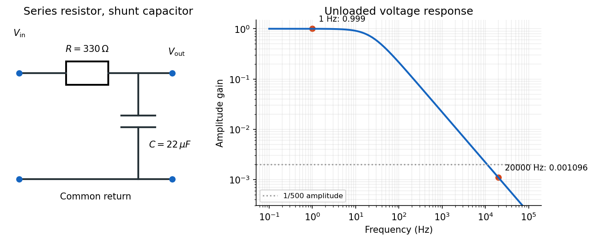
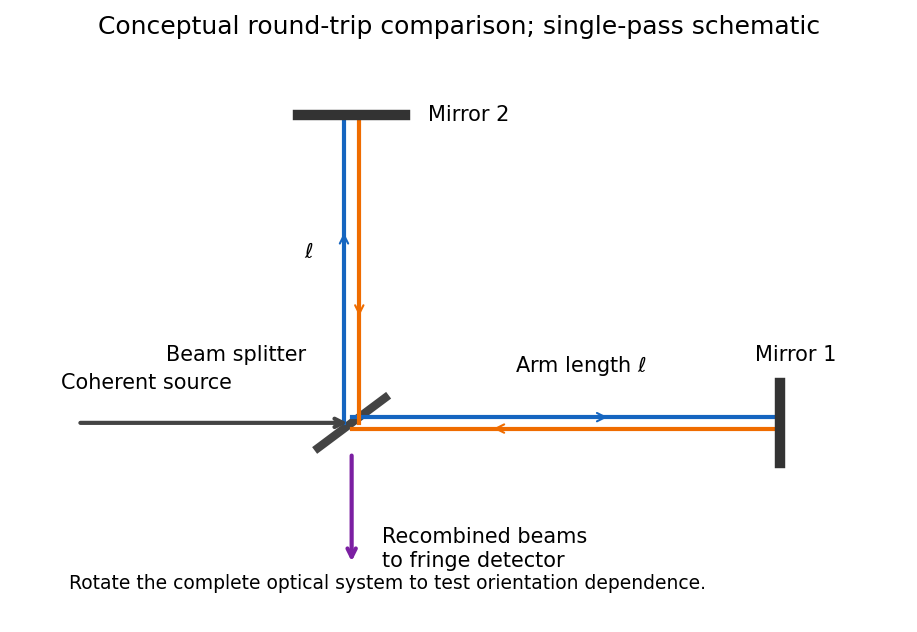
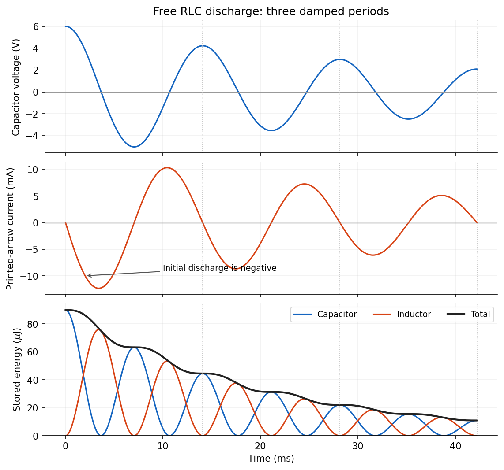
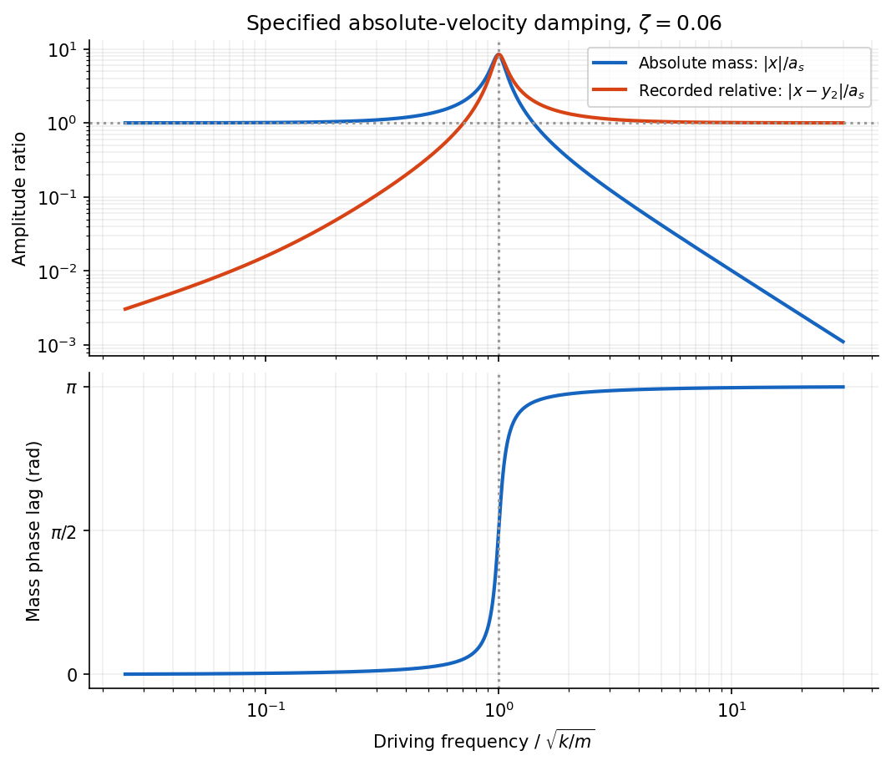
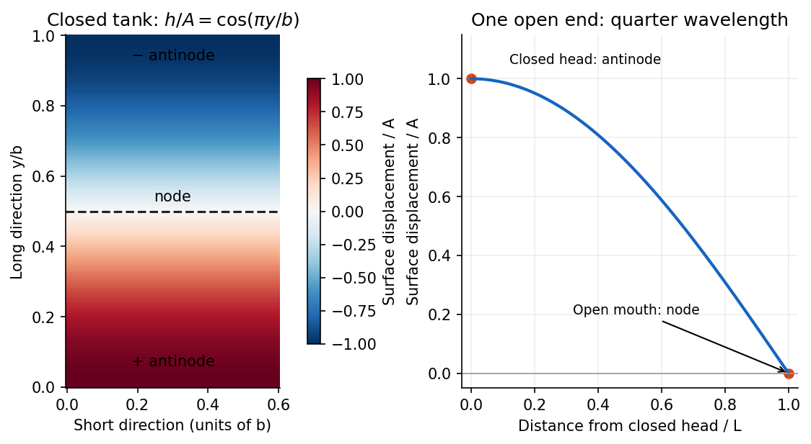
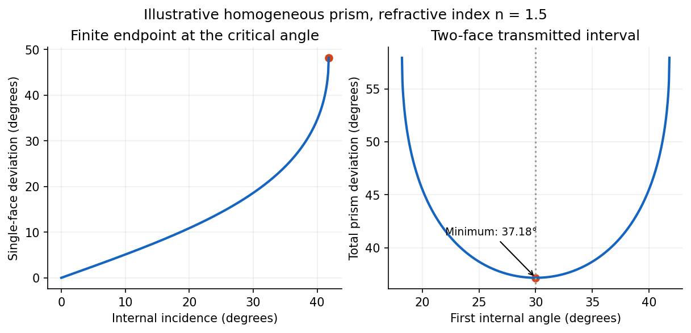
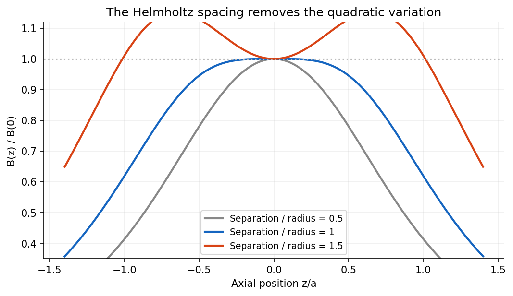

# Paper 1

↑ **Parent:** [2016](../2016.md)

[Original public PDF, physical pages 47–57; examination dated 4 June 2016](https://www.whatdotheyknow.com/request/natural_science_tripos_physics_e_2/response/2340776/attach/2/FOI%202023%20399%20Zahid%20materials.pdf?cookie_passthrough=1#page=47)

**Table of contents**

- [Section A](#section-a)
  - [A1](#section-a/a1)
    - [Solution](#section-a/a1/solution)
  - [A2](#section-a/a2)
    - [Solution](#section-a/a2/solution)
  - [A3](#section-a/a3)
    - [Solution](#section-a/a3/solution)
  - [A4](#section-a/a4)
    - [Solution](#section-a/a4/solution)
  - [A5](#section-a/a5)
    - [Solution](#section-a/a5/solution)
  - [A6](#section-a/a6)
    - [Solution](#section-a/a6/solution)
- [Section B](#section-b)
  - [B7](#section-b/b7)
    - [Solution](#section-b/b7/solution)
  - [B8](#section-b/b8)
    - [Solution](#section-b/b8/solution)
    - [a](#section-b/b8/a)
      - [Solution](#section-b/b8/a/solution)
    - [b](#section-b/b8/b)
      - [Solution](#section-b/b8/b/solution)
    - [c](#section-b/b8/c)
      - [Solution](#section-b/b8/c/solution)
    - [d](#section-b/b8/d)
      - [Solution](#section-b/b8/d/solution)
  - [B9](#section-b/b9)
    - [Solution](#section-b/b9/solution)
- [Section C](#section-c)
  - [C10](#section-c/c10)
    - [Solution](#section-c/c10/solution)
    - [a](#section-c/c10/a)
      - [Solution](#section-c/c10/a/solution)
    - [b](#section-c/c10/b)
      - [Solution](#section-c/c10/b/solution)
    - [c](#section-c/c10/c)
      - [Solution](#section-c/c10/c/solution)
  - [C11](#section-c/c11)
    - [Solution](#section-c/c11/solution)
- [Section D](#section-d)
  - [D12](#section-d/d12)
    - [Solution](#section-d/d12/solution)
  - [D13](#section-d/d13)
    - [Solution](#section-d/d13/solution)
- [Section E](#section-e)
  - [E14](#section-e/e14)
    - [Solution](#section-e/e14/solution)
  - [E15](#section-e/e15)
    - [a](#section-e/e15/a)
      - [Solution](#section-e/e15/a/solution)
    - [b](#section-e/e15/b)
      - [Solution](#section-e/e15/b/solution)
    - [c](#section-e/e15/c)
      - [Solution](#section-e/e15/c/solution)
    - [d](#section-e/e15/d)
      - [Solution](#section-e/e15/d/solution)

## Section A

↑ **Parent:** [Paper 1](paper-1.md)

<h3 id="section-a/a1">A1</h3>

↑ **Parent:** [Section A](#section-a)

<h4 id="section-a/a1/solution">Solution</h4>

↑ **Parent:** [A1](#section-a/a1)

**The [ground-state energies](../../quantum-mechanics.md#ground-state-energy) are $1.50\ \mathrm{eV}$ and $0.376\ \mathrm{eV}$, respectively.** For a [particle in a box](../../quantum-mechanics.md#infinite-square-well) of width $L$, the [wave function](../../wave-function.md) must vanish at both infinite walls. The lowest nonzero [standing wave](../../mathematical-physics.md#standing-wave) therefore has [wavelength](../../wave-equation.md#wavelength) $2L$, giving the [kinetic energy](../../energy.md#kinetic-energy) eigenvalue

$$
E_1=\frac{\pi^2\hbar^2}{2m_eL^2}=\frac{h^2}{8m_eL^2}.
$$

Using the [electron mass](../../physics.md#electron-mass) and converting [joules](../../physics.md#joule) to [electronvolts](../../electronegativity.md#electronvolt) gives

$$
\boxed{E_1(0.5\ \mathrm{nm})\simeq1.504\ \mathrm{eV},\qquad E_1(1\ \mathrm{nm})\simeq0.3760\ \mathrm{eV}.}
$$

Doubling the confinement length divides this [kinetic energy](../../energy.md#kinetic-energy) by four. A zero [potential energy](../../energy.md#potential-energy) inside the box does not imply zero total [energy](../../energy.md): a constant, zero-[momentum](../../momentum.md) [wave function](../../wave-function.md) cannot satisfy both wall conditions unless it vanishes everywhere. This is a concrete manifestation of [quantum confinement](../../quantum-mechanics.md#quantum-confinement) and the [Heisenberg uncertainty principle](../../quantum-theory.md#heisenberg-uncertainty-relation).

<h3 id="section-a/a2">A2</h3>

↑ **Parent:** [Section A](#section-a)

<h4 id="section-a/a2/solution">Solution</h4>

↑ **Parent:** [A2](#section-a/a2)

Write the proposed [Jeans mass](../../stellar-astrophysics.md#jeans-mass) as $M_J=K v^aG^bP^c$, with dimensionless $K$. The dimensions of [speed](../../classical-mechanics.md#speed), the [gravitational constant](../../newton-s-law-of-universal-gravitation.md#gravitational-constant) and [pressure](../../pressure.md) are

$$
[v]=\mathsf L\mathsf T^{-1},\qquad [G]=\mathsf L^3\mathsf M^{-1}\mathsf T^{-2},\qquad [P]=\mathsf M\mathsf L^{-1}\mathsf T^{-2}.
$$

Equating the exponents of [mass](../../classical-mechanics.md#mass), length and time gives

$$
-b+c=1,\qquad a+3b-c=0,\qquad -a-2b-2c=0.
$$

Thus $a=4$, $b=-3/2$ and $c=-1/2$, so the [pressure-confined Jeans mass](../../stellar-astrophysics.md#pressure-confined-jeans-mass) scales as

$$
\boxed{M_J=K\frac{v^4}{G^{3/2}P^{1/2}}.}
$$

A larger [speed of sound](../../compressible-flow.md#speed-of-sound) gives stronger support against [gravitational collapse](../../astrophysics.md#gravitational-collapse); stronger confinement at fixed [speed of sound](../../compressible-flow.md#speed-of-sound) lowers the characteristic unstable [mass](../../classical-mechanics.md#mass). **[Dimensional analysis](../../mathematical-physics.md#dimensional-analysis) determines the scaling, not $K$**, which requires a particular cloud model and instability criterion.

<h3 id="section-a/a3">A3</h3>

↑ **Parent:** [Section A](#section-a)

<h4 id="section-a/a3/solution">Solution</h4>

↑ **Parent:** [A3](#section-a/a3)

Use an [RC low-pass filter](../../electrical-engineering.md#rc-low-pass-filter): put the [resistor](../../electric-charge.md#resistor) in series with the input and the [capacitor](../../electromagnetism.md#capacitor) between the output node and the return conductor. Measure the output [voltage](../../random-walk.md#voltage) across the [capacitor](../../electromagnetism.md#capacitor), with negligible output loading. The [voltage divider](../../electrical-engineering.md#voltage-divider) then has [transfer function](../../control-theory.md#transfer-function)

$$
H(\omega)=\frac{1/(i\omega C)}{R+1/(i\omega C)}=\frac1{1+i\omega RC},\qquad |H|=\frac1{\sqrt{1+(\omega RC)^2}}.
$$

At the high [frequency](../../wave.md#frequency), the attenuation requirement is

$$
2\pi f_hRC>\sqrt{500^2-1},\qquad C>\frac{\sqrt{500^2-1}}{2\pi(20000)(330)}\simeq12.1\ \mu\mathrm F.
$$

At the low [frequency](../../wave.md#frequency), approximately unchanged [amplitude](../../wave.md#wave-amplitude) means $2\pi f_lRC\ll1$, so

$$
\boxed{12.1\ \mu\mathrm F<C\ll482\ \mu\mathrm F.}
$$

The upper relation is an asymptotic design condition, because “approximately” specifies no numerical tolerance. For example, retaining at least $99\%$ of the low-[frequency](../../wave.md#frequency) [amplitude](../../wave.md#wave-amplitude) would sharpen the upper bound to approximately $68.7\ \mu\mathrm F$.

**A practical illustrative choice is $C=22\ \mu\mathrm F$.** Its [voltage gain](../../electrical-circuit.md#voltage-gain) is approximately $0.99896$ at $1\ \mathrm{Hz}$ and $0.001096$ at $20\ \mathrm{kHz}$: the latter [amplitude](../../wave.md#wave-amplitude) is reduced by a factor of about $912$. Its [cutoff frequency](../../electrical-engineering.md#cutoff-frequency) is $1/(2\pi RC)\simeq21.9\ \mathrm{Hz}$.

**[Figure 1](#section-a/a3/image-an-original-rc-low-pass-circuit-and-its-amplitude-response-for-a-22-microfarad-capacitor). An original RC low-pass circuit and its amplitude response for a 22 microfarad capacitor**.

<h3 id="section-a/a4">A4</h3>

↑ **Parent:** [Section A](#section-a)

<h4 id="section-a/a4/solution">Solution</h4>

↑ **Parent:** [A4](#section-a/a4)

For an ideal air-gap [parallel-plate capacitor](../../electromagnetism.md#parallel-plate-capacitor), neglecting fringing, the [electric field](../../electric-field.md) between oppositely charged plates is $E=\sigma/\epsilon_0=Q/(\epsilon_0 A)$. [Dielectric breakdown](../../permittivity.md#dielectric-breakdown) therefore limits the magnitude of the [electric charge](../../electric-charge.md) on either plate to

$$
\boxed{Q_{\max}=\epsilon_0 A E_{\rm bd}=(8.854\times10^{-12})(0.03)^2(5\times10^6)\simeq3.98\times10^{-8}\ \mathrm C=39.8\ \mathrm{nC}.}
$$

The two plates carry $+Q$ and $-Q$; the quoted stored [electric charge](../../electric-charge.md) is the magnitude on one plate, rather than the net [electric charge](../../electric-charge.md) of the whole [capacitor](../../electromagnetism.md#capacitor). The gap does not enter this ideal bound: $C=\epsilon_0 A/d$ and $V_{\max}=E_{\rm bd}d$ make $CV_{\max}$ independent of $d$. Edge enhancement of the [electric field](../../electric-field.md) can lower the practical limit.

<h3 id="section-a/a5">A5</h3>

↑ **Parent:** [Section A](#section-a)

<h4 id="section-a/a5/solution">Solution</h4>

↑ **Parent:** [A5](#section-a/a5)

Far from its ends, approximate the body by an infinite uniform [cylinder](../../geometry-and-topology.md#cylinder-geometry). By cylindrical [symmetry](../../physics.md#symmetry-physics), the [Newtonian gravitational field](../../newton-s-law-of-universal-gravitation.md#newtonian-gravitational-field) is radial. Applying [Gauss's law for gravity](../../newton-s-law-of-universal-gravitation.md#gauss-s-law-for-gravity) to a coaxial cylindrical surface of radius $s$ and length $\ell$ outside the material gives

$$
g(s)\,2\pi s\ell=4\pi G\rho\pi R^2\ell,\qquad g(s)=\frac{2\pi G\rho R^2}{s}.
$$

At the surface, $R=50\ \mathrm m$, so

$$
\boxed{g(R)\simeq2\pi G\rho R\simeq4.19\times10^{-5}\ \mathrm{m\,s^{-2}}.}
$$

The [gravitational acceleration](../../newton-s-law-of-universal-gravitation.md#gravitational-acceleration) points inward toward the axis. Its small magnitude reflects both the small size and the modest [density](../../fluid-mechanics.md#density). The infinite-[cylinder](../../geometry-and-topology.md#cylinder-geometry) approximation uses the specified distance from both ends; a spherical approximation would discard the relevant geometry. No rotational contribution is included, since no rotation rate is supplied.

<h3 id="section-a/a6">A6</h3>

↑ **Parent:** [Section A](#section-a)

<h4 id="section-a/a6/solution">Solution</h4>

↑ **Parent:** [A6](#section-a/a6)

The threshold must conserve both [energy](../../energy.md) and [momentum](../../momentum.md). For head-on [photons](../../quantum-mechanics.md#photon), the total [energy](../../energy.md) is $E_1+E_2$, while the total [momentum](../../momentum.md) has magnitude $|E_2-E_1|/c$. Their combined [invariant mass](../../special-relativity.md#invariant-mass) $M$ satisfies

$$
M^2c^4=(E_1+E_2)^2-c^2\left(\frac{E_2-E_1}{c}\right)^2=4E_1E_2.
$$

At the threshold for [photon-photon pair production](../../perturbative-quantum-field-theory.md#photon-photon-pair-production), the [electron](../../physics.md#electron) and [Positron](../../physics.md#positron) have no relative [momentum](../../momentum.md) in their [centre-of-momentum frame](../../special-relativity.md#center-of-momentum-frame), so $M=2m_e$. Therefore

$$
\boxed{E_{2,\min}=\frac{(m_ec^2)^2}{E_1}=\frac{(5.110\times10^5\ \mathrm{eV})^2}{10^{-3}\ \mathrm{eV}}\simeq2.61\times10^{14}\ \mathrm{eV}=261\ \mathrm{TeV}.}
$$

Simply equating the laboratory [energy](../../energy.md) to $2m_ec^2$ would miss the very large laboratory [momentum](../../momentum.md): the newly produced pair must carry it away.

## Section B

↑ **Parent:** [Paper 1](paper-1.md)

<h3 id="section-b/b7">B7</h3>

↑ **Parent:** [Section B](#section-b)

<h4 id="section-b/b7/solution">Solution</h4>

↑ **Parent:** [B7](#section-b/b7)

The [moment of inertia](../../rigid-body-dynamics.md#moment-of-inertia) about a specified axis is $I=\int s^2\,dm$, where $s$ is perpendicular distance from the axis. The [parallel axis theorem](../../rigid-body-dynamics.md#parallel-axis-theorem) states $I=I_{\rm cm}+md^2$ for two parallel axes separated by $d$, one passing through the [centre of mass](../../classical-mechanics.md#center-of-mass) of a body of [mass](../../classical-mechanics.md#mass) $m$.

It is easiest to calculate the eccentric disc by subtraction. Let $m_f$ be the [mass](../../classical-mechanics.md#mass) of the unperforated disc and $m_h$ the removed [mass](../../classical-mechanics.md#mass). Uniform thickness and [density](../../fluid-mechanics.md#density) give $m_h=m_f/4$ and $m_f-m_h=M$, hence $m_f=4M/3$ and $m_h=M/3$. The hole is tangent to the rim, so its centre, and therefore the shaft axis, lies $R/2$ from the original disc centre. About the shaft axis,

$$
I_{\rm perforated}=\frac{4M}{3}\left(\frac{R^2}{2}+\frac{R^2}{4}\right)-\frac12\frac M3\left(\frac R2\right)^2=\frac{23}{24}MR^2.
$$

The shaft contributes $I_{\rm shaft}=M(R/2)^2/2=MR^2/8$. Thus

$$
\boxed{I=I_{\rm perforated}+I_{\rm shaft}=\frac{13}{12}MR^2.}
$$

The motor's [torque](../../momentum.md#torque) is $P/\omega$ at nonzero [angular velocity](../../rigid-body-dynamics.md#angular-velocity), while the resisting [torque](../../momentum.md#torque) is $-\gamma\omega$. The [rotational equation of motion](../../rigid-body-dynamics.md#rotational-equation-of-motion) and its equivalent [energy balance](../../mathematical-physics.md#energy-balance) are

$$
I\dot\omega=\frac P\omega-\gamma\omega,\qquad \frac{d}{dt}\left(\frac12I\omega^2\right)=P-\gamma\omega^2.
$$

At the [steady state](../../dynamical-systems.md#steady-state), input [power](../../energy.md#power) equals dissipated [power](../../energy.md#power), giving

$$
\boxed{\omega_0=\sqrt{P/\gamma}.}
$$

For the acceleration, use $u=\omega^2$. Then $\dot u+(2\gamma/I)u=2P/I$ with $u(0)=0$, so

$$
u(t)=\omega_0^2(1-e^{-2\gamma t/I}),\qquad \boxed{t=-\frac I{2\gamma}\ln\left(1-\frac{\omega^2}{\omega_0^2}\right),\quad0\leq\omega<\omega_0.}
$$

The approach to $\omega_0$ takes infinite time. This [constant-power rotational acceleration](../../rigid-body-dynamics.md#constant-power-rotational-acceleration) idealizes the start: $P/\omega$ diverges at rest, although the [energy balance](../../mathematical-physics.md#energy-balance) has a well-defined limiting solution. A real motor has finite starting [torque](../../momentum.md#torque).

<h3 id="section-b/b8">B8</h3>

↑ **Parent:** [Section B](#section-b)

<h4 id="section-b/b8/solution">Solution</h4>

↑ **Parent:** [B8](#section-b/b8)

[Conservation of energy](../../mathematical-physics.md#conservation-of-energy) states that the total [energy](../../energy.md) of an isolated system is constant. In a mechanical problem with conservative [forces](../../force.md) and no dissipation, it gives $K+U=\text{constant}$. It often determines a [speed](../../classical-mechanics.md#speed) or turning height directly, without solving the full time-dependent [equation of motion](../../classical-mechanics.md#equation-of-motion). With external work or dissipation, use the corresponding [energy balance](../../mathematical-physics.md#energy-balance) instead.

After a drop leaves the wheel, neglecting air resistance, the conservative [force](../../force.md) of the [Newtonian gravitational field](../../newton-s-law-of-universal-gravitation.md#newtonian-gravitational-field) acts. Put the origin at the wheel axis and choose positive horizontal displacement to the right. In the printed diagram $\theta$ is measured upward from the leftward horizontal radius, and rotation is clockwise. The release position and [velocity](../../classical-mechanics.md#velocity) are therefore

$$
(x_0,y_0)=(-r\cos\theta,r\sin\theta),\qquad (v_{x0},v_{y0})=(r\omega\sin\theta,r\omega\cos\theta).
$$

For upward release, $\cos\theta>0$. These conventions fix the signs used below.

<h4 id="section-b/b8/a">a</h4>

↑ **Parent:** [B8](#section-b/b8)

<h5 id="section-b/b8/a/solution">Solution</h5>

↑ **Parent:** [A](#section-b/b8/a)

With zero [gravitational potential energy](../../energy.md#gravitational-energy) at the wheel axis, the release [energy](../../energy.md) and the [energy](../../energy.md) at the apex of the [projectile motion](../../classical-mechanics.md#projectile-motion) are

$$
E_{\rm release}=\frac12mr^2\omega^2+mgr\sin\theta,\qquad E_{\rm apex}=\frac12mr^2\omega^2\sin^2\theta+mgy_{\max}.
$$

Only the vertical [velocity](../../classical-mechanics.md#velocity) vanishes at the apex: the horizontal [kinetic energy](../../energy.md#kinetic-energy) remains. Equating the two [energies](../../energy.md) gives

$$
\boxed{y_{\max}(\theta)=r\sin\theta+\frac{r^2\omega^2}{2g}\cos^2\theta.}
$$

<h4 id="section-b/b8/b">b</h4>

↑ **Parent:** [B8](#section-b/b8)

<h5 id="section-b/b8/b/solution">Solution</h5>

↑ **Parent:** [B](#section-b/b8/b)

Set $s=\sin\theta$. The maximum height becomes the concave [quadratic function](../../polynomial.md#quadratic-function)

$$
y_{\max}=rs+\frac{r^2\omega^2}{2g}(1-s^2),\qquad \frac{dy_{\max}}{ds}=r-\frac{r^2\omega^2}{g}s.
$$

Under the stated high-[angular frequency](../../lagrangian-mechanics.md#angular-frequency) assumption, $r\omega^2>g$, its interior maximum is

$$
\boxed{\sin\theta_* =\frac g{r\omega^2},\qquad (x_*,y_*)=\left(-r\sqrt{1-\frac{g^2}{r^2\omega^4}},\frac g{\omega^2}\right).}
$$

Thus the optimum release lies on the upper-left quarter of the wheel for the printed clockwise rotation. The largest attained height is

$$
\boxed{Y(\omega)=\frac{r^2\omega^2}{2g}+\frac g{2\omega^2}.}
$$

If extended to $r\omega^2\leq g$, the maximum over release positions is the limiting height $r$ at the top of the rim. The interior solution is the relevant branch for reaching a ceiling above the wheel.

<h4 id="section-b/b8/c">c</h4>

↑ **Parent:** [B8](#section-b/b8)

<h5 id="section-b/b8/c/solution">Solution</h5>

↑ **Parent:** [C](#section-b/b8/c)

To avoid contact with the ceiling, require $Y(\omega)<h$. Writing $X=r^2\omega^2$ gives

$$
X^2-2ghX+g^2r^2<0,
$$

whose roots are $g(h\pm\sqrt{h^2-r^2})$. Because $h>r$, the lower root is less than $gr$, while the assumed branch has $X>gr$. The lower inequality is therefore automatic on this branch, leaving

$$
\boxed{r^2\omega^2<gh+g\sqrt{h^2-r^2}.}
$$

Equality is the first grazing contact. This branch check is essential: retaining both algebraic roots as independent lower and upper speed limits would introduce a spurious lower limit on avoiding the ceiling.

<h4 id="section-b/b8/d">d</h4>

↑ **Parent:** [B8](#section-b/b8)

<h5 id="section-b/b8/d/solution">Solution</h5>

↑ **Parent:** [D](#section-b/b8/d)

At first contact the globally highest trajectory just touches the ceiling at its apex. Its flight time to that point is $t_*=r\omega\cos\theta_*/g$. The horizontal displacement from the wheel axis is

$$
x_{\rm hit}=-r\cos\theta_*+r\omega\sin\theta_*\frac{r\omega\cos\theta_*}{g}=\cos\theta_*\left(-r+\frac{r^2\omega^2}{g}\sin\theta_*\right)=0.
$$

Hence **the first point struck is directly above the rotation axis**, independently of $h$. The release starts to the left of the axis, but the drop's horizontal travel exactly cancels that offset at the optimum apex. The first-contact [angular velocity](../../rigid-body-dynamics.md#angular-velocity) satisfies $r^2\omega_*^2=g(h+\sqrt{h^2-r^2})$.

<h3 id="section-b/b9">B9</h3>

↑ **Parent:** [Section B](#section-b)

<h4 id="section-b/b9/solution">Solution</h4>

↑ **Parent:** [B9](#section-b/b9)

The [Michelson-Morley experiment](../../special-relativity.md#michelson-morley-experiment) splits coherent [light](../../optics.md#light) into two perpendicular arms, reflects the beams and recombines them to observe [interference fringes](../../physical-optics.md#interference-fringe). Rotating the apparatus interchanges each arm's orientation relative to a proposed stationary [luminiferous aether](../../physics.md#luminiferous-aether). The historical experiment used multiple reflections to increase the effective optical path and a rotatable support to compare orientations.[1887, printed pp. 333–341: optical arrangement, rotation and fringe-shift comparison](../../physics-bibliography.md#on-the-relative-motion-of-the-earth-and-the-luminiferous-ether-by-albert-abraham-michelson-and-edward-w-morley)

**[Figure 2](#section-b/b9/image-original-schematic-of-perpendicular-round-trip-optical-paths-in-a-michelson-interferometer). Original schematic of perpendicular round-trip optical paths in a Michelson interferometer**.

For equal one-way effective arm lengths $\ell$, a classical stationary-aether model gives

$$
t_\parallel=\frac\ell{c-v}+\frac\ell{c+v}\simeq\frac{2\ell}{c}\left(1+\frac{v^2}{c^2}\right),\qquad t_\perp=\frac{2\ell}{\sqrt{c^2-v^2}}\simeq\frac{2\ell}{c}\left(1+\frac{v^2}{2c^2}\right).
$$

A right-angle rotation should reverse their difference, producing a [fringe shift](../../physical-optics.md#fringe-shift) of approximately $2\ell v^2/(\lambda c^2)$. The observed orientation-dependent shift was much smaller than the stationary-aether prediction. In [special relativity](../../special-relativity.md), the apparatus rest frame has the same vacuum [speed of light](../../special-relativity.md#speed-of-light) along both arms, so no such orientation-dependent shift is expected. The result supports [special relativity](../../special-relativity.md) but does not, by itself, uniquely establish every postulate or exclude every modified aether theory.

For the rocket, take its tail at $x'=0$ and nose at $x'=L_0$, with coincident frame origins when $t=t'=0$. Denote emission, reflection and return by $A,B,C$. In the rocket's [inertial frame](../../mathematical-physics.md#inertial-frame), their coordinates $(t',x')$ are

$$
\boxed{A:(0,L_0),\quad B:(L_0/c,0),\quad C:(2L_0/c,L_0).}
$$

The inverse [Lorentz transformation](../../special-relativity.md#lorentz-transformation) is $x=\Gamma(x'+ut')$, $t=\Gamma(t'+ux'/c^2)$, where $\Gamma=(1-u^2/c^2)^{-1/2}$. Thus the same [spacetime events](../../special-relativity.md#event-relativity), in coordinates $(t,x)$, are

$$
\boxed{\begin{aligned}
A&:\left(\Gamma uL_0/c^2,\ \Gamma L_0\right),\\
B&:\left(\Gamma L_0/c,\ \Gamma uL_0/c\right),\\
C&:\left(\Gamma(2L_0/c+uL_0/c^2),\ \Gamma(L_0+2uL_0/c)\right).
\end{aligned}}
$$

There is no requirement that emission have $t=0$ in this chosen laboratory coordinate system.

The nose-to-tail travel time is $\Delta t_{AB}=\Gamma L_0(1-u/c)/c$. If $L$ is the laboratory length measured at one laboratory time, a left-moving pulse and the right-moving tail close their initial separation at speed $c+u$. Therefore

$$
L=(c+u)\Delta t_{AB}=\Gamma L_0(1-u^2/c^2),\qquad \boxed{L=L_0/\Gamma.}
$$

This derives [length contraction](../../special-relativity.md#length-contraction) from the pulse's travel. Comparing the positions of the two endpoints at different laboratory times would not measure the rocket's laboratory length.

## Section C

↑ **Parent:** [Paper 1](paper-1.md)

<h3 id="section-c/c10">C10</h3>

↑ **Parent:** [Section C](#section-c)

<h4 id="section-c/c10/solution">Solution</h4>

↑ **Parent:** [C10](#section-c/c10)

After switching, [Kirchhoff's voltage law](../../random-walk.md#kirchhoff-cycle-law) gives the free [series RLC circuit](../../electrical-circuit.md#series-rlc-circuit) equation

$$
L\ddot q+R\dot q+q/C=0.
$$

Its characteristic roots are $-\gamma\pm i\omega_d$, where

$$
\boxed{\gamma=\frac R{2L},\qquad \omega_d=\sqrt{\frac1{LC}-\frac{R^2}{4L^2}}.}
$$

A real, nonzero oscillation [frequency](../../wave.md#frequency) requires $R^2<4L/C$. For a passive [resistor](../../electric-charge.md#resistor),

$$
\boxed{0\leq R<2\sqrt{L/C}\simeq894\ \Omega.}
$$

The endpoint $R=0$ is the undamped limit; strictly decaying oscillations have $0<R<894\ \Omega$. The critical endpoint itself does not have a nonzero $\omega_d$.

Let $Q=CV_0$ denote the initial [electric charge](../../electric-charge.md), so $Q=30\ \mu\mathrm C$ and $\dot q(0)=0$. Distinguish $Q$ from the amplitude coefficient $q_0$ in an exponential-times-cosine representation: imposing zero initial [electric current](../../electric-charge.md#electric-current) generally requires a nonzero phase.

<h4 id="section-c/c10/a">a</h4>

↑ **Parent:** [C10](#section-c/c10)

<h5 id="section-c/c10/a/solution">Solution</h5>

↑ **Parent:** [A](#section-c/c10/a)

Put $\omega_0^2=1/(LC)$. The initial conditions give

$$
q(t)=Qe^{-\gamma t}\left(\cos\omega_dt+\frac\gamma{\omega_d}\sin\omega_dt\right),\qquad V_C(t)=V_0e^{-\gamma t}\left(\cos\omega_dt+\frac\gamma{\omega_d}\sin\omega_dt\right).
$$

The printed [electric current](../../electric-charge.md#electric-current) arrow points toward the positively labelled [capacitor](../../electromagnetism.md#capacitor) plate, so its signed [electric current](../../electric-charge.md#electric-current) is $I=\dot q$, not the positive discharge magnitude. Hence

$$
\boxed{I(t)=-\frac{V_0}{L\omega_d}e^{-\gamma t}\sin\omega_dt.}
$$

For the stated [electrical resistance](../../electric-charge.md#electrical-resistance),

$$
\gamma=25\ \mathrm{s^{-1}},\quad \omega_0\simeq447.21\ \mathrm{s^{-1}},\quad \omega_d\simeq446.51\ \mathrm{s^{-1}},\quad T_d\simeq14.07\ \mathrm{ms}.
$$

**The [voltage](../../random-walk.md#voltage) starts at $6\ \mathrm V$ with zero slope; the signed [electric current](../../electric-charge.md#electric-current) starts at zero and initially becomes negative.** Its initial slope is $\dot I(0)=-V_0/L=-6\ \mathrm{A\,s^{-1}}$. Both oscillate with an $e^{-25t}$ envelope and a $40\ \mathrm{ms}$ amplitude [time constant](../../analysis.md#time-constant). The phase difference is close to a quarter period, with the small damping correction displayed explicitly in $V_C$.

**[Figure 3](#section-c/c10/a/image-signed-capacitor-voltage-and-printed-arrow-current-with-the-exchange-and-dissipation-of-circuit-energy-over-three-periods). Signed capacitor voltage and printed-arrow current, with the exchange and dissipation of circuit energy over three periods**.

<h4 id="section-c/c10/b">b</h4>

↑ **Parent:** [C10](#section-c/c10)

<h5 id="section-c/c10/b/solution">Solution</h5>

↑ **Parent:** [B](#section-c/c10/b)

The [capacitor](../../electromagnetism.md#capacitor) stores [electrostatic energy](../../electrostatics.md#electrostatic-energy), the [inductor](../../electromagnetism.md#inductor) stores [magnetic energy](../../electromagnetic-wave.md#magnetic-energy), and the [resistor](../../electric-charge.md#resistor) converts [energy](../../energy.md) into heat. Their instantaneous values are

$$
\boxed{E_C=\frac{q^2}{2C}=\frac12CV_C^2,\qquad E_I=\frac12LI^2,\qquad P_R=RI^2.}
$$

The sign convention for [electric current](../../electric-charge.md#electric-current) does not change these expressions. With the initial [voltage](../../random-walk.md#voltage), $E_C(0)=CV_0^2/2=90\ \mu\mathrm J$ and $E_I(0)=P_R(0)=0$.

<h4 id="section-c/c10/c">c</h4>

↑ **Parent:** [C10](#section-c/c10)

<h5 id="section-c/c10/c/solution">Solution</h5>

↑ **Parent:** [C](#section-c/c10/c)

The two stored [energies](../../energy.md) follow directly by squaring the expressions for [electric charge](../../electric-charge.md) and [electric current](../../electric-charge.md#electric-current):

$$
E_C=\frac12CV_0^2e^{-2\gamma t}\left(\cos\omega_dt+\frac\gamma{\omega_d}\sin\omega_dt\right)^2,\qquad E_I=\frac{V_0^2}{2L\omega_d^2}e^{-2\gamma t}\sin^2\omega_dt.
$$

Both are nonnegative, with alternating maxima. Initially all stored [energy](../../energy.md) is in the [capacitor](../../electromagnetism.md#capacitor); at a zero of $q$ it is entirely in the [inductor](../../electromagnetism.md#inductor). The total is

$$
E=\frac{q^2}{2C}+\frac12L\dot q^2,\qquad \boxed{\frac{dE}{dt}=\dot q\left(\frac qC+L\ddot q\right)=-R I^2\leq0.}
$$

**The total [energy](../../energy.md) decreases monotonically, with a horizontal tangent whenever the [electric current](../../electric-charge.md#electric-current) is zero.** Its envelope decays on the $1/(2\gamma)=20\ \mathrm{ms}$ scale, but the exact total is not a featureless exponential: the resistor's instantaneous loss varies within each oscillation. The figure in part (a) shows this gradual modulation of the downward slope as well as the component [energies](../../energy.md).

<h3 id="section-c/c11">C11</h3>

↑ **Parent:** [Section C](#section-c)

<h4 id="section-c/c11/solution">Solution</h4>

↑ **Parent:** [C11](#section-c/c11)

Measure the mass's displacement $x$ from its static equilibrium height. This removes the constant spring extension supporting its [weight](../../semisimple-lie-algebra.md#weight-representation-theory). If the spring's top moves with the box, its incremental extension is $y_2-x$, so its incremental upward [force](../../force.md) is $k(y_2-x)$. The specified damping force is against the mass's velocity in the static frame. [Newton's second law](../../force.md#newton-s-second-law) therefore gives

$$
\boxed{m\ddot x+b\dot x+kx=ky_2=ka_s\cos\omega t.}
$$

In absolute height coordinates an additional constant on the right expresses the spring's rest length, its fixed attachment height and [gravity](../../physics.md#gravity); translating to static equilibrium removes it. Replacing the given damping by $-b(\dot x-\dot y_2)$ would describe a different [base-excited oscillator](../../analysis.md#base-excited-oscillator).

After the decaying transient, write the [steady-state response](../../analysis.md#steady-state-response) as $x=A(\omega)\cos(\omega t-\Phi)$. Using a complex sinusoid gives

$$
\widetilde x=\frac{ka_s}{k-m\omega^2+ib\omega},
$$

so

$$
\boxed{A(\omega)=\frac{ka_s}{\sqrt{(k-m\omega^2)^2+b^2\omega^2}},\qquad \Phi(\omega)=\operatorname{atan2}(b\omega,k-m\omega^2).}
$$

For positive [frequency](../../wave.md#frequency), the phase lag lies between zero and $\pi$, passing through $\pi/2$ at $\omega_0=\sqrt{k/m}$. For small $b$, the [frequency response](../../electrical-engineering.md#frequency-response) begins at $a_s$, develops a narrow [resonance](../../dynamical-systems.md#resonance) near $\omega_0$, and falls as

$$
A(\omega)\sim\frac{k a_s}{m\omega^2}\qquad(\omega\gg\omega_0).
$$

The precise amplitude-peak [frequency](../../wave.md#frequency) is $\sqrt{k/m-b^2/(2m^2)}$ when that expression is positive.

**[Figure 4](#section-c/c11/image-absolute-and-relative-motion-of-the-stated-seismograph-model-and-the-phase-lag-of-its-inertial-mass). Absolute and relative motion of the stated seismograph model, and the phase lag of its inertial mass**.

The pen records the relative displacement $z=x-y_2$. Its complex [transfer function](../../control-theory.md#transfer-function) is

$$
\frac{\widetilde z}{a_s}=\frac{m\omega^2-ib\omega}{k-m\omega^2+ib\omega}.
$$

At high [frequency](../../wave.md#frequency), $x$ is small while $z\simeq-y_2$. **The inertial mass then stays nearly stationary and the recorded relative motion reproduces the ground displacement, with reversed sign.** At low [frequency](../../wave.md#frequency) the mass follows the box and their relative motion is small; near [resonance](../../dynamical-systems.md#resonance) the response is strongly frequency-dependent. Here “high” means compared with the suspension's natural [frequency](../../wave.md#frequency), rather than an absolute seismic-frequency threshold.

## Section D

↑ **Parent:** [Paper 1](paper-1.md)

<h3 id="section-d/d12">D12</h3>

↑ **Parent:** [Section D](#section-d)

<h4 id="section-d/d12/solution">Solution</h4>

↑ **Parent:** [D12](#section-d/d12)

Comparing with the standard [wave equation](../../wave-equation.md) gives the shallow-water [wave speed](../../wave-equation.md#wave-speed)

$$
\boxed{c=\sqrt{gd}.}
$$

Twice differentiating the proposed [standing wave](../../mathematical-physics.md#standing-wave) multiplies its spatial factors by $-k_x^2$ and $-k_y^2$, and its temporal factor by $-\omega^2$. It solves the [wave equation](../../wave-equation.md) precisely when

$$
\boxed{\omega^2=gd(k_x^2+k_y^2).}
$$

To obtain the local [gravitational potential energy](../../energy.md#gravitational-energy), integrate through a water column of height $d+h$ and unit horizontal area:

$$
V(t)=\int_0^{d+h}\rho gz\,dz=\frac{\rho g}{2}(d+h)^2.
$$

The time averages are $\langle h\rangle=0$ and $\langle h^2\rangle=A^2\cos^2(k_xx)\cos^2(k_yy)/2$. Thus

$$
\boxed{\langle V\rangle=\frac12\rho gd^2+\frac14\rho gA^2\cos^2(k_xx)\cos^2(k_yy),\quad c_1=\frac12\rho gd^2,\quad c_2=\frac14\rho gA^2.}
$$

The constant is retained because the specified zero of [gravitational potential](../../newton-s-law-of-universal-gravitation.md#newtonian-potential-of-a-point-mass) is the tank bottom. This is local time-averaged [potential energy](../../energy.md#potential-energy), not the sum of [potential energy](../../energy.md#potential-energy) and [kinetic energy](../../energy.md#kinetic-energy).

The no-normal-flow wall conditions are [Neumann boundary conditions](../../differential-equation.md#neumann-boundary-condition). Differentiating the cosine factors at the opposite walls gives

$$
\boxed{k_x=\frac{m\pi}{a},\qquad k_y=\frac{n\pi}{b},\qquad m,n=0,1,2,\ldots.}
$$

Negative integers give the same cosine modes. The formal $m=n=0$ case has $\omega=0$: it is a uniform change of the mean level, not a finite-[frequency](../../wave.md#frequency) oscillation. In a closed tank with fixed water volume even that mean-level change is excluded from the oscillatory disturbance.

Since $a<b$, the lowest finite [frequency](../../wave.md#frequency) is the mode $(m,n)=(0,1)$:

$$
\boxed{h=A\cos(\pi y/b)\cos(\omega t),\qquad \omega=\frac\pi b\sqrt{gd}.}
$$

It is uniform across the shorter direction, has opposite-sign displacement [antinodes](../../wave-equation.md#antinode) at the two ends of the longer direction, and a displacement [node](../../dynamical-systems.md#node-dynamical-systems) midway along it.

**[Figure 5](#section-d/d12/image-original-mode-shapes-for-a-closed-rectangular-tank-and-an-ideal-basin-with-one-open-end). Original mode shapes for a closed rectangular tank and an ideal basin with one open end**.

For the open-ended [Bay of Fundy](../../newton-s-law-of-universal-gravitation.md#bay-of-fundy) model, approximate the ocean mouth as a displacement [node](../../dynamical-systems.md#node-dynamical-systems) and the closed head as an [antinode](../../wave-equation.md#antinode). The fundamental is a [quarter-wave basin resonance](../../mathematical-physics.md#quarter-wave-basin-resonance), so its [wavelength](../../wave-equation.md#wavelength) is $4L$ and

$$
T=\frac{4L}{\sqrt{gd}},\qquad \boxed{d=\frac{16L^2}{gT^2}.}
$$

Taking a roughly $12$-hour [semidiurnal tide](../../newton-s-law-of-universal-gravitation.md#semidiurnal-tide) gives $d\simeq79\ \mathrm m$. Using the principal lunar period of approximately $12\ \mathrm h\ 25\ \mathrm{min}$ gives $d\simeq73\ \mathrm m$. **The idealized estimate is therefore about $7\text{–}8\times10^1\ \mathrm m$.** The lunar period is half of a roughly $24$-hour $50$-minute lunar day.[Examples M2 and S2: two lunar peaks per 24 hours 50 minutes, compared with two solar peaks per 24 hours](../../physics-bibliography.md#about-harmonic-constituents-by-national-oceanic-and-atmospheric-administration)

This estimate treats the mouth as an ideal open boundary and replaces the real basin by a uniform depth. The supplied large tidal height motivates [resonance](../../dynamical-systems.md#resonance); it is not enough by itself to determine damping or an amplification factor in this model.

<h3 id="section-d/d13">D13</h3>

↑ **Parent:** [Section D](#section-d)

<h4 id="section-d/d13/solution">Solution</h4>

↑ **Parent:** [D13](#section-d/d13)

[Snell's law](../../partial-differential-equation.md#snell-s-law) is $n_1\sin\theta_1=n_2\sin\theta_2$, with angles measured from the interface normal. The [Huygens-Fresnel principle](../../physical-optics.md#huygens-fresnel-principle) explains it by constructing the transmitted [wavefront](../../physical-optics.md#wavefront) from secondary wavelets: during the same time interval, distances travelled in the two media are proportional to $c/n_1$ and $c/n_2$. The geometry of the advancing plane [wavefront](../../physical-optics.md#wavefront) then gives $\sin\theta_1/\sin\theta_2=(c/n_1)/(c/n_2)=n_2/n_1$.

For incidence from index $n$ into vacuum, the transmitted angle is $\alpha=\arcsin(n\sin\theta)$. The ray bends away from the normal, so its positive deviation is

$$
\boxed{\delta(\theta,n)=\arcsin(n\sin\theta)-\theta.}
$$

For $0<\theta<\theta_c=\arcsin(1/n)$,

$$
\frac{\partial\delta}{\partial\theta}=\frac{n\cos\theta}{\sqrt{1-n^2\sin^2\theta}}-1>0.
$$

Thus the graph rises monotonically from zero to a finite endpoint with a vertical tangent:

$$
\boxed{\theta_c=\arcsin(1/n),\qquad \delta_{\max}=\frac\pi2-\arcsin(1/n).}
$$

At the endpoint the transmitted ray grazes the interface. Beyond the [critical angle for total internal reflection](../../electromagnetic-wave.md#critical-angle-for-total-internal-reflection), no propagating transmitted ray exists and [total internal reflection](../../electromagnetic-wave.md#total-internal-reflection) occurs.

Inside a [prism](../../euclidean-geometry.md#prism-geometry), the two ray angles with the face normals sum to its apex angle. For the equilateral cross-section, they are $\theta$ and $\pi/3-\theta$. The entry deviation equals the corresponding exit deviation under ray reversal. Adding the two changes of direction therefore gives

$$
\boxed{\Delta(\theta)=\delta(\theta,n)+\delta(\pi/3-\theta,n).}
$$

This is symmetric about $\theta=\pi/6$. Symmetry alone gives a stationary point; to establish that it is a minimum, differentiate once more:

$$
\frac{\partial^2\delta}{\partial\theta^2}=\frac{n(n^2-1)\sin\theta}{(1-n^2\sin^2\theta)^{3/2}}>0
$$

within the transmitted-ray interval. The sum is therefore strictly convex, and

$$
\boxed{\theta_{\min}=\frac\pi6,\qquad \Delta_{\min}=2\arcsin(n/2)-\frac\pi3.}
$$

These expressions require $1<n<2$ for a non-grazing path through both faces; $n=2$ is a grazing limit, and $n>2$ admits no such two-face transmitted path. More explicitly, both internal angles must be at most $\theta_c$, which is possible only if $2\theta_c\geq\pi/3$.

**[Figure 6](#section-d/d13/image-single-interface-deviation-and-the-symmetric-minimum-of-an-equilateral-prism-illustrated-for-index-1-5). Single-interface deviation and the symmetric minimum of an equilateral prism, illustrated for index 1.5**.

Atmospheric hexagonal ice crystals can present pairs of faces with a $60^\circ$ angle, acting as small [prisms](../../euclidean-geometry.md#prism-geometry). Their orientations turn the minimum-deviation cone around the Moon into an [optical halo](../../optics.md#optical-halo). No transmitted ray of this family is deflected less than the [minimum deviation of a prism](../../euclidean-geometry.md#minimum-deviation-of-a-prism). Moreover, near the minimum, $\Delta-\Delta_{\min}$ is quadratic in the departure from the symmetric ray, so a range of incident directions is compressed into a small outgoing angular range. **This [caustic](../../geometrical-optics.md#wave-caustic) makes the inner rim sharp and bright**, with the ray density decreasing farther outside. The common [22-degree halo](../../optics.md#22-degree-halo) has an angular radius near $22^\circ$ about either the Sun or Moon, hence a diameter near $44^\circ$.[Section 3.2.3.1.1: radius, central luminary, bright ring and darker interior](../../physics-bibliography.md#international-cloud-atlas-by-world-meteorological-organization)

## Section E

↑ **Parent:** [Paper 1](paper-1.md)

<h3 id="section-e/e14">E14</h3>

↑ **Parent:** [Section E](#section-e)

<h4 id="section-e/e14/solution">Solution</h4>

↑ **Parent:** [E14](#section-e/e14)

For a steady thin-wire [electric current](../../electric-charge.md#electric-current), the [Biot-Savart law](../../electromagnetism.md#biot-savart-law) is

$$
d\mathbf B=\frac{\mu_0I}{4\pi}\frac{d\boldsymbol\ell\times\mathbf R}{R^3},
$$

where $\mathbf R$ points from the source element to the field point and $d\boldsymbol\ell$ follows positive [electric current](../../electric-charge.md#electric-current). On a circular loop's axis the transverse contributions cancel by [symmetry](../../physics.md#symmetry-physics). The axial numerator is $a^2d\varphi$ and the distance is $\sqrt{a^2+z^2}$, giving

$$
B_z(z)=\frac{\mu_0I}{4\pi}\int_0^{2\pi}\frac{a^2\,d\varphi}{(a^2+z^2)^{3/2}},\qquad \boxed{B_z(z)=\frac{\mu_0I a^2}{2(a^2+z^2)^{3/2}}.}
$$

Its graph is positive and even, with maximum $\mu_0I/(2a)$ at the centre and a $|z|^{-3}$ far-field decay. Reversing the [electric current](../../electric-charge.md#electric-current) reverses its sign.

For two equally oriented $N$-turn coils centred at $\pm D$, superposition gives

$$
B_{\rm ax}(z)=\frac{\mu_0NIa^2}{2}\left[\frac1{(a^2+(z-D)^2)^{3/2}}+\frac1{(a^2+(z+D)^2)^{3/2}}\right].
$$

Consequently

$$
\boxed{B_{\rm ax}(0)=\frac{\mu_0NIa^2}{(a^2+D^2)^{3/2}}.}
$$

This is an even differentiable function, so every odd derivative at zero vanishes, including the first and third. To check the second derivative explicitly, let $f(s)=(a^2+s^2)^{-3/2}$. Then

$$
f''(s)=\frac{3(4s^2-a^2)}{(a^2+s^2)^{7/2}},\qquad B_{\rm ax}''(0)=\frac{3\mu_0NIa^2(4D^2-a^2)}{(a^2+D^2)^{7/2}}.
$$

Thus **$2D=a$ makes the quadratic variation vanish**, which is the [Helmholtz coil](../../electromagnetism.md#helmholtz-coil) condition. The central value and leading axial variation are

$$
\boxed{B_0=\left(\frac45\right)^{3/2}\frac{\mu_0NI}{a},\qquad \frac{B_{\rm ax}(z)}{B_0}=1-\frac{144}{125}\left(\frac za\right)^4+O((z/a)^6).}
$$

**[Figure 7](#section-e/e14/image-an-original-comparison-of-axial-field-uniformity-for-several-coil-separations). An original comparison of axial field uniformity for several coil separations**.

Near the centre, the coils' [magnetic field lines](../../magnetic-field.md#magnetic-field-line) are nearly straight and parallel to the axis. On the axis rotational [symmetry](../../physics.md#symmetry-physics) makes $B_x=B_y=0$ exactly; in the central plane the radial components from the two coils cancel. More quantitatively, in the current-free central volume, axisymmetry and $\nabla\cdot\mathbf B=0$ imply

$$
B_r(r,z)=-\frac r2B_{\rm ax}'(z)+O(r^3),\qquad B_z(r,z)=B_{\rm ax}(z)-\frac{r^2}{4}B_{\rm ax}''(z)+O(r^4).
$$

The suppressed axial derivatives therefore also suppress transverse [magnetic fields](../../magnetic-field.md) near the centre. The smallness applies locally compared with the coil radius; it is not a claim of an exactly uniform field throughout the apparatus.

<h3 id="section-e/e15">E15</h3>

↑ **Parent:** [Section E](#section-e)

<h4 id="section-e/e15/a">a</h4>

↑ **Parent:** [E15](#section-e/e15)

<h5 id="section-e/e15/a/solution">Solution</h5>

↑ **Parent:** [A](#section-e/e15/a)

In a fixed point-mass [Newtonian gravitational field](../../newton-s-law-of-universal-gravitation.md#newtonian-gravitational-field), a test [mass](../../classical-mechanics.md#mass) $m$ experiences

$$
\mathbf F=-\frac{GMm}{r^2}\widehat{\mathbf r}.
$$

Because this is a [central force](../../mathematical-physics.md#central-force), its [torque](../../momentum.md#torque) about the attracting centre vanishes and [angular momentum](../../momentum.md#angular-momentum) is conserved. The orbit lies in a fixed plane and sweeps out equal areas in equal times. Since the [force](../../force.md) is also conservative, the specific orbital [energy](../../energy.md) is constant:

$$
\varepsilon=\frac12\dot r^2+\frac{j^2}{2r^2}-\frac{GM}{r},\qquad j=r^2\dot\varphi.
$$

The last two terms form an [effective potential](../../mathematical-physics.md#effective-potential). They show how the angular-momentum barrier competes with attraction and determines the turning radii. For nonradial motion the orbit is a [conic section](../../euclidean-geometry.md#conic-section):

$$
\boxed{r=\frac{p}{1+e\cos(\varphi-\varphi_0)},\qquad p=\frac{j^2}{GM},\qquad e^2=1+\frac{2\varepsilon j^2}{G^2M^2}.}
$$

Negative [energy](../../energy.md) gives an [ellipse](../../euclidean-geometry.md#ellipse), with $e<1$; zero [energy](../../energy.md) gives a [parabola](../../euclidean-geometry.md#parabola); positive [energy](../../energy.md) gives a [hyperbola](../../euclidean-geometry.md#hyperbola). The circular limit has $e=0$, $v_c=\sqrt{GM/r}$ and $\varepsilon=-GM/(2r)$. For a bound [ellipse](../../euclidean-geometry.md#ellipse) of semimajor axis $a$, $\varepsilon=-GM/(2a)$ and the [orbital period](../../celestial-mechanics.md#orbital-period) is $T=2\pi\sqrt{a^3/(GM)}$. The local [escape speed](../../energy.md#escape-velocity) is $\sqrt{2GM/r}$. These are the point-mass, test-particle limits; extended mass distributions or noncentral perturbations change the orbit laws.

<h4 id="section-e/e15/b">b</h4>

↑ **Parent:** [E15](#section-e/e15)

<h5 id="section-e/e15/b/solution">Solution</h5>

↑ **Parent:** [B](#section-e/e15/b)

An [electric dipole](../../electrostatics.md#electric-dipole) consists of opposite [electric charges](../../electric-charge.md) separated by a short displacement. Its [electric dipole moment](../../electrostatics.md#electric-dipole-moment) is $\mathbf p=q\mathbf d$, directed from negative to positive [electric charge](../../electric-charge.md). At distances large compared with the separation, its leading [electric potential](../../electric-field.md#electric-potential) and [electric field](../../electric-field.md) in vacuum are

$$
\boxed{V(\mathbf r)=\frac{\mathbf p\cdot\widehat{\mathbf r}}{4\pi\epsilon_0r^2},\qquad \mathbf E(\mathbf r)=\frac{3(\mathbf p\cdot\widehat{\mathbf r})\widehat{\mathbf r}-\mathbf p}{4\pi\epsilon_0r^3}.}
$$

The absence of net [electric charge](../../electric-charge.md) removes the monopole term; the dipole [electric potential](../../electric-field.md#electric-potential) therefore falls as $r^{-2}$ rather than $r^{-1}$. On its axis the [electric field](../../electric-field.md) is parallel to $\mathbf p$ with magnitude $2p/(4\pi\epsilon_0r^3)$; on the equatorial plane it points oppositely with half that magnitude.

In a uniform applied [electric field](../../electric-field.md), the two [forces](../../force.md) cancel as a net translation but form a couple. The [torque](../../momentum.md#torque) and [potential energy](../../energy.md#potential-energy) are

$$
\boxed{\boldsymbol\tau=\mathbf p\times\mathbf E,\qquad U=-\mathbf p\cdot\mathbf E.}
$$

Alignment parallel to the [electric field](../../electric-field.md) is stable. A nonuniform [electric field](../../electric-field.md) can also exert a net [force](../../force.md), $\mathbf F=\nabla(\mathbf p\cdot\mathbf E)$ for a fixed permanent [electric dipole moment](../../electrostatics.md#electric-dipole-moment). An induced [electric dipole](../../electrostatics.md#electric-dipole) instead depends on the applied [electric field](../../electric-field.md), so its [energy](../../energy.md) must account for the work needed to create it.

<h4 id="section-e/e15/c">c</h4>

↑ **Parent:** [E15](#section-e/e15)

<h5 id="section-e/e15/c/solution">Solution</h5>

↑ **Parent:** [C](#section-e/e15/c)

[Electromagnetic induction](../../electromagnetism.md#electromagnetic-induction) is the production of an [electromotive force](../../electric-charge.md#electromotive-force) by changing [magnetic flux](../../magnetic-field.md#magnetic-flux) or by moving a conductor through a [magnetic field](../../magnetic-field.md). With the loop and surface orientations related by the [right-hand rule](../../electromagnetism.md#right-hand-rule), [Faraday's law of induction](../../maxwell-equations.md#faraday-s-law-of-induction) is

$$
\boxed{\mathcal E=\oint(\mathbf E+\mathbf v\times\mathbf B)\cdot d\boldsymbol\ell=-\frac{d}{dt}\int\mathbf B\cdot d\mathbf S.}
$$

Here $\mathbf v$ is the local wire velocity. For a stationary loop, the induced [electric field](../../electric-field.md) can have a nonzero closed-path integral; its differential form is $\nabla\times\mathbf E=-\partial\mathbf B/\partial t$. For a straight rod moving perpendicularly to itself and to a uniform [magnetic field](../../magnetic-field.md), the motional [electromotive force](../../electric-charge.md#electromotive-force) has magnitude $B\ell v$.

The minus sign expresses [Lenz's law](../../maxwell-equations.md#lenz-s-law): the induced [electric current](../../electric-charge.md#electric-current) produces a [magnetic field](../../magnetic-field.md) that opposes the change in linked [magnetic flux](../../magnetic-field.md#magnetic-flux). Pulling a conducting loop through a [magnetic field](../../magnetic-field.md) therefore requires work against an electromagnetic resisting [force](../../force.md); that work supplies the resulting heat or stored [energy](../../energy.md).

For an [inductor](../../electromagnetism.md#inductor) with constant self-[inductance](../../electromagnetism.md#inductance), $\mathcal E=-L\,dI/dt$ and its stored [magnetic energy](../../electromagnetic-wave.md#magnetic-energy) is $LI^2/2$. A changing [electric current](../../electric-charge.md#electric-current) in one coil can induce an [electromotive force](../../electric-charge.md#electromotive-force) in another through [mutual inductance](../../electromagnetism.md#mutual-inductance), the operating principle of a [electrical transformer](../../electrical-engineering.md#transformer-electrical-engineering). These examples connect the flux law, the direction of the response and [conservation of energy](../../mathematical-physics.md#conservation-of-energy).

<h4 id="section-e/e15/d">d</h4>

↑ **Parent:** [E15](#section-e/e15)

<h5 id="section-e/e15/d/solution">Solution</h5>

↑ **Parent:** [D](#section-e/e15/d)

The [Lorentz force](../../relativistic-electromagnetism.md#lorentz-force) determines the motion of a [charged particle](../../electric-charge.md#charged-particle):

$$
\boxed{\frac{d\mathbf p}{dt}=q(\mathbf E+\mathbf v\times\mathbf B).}
$$

At nonrelativistic [speeds](../../classical-mechanics.md#speed), $\mathbf p=m\mathbf v$. The [electric field](../../electric-field.md) does work at rate $q\mathbf E\cdot\mathbf v$, while the magnetic part of the [Lorentz force](../../relativistic-electromagnetism.md#lorentz-force) is perpendicular to [velocity](../../classical-mechanics.md#velocity) and does no work. A uniform [electric field](../../electric-field.md) gives constant [acceleration](../../classical-mechanics.md#acceleration) $q\mathbf E/m$; with a transverse initial [velocity](../../classical-mechanics.md#velocity), the trajectory is a [parabola](../../euclidean-geometry.md#parabola).

In a uniform [magnetic field](../../magnetic-field.md), the parallel [velocity](../../classical-mechanics.md#velocity) is constant, while the perpendicular component undergoes [circular motion](../../classical-mechanics.md#circular-motion). The angular [cyclotron frequency](../../quantum-theory.md#cyclotron-frequency), orbit radius and helical pitch are

$$
\boxed{\Omega_c=\frac{|q|B}{m},\qquad r_L=\frac{mv_\perp}{|q|B},\qquad p_{\rm helix}=\frac{2\pi v_\parallel}{\Omega_c}.}
$$

The sign of $q$ determines the sense of rotation. For perpendicular uniform [electric fields](../../electric-field.md) and [magnetic fields](../../magnetic-field.md), the guiding centre has the [electric drift](../../relativistic-electromagnetism.md#electric-drift-in-crossed-uniform-fields) velocity

$$
\boxed{\mathbf v_D=\frac{\mathbf E\times\mathbf B}{B^2}.}
$$

Indeed, $\mathbf E+\mathbf v_D\times\mathbf B=0$, so the remaining motion is cyclotron rotation about that drifting centre, with possible motion along the [magnetic field](../../magnetic-field.md). The drift is independent of [electric charge](../../electric-charge.md) sign and [mass](../../classical-mechanics.md#mass). At relativistic [energies](../../energy.md), retain $\mathbf p=\Gamma m\mathbf v$ and the corresponding relativistic orbit radius rather than assuming constant nonrelativistic [acceleration](../../classical-mechanics.md#acceleration).

## ↑ Ancestors (10)

1. [2016](../2016.md)
2. [Past exam of the physics course of the year 1 of the natural sciences course of the University of Cambridge](../../past-exam-of-the-physics-course-of-the-year-1-of-the-natural-sciences-course-of-the-university-of-cambridge.md)
3. [Physics course of the year 1 of the natural sciences course of the University of Cambridge](../../university-of-cambridge.md#physics-course-of-the-year-1-of-the-natural-sciences-course-of-the-university-of-cambridge)
4. [Year 1 of the natural sciences course of the University of Cambridge](../../university-of-cambridge.md#year-1-of-the-natural-sciences-course-of-the-university-of-cambridge)
5. [Year of the natural sciences course of the University of Cambridge](../../university-of-cambridge.md#year-of-the-natural-sciences-course-of-the-university-of-cambridge)
6. [Natural sciences course of the University of Cambridge](../../university-of-cambridge.md#natural-sciences-course-of-the-university-of-cambridge)
7. [Course of the University of Cambridge](../../university-of-cambridge.md#course-of-the-university-of-cambridge)
8. [University of Cambridge](../../university-of-cambridge.md)
9. [List of universities](../../README.md#list-of-universities)
10. [Codex Wiki](../../README.md)
