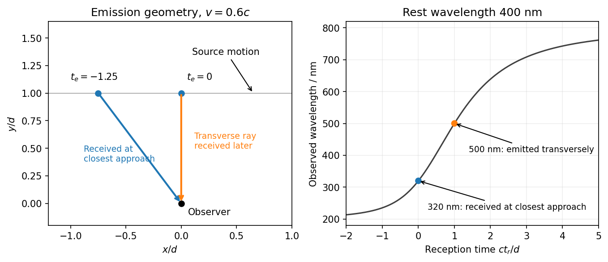
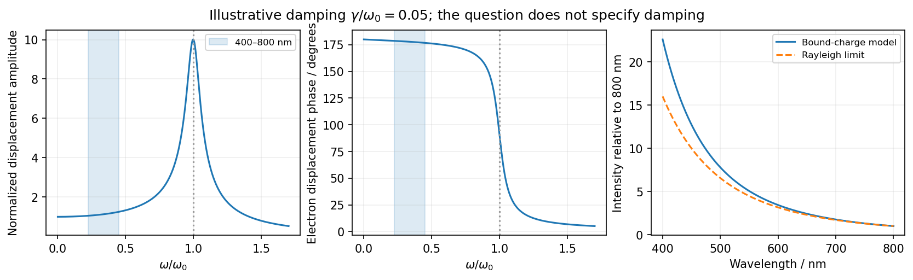
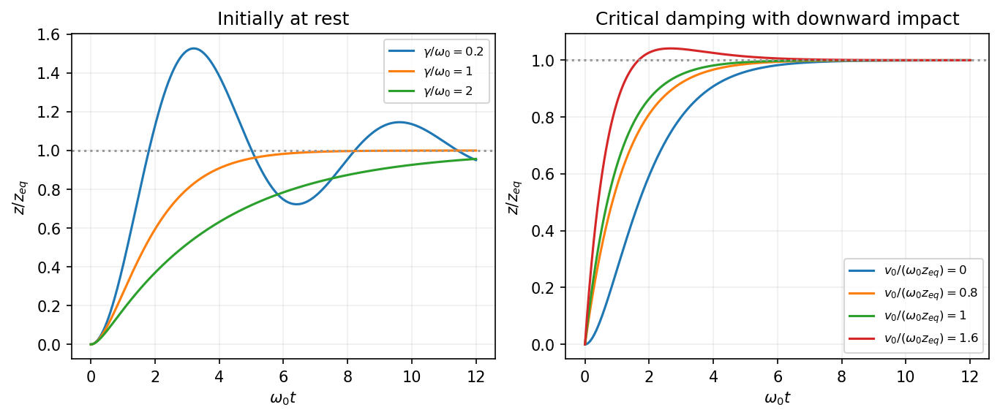
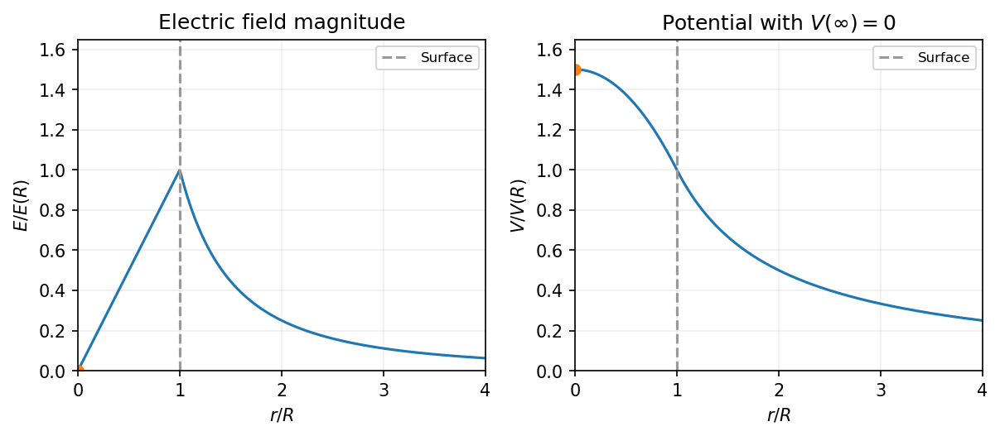

# 2017

↑ **Parent:** [Past exam of the physics course of the year 1 of the natural sciences course of the University of Cambridge](../past-exam-of-the-physics-course-of-the-year-1-of-the-natural-sciences-course-of-the-university-of-cambridge.md)

[Original paper, released PDF pages 1–10](https://www.whatdotheyknow.com/request/natural_science_tripos_physics_e/response/2127325/attach/3/FOI%202022%20639%20Sullivan%20materials.pdf?cookie_passthrough=1#page=1)

**Table of contents**

- [Section A](#section-a)
  - [1](#section-a/1)
    - [Solution](#section-a/1/solution)
  - [2](#section-a/2)
    - [Solution](#section-a/2/solution)
  - [3](#section-a/3)
    - [Solution](#section-a/3/solution)
  - [4](#section-a/4)
    - [Solution](#section-a/4/solution)
  - [5](#section-a/5)
    - [Solution](#section-a/5/solution)
  - [6](#section-a/6)
    - [Solution](#section-a/6/solution)
- [Section B](#section-b)
  - [7](#section-b/7)
    - [Solution](#section-b/7/solution)
  - [8](#section-b/8)
    - [Solution](#section-b/8/solution)
  - [9](#section-b/9)
    - [Solution](#section-b/9/solution)
- [Section C](#section-c)
  - [10](#section-c/10)
    - [Solution](#section-c/10/solution)
  - [11](#section-c/11)
    - [Solution](#section-c/11/solution)
- [Section D](#section-d)
  - [12](#section-d/12)
    - [Solution](#section-d/12/solution)
  - [13](#section-d/13)
    - [Solution](#section-d/13/solution)
- [Section E](#section-e)
  - [14](#section-e/14)
    - [Solution](#section-e/14/solution)
  - [15](#section-e/15)
    - [a](#section-e/15/a)
      - [Solution](#section-e/15/a/solution)
    - [b](#section-e/15/b)
      - [Solution](#section-e/15/b/solution)
    - [c](#section-e/15/c)
      - [Solution](#section-e/15/c/solution)
    - [d](#section-e/15/d)
      - [Solution](#section-e/15/d/solution)

## Section A

↑ **Parent:** [2017](2017.md)

<h3 id="section-a/1">1</h3>

↑ **Parent:** [Section A](#section-a)

<h4 id="section-a/1/solution">Solution</h4>

↑ **Parent:** [1](#section-a/1)

Take a representative tennis-ball [mass](../classical-mechanics.md#mass) of $m\simeq0.06\,\mathrm{kg}$. The [speed](../classical-mechanics.md#speed) is nonrelativistic, so the [de Broglie wavelength](../wave-function.md#de-broglie-wavelength) is

$$
\boxed{\lambda=\frac hp\simeq\frac h{mv}=\frac{6.626\times10^{-34}}{0.06\times10}\simeq1.1\times10^{-33}\,\mathrm m.}
$$

This is an estimate because the [mass](../classical-mechanics.md#mass) was not specified. The [wavelength](../wave-equation.md#wavelength) is vastly smaller than any practicable aperture or obstacle separation: a [diffraction](../quantum-scattering.md#diffraction) angle of order $\lambda/d$ is unresolvably small for laboratory-scale $d$. Moreover, interactions with air, thermal radiation and the apparatus destroy observable coherence between macroscopically distinct paths. [Quantum mechanics](../quantum-mechanics.md) still applies; the small [wavelength](../wave-equation.md#wavelength) and rapid [decoherence](../quantum-theory.md#quantum-decoherence) explain why ordinary experiments reveal classical trajectories rather than a measurable [interference](../physical-optics.md#interference-wave-propagation) pattern.

<h3 id="section-a/2">2</h3>

↑ **Parent:** [Section A](#section-a)

<h4 id="section-a/2/solution">Solution</h4>

↑ **Parent:** [2](#section-a/2)

Write $X=1/(\omega C)=200\,\Omega$. The magnitude of the [series RC impedance](../electrical-circuit.md#series-rc-impedance) is

$$
\boxed{Z_m=\sqrt{R^2+X^2}=\sqrt{100^2+200^2}=223.61\,\Omega.}
$$

For independent small errors interpreted as [standard uncertainties](../physics.md#standard-uncertainty), [propagation of uncertainty](../wave-equation.md#propagation-of-uncertainty) gives

$$
u(Z_m)^2=\left(\frac R{Z_m}u_R\right)^2+\left(\frac{X^2}{Z_m}\frac{u_\omega}{\omega}\right)^2+\left(\frac{X^2}{Z_m}\frac{u_C}{C}\right)^2.
$$

The input uncertainties are $u_R=2\,\Omega$, $u_\omega/\omega=0.01$, and $u_C/C=0.01$. Thus $u(Z_m)^2=0.80+3.20+3.20=7.20\,\Omega^2$, and

$$
\boxed{|Z|=(223.6\pm2.7)\,\Omega\quad\text{with independent standard uncertainties}.}
$$

The fractional uncertainty is $1.20\%$. If the stated errors are instead worst-case bounds, their first-order contributions add in magnitude, giving approximately $4.47\,\Omega$, or $2.0\%$, rather than the quadrature result. Both conventions require the error interpretation to be specified.

<h3 id="section-a/3">3</h3>

↑ **Parent:** [Section A](#section-a)

<h4 id="section-a/3/solution">Solution</h4>

↑ **Parent:** [3](#section-a/3)

Use the [thin lens](../geometrical-optics.md#thin-lens) equation with positive object and real-image distances $u,v$:

$$
\frac1f=\frac1u+\frac1v,\qquad v=\frac{fu}{u-f}=\frac{(4)(300)}{300-4}\,\mathrm{mm}=4.054\,\mathrm{mm}.
$$

The transverse [magnification](../optics.md#magnification) is $M=-v/u=-f/(u-f)=-4/296$. For an object dimension $500\,\mathrm{mm}$, the corresponding image dimension is

$$
\boxed{|h_i|=\frac4{296}(500)\,\mathrm{mm}=6.76\,\mathrm{mm}.}
$$

The minus sign of the [magnification](../optics.md#magnification) means that the image is inverted. This is the ideal thin-lens prediction; it assumes the relevant field is admitted by the camera and ignores lens distortion.

<h3 id="section-a/4">4</h3>

↑ **Parent:** [Section A](#section-a)

<h4 id="section-a/4/solution">Solution</h4>

↑ **Parent:** [4](#section-a/4)

For uniform Earth density, the [shell theorem](../mathematical-physics.md#spherical-shell-theorem) says that only [mass](../classical-mechanics.md#mass) within radius $r$ contributes to the [gravitational field](../physics.md#gravitational-field) there. Since enclosed [mass](../classical-mechanics.md#mass) is proportional to $r^3$,

$$
g(r)=\frac{GM(r)}{r^2}=g(R)\frac rR.
$$

At depth $h$, $g_h/g_0=1-h/R$. A [simple pendulum](../simple-pendulum.md) has small-[amplitude](../wave.md#wave-amplitude) period $P=2\pi\sqrt{l/g}$, so the [pendulum clock below a uniform-density surface](../simple-pendulum.md#pendulum-clock-below-a-uniform-density-surface) runs at the fraction $P_0/P_h=\sqrt{1-h/R}$ of its surface-calibrated rate. After a surface-clock hour, its lag is

$$
\boxed{\Delta t=3600\left[1-\sqrt{1-\frac{1000}{6.371\times10^6}}\right]\,\mathrm s\simeq0.283\,\mathrm s.}
$$

The mine clock is slower because gravity is weaker under the stated uniform-density assumption. The expansion $\Delta t\simeq3600h/(2R)$ gives the same result. This is a change in the mechanical pendulum period, not a relativistic clock effect; a realistic Earth density profile would require a different interior-gravity calculation.

<h3 id="section-a/5">5</h3>

↑ **Parent:** [Section A](#section-a)

<h4 id="section-a/5/solution">Solution</h4>

↑ **Parent:** [5](#section-a/5)

Use distinct symbols for the dimensions of [mass](../classical-mechanics.md#mass), length, time, temperature and amount of substance. The [molar gas constant](../ideal-gas.md#molar-gas-constant) has dimensions $\mathsf M\mathsf L^2\mathsf T^{-2}\mathsf\Theta^{-1}\mathsf N^{-1}$, while the given $M$ is a [molar mass](../chemistry.md#molar-mass) with dimensions $\mathsf M\mathsf N^{-1}$. Matching dimensions in the proposed power law gives

$$
\alpha+\gamma=0,\qquad 2\alpha+\delta=0,\qquad -2\alpha=-1,\qquad -\alpha+\beta=0,
$$

with the amount-of-substance equation repeating $\alpha+\gamma=0$. Therefore

$$
\boxed{\alpha=\frac12,\quad\beta=\frac12,\quad\gamma=-\frac12,\quad\delta=-1,\qquad f\propto\frac1L\sqrt{\frac{RT}{M}}.}
$$

[Dimensional analysis](../mathematical-physics.md#dimensional-analysis) fixes these exponents but not a dimensionless multiplier. For example, an open-tube mode number and the gas's heat-capacity ratio enter the actual [resonance](../dynamical-systems.md#resonance) [frequency](../wave.md#frequency) without changing the dimensions.

<h3 id="section-a/6">6</h3>

↑ **Parent:** [Section A](#section-a)

<h4 id="section-a/6/solution">Solution</h4>

↑ **Parent:** [6](#section-a/6)

In the $e^{i\omega t}$ [phasor](../wave.md#phasor) convention, the total series [RL circuit](../electrical-circuit.md#rl-circuit) impedance is $R+i\omega L$. The resistor voltage follows the current, so its [transfer function](../control-theory.md#transfer-function) relative to the applied voltage is

$$
\frac{\widetilde V_R}{\widetilde V_{\mathrm{in}}}=\frac R{R+i\omega L}.
$$

At the stated condition $R=\omega L$,

$$
\boxed{\frac{\widetilde V_R}{\widetilde V_{\mathrm{in}}}=\frac{1-i}{2}=\frac{e^{-i\pi/4}}{\sqrt2}.}
$$

Thus the resistor-voltage [amplitude](../wave.md#wave-amplitude) is $\boxed{V_{R,0}=V_{\mathrm{in},0}/\sqrt2}$ and it **lags by $45^\circ$**. For a cosine input it is $V_R(t)=V_{\mathrm{in},0}\cos(\omega t-\pi/4)/\sqrt2$.

## Section B

↑ **Parent:** [2017](2017.md)

<h3 id="section-b/7">7</h3>

↑ **Parent:** [Section B](#section-b)

<h4 id="section-b/7/solution">Solution</h4>

↑ **Parent:** [7](#section-b/7)

The original diagram has a horizontal bottle neck, so weight does not enter the axial [force](../force.md) balance. Gauge pressure acts on the cork's end area and supplies outward [force](../force.md) $F_g=\pi a^2P_g$. The radial contact [force](../force.md) is the contact pressure times the cylindrical contact area, $N=2\pi a(l-x)P_c$. The limiting friction is $\mu N$, so outward sliding occurs when

$$
\pi a^2P_g>2\pi a(l-x)\mu P_c,\qquad \boxed{P_g>\frac{2(l-x)\mu P_c}{a}.}
$$

The assumption of equal static and [kinetic friction](../newtonian-mechanics.md#kinetic-friction) coefficients removes a separate [force](../force.md) drop when slipping starts.

Initially the pressure is marginal at $x=0$, so $\pi a^2P_g=2\pi al\mu P_c$. During extraction the contact length decreases, while the pressure [force](../force.md) stays constant. The net [force](../force.md) is therefore $F(x)=\pi a^2P_gx/l$. The cork's [mass](../classical-mechanics.md#mass) is $m_c=\rho\pi a^2l$, giving the [pressure-driven cork ejection](../newtonian-mechanics.md#pressure-driven-cork-ejection) equation

$$
\boxed{\ddot x=b^2x,\qquad b^2=\frac{P_g}{\rho l^2}.}
$$

For $x(0)=0$ and $\dot x(0)=v_0>0$, solving the constant-coefficient equation gives

$$
\boxed{x(t)=c\sinh(bt),\qquad b=\frac1l\sqrt{\frac{P_g}{\rho}},\qquad c=\frac{v_0}{b}=v_0l\sqrt{\frac\rho{P_g}}.}
$$

The equilibrium is unstable: as the cork moves out, friction decreases and the unbalanced [force](../force.md) grows.

Multiplying the equation of motion by $\dot x$ and integrating gives $\dot x^2=v_0^2+b^2x^2$. The contact ends at $x=l$, so

$$
\boxed{v_{\mathrm{exit}}^2=v_0^2+\frac{P_g}{\rho},\qquad v_{\mathrm{exit}}\longrightarrow\sqrt{\frac{P_g}{\rho}}\quad(v_0\to0^+).}
$$

Equivalently, the net [work](../energy.md#work) is $\int_0^lF(x)dx=\pi a^2P_gl/2$. Exactly zero initial [velocity](../classical-mechanics.md#velocity) would leave the ideal marginal configuration stationary. The exit time $b^{-1}\operatorname{arsinh}(bl/v_0)$ diverges as $v_0\to0^+$, even though the limiting exit [speed](../classical-mechanics.md#speed) is finite.

The density is $500\,\mathrm{kg\,m^{-3}}$, so $v_{\mathrm{exit}}\simeq\sqrt{400000/500}=28.3\,\mathrm{m\,s^{-1}}$. For an ideal upward launch at this [speed](../classical-mechanics.md#speed), [conservation of mechanical energy](../energy.md#conservation-of-mechanical-energy) gives height above the exit

$$
\boxed{h=\frac{v_{\mathrm{exit}}^2}{2g}=\frac{P_g}{2\rho g}\simeq40.8\,\mathrm m\approx41\,\mathrm m.}
$$

This neglects air resistance and the small gravitational [work](../energy.md#work) during extraction compared with the launch [energy](../energy.md). Actual gas pressure need not stay constant, so it is an idealized estimate.

Adding a stopper that doubles the moving [mass](../classical-mechanics.md#mass), while preserving the same pressured area and contact friction, leaves the extraction [work](../energy.md#work) unchanged. The squared exit [speed](../classical-mechanics.md#speed) and the ballistic height are therefore halved:

$$
\boxed{v_{\mathrm{stopper}}=\frac{v_{\mathrm{exit}}}{\sqrt2},\qquad h_{\mathrm{stopper}}=\frac h2\simeq20.4\,\mathrm m.}
$$

<h3 id="section-b/8">8</h3>

↑ **Parent:** [Section B](#section-b)

<h4 id="section-b/8/solution">Solution</h4>

↑ **Parent:** [8](#section-b/8)

For particles in an [inertial frame](../mathematical-physics.md#inertial-frame), total [momentum](../momentum.md) and [angular momentum](../momentum.md#angular-momentum) about a fixed origin are

$$
\boxed{\mathbf P=\sum_i m_i\mathbf v_i,\qquad \mathbf L_O=\sum_i\mathbf r_i\times m_i\mathbf v_i.}
$$

The [momentum](../momentum.md) derivative is the total external [force](../force.md) when internal forces cancel pairwise. [Angular momentum](../momentum.md#angular-momentum) is conserved when the total external [torque](../momentum.md#torque) vanishes and the internal torques sum to zero, as for pairwise equal-and-opposite central forces. Equal-and-opposite internal forces alone need not cancel internal [torque](../momentum.md#torque) if their lines of action are different. An isolated system with these internal-[force](../force.md) properties conserves both quantities; if fields carry [momentum](../momentum.md), the complete system must include them.

For a straight rocket, let its instantaneous remaining [mass](../classical-mechanics.md#mass) be $M$ and let $dM<0$ be ejected during a [velocity](../classical-mechanics.md#velocity) increase $dv$. The exhaust's inertial [velocity](../classical-mechanics.md#velocity) is $v-v_e$ to first order. [Conservation of momentum](../momentum.md#momentum-conservation) gives

$$
Mv=(M+dM)(v+dv)+(-dM)(v-v_e),\qquad M\,dv=-v_e\,dM.
$$

Integrating from initial [mass](../classical-mechanics.md#mass) $m+m_f$ to dry [mass](../classical-mechanics.md#mass) $m$ yields the [rocket equation](../momentum.md#rocket-equation)

$$
\boxed{v=v_e\log\frac{m+m_f}{m}.}
$$

It is the rocket-plus-exhaust system that is isolated; the rocket alone is a variable-[mass](../classical-mechanics.md#mass) open system.

For the firework, the original diagram places one tangentially firing point rocket at the end of each radial rod. The [parallel axis theorem](../rigid-body-dynamics.md#parallel-axis-theorem) changes each rod's central inertia to $ma^2/12+m(a/2)^2=ma^2/3$. Adding all rods and fueled rockets gives

$$
\boxed{I_i=3\left[\frac{ma^2}{3}+(m+m_f)a^2\right]=(4m+3m_f)a^2.}
$$

When fuel is exhausted, $I_f=4ma^2$.

Let $M_f$ now denote the total remaining fuel in all three rockets, so $I=4ma^2+a^2M_f$. Fuel at the rim co-rotates before ejection. Its backward tangential exhaust [velocity](../classical-mechanics.md#velocity) is $a\omega-v_e$, and its [angular momentum](../momentum.md#angular-momentum) per unit [mass](../classical-mechanics.md#mass) about the axle is $a(a\omega-v_e)$. For an infinitesimal ejection,

$$
I\omega=(I+dI)(\omega+d\omega)+(-dM_f)a(a\omega-v_e).
$$

Since $dI=a^2dM_f$, the co-rotation terms cancel and leave $I\,d\omega=-av_e\,dM_f$. The [tangential-exhaust rotor with a fixed dry inertia](../classical-mechanics.md#tangential-exhaust-rotor-with-a-fixed-dry-inertia) therefore obeys

$$
\omega_f=\frac{v_e}{a}\log\frac{I_i}{I_f},\qquad \boxed{\omega_f=\frac{v_e}{a}\log\beta,\quad \beta=\frac{4m+3m_f}{4m}=1+\frac{3m_f}{4m}.}
$$

Neglecting the exhaust's initial tangential motion would give an incorrect angular-[momentum](../momentum.md) balance. The rod [mass](../classical-mechanics.md#mass) remains in the denominator throughout the burn.

After the burn, the opposing constant axle [torque](../momentum.md#torque) $G>0$ acts on the fixed inertia $I_f$. Its [work](../energy.md#work) over the remaining turn equals the initial [rotational kinetic energy](../energy.md#rotational-kinetic-energy):

$$
G\Delta\theta=\frac12I_f\omega_f^2,\qquad \boxed{\Delta\theta=\frac{2ma^2\omega_f^2}{G}=\frac{2mv_e^2}{G}(\log\beta)^2.}
$$

<h3 id="section-b/9">9</h3>

↑ **Parent:** [Section B](#section-b)

<h4 id="section-b/9/solution">Solution</h4>

↑ **Parent:** [9](#section-b/9)

Use the PDF's notation $f_0$ for the source-frame pulse [frequency](../wave.md#frequency), and set $\beta=v/c$, $\gamma=(1-\beta^2)^{-1/2}$. Successive emissions occur at the same train-frame position and are separated by [proper time](../special-relativity.md#proper-time) $1/f_0$. The [Lorentz transformation](../special-relativity.md#lorentz-transformation) gives a station-frame emission interval $\Delta t_e=\gamma/f_0$ and displacement $v\Delta t_e$. For a receding beacon, the second pulse travels an extra distance $v\Delta t_e$, so

$$
\Delta t_r=\Delta t_e(1+\beta),\qquad \boxed{\frac f{f_0}=\frac1{\gamma(1+\beta)}=\sqrt{\frac{1-\beta}{1+\beta}}.}
$$

This derivation includes both [time dilation](../special-relativity.md#time-dilation) and the change in light-travel time. Expanding for $\beta\ll1$ gives $f/f_0=1-\beta+O(\beta^2)$, recovering the stated nonrelativistic approximation.

Let $\lambda_0$ be the common [wavelength](../wave-equation.md#wavelength) of the identical lights at rest. The approaching and receding [relativistic Doppler effect](../wave.md#relativistic-doppler-effect) factors give

$$
\lambda_1=\lambda_0\sqrt{\frac{1-\beta}{1+\beta}},\qquad \lambda_2=\lambda_0\sqrt{\frac{1+\beta}{1-\beta}}.
$$

Their ratio and product therefore determine the [speed](../classical-mechanics.md#speed) and rest [wavelength](../wave-equation.md#wavelength) separately:

$$
\boxed{\beta=\frac{\lambda_2-\lambda_1}{\lambda_2+\lambda_1}=\frac{636-530}{636+530}=\frac1{11},\qquad v=0.0909c,}
$$

$$
\boxed{\lambda_0=\sqrt{\lambda_1\lambda_2}=580.6\,\mathrm{nm}.}
$$

No assumption about the rest color was needed.

The last observation requires a transverse-geometry convention. The general observer-frame ray formula is

$$
\boxed{\lambda=\gamma\lambda'_3(1-\beta\cos\theta),}
$$

where $\theta$ is the angle between source [velocity](../classical-mechanics.md#velocity) and photon propagation **in the platform frame at emission**. Under the usual transverse-ray interpretation, $\theta=\pi/2$, so for $\beta=0.6$ and $\gamma=1.25$,

$$
\boxed{\lambda=\gamma\lambda'_3=500\,\mathrm{nm}\quad\text{for a platform-frame transverse ray}.}
$$

This is the standard transverse redshift from [time dilation](../special-relativity.md#time-dilation).

There is a genuine distinction between emission and reception at the instant of passing. A side-mounted source emitting perpendicularly in its own frame instead has $\cos\theta=\beta$ by [aberration of light](../mathematical-physics.md#relativistic-aberration), giving $\lambda=\lambda'_3/\gamma=320\,\mathrm{nm}$. The same blue result occurs if “at the exact moment” means reception when the source's current position is at closest approach, with a small finite transverse offset. For offset $d$, reception and emission satisfy $t_r=t_e+\sqrt{v^2t_e^2+d^2}/c$. Setting $t_r=0$ gives $t_e=-\gamma d/c$ and $\cos\theta=\beta$; setting $t_e=0$ instead gives the transverse ray received at $t_r=d/c$. These limits remain different as $d\to0$.

**[Figure 1](#section-b/9/image-emission-at-closest-approach-and-reception-at-closest-approach-give-different-doppler-factors). Emission at closest approach and reception at closest approach give different Doppler factors**.

Thus **500 nm requires the transverse ray in the platform frame**; **320 nm applies to reception at closest approach or transverse emission in the train frame**. The wording does not distinguish these event/frame choices, so merely neglecting the source-observer separation is insufficient to select between them. The reusable derivation is [transverse Doppler shift and observation time](../wave.md#transverse-doppler-shift-and-observation-time).

## Section C

↑ **Parent:** [2017](2017.md)

<h3 id="section-c/10">10</h3>

↑ **Parent:** [Section C](#section-c)

<h4 id="section-c/10/solution">Solution</h4>

↑ **Parent:** [10](#section-c/10)

Expand the cloud's [potential energy](../energy.md#potential-energy) about a [stable equilibrium](../dynamical-systems.md#stable-equilibrium): $U(z)=U(0)+U'(0)z+U''(0)z^2/2+\cdots$. Equilibrium gives $U'(0)=0$, stability gives $U''(0)=k>0$, and reflection symmetry also removes odd terms. For small displacements, $U-U(0)\simeq kz^2/2$ and $F=-dU/dz\simeq-kz$.

Including the electric and damping forces, [Newton's second law](../force.md#newton-s-second-law) is $m\ddot z=qE(t)-b\dot z-kz$. Dividing by $m$ gives the [Lorentz oscillator model](../permittivity.md#lorentz-oscillator-model)

$$
\boxed{\ddot z+2\gamma\dot z+\omega_0^2z=\frac qmE(t),\qquad \omega_0=\sqrt{\frac km},\quad \gamma=\frac b{2m}.}
$$

The specified convention uses $2\gamma$ as the damping coefficient per unit [mass](../classical-mechanics.md#mass).

For the steady response, represent the field by $E_0e^{i\omega t}$ and the displacement by $\widetilde z e^{i\omega t}$, taking real parts for physical quantities. Substitution gives

$$
(\omega_0^2-\omega^2+2i\gamma\omega)\widetilde z=\frac{qE_0}{m},\qquad \widetilde z=\frac{qE_0/m}{\omega_0^2-\omega^2+2i\gamma\omega}.
$$

Define the nonnegative [amplitude](../wave.md#wave-amplitude) $z_0=|\widetilde z|$ and $\delta=\operatorname{atan2}(2\gamma\omega,\omega_0^2-\omega^2)$. Then

$$
\boxed{z_0=\frac{|q|E_0/m}{\sqrt{(\omega_0^2-\omega^2)^2+4\gamma^2\omega^2}},\qquad \phi=\arg q-\delta\pmod{2\pi}.}
$$

For positive $q$, $\phi=-\delta$. For electrons $q<0$, the [phase of a negatively charged driven oscillator](../permittivity.md#phase-of-a-negatively-charged-driven-oscillator) is $\phi=\pi-\delta$: the low-[frequency](../wave.md#frequency) displacement is opposite to the field, rather than in [phase](../wave.md#phase-waves) with it. A signed [amplitude](../wave.md#wave-amplitude) could absorb this extra $\pi$, but the [phase](../wave.md#phase-waves) convention must then be stated. The induced dipole $p=qz$ has [phase](../wave.md#phase-waves) $-\delta$ for either charge sign. Transient free oscillations have been omitted because the question asks for steady state.

For the electron cloud, $q/m=-e/m_e$ and

$$
\omega_0=\sqrt{\frac{k/n}{m_e}}=\sqrt{\frac{100}{9.109\times10^{-31}}}=1.05\times10^{16}\,\mathrm{rad\,s^{-1}}.
$$

The visible range corresponds to $\omega=2\pi c/\lambda$ between $2.35\times10^{15}$ and $4.71\times10^{15}\,\mathrm{rad\,s^{-1}}$, below this [resonance](../dynamical-systems.md#resonance). The resonant [wavelength](../wave-equation.md#wavelength) is about $180\,\mathrm{nm}$, in the ultraviolet.

The [acceleration](../classical-mechanics.md#acceleration) [amplitude](../wave.md#wave-amplitude) is $\omega^2z_0$. At fixed incident field [amplitude](../wave.md#wave-amplitude), the scattered intensity is therefore proportional to

$$
\boxed{I_{\mathrm{sc}}(\omega)\propto\frac{\omega^4}{(\omega_0^2-\omega^2)^2+4\gamma^2\omega^2}.}
$$

Well below [resonance](../dynamical-systems.md#resonance) and outside strong damping corrections, $z_0$ is nearly [frequency](../wave.md#frequency)-independent and this becomes the [Rayleigh scattering wavelength dependence](../electromagnetic-radiation.md#rayleigh-scattering-wavelength-dependence) $I_{\mathrm{sc}}\propto\omega^4\propto\lambda^{-4}$. The shortest visible wavelengths are consequently scattered much more strongly into directions away from the direct solar beam than the longest ones, producing a blue sky. The simple fourth-power approximation gives a factor 16 between 400 and 800 nm at equal incident intensity. Retaining the undamped denominator with the given [resonance](../dynamical-systems.md#resonance) raises that factor to about 22.7, since the upper end is not extremely far below [resonance](../dynamical-systems.md#resonance). The exact ratio needs the unspecified damping and incident solar spectrum; the stronger scattering of the blue end is the robust conclusion here.

**[Figure 2](#section-c/10/image-bound-charge-response-below-an-ultraviolet-resonance-favors-short-visible-wavelengths). Bound-charge response below an ultraviolet resonance favors short visible wavelengths**.

The model describes [frequency](../wave.md#frequency)-dependent scattering, not the detailed perceived color after solar-spectrum weighting and human visual response. It also explains why treating the electrons as free at visible frequencies would miss the bound-charge fourth-power limit.

<h3 id="section-c/11">11</h3>

↑ **Parent:** [Section C](#section-c)

<h4 id="section-c/11/solution">Solution</h4>

↑ **Parent:** [11](#section-c/11)

Use the diagram's downward displacement $z$, measured from the unloaded plate position, and take $z(0)=0$. The [mechanical energy](../energy.md#mechanical-energy), with gravitational potential zero at that reference, is

$$
\boxed{E=\frac12m\dot z^2+\frac12kz^2-mgz.}
$$

The loaded equilibrium follows from $kz_{\mathrm{eq}}=mg$, so its downward shift is $\boxed{z_{\mathrm{eq}}=mg/k}$.

The shock absorber's [force](../force.md) is $-b\dot z$, hence its power is [force](../force.md) times [velocity](../classical-mechanics.md#velocity): $dE/dt=-b\dot z^2\leq0$. Differentiating the [energy](../energy.md) gives $\dot z(m\ddot z+kz-mg)=-b\dot z^2$, which yields, with continuity through instants of zero [velocity](../classical-mechanics.md#velocity),

$$
\boxed{m\ddot z+b\dot z+kz=mg.}
$$

Set $\omega_0=\sqrt{k/m}$ and $\gamma=b/(2m)$.

For release from rest, the three [step response of a damped oscillator](../analysis.md#step-response-of-a-damped-oscillator) regimes are easy to compare after shifting to $z-z_{\mathrm{eq}}$. With light damping $0<\gamma<\omega_0$, write $\omega_d=\sqrt{\omega_0^2-\gamma^2}$:

$$
\frac z{z_{\mathrm{eq}}}=1-e^{-\gamma t}\left(\cos\omega_dt+\frac\gamma{\omega_d}\sin\omega_dt\right).
$$

It overshoots and oscillates around the loaded position with a decaying envelope. At [critical damping](../wave-equation.md#critical-damping), $\gamma=\omega_0$, it becomes $z/z_{\mathrm{eq}}=1-(1+\gamma t)e^{-\gamma t}$, approaching monotonically from below. For heavy damping $\gamma>\omega_0$, set $\eta=\sqrt{\gamma^2-\omega_0^2}$ and replace the trigonometric bracket by $\cosh\eta t+(\gamma/\eta)\sinh\eta t$. This is also monotonic, but its slow exponential delays settling.

**[Figure 3](#section-c/11/image-damping-controls-the-scale-s-settling-while-initial-impact-velocity-can-still-cause-overshoot). Damping controls the scale's settling, while initial impact velocity can still cause overshoot**.

[Critical damping](../wave-equation.md#critical-damping) gives the fastest nonoscillatory settling from the unloaded rest condition, avoiding a repeatedly swinging reading without the sluggishness of [overdamping](../wave-equation.md#overdamping). Its required coefficient is

$$
\boxed{b_{\mathrm{crit}}=2\sqrt{km}.}
$$

At [critical damping](../wave-equation.md#critical-damping) the repeated characteristic root is $-\gamma$. Thus the general displacement under constant load is $(A+Bt)e^{-\gamma t}+C$. The equilibrium and initial conditions give $C=z_{\mathrm{eq}}$, $A=-z_{\mathrm{eq}}$ and $B-\gamma A=v_0$, hence

$$
\boxed{A=-\frac{mg}{k},\qquad B=v_0-\gamma\frac{mg}{k},\qquad C=\frac{mg}{k},\qquad \gamma=\sqrt{\frac km}.}
$$

Subtracting the final position gives $z-z_{\mathrm{eq}}=[-z_{\mathrm{eq}}+(v_0-\gamma z_{\mathrm{eq}})t]e^{-\gamma t}$. The exponential is positive and the bracket starts negative. It becomes positive at some $t>0$ if and only if its slope is positive. Therefore [critical-damping overshoot from initial velocity](../wave-equation.md#critical-damping-overshoot-from-initial-velocity) requires

$$
\boxed{v_0>\gamma z_{\mathrm{eq}}=g\sqrt{\frac mk}=\frac g\gamma,}
$$

with $v_0$ positive downwards. At equality the scale still approaches from below. [Critical damping](../wave-equation.md#critical-damping) prevents oscillatory modes, but does not guarantee a non-overshooting response to an arbitrarily large impact [velocity](../classical-mechanics.md#velocity).

## Section D

↑ **Parent:** [2017](2017.md)

<h3 id="section-d/12">12</h3>

↑ **Parent:** [Section D](#section-d)

<h4 id="section-d/12/solution">Solution</h4>

↑ **Parent:** [12](#section-d/12)

Here $V(x,y)$ is the [potential energy](../energy.md#potential-energy) and $E$ is the stationary [energy](../energy.md) [eigenvalue](../linear-operator-theory.md#eigenvalue). The [Schrödinger equation](../mathematical-physics.md#schrodinger-equation) is the [eigenvalue](../linear-operator-theory.md#eigenvalue) equation for kinetic plus [potential energy](../energy.md#potential-energy). Its boundary conditions select the allowed energies. For a normalized [wavefunction](../wave-function.md), the [Born rule](../wave-function.md#born-rule) assigns probability $|\psi(x,y)|^2dx\,dy$ to a small area, and $\int|\psi|^2dx\,dy=1$. A stationary state's full time dependence is $\psi(x,y)e^{-iEt/\hbar}$; its [probability density](../wave-function.md#probability-density) is time-independent.

The infinite walls impose $\psi=0$ on all four boundaries. For a separated solution $\psi=X(x)Y(y)$ in the zero-potential interior,

$$
\frac{X''}{X}+\frac{Y''}{Y}=-\frac{2mE}{\hbar^2}.
$$

The first term depends only on $x$ and the second only on $y$, so each is constant, $-k_x^2$ and $-k_y^2$. Vanishing at $x=0$ and $y=0$ removes the cosine terms. Vanishing at the other boundaries gives

$$
\boxed{k_x=\frac{n_x\pi}{a},\qquad k_y=\frac{n_y\pi}{b},\qquad n_x,n_y=1,2,\ldots.}
$$

The normalized [two-dimensional infinite square well](../quantum-mechanics.md#two-dimensional-infinite-square-well) [eigenbasis](../linear-operator-theory.md#eigenbasis) and energies are

$$
\boxed{\psi_{n_xn_y}(x,y)=\frac2{\sqrt{ab}}\sin\frac{n_x\pi x}{a}\sin\frac{n_y\pi y}{b},\qquad E_{n_xn_y}=\frac{\pi^2\hbar^2}{2m}\left(\frac{n_x^2}{a^2}+\frac{n_y^2}{b^2}\right).}
$$

Normalization follows from the two sine-squared integrals $a/2$ and $b/2$. Zero quantum numbers would give an identically zero function. These separated products form a basis, not every possible [wavefunction](../wave-function.md): a general state is their [superposition](../vector-space.md#superposition-principle), and a degenerate [energy](../energy.md) eigenspace can have nonseparable stationary combinations of products with that same [energy](../energy.md).

For $a=1\,\mathrm{nm}$ and $b=2\,\mathrm{nm}$, the ground state is $(1,1)$ and the nearest excitation is $(1,2)$, along the longer side. The next quantum along the shorter side costs more [energy](../energy.md). Thus

$$
\boxed{\epsilon_{\min}=E_{12}-E_{11}=\frac{3\pi^2\hbar^2}{2m_eb^2}=4.52\times10^{-20}\,\mathrm J=0.282\,\mathrm{eV}.}
$$

This transition has nonzero dipole matrix element for an electric-field component along $y$. Light polarized strictly along $x$ would not drive it, so the minimum assumes an allowed [polarization](../wave.md#polarization-waves) rather than an arbitrary fixed one.

For the requested degeneracy, keep $b>a$. The first two states are necessarily $(1,1)$ and $(1,2)$, since $E_{21}-E_{12}=3\pi^2\hbar^2(a^{-2}-b^{-2})/(2m)>0$. The third level is the smaller of $E_{21}$ and $E_{13}$: states with both indices at least two lie above $E_{21}$, and higher states on the $n_x=1$ sequence lie above $E_{13}$. Make these two candidates equal:

$$
\frac4{a^2}+\frac1{b^2}=\frac1{a^2}+\frac9{b^2},\qquad \boxed{b=\sqrt{\frac83}\,a=1.633\,\mathrm{nm}.}
$$

The [third-level degeneracy in a rectangular quantum box](../quantum-mechanics.md#third-level-degeneracy-in-a-rectangular-quantum-box) then has lowest distinct energies $11/8$, $5/2$ and $35/8$ in units $\pi^2\hbar^2/(2m_ea^2)$, with multiplicities one, one and two. The third-level pair is exactly $(2,1)$ and $(1,3)$.

<h3 id="section-d/13">13</h3>

↑ **Parent:** [Section D](#section-d)

<h4 id="section-d/13/solution">Solution</h4>

↑ **Parent:** [13](#section-d/13)

At the first two specified times, the displacement profiles are

$$
\boxed{y(x,0)=y_0\cos kx,\qquad y\left(x,\frac{\pi}{2\omega}\right)=y_0\sin kx.}
$$

The second curve is the first shifted right by $\pi/(2k)=\lambda/4$. More generally a point of fixed wave [phase](../wave.md#phase-waves) satisfies $\omega t-kx=\text{constant}$, so it moves along $x=(\omega/k)t+\text{constant}$. Hence the wave travels in the positive $x$ direction with

$$
\boxed{c=\frac\omega k.}
$$

This [phase velocity](../dispersion-relation.md#phase-velocity) is distinct from the local transverse [velocity](../classical-mechanics.md#velocity) $\partial y/\partial t$ of a string element.

For the [force](../force.md) derivation take a short segment between $x$ and $x+\Delta x$. Let the tangent angles to the positive $x$ axis be $\theta_L$ and $\theta_R$. The left [tension](../force.md#tension) pulls along the negative tangent and the right [tension](../force.md#tension) along the positive tangent. With small slopes and approximately constant [tension](../force.md#tension) magnitude $T$, the horizontal components cancel to leading order and

$$
F_y=T\sin\theta_R-T\sin\theta_L\simeq T[y_x(x+\Delta x)-y_x(x)]\simeq T\Delta x\,y_{xx}.
$$

The segment [mass](../classical-mechanics.md#mass) is $\rho\Delta x$, where $\rho$ is **[mass](../classical-mechanics.md#mass) per unit length**, not volume density. [Newton's second law](../force.md#newton-s-second-law) therefore gives

$$
\boxed{\rho y_{tt}=Ty_{xx},\qquad y_{tt}=c^2y_{xx},\qquad c=\sqrt{\frac T\rho}.}
$$

The approximation neglects bending stiffness, damping and changes in [tension](../force.md#tension) caused by finite-[amplitude](../wave.md#wave-amplitude) stretching.

**[Figure 4](#section-d/13/image-string-element-forces-a-right-moving-sinusoid-and-two-gaussian-pulse-initial-conditions). String-element forces, a right-moving sinusoid and two Gaussian-pulse initial conditions**.

Converting the supplied density gives $\rho=0.020\,\mathrm{kg\,m^{-1}}$, so

$$
c=\sqrt{\frac{1000}{0.020}}=223.6\,\mathrm{m\,s^{-1}},\qquad \boxed{f=\frac c\lambda=\frac{223.6}{0.5}=447\,\mathrm{Hz}.}
$$

For the pulse, define $g(x)=Ae^{-ax^2/2}$ with $a>0$. The given initial [velocity](../classical-mechanics.md#velocity) is $-cg'(x)$, exactly the [velocity](../classical-mechanics.md#velocity) associated with a right-moving displacement $g(x-ct)$. Therefore

$$
\boxed{y(x,t)=A\exp\left[-\frac a2(x-ct)^2\right].}
$$

It moves right without changing shape in this nondispersive model. With the same initial displacement but zero initial transverse [velocity](../classical-mechanics.md#velocity), [D'Alembert's formula](../wave-equation.md#d-alembert-s-formula) instead gives the [Gaussian pulse splitting from zero initial velocity](../wave-equation.md#gaussian-pulse-splitting-from-zero-initial-velocity)

$$
\boxed{y(x,t)=\frac A2\left\{e^{-a(x-ct)^2/2}+e^{-a(x+ct)^2/2}\right\}.}
$$

The two half-[amplitude](../wave.md#wave-amplitude) pulses travel in opposite directions. Their initial velocities cancel, while their initial displacements add to the prescribed [Gaussian](../probability-distribution.md#normal-distribution). The two initial-value problems have different kinetic energies; splitting into half-height pulses does not contradict [energy](../energy.md) conservation. These forms assume a string long enough that reflections from its ends have not returned.

## Section E

↑ **Parent:** [2017](2017.md)

<h3 id="section-e/14">14</h3>

↑ **Parent:** [Section E](#section-e)

<h4 id="section-e/14/solution">Solution</h4>

↑ **Parent:** [14](#section-e/14)

In [electrostatics](../electrostatics.md), [Gauss's law](../maxwell-equations.md#gauss-s-law) is

$$
\boxed{\oint_{\partial\Omega}\mathbf E\cdot d\mathbf A=\frac{Q_{\mathrm{enc}}}{\epsilon_0},\qquad \boldsymbol\nabla\cdot\mathbf E=\frac\rho{\epsilon_0}.}
$$

The surface normal points outward. [Spherical symmetry](../geometry-and-topology.md#spherical-symmetry) makes the field radial and constant in magnitude on a concentric [Gaussian](../probability-distribution.md#normal-distribution) surface.

For a uniformly charged sphere, enclosed charge is $4\pi\rho_0r^3/3$ inside and $Q=4\pi\rho_0R^3/3$ outside. Thus the radial field is

$$
\boxed{E_r(r)=\begin{cases}\displaystyle\frac{\rho_0r}{3\epsilon_0},&0\leq r\leq R,\\[4pt]\displaystyle\frac{\rho_0R^3}{3\epsilon_0r^2},&r\geq R.\end{cases}}
$$

Set potential zero at infinity. Outside, $V=Q/(4\pi\epsilon_0r)$. Inside, integrate $dV/dr=-E_r$ from the known boundary value, obtaining

$$
\boxed{V(r)=\begin{cases}\displaystyle\frac{\rho_0}{6\epsilon_0}(3R^2-r^2),&r\leq R,\\[4pt]\displaystyle\frac{\rho_0R^3}{3\epsilon_0r},&r\geq R.\end{cases}}
$$

The field rises linearly from zero to its maximum at $R$, then falls as $r^{-2}$. The potential falls quadratically from $\rho_0R^2/(2\epsilon_0)$ to its surface value and then as $r^{-1}$. Both are continuous at the surface; there is no separate sheet of surface charge.

**[Figure 5](#section-e/14/image-radial-field-and-potential-of-a-uniformly-charged-solid-sphere). Radial field and potential of a uniformly charged solid sphere**.

For the [electric field of a hydrogen ground-state electron cloud](../mathematical-physics.md#electric-field-of-a-hydrogen-ground-state-electron-cloud), its enclosed charge is

$$
Q_e(r)=4\pi\int_0^r s^2\rho(s)\,ds=-\frac{4e}{a_0^3}\int_0^r s^2e^{-2s/a_0}\,ds.
$$

Writing $u=2s/a_0$ and using $\int u^2e^{-u}du=-e^{-u}(u^2+2u+2)$ gives

$$
Q_e(r)=-e\left[1-e^{-2r/a_0}\left(1+\frac{2r}{a_0}+\frac{2r^2}{a_0^2}\right)\right].
$$

The total electron-cloud charge tends to $-e$, as required. Dividing by $4\pi\epsilon_0r^2$ yields

$$
\boxed{E_{e,r}(r)=\frac e{4\pi\epsilon_0}\left[\frac{e^{-2r/a_0}-1}{r^2}+\frac{2e^{-2r/a_0}}{a_0r}+\frac{2e^{-2r/a_0}}{a_0^2}\right].}
$$

The expression is negative and therefore points inward. Its apparently singular terms cancel at small radius, leaving $E_{e,r}\simeq-er/(3\pi\epsilon_0a_0^3)$.

A distant external charge polarizes the neutral atom. Its [electric field](../electric-field.md) displaces the positive and negative charge distributions relative to one another, giving an induced dipole $\mathbf p=\alpha\mathbf E_{\mathrm{ext}}$ with static [electric polarizability](../electrostatics.md#electric-polarizability) $\alpha>0$. The field is stronger on the nearer side, so the opposite-charge attraction exceeds the like-charge repulsion. This is [charge-induced dipole attraction](../electrostatics.md#charge-induced-dipole-attraction), not a net monopole charge on the atom.

Quantitatively, for external charge $Q=\pm e$ at separation $r$, the [polarization](../wave.md#polarization-waves) [energy](../energy.md) is $U=-\alpha E_{\mathrm{ext}}^2/2$, hence

$$
\boxed{U(r)=-\frac{\alpha Q^2}{2(4\pi\epsilon_0)^2r^4},\qquad F_r=-\frac{dU}{dr}=-\frac{2\alpha Q^2}{(4\pi\epsilon_0)^2r^5}.}
$$

Here negative $F_r$ means decreasing separation. Reversing the external charge reverses the induced dipole but leaves this leading long-range [force](../force.md) attractive and of the same magnitude. The factor one half accounts for the [energy](../energy.md) cost of inducing the dipole.

The supplied charge density describes the unperturbed atom. Adding its electron field to the nucleus field leaves $E_{\mathrm{atom}}=e e^{-2r/a_0}(r^{-2}+2/(a_0r)+2/a_0^2)/(4\pi\epsilon_0)$, an exponentially small residual because the cloud has an infinite tail. A completely frozen density would give only that tiny sign-dependent [force](../force.md). Allowing [polarization](../wave.md#polarization-waves) is essential to obtain the dominant attractive power-law [force](../force.md) for either sign of external charge when $r\gg a_0$.

<h3 id="section-e/15">15</h3>

↑ **Parent:** [Section E](#section-e)

<h4 id="section-e/15/a">a</h4>

↑ **Parent:** [15](#section-e/15)

<h5 id="section-e/15/a/solution">Solution</h5>

↑ **Parent:** [A](#section-e/15/a)

A charge $q$ moving nonrelativistically in prescribed fields obeys the [Lorentz force law](../relativistic-electromagnetism.md#lorentz-force)

$$
\boxed{m\frac{d\mathbf v}{dt}=q(\mathbf E+\mathbf v\times\mathbf B).}
$$

The magnetic part is perpendicular to [velocity](../classical-mechanics.md#velocity), so $d(mv^2/2)/dt=q\mathbf E\cdot\mathbf v$: the [electric field](../electric-field.md) can change [kinetic energy](../energy.md#kinetic-energy), while the [magnetic field](../magnetic-field.md) alone changes direction without doing [work](../energy.md#work).

In a uniform [electric field](../electric-field.md) with no [magnetic field](../magnetic-field.md), [acceleration](../classical-mechanics.md#acceleration) is constant: $\mathbf v=\mathbf v_0+(q\mathbf E/m)t$ and $\mathbf r=\mathbf r_0+\mathbf v_0t+q\mathbf E t^2/(2m)$. The trajectory is a parabola when there is initial motion perpendicular to the field, and a line when motion is purely along it. Reversing the charge reverses the electric [acceleration](../classical-mechanics.md#acceleration).

In a uniform [magnetic field](../magnetic-field.md) with no [electric field](../electric-field.md), resolve [velocity](../classical-mechanics.md#velocity) into parallel and perpendicular components. The parallel component is constant; the perpendicular component rotates at the [cyclotron frequency](../quantum-theory.md#cyclotron-frequency)

$$
\boxed{\omega_c=\frac{|q|B}{m},\qquad r_L=\frac{mv_\perp}{|q|B}.}
$$

The resulting path is a helix, or a circle if $v_\parallel=0$, with pitch $2\pi v_\parallel/\omega_c$. Charge sign determines its sense of rotation. These relations underlie magnetic bending and [mass](../classical-mechanics.md#mass)/charge analysis. At relativistic energies, use [momentum](../momentum.md) $\mathbf p=\gamma m\mathbf v$; at fixed [energy](../energy.md) the [cyclotron frequency](../quantum-theory.md#cyclotron-frequency) becomes $|q|B/(\gamma m)$.

For uniform crossed fields $\mathbf E\perp\mathbf B$, the [velocity](../classical-mechanics.md#velocity) $\mathbf v_D=\mathbf E\times\mathbf B/B^2$ satisfies $\mathbf E+\mathbf v_D\times\mathbf B=0$. The orbit is a gyromotion about a [guiding center](../electromagnetism.md#guiding-center) drifting with

$$
\boxed{\mathbf v_D=\frac{\mathbf E\times\mathbf B}{B^2},}
$$

independent of [mass](../classical-mechanics.md#mass) and charge sign. A [velocity selector](../relativistic-electromagnetism.md#velocity-selector) transmits particles with the appropriate direction and [speed](../classical-mechanics.md#speed) $E/B$ without deflection. If the [electric field](../electric-field.md) has a component along the [magnetic field](../magnetic-field.md), that component accelerates the parallel motion instead. Nonuniform fields can add other drifts; the simple helix and uniform crossed-field expressions require the stated uniform-field assumptions.

<h4 id="section-e/15/b">b</h4>

↑ **Parent:** [15](#section-e/15)

<h5 id="section-e/15/b/solution">Solution</h5>

↑ **Parent:** [B](#section-e/15/b)

A position-dependent [force](../force.md) is a [conservative force](../energy.md#conservative-force) when its [work](../energy.md#work) depends only on endpoints. Equivalently, its [work](../energy.md#work) around any closed allowed path vanishes, and one can define a [potential energy](../energy.md#potential-energy) $U$ satisfying

$$
\boxed{\mathbf F=-\boldsymbol\nabla U,\qquad W_{A\to B}=U(A)-U(B).}
$$

The potential is defined up to an additive constant. A vanishing [curl](../multivariable-calculus.md#curl), $\boldsymbol\nabla\times\mathbf F=0$, is a local test; it guarantees a global single-valued potential on a [simply connected](../algebraic-topology.md#simply-connected-space) region with suitable regularity. Holes or excluded singularities require checking the global path condition.

The [work-energy theorem](../energy.md#work-energy-theorem) gives $dK/dt=\mathbf F\cdot\mathbf v$. For a static potential this implies $d(K+U)/dt=0$. If $U$ depends explicitly on time, then instead $d(K+U)/dt=\partial U/\partial t$ under that [force](../force.md) alone. Friction and other nonconservative forces add their own power and can convert [mechanical energy](../energy.md#mechanical-energy) into heat.

Examples include the [gravitational potential energy](../energy.md#gravitational-energy) $-GMm/r$ outside a spherical [mass](../classical-mechanics.md#mass) and the electrostatic [energy](../energy.md) $U=qV$, where $\mathbf E=-\boldsymbol\nabla V$. For a point source charge $Q$, $U=qQ/(4\pi\epsilon_0r)$, giving attraction or repulsion through the sign of $qQ$. A spring has $U=kx^2/2$ and [force](../force.md) $-kx$. An equilibrium has $\boldsymbol\nabla U=0$; a strict local minimum is stable against small displacements when the quadratic curvature is positive. Expanding about that minimum explains the harmonic restoring [force](../force.md) used in many small-oscillation models.

Magnetic [force](../force.md) on a moving point charge does no [work](../energy.md#work), but it is [velocity](../classical-mechanics.md#velocity)-dependent and is not generally a position-only [force](../force.md) $-\boldsymbol\nabla U$. Likewise a time-varying [magnetic flux](../magnetic-field.md#magnetic-flux) induces a circulating [electric field](../electric-field.md) with $\oint\mathbf E\cdot d\mathbf l=-d\Phi_B/dt$, so that [electric field](../electric-field.md) cannot globally be represented solely by an electrostatic scalar potential. These distinctions prevent treating every field [force](../force.md) as conservative simply because an [energy](../energy.md) description exists for the complete system.

<h4 id="section-e/15/c">c</h4>

↑ **Parent:** [15](#section-e/15)

<h5 id="section-e/15/c/solution">Solution</h5>

↑ **Parent:** [C](#section-e/15/c)

For steady currents in vacuum, the [Biot-Savart law](../electromagnetism.md#biot-savart-law) gives the [magnetic field](../magnetic-field.md) by summing oriented current elements. With $\mathbf R=\mathbf r-\mathbf r'$ from the source to the observation point,

$$
\boxed{\mathbf B(\mathbf r)=\frac{\mu_0}{4\pi}\int\frac{\mathbf J(\mathbf r')\times\mathbf R}{R^3}\,d^3r'.}
$$

For a thin wire it becomes $\mathbf B=(\mu_0I/4\pi)\int d\mathbf l'\times\widehat{\mathbf R}/R^2$. The cross product fixes the direction by the right-hand rule. Fields from different steady circuits add by [superposition](../vector-space.md#superposition-principle); the entire current path, including return wires where relevant, belongs in the calculation.

An infinite straight wire gives circular field lines of magnitude $\boxed{B=\mu_0I/(2\pi s)}$ at perpendicular distance $s$. This follows by integrating the transverse component of each element along the wire. A circular loop of radius $a$ has cancelling transverse components on its axis, leaving

$$
\boxed{B_z(z)=\frac{\mu_0Ia^2}{2(a^2+z^2)^{3/2}},\qquad B_z(0)=\frac{\mu_0I}{2a}.}
$$

Multiple coincident turns multiply the field by their number. Far from the loop this is the field of a magnetic dipole of moment $\boldsymbol\mu=I\pi a^2\widehat{\mathbf n}$. Integrating over many loops gives the approximately uniform interior field $B\simeq\mu_0nI$ of a long [solenoid](../magnetic-field.md#solenoid), with $n$ turns per unit length. Finite coils have fringing fields, and appropriately spaced coil pairs can produce a more uniform measurement region.

The law is useful for predicting fields of wires and coils where direct symmetry is insufficient, designing electromagnets and estimating stray fields. It is a magnetostatic law: steady charge flow satisfies charge continuity. An instantaneous application to rapidly changing currents neglects propagation and radiation; such problems require the time-dependent [Maxwell's equations](../maxwell-equations.md) and retarded fields. A quasistatic approximation can be valid when circuit dimensions are small compared with the light-travel distance during the variation timescale.

<h4 id="section-e/15/d">d</h4>

↑ **Parent:** [15](#section-e/15)

<h5 id="section-e/15/d/solution">Solution</h5>

↑ **Parent:** [D](#section-e/15/d)

In SI units, the microscopic [Maxwell's equations](../maxwell-equations.md) for total charge density $\rho$ and current density $\mathbf J$ are

$$
\boxed{\boldsymbol\nabla\cdot\mathbf E=\frac\rho{\epsilon_0},\qquad \boldsymbol\nabla\cdot\mathbf B=0,\qquad \boldsymbol\nabla\times\mathbf E=-\frac{\partial\mathbf B}{\partial t},\qquad \boldsymbol\nabla\times\mathbf B=\mu_0\mathbf J+\mu_0\epsilon_0\frac{\partial\mathbf E}{\partial t}.}
$$

The first is [Gauss's law](../maxwell-equations.md#gauss-s-law): [electric charge](../electric-charge.md) sources [electric flux](../electric-field.md#electric-flux). The second is [Gauss's law for magnetism](../maxwell-equations.md#gauss-s-law-for-magnetism), expressing the absence of magnetic monopole sources in this theory. [Faraday's law](../maxwell-equations.md#faraday-s-law-of-induction) relates changing [magnetic flux](../magnetic-field.md#magnetic-flux) to circulating [electric field](../electric-field.md). The [Ampere-Maxwell law](../maxwell-equations.md#ampere-s-circuital-law) relates magnetic circulation to both material current and changing [electric flux](../electric-field.md#electric-flux).

For fixed loops and surfaces, the integral versions are

$$
\oint_{\partial\Omega}\mathbf E\cdot d\mathbf A=\frac{Q_{\mathrm{enc}}}{\epsilon_0},\quad \oint_{\partial\Omega}\mathbf B\cdot d\mathbf A=0,
$$

$$
\oint_{\partial S}\mathbf E\cdot d\mathbf l=-\frac d{dt}\int_S\mathbf B\cdot d\mathbf A,\quad \oint_{\partial S}\mathbf B\cdot d\mathbf l=\mu_0I_S+\mu_0\epsilon_0\frac d{dt}\int_S\mathbf E\cdot d\mathbf A.
$$

Surface and loop orientations are related by the right-hand rule. These forms follow from the divergence theorem and Stokes' theorem. In material media, equivalent macroscopic equations can separate free and bound sources using $\mathbf D$ and $\mathbf H$ together with constitutive relations; the displayed forms use total sources.

The displacement-current term is essential for [charge conservation](../electric-charge.md#charge-conservation). Taking the divergence of the last differential equation and using [Gauss's law](../maxwell-equations.md#gauss-s-law) gives $\partial_t\rho+\boldsymbol\nabla\cdot\mathbf J=0$. It also makes magnetic circulation consistent for surfaces spanning the same loop through either a charging capacitor's wire or its dielectric gap.

In source-free vacuum the [curl](../multivariable-calculus.md#curl) equations combine to give $\nabla^2\mathbf E=\mu_0\epsilon_0\partial_t^2\mathbf E$, with the same equation for $\mathbf B$. Thus

$$
\boxed{c=\frac1{\sqrt{\mu_0\epsilon_0}}.}
$$

A plane wave is transverse, with $\mathbf E$, $\mathbf B$ and propagation direction mutually perpendicular and $E=cB$. The fields transport [energy](../energy.md) with density $u=\epsilon_0E^2/2+B^2/(2\mu_0)$ and [Poynting vector](../electromagnetic-wave.md#poynting-vector) $\mathbf S=\mathbf E\times\mathbf B/\mu_0$. Together with the [Lorentz force law](../relativistic-electromagnetism.md#lorentz-force), the equations connect charges, currents, forces, induction and electromagnetic radiation.

## ↑ Ancestors (9)

1. [Past exam of the physics course of the year 1 of the natural sciences course of the University of Cambridge](../past-exam-of-the-physics-course-of-the-year-1-of-the-natural-sciences-course-of-the-university-of-cambridge.md)
2. [Physics course of the year 1 of the natural sciences course of the University of Cambridge](../university-of-cambridge.md#physics-course-of-the-year-1-of-the-natural-sciences-course-of-the-university-of-cambridge)
3. [Year 1 of the natural sciences course of the University of Cambridge](../university-of-cambridge.md#year-1-of-the-natural-sciences-course-of-the-university-of-cambridge)
4. [Year of the natural sciences course of the University of Cambridge](../university-of-cambridge.md#year-of-the-natural-sciences-course-of-the-university-of-cambridge)
5. [Natural sciences course of the University of Cambridge](../university-of-cambridge.md#natural-sciences-course-of-the-university-of-cambridge)
6. [Course of the University of Cambridge](../university-of-cambridge.md#course-of-the-university-of-cambridge)
7. [University of Cambridge](../university-of-cambridge.md)
8. [List of universities](../README.md#list-of-universities)
9. [Codex Wiki](../README.md)
