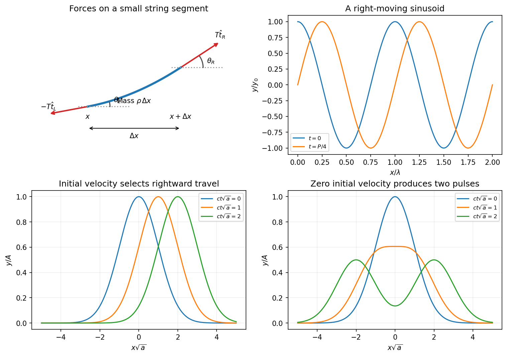

<h1 id="section-d/13/solution">Solution</h1>

↑ **Parent:** [13](../13.md)

At the first two specified times, the displacement profiles are

$$
\boxed{y(x,0)=y_0\cos kx,\qquad y\left(x,\frac{\pi}{2\omega}\right)=y_0\sin kx.}
$$

The second curve is the first shifted right by $\pi/(2k)=\lambda/4$. More generally a point of fixed wave [phase](../../../../phase-waves.md) satisfies $\omega t-kx=\text{constant}$, so it moves along $x=(\omega/k)t+\text{constant}$. Hence the wave travels in the positive $x$ direction with

$$
\boxed{c=\frac\omega k.}
$$

This [phase velocity](../../../../phase-velocity.md) is distinct from the local transverse [velocity](../../../../velocity.md) $\partial y/\partial t$ of a string element.

For the [force](../../../../force-split.md) derivation take a short segment between $x$ and $x+\Delta x$. Let the tangent angles to the positive $x$ axis be $\theta_L$ and $\theta_R$. The left [tension](../../../../tension.md) pulls along the negative tangent and the right [tension](../../../../tension.md) along the positive tangent. With small slopes and approximately constant [tension](../../../../tension.md) magnitude $T$, the horizontal components cancel to leading order and

$$
F_y=T\sin\theta_R-T\sin\theta_L\simeq T[y_x(x+\Delta x)-y_x(x)]\simeq T\Delta x\,y_{xx}.
$$

The segment [mass](../../../../mass.md) is $\rho\Delta x$, where $\rho$ is **[mass](../../../../mass.md) per unit length**, not volume density. [Newton's second law](../../../../newton-s-second-law.md) therefore gives

$$
\boxed{\rho y_{tt}=Ty_{xx},\qquad y_{tt}=c^2y_{xx},\qquad c=\sqrt{\frac T\rho}.}
$$

The approximation neglects bending stiffness, damping and changes in [tension](../../../../tension.md) caused by finite-[amplitude](../../../../wave-amplitude.md) stretching.

**[Figure 4](#section-d/13/image-string-element-forces-a-right-moving-sinusoid-and-two-gaussian-pulse-initial-conditions). String-element forces, a right-moving sinusoid and two Gaussian-pulse initial conditions**.

Converting the supplied density gives $\rho=0.020\,\mathrm{kg\,m^{-1}}$, so

$$
c=\sqrt{\frac{1000}{0.020}}=223.6\,\mathrm{m\,s^{-1}},\qquad \boxed{f=\frac c\lambda=\frac{223.6}{0.5}=447\,\mathrm{Hz}.}
$$

For the pulse, define $g(x)=Ae^{-ax^2/2}$ with $a>0$. The given initial [velocity](../../../../velocity.md) is $-cg'(x)$, exactly the [velocity](../../../../velocity.md) associated with a right-moving displacement $g(x-ct)$. Therefore

$$
\boxed{y(x,t)=A\exp\left[-\frac a2(x-ct)^2\right].}
$$

It moves right without changing shape in this nondispersive model. With the same initial displacement but zero initial transverse [velocity](../../../../velocity.md), [D'Alembert's formula](../../../../d-alembert-s-formula.md) instead gives the [Gaussian pulse splitting from zero initial velocity](../../../../gaussian-pulse-splitting-from-zero-initial-velocity.md)

$$
\boxed{y(x,t)=\frac A2\left\{e^{-a(x-ct)^2/2}+e^{-a(x+ct)^2/2}\right\}.}
$$

The two half-[amplitude](../../../../wave-amplitude.md) pulses travel in opposite directions. Their initial velocities cancel, while their initial displacements add to the prescribed [Gaussian](../../../../normal-distribution.md). The two initial-value problems have different kinetic energies; splitting into half-height pulses does not contradict [energy](../../../../energy-split.md) conservation. These forms assume a string long enough that reflections from its ends have not returned.

## ↑ Ancestors (12)

1. [13](../13.md)
2. [Section D](../../section-d.md)
3. [2017](../../../2017-split.md)
4. [Past exam of the physics course of the year 1 of the natural sciences course of the University of Cambridge](../../../split.md)
5. [Physics course of the year 1 of the natural sciences course of the University of Cambridge](../../../../physics-course-of-the-year-1-of-the-natural-sciences-course-of-the-university-of-cambridge.md)
6. [Year 1 of the natural sciences course of the University of Cambridge](../../../../year-1-of-the-natural-sciences-course-of-the-university-of-cambridge.md)
7. [Year of the natural sciences course of the University of Cambridge](../../../../year-of-the-natural-sciences-course-of-the-university-of-cambridge.md)
8. [Natural sciences course of the University of Cambridge](../../../../natural-sciences-course-of-the-university-of-cambridge.md)
9. [Course of the University of Cambridge](../../../../course-of-the-university-of-cambridge.md)
10. [University of Cambridge](../../../../university-of-cambridge-split.md)
11. [List of universities](../../../../list-of-universities.md)
12. [Codex Wiki](../../../../split.md)
