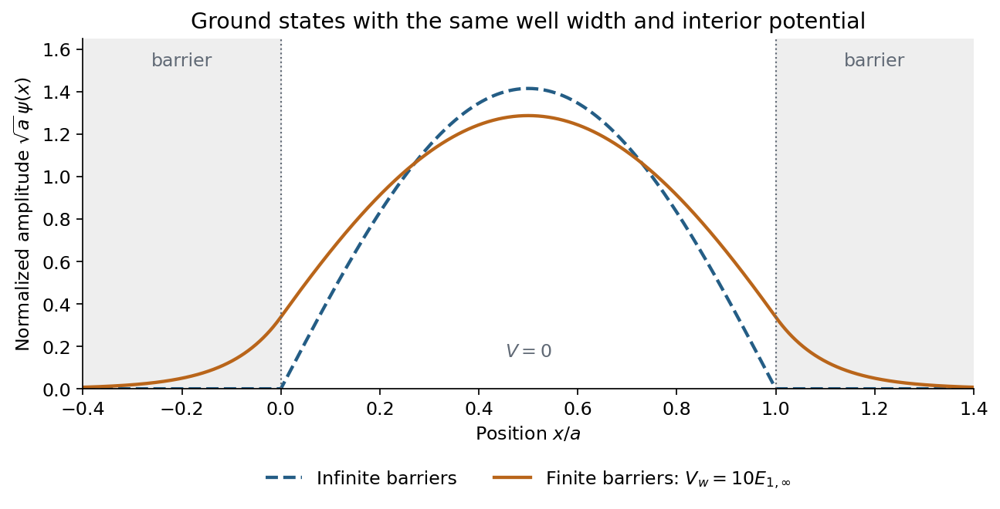
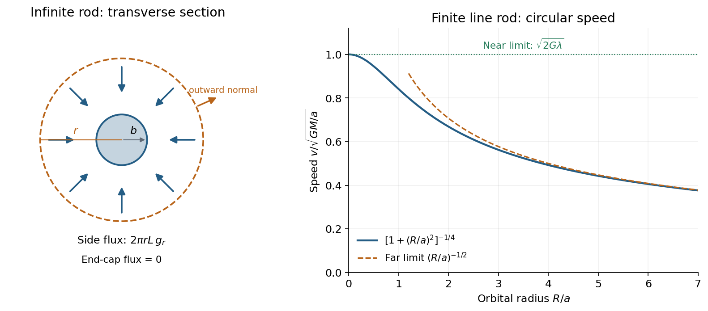

# 2018

↑ **Parent:** [Past exam of the physics course of the year 1 of the natural sciences course of the University of Cambridge](../past-exam-of-the-physics-course-of-the-year-1-of-the-natural-sciences-course-of-the-university-of-cambridge.md)

[Original paper, released PDF pages 16–25](https://www.whatdotheyknow.com/request/natural_science_tripos_physics_e/response/2127325/attach/3/FOI%202022%20639%20Sullivan%20materials.pdf?cookie_passthrough=1#page=16)

**Table of contents**

- [Section A](#section-a)
  - [1](#section-a/1)
    - [Solution](#section-a/1/solution)
  - [2](#section-a/2)
    - [Solution](#section-a/2/solution)
  - [3](#section-a/3)
    - [Solution](#section-a/3/solution)
  - [4](#section-a/4)
    - [Solution](#section-a/4/solution)
  - [5](#section-a/5)
    - [Solution](#section-a/5/solution)
  - [6](#section-a/6)
    - [Solution](#section-a/6/solution)
- [Section B](#section-b)
  - [7](#section-b/7)
    - [Solution](#section-b/7/solution)
  - [8](#section-b/8)
    - [Solution](#section-b/8/solution)
  - [9](#section-b/9)
    - [Solution](#section-b/9/solution)
- [Section C](#section-c)
  - [10](#section-c/10)
    - [Solution](#section-c/10/solution)
  - [11](#section-c/11)
    - [Solution](#section-c/11/solution)
- [Section D](#section-d)
  - [12](#section-d/12)
    - [Solution](#section-d/12/solution)
  - [13](#section-d/13)
    - [Solution](#section-d/13/solution)
- [Section E](#section-e)
  - [14](#section-e/14)
    - [Solution](#section-e/14/solution)
  - [15](#section-e/15)
    - [a](#section-e/15/a)
      - [Solution](#section-e/15/a/solution)
    - [b](#section-e/15/b)
      - [Solution](#section-e/15/b/solution)
    - [c](#section-e/15/c)
      - [Solution](#section-e/15/c/solution)
    - [d](#section-e/15/d)
      - [Solution](#section-e/15/d/solution)

## Section A

↑ **Parent:** [2018](2018.md)

<h3 id="section-a/1">1</h3>

↑ **Parent:** [Section A](#section-a)

<h4 id="section-a/1/solution">Solution</h4>

↑ **Parent:** [1](#section-a/1)

For the same massless [spring](../elasticity-physics.md#spring) of [spring constant](../elasticity-physics.md#spring-constant) $k$, [Hooke's law](../elasticity-physics.md#hooke-s-law) gives the vertical [simple harmonic motion](../classical-mechanics.md#simple-harmonic-motion) about the displaced [equilibrium](../dynamical-systems.md#equilibrium-point-of-a-dynamical-system) position:

$$
\nu_i=\frac1{2\pi}\sqrt{\frac{k}{m_i}},\qquad
R=\frac{m_1}{m_2}=\left(\frac{\nu_2}{\nu_1}\right)^2.
$$

Gravity shifts the [equilibrium](../dynamical-systems.md#equilibrium-point-of-a-dynamical-system) extension but does not change this [frequency](../wave.md#frequency). Use the measured [sample means](../variance.md#sample-mean) in the ratio estimate. For small measurement errors, [logarithmic differentiation](../calculus.md#logarithmic-differentiation) gives

$$
\frac{dR}{R}=2\frac{d\nu_2}{\nu_2}-2\frac{d\nu_1}{\nu_1}.
$$

Assuming the two frequency estimates have [independent](../random-variable.md#independent-random-variables) errors, their [variances](../variance.md) add. Writing $\epsilon=\delta\nu/\overline\nu$ for their common fractional [standard uncertainty](../physics.md#standard-uncertainty), [monomial uncertainty propagation](../wave-equation.md#monomial-uncertainty-propagation) yields

$$
\left(\frac{\sigma(R)}R\right)^2\simeq4\epsilon^2+4\epsilon^2,
\qquad
\boxed{\frac{\sigma(R)}R\simeq\sqrt8\,\frac{\delta\nu}{\overline\nu}.}
$$

This is a first-order uncertainty formula, rather than an exact identity for an arbitrary noisy ratio. It assumes that errors in the two measured [frequencies](../wave.md#frequency) have zero [covariance](../variance.md#covariance).

There is a statistical distinction in the wording: the [standard deviation](../variance.md#standard-deviation) of individual repetitions is not the [standard error](../statistical-inference.md#standard-error) of their [sample mean](../variance.md#sample-mean). If the supplied $\sigma(\nu_i)$ describes individual trials, the frequency means have errors $\sigma(\nu_i)/\sqrt n$, and the ratio formed from those means instead satisfies

$$
\boxed{\frac{\sigma(R_{\rm means})}{R_{\rm means}}\simeq
\sqrt{\frac8n}\,\frac{\delta\nu}{\overline\nu}.}
$$

Thus the printed formula describes either a single-pair ratio or a convention in which $\delta\nu$ already denotes the uncertainty of each averaged [frequency](../wave.md#frequency). Under either consistent interpretation, [independent](../random-variable.md#independent-random-variables) repeated measurements reduce statistical error in proportion to $n^{-1/2}$. Halving it requires **$4n$ trials in total for each mass, or $3n$ additional trials**. Repetition alone does not reduce a fixed [systematic error](../physics.md#systematic-error).

<h3 id="section-a/2">2</h3>

↑ **Parent:** [Section A](#section-a)

<h4 id="section-a/2/solution">Solution</h4>

↑ **Parent:** [2](#section-a/2)

The spacecraft clock measures [proper time](../special-relativity.md#proper-time) $\tau$, while a clock at rest with Earth measures the launch-to-emission interval $t$. Neglect Earth's subsequent motion and gravity, as in the intended [special relativity](../special-relativity.md) model. The [Lorentz factor](../special-relativity.md#lorentz-factor) and [time dilation](../special-relativity.md#time-dilation) give

$$
\gamma=\frac1{\sqrt{1-v^2/c^2}}=\frac3{\sqrt8},\qquad
t=\gamma\tau=\frac3{\sqrt8}(12\,\mathrm h)=12.7279\,\mathrm h.
$$

In Earth's [inertial frame](../mathematical-physics.md#inertial-frame), the spacecraft's [displacement](../classical-mechanics.md#displacement) at emission is $d=vt$. Therefore

$$
\boxed{d=\frac{c\tau}{\sqrt8}=4.24264\ \text{light-hours}
\simeq4.58\times10^{12}\,\mathrm m.}
$$

Here $\tau=43200\,\mathrm s$ and the [speed of light](../special-relativity.md#speed-of-light) is $c=2.99792458\times10^8\,\mathrm{m\,s^{-1}}$. The distance is evaluated at the emission event, using simultaneous Earth-frame endpoints, as required by [relativity of simultaneity](../special-relativity.md#relativity-of-simultaneity); the return signal has not yet reached Earth. A distance assigned on the spacecraft's simultaneous time slice is different: Earth has moved away at $c/3$ for $12\,\mathrm h$ in that frame, giving $c\tau/3=4$ light-hours. Specifying the [reference frame](../mathematical-physics.md#reference-frame) is essential to the numerical answer.

<h3 id="section-a/3">3</h3>

↑ **Parent:** [Section A](#section-a)

<h4 id="section-a/3/solution">Solution</h4>

↑ **Parent:** [3](#section-a/3)

Use dimensions $\mathsf M,\mathsf L,\mathsf T$ for [mass](../classical-mechanics.md#mass), [length](../physics.md#length) and [time](../classical-mechanics.md#time-in-physics). The [reduced Planck constant](../quantum-mechanics.md#reduced-planck-constant), [gravitational constant](../newton-s-law-of-universal-gravitation.md#gravitational-constant) and [speed of light](../special-relativity.md#speed-of-light) have dimensions

$$
[\hbar]=\mathsf M\mathsf L^2\mathsf T^{-1},\qquad
[G]=\mathsf L^3\mathsf M^{-1}\mathsf T^{-2},\qquad
[c]=\mathsf L\mathsf T^{-1}.
$$

For $l_p=\hbar^\alpha G^\beta c^\gamma$ to have the dimensions of a [length](../physics.md#length), [dimensional analysis](../mathematical-physics.md#dimensional-analysis) requires

$$
\alpha-\beta=0,\qquad
2\alpha+3\beta+\gamma=1,\qquad
-\alpha-2\beta-\gamma=0.
$$

The first equation gives $\beta=\alpha$; the third gives $\gamma=-3\alpha$. Substitution in the second gives $2\alpha=1$. Hence

$$
\boxed{\alpha=\frac12,\qquad\beta=\frac12,\qquad\gamma=-\frac32,
\qquad l_p=\sqrt{\frac{\hbar G}{c^3}}.}
$$

With $\hbar=1.054571817\times10^{-34}\,\mathrm{J\,s}$, $G=6.67430\times10^{-11}\,\mathrm{m^3\,kg^{-1}\,s^{-2}}$ and $c=2.99792458\times10^8\,\mathrm{m\,s^{-1}}$, the [Planck length](../mathematical-physics.md#planck-length) is

$$
\boxed{l_p\simeq1.6163\times10^{-35}\,\mathrm m.}
$$

The proposed monomial fixes the dimensionless prefactor to one; [dimensional analysis](../mathematical-physics.md#dimensional-analysis) on its own cannot select an arbitrary dimensionless multiplier.

<h3 id="section-a/4">4</h3>

↑ **Parent:** [Section A](#section-a)

<h4 id="section-a/4/solution">Solution</h4>

↑ **Parent:** [4](#section-a/4)

**First intensity minimum.** In [Fraunhofer diffraction](../physical-optics.md#fraunhofer-diffraction), the path difference between adjacent slits is $d\sin\theta$, so the relative [wave phase](../wave.md#phase-waves) is $\delta=2\pi d\sin\theta/\lambda_1$. Summing the $N$ equal [complex amplitudes](../wave.md#complex-amplitude) as a [geometric series](../sequence-and-series.md#geometric-series) gives the [diffraction grating](../physical-optics.md#diffraction-grating) interference factor

$$
I(\theta)\propto
\left|\sum_{j=0}^{N-1}e^{ij\delta}\right|^2
=\frac{\sin^2(N\delta/2)}{\sin^2(\delta/2)}.
$$

The central maximum has $\delta=0$. Its nearest zero occurs at $N\delta/2=\pi$, where the denominator is nonzero. Thus

$$
\sin\theta_{\min}=\frac{\lambda_1}{Nd}
=\frac{640\times10^{-9}}{10(80\times10^{-6})}=8.00\times10^{-4},
\qquad
\boxed{|\theta_{\min}|=8.00\times10^{-4}\,\mathrm{rad}=0.0458^\circ.}
$$

There is a symmetric first zero on each side of the incident direction. The narrow slits are treated as having a sufficiently broad [single-slit diffraction](../physical-optics.md#single-slit-diffraction) envelope.

**Wavelength resolution and the missing order specification.** Adopt the [Rayleigh criterion](../point-spread-function.md#rayleigh-criterion): the principal maximum of one [wavelength](../wave-equation.md#wavelength) lies at the adjacent minimum of the other in the same nonzero [diffraction order](../physical-optics.md#diffraction-order) $m$. For $\lambda_2>\lambda_1$ and $m>0$, those directions obey

$$
d\sin\theta=m\lambda_2
=\left(m+\frac1N\right)\lambda_1.
$$

Consequently the ideal [resolving power of a diffraction grating](../physical-optics.md#resolving-power-of-a-diffraction-grating) is $\lambda_1/\Delta\lambda=mN$, giving

$$
\boxed{\Delta\lambda_{\min,m}=\frac{\lambda_1}{mN}
=\frac{64}{m}\,\mathrm{nm}.}
$$

The usual first-order reading therefore gives **$64\,\mathrm{nm}$**. Zero [diffraction order](../physical-optics.md#diffraction-order) cannot separate the two [wavelengths](../wave-equation.md#wavelength), because both central maxima coincide.

The paper does not specify which [diffraction order](../physical-optics.md#diffraction-order) is observed, so $64\,\mathrm{nm}$ is not an order-independent minimum. In the ideal infinitely narrow-slit model, the largest usable order for this positive wavelength separation must satisfy $(m+1/N)\lambda_1\le d$. Since $d/\lambda_1=125$, this permits $m\le124$, giving the formal all-order result

$$
\boxed{\Delta\lambda_{\min,124}=0.516\,\mathrm{nm}.}
$$

That pair meets the criterion at $\theta\simeq83.1^\circ$. Order $125$ of $\lambda_1$ is at grazing incidence and the corresponding longer-wavelength peak cannot propagate. In a real device, finite slit width, weak high-order intensity and screen acceptance may prevent such an extreme order from being used; those data are absent. Thus the specified-order expression, and $64\,\mathrm{nm}$ when first order is intended, are the defensible resolution answers under the stated criterion.

<h3 id="section-a/5">5</h3>

↑ **Parent:** [Section A](#section-a)

<h4 id="section-a/5/solution">Solution</h4>

↑ **Parent:** [5](#section-a/5)

For a [photon](../quantum-mechanics.md#photon), the [photon energy](../quantum-mechanics.md#photon-energy) formula and the vacuum relation $\nu=c/\lambda$ give $E_\gamma=hc/\lambda$. For an [electron](../physics.md#electron), the [de Broglie wavelength](../wave-function.md#de-broglie-wavelength) gives the same [momentum](../momentum.md) magnitude $p=h/\lambda$, but the nonrelativistic [kinetic energy](../energy.md#kinetic-energy) is $K_e=p^2/(2m_e)$. Using $h=6.62607015\times10^{-34}\,\mathrm{J\,s}$, $m_e=9.10938\times10^{-31}\,\mathrm{kg}$ and $1\,\mathrm{eV}=1.602176634\times10^{-19}\,\mathrm J$,

$$
E_\gamma=\frac{(6.62607015\times10^{-34})(2.99792458\times10^8)}{4.0\times10^{-9}}
=4.96611\times10^{-17}\,\mathrm J,
$$

$$
K_e=\frac{(6.62607015\times10^{-34})^2}{2(9.10938\times10^{-31})(4.0\times10^{-9})^2}
=1.50617\times10^{-20}\,\mathrm J.
$$

Thus, to the precision of the [wavelength](../wave-equation.md#wavelength),

$$
\boxed{E_\gamma=3.1\times10^2\,\mathrm{eV},\qquad K_e=9.4\times10^{-2}\,\mathrm{eV}.}
$$

The electron answer is its [kinetic energy](../energy.md#kinetic-energy), as required for the diffraction experiment; its [relativistic energy](../special-relativity.md#relativistic-energy) would additionally include the approximately $511\,\mathrm{keV}$ [rest energy](../special-relativity.md#rest-energy). Since $K_e\ll m_ec^2$, the nonrelativistic approximation is well justified. Equal [wavelengths](../wave-equation.md#wavelength) imply equal [momenta](../momentum.md), not equal energies for particles with different [energy–momentum relations](../special-relativity.md#energy-momentum-relation).

<h3 id="section-a/6">6</h3>

↑ **Parent:** [Section A](#section-a)

<h4 id="section-a/6/solution">Solution</h4>

↑ **Parent:** [6](#section-a/6)

Put the charged sheet at $z=0$ and the grounded plates at $z=\pm d/2$. By symmetry the [electric field](../electric-field.md) points away from the positive sheet with equal magnitude in the two gaps. A [Gaussian pillbox](../maxwell-equations.md#gaussian-pillbox) crossing the sheet gives

$$
E_z(0^+)-E_z(0^-)=\frac\sigma{\varepsilon_0},\qquad
|E|=\frac\sigma{2\varepsilon_0}.
$$

The plate boundary conditions fix their [electric potentials](../electric-field.md#electric-potential) to zero. For the [charged sheet between grounded parallel plates](../electrostatics.md#charged-sheet-between-grounded-parallel-plates), the central potential is

$$
V_s=|E|\frac d2=\frac{\sigma d}{4\varepsilon_0},\qquad
\sigma=1.0\times10^{-7}\,\mathrm{C\,m^{-2}},\quad d=1.0\times10^{-2}\,\mathrm m.
$$

With [vacuum permittivity](../permittivity.md#vacuum-permittivity) $\varepsilon_0=8.85419\times10^{-12}\,\mathrm{F\,m^{-1}}$, $V_s\simeq28.24\,\mathrm V$. An [electron](../physics.md#electron) has [electric charge](../electric-charge.md) $-e$, so moving from a grounded plate to this positive potential decreases its [potential energy](../energy.md#potential-energy) by $eV_s$. [Conservation of energy](../mathematical-physics.md#conservation-of-energy) then gives

$$
\frac12m_ev^2=eV_s=\frac{e\sigma d}{4\varepsilon_0},
\qquad
\boxed{v=\sqrt{\frac{e\sigma d}{2\varepsilon_0m_e}}
\simeq3.2\times10^6\,\mathrm{m\,s^{-1}}.}
$$

The unrounded value is $3.15\times10^6\,\mathrm{m\,s^{-1}}$, about $0.0105c$. Either plate gives the same [speed](../classical-mechanics.md#speed). The ideal calculation neglects the electron's disturbance of the prescribed field and image-force effects at its release point, consistently with treating it as a [test particle](../classical-mechanics.md#test-particle).

## Section B

↑ **Parent:** [2018](2018.md)

<h3 id="section-b/7">7</h3>

↑ **Parent:** [Section B](#section-b)

<h4 id="section-b/7/solution">Solution</h4>

↑ **Parent:** [7](#section-b/7)

**Powered vertical flight.** Take upward [velocity](../classical-mechanics.md#velocity) $v$ as positive, and let $v_e>0$ be the downward exhaust [speed](../classical-mechanics.md#speed) relative to the rocket. During $dt$ the rocket's [mass](../classical-mechanics.md#mass) changes by $dm<0$, and exhaust mass $-dm$ leaves with Earth-frame [velocity](../classical-mechanics.md#velocity) $v-v_e$. Compare the [momentum](../momentum.md) of the rocket plus this newly expelled exhaust before and after the interval:

$$
(m+dm)(v+dv)+(-dm)(v-v_e)-mv=-mg\,dt.
$$

Discard the second-order product $dm\,dv$. The result is $m\,dv+v_e\,dm=-mg\,dt$, or

$$
m\frac{dv}{dt}=-v_e\frac{dm}{dt}-mg.
$$

The positive [rocket thrust](../momentum.md#rocket-thrust) is $-v_e\dot m$. Integrating with $v(0)=0$ and $m(0)=m_0$ gives the [rocket equation](../momentum.md#rocket-equation) with gravitational loss:

$$
\boxed{v(t)=v_e\ln\frac{m_0}{m(t)}-gt.}
$$

Using $d(mv)/dt$ for the rocket alone without the exhaust [momentum flux](../mathematical-physics.md#momentum-flux) would give the wrong equation for this open system.

**Orbital speed under the stated gravity assumption.** A [circular orbit](../classical-mechanics.md#circular-orbit) of radius $r_o=R_E+h_o=7.90\times10^6\,\mathrm m$ requires [centripetal acceleration](../classical-mechanics.md#centripetal-acceleration) $v_o^2/r_o$. If the magnitude of [gravitational acceleration](../newton-s-law-of-universal-gravitation.md#gravitational-acceleration) is the stipulated constant $g=9.8\,\mathrm{m\,s^{-2}}$ even at the orbit,

$$
\frac{v_o^2}{r_o}=g,
\qquad
\boxed{v_o=\sqrt{gr_o}=8.80\times10^3\,\mathrm{m\,s^{-1}}.}
$$

This treats gravity as centrally directed for the orbital calculation, while retaining its constant magnitude. The subsequent flat-surface approximation treats its direction as locally vertical.

**Burnout height.** During the unpowered [projectile motion](../classical-mechanics.md#projectile-motion), horizontal [velocity](../classical-mechanics.md#velocity) is constant. At the top of the trajectory the vertical component vanishes, so the horizontal component must equal the orbital [speed](../classical-mechanics.md#speed) $v_o$. At burnout, therefore,

$$
v_{y,b}=v_o\tan30^\circ,\qquad
h_o-h_b=\frac{v_{y,b}^2}{2g}=\frac{v_o^2}{6g}.
$$

These follow either by integrating $\ddot y=-g$ or by the vertical [work-energy theorem](../energy.md#work-energy-theorem). Substituting the preceding constant-$g$ orbital result gives

$$
\boxed{h_b=h_o-\frac{R_E+h_o}{6}
=1.83\times10^5\,\mathrm m\simeq183\,\mathrm{km}.}
$$

The vertical component is initially positive, as required to reach the orbit after burnout.

**Alternative inverse-square interpretation.** A real Earth's exterior [Newtonian gravitational field](../newton-s-law-of-universal-gravitation.md#newtonian-gravitational-field) is not constant over a $1500\,\mathrm{km}$ altitude change. If $9.8\,\mathrm{m\,s^{-2}}$ instead means the surface value $g_0$, then [Newton's law of universal gravitation](../newton-s-law-of-universal-gravitation.md) gives $GM=g_0R_E^2$ and

$$
v_o=\sqrt{\frac{g_0R_E^2}{R_E+h_o}}=7.13\times10^3\,\mathrm{m\,s^{-1}}.
$$

Using this orbital [speed](../classical-mechanics.md#speed) but the paper's constant-$g$ flat [projectile motion](../classical-mechanics.md#projectile-motion) approximation for the coast would give

$$
\boxed{h_b=1.50\times10^6-
\frac{R_E^2}{6(R_E+h_o)}=6.36\times10^5\,\mathrm m\simeq636\,\mathrm{km}.}
$$

This alternative changes the global constant-gravity assumption; it is not the same model as the $183\,\mathrm{km}$ result. An exact curved [Kepler orbit](../celestial-mechanics.md#kepler-orbit) coast would also abandon the prescribed flat trajectory. The printed assumptions support the constant-magnitude answers above, while the inverse-square values explain the different answer obtained from the usual physical Earth-orbit formula.

<h3 id="section-b/8">8</h3>

↑ **Parent:** [Section B](#section-b)

<h4 id="section-b/8/solution">Solution</h4>

↑ **Parent:** [8](#section-b/8)

**Directions.** Choose $+x$ along the horizontal spindle from the pivot to the disk, and $+z$ vertically upward. With [lever arm](../momentum.md#lever-arm) $\mathbf r=l\widehat{\mathbf x}$ and weight $\mathbf F_g=-mg\widehat{\mathbf z}$, the [torque](../momentum.md#torque) about the pivot is

$$
\boldsymbol\tau=\mathbf r\times\mathbf F_g=mgl\widehat{\mathbf y}.
$$

Clockwise [precession](../rigid-body-dynamics.md#precession) viewed from above has $\boldsymbol\Omega=-\Omega\widehat{\mathbf z}$. The relation $\boldsymbol\tau=\boldsymbol\Omega\times\mathbf L$ therefore requires the spin [angular momentum](../momentum.md#angular-momentum) to point along $-x$, **from the disk toward the pivot**. The disk spins **clockwise when viewed from its outer face looking along the spindle toward the pivot**. Looking from the pivot reverses that apparent rotation. The [right-hand rule](../electromagnetism.md#right-hand-rule) fixes these signs unambiguously.

**[Figure 1](#section-b/8/image-top-view-torque-and-angular-momentum-directions-with-the-disk-s-spin-viewed-from-its-outer-face). Top-view torque and angular-momentum directions, with the disk's spin viewed from its outer face**.

The drawing shows an instantaneous top view; the disk's [angular momentum](../momentum.md#angular-momentum) and the horizontal spindle turn clockwise together. The pivot [force](../force.md) has zero [torque](../momentum.md#torque) about the pivot.

**Rate of precession.** For steady horizontal motion the spin contribution has magnitude $L=I\omega$ and turns through $d\phi=\Omega\,dt$ in time $dt$. Its change is perpendicular to itself and has magnitude $dL=L\,d\phi$. Hence

$$
|\boldsymbol\tau|=\left|\frac{d\mathbf L}{dt}\right|=\Omega I\omega=mgl,
\qquad
\boxed{\Omega=\frac{mgl}{I\omega}.}
$$

This is the usual [slow steady gyroscope precession](../momentum.md#slow-steady-gyroscope-precession) relation. Any constant vertical [angular momentum](../momentum.md#angular-momentum) associated with steady precession has zero time derivative; the horizontal spin contribution supplies the changing component here. Transient [nutation](../rigid-body-dynamics.md#nutation) is excluded by the prescribed horizontal steady motion.

**Clock design.** Convert both rotation rates to [angular frequencies](../lagrangian-mechanics.md#angular-frequency):

$$
\Omega=\frac{2\pi}{60}\,\mathrm{rad\,s^{-1}},\qquad
\omega=2\pi(300)\,\mathrm{rad\,s^{-1}}.
$$

For the [moment of inertia of a uniform disc](../rigid-body-dynamics.md#moment-of-inertia-of-a-uniform-disc), $I=mR^2/2$, so the [mass](../classical-mechanics.md#mass) cancels:

$$
\boxed{l=\frac{\Omega R^2\omega}{2g}
=\frac{(2\pi/60)(0.10)^2(600\pi)}{2(9.8)}
=0.1007\,\mathrm m\simeq10.1\,\mathrm{cm}.}
$$

**Spin friction.** At fixed geometry, reducing $\omega$ increases $\Omega\propto1/\omega$. The [precession](../rigid-body-dynamics.md#precession) period, $T_p=2\pi/\Omega$, therefore **decreases**. This trend holds while slow steady [precession](../rigid-body-dynamics.md#precession) remains a suitable description; it cannot be extrapolated to a stopped disk.

**Counterweight.** To oppose the disk's gravitational [torque](../momentum.md#torque), place the counterweight on the other side of the pivot, at $-l_c\widehat{\mathbf x}$. The net [torque](../momentum.md#torque) is

$$
\boldsymbol\tau=g(ml-m_cl_c)\widehat{\mathbf y}.
$$

A horizontal axle can remain fixed when this vanishes, giving

$$
\boxed{l_c=\frac{ml}{m_c}\quad\text{on the opposite side of the pivot}.}
$$

For the fixed spin direction already found, [counterbalanced gyroscope precession](../momentum.md#counterbalanced-gyroscope-precession) has signed rate

$$
\Omega_z=-\frac{g(ml-m_cl_c)}{I\omega}.
$$

Moving the counterweight outward from the pivot first slows the clockwise motion, eliminates its driving [torque](../momentum.md#torque) at balance, and then reverses the steady motion to counterclockwise. A counterweight on the disk's side would add to the gravitational [torque](../momentum.md#torque). These statements neglect axial spin [moment of inertia](../rigid-body-dynamics.md#moment-of-inertia) of the counterweight and assume the stated horizontal motion, without a separately imposed precession at balance.

<h3 id="section-b/9">9</h3>

↑ **Parent:** [Section B](#section-b)

<h4 id="section-b/9/solution">Solution</h4>

↑ **Parent:** [9](#section-b/9)

**Momentum identity.** From the [Lorentz factor](../special-relativity.md#lorentz-factor), $v^2/c^2=1-\gamma^{-2}$. The relativistic [three-momentum](../special-relativity.md#three-momentum) therefore satisfies

$$
p^2=\gamma^2m^2v^2=m^2c^2\gamma^2(1-\gamma^{-2}),
\qquad
\boxed{p^2=m^2c^2(\gamma^2-1).}
$$

Together with [relativistic energy](../special-relativity.md#relativistic-energy) $E=\gamma mc^2$, this gives the [energy–momentum relation](../special-relativity.md#energy-momentum-relation) $E^2-p^2c^2=m^2c^4$.

**Parent in the laboratory.** The [rest energy](../special-relativity.md#rest-energy) is $m_0c^2=1\,\mathrm{GeV}$, while the total [relativistic energy](../special-relativity.md#relativistic-energy) is $3\,\mathrm{GeV}$. Consequently

$$
\gamma_0=3,\qquad
\boxed{\frac{v_0}{c}=\sqrt{1-\frac19}=\frac{\sqrt8}{3}=0.942809.}
$$

Its [momentum](../momentum.md) magnitude is $p_0c=\sqrt{3^2-1^2}\,\mathrm{GeV}=\sqrt8\,\mathrm{GeV}$.

**Daughters in the zero-momentum frame.** The [centre-of-momentum frame](../special-relativity.md#center-of-momentum-frame) is initially the parent's rest frame. [Conservation of momentum](../momentum.md#momentum-conservation) gives $\mathbf p_1^*=-\mathbf p_2^*$. Equal daughter [rest masses](../special-relativity.md#invariant-mass) then imply equal [relativistic energies](../special-relativity.md#relativistic-energy). [Conservation of relativistic energy](../special-relativity.md#conservation-of-relativistic-energy) gives

$$
E_X^*=\frac{m_0c^2}{2}=\frac12\,\mathrm{GeV},\qquad
\gamma_X=\frac{E_X^*}{m_Xc^2}
=\frac{m_0/2}{m_0/3}=\frac32.
$$

Their [speeds](../classical-mechanics.md#speed) are therefore

$$
\boxed{\gamma_X=\frac32,\qquad \frac{v_X^*}{c}
=\sqrt{1-\frac49}=\frac{\sqrt5}{3}=0.745356.}
$$

The two [velocities](../classical-mechanics.md#velocity) are opposite, and $p_X^*c=\sqrt{(1/2)^2-(1/3)^2}\,\mathrm{GeV}=\sqrt5\,\mathrm{GeV}/6$. Their total [kinetic energy](../energy.md#kinetic-energy) is $m_0c^2-2m_Xc^2=m_0c^2/3$.

**Invariant of the complete system.** Before the decay, in the [centre-of-momentum frame](../special-relativity.md#center-of-momentum-frame),

$$
\mathcal I_{\rm before}=(m_0c^2)^2-0=m_0^2c^4.
$$

After the [relativistic two-body decay](../special-relativity.md#relativistic-two-body-decay),

$$
\mathcal I_{\rm after}=(E_X^*+E_X^*)^2
-c^2|\mathbf p_X^*+(-\mathbf p_X^*)|^2
=(m_0c^2)^2.
$$

In the laboratory, [four-momentum conservation](../special-relativity.md#four-momentum-conservation) fixes the summed daughter energy to $3\,\mathrm{GeV}$ and their summed [momentum](../momentum.md) to the parent's $\mathbf p_0$. Thus the same calculation is

$$
\boxed{\mathcal I_{\rm before}=\mathcal I_{\rm after}
=(3\,\mathrm{GeV})^2-(\sqrt8\,\mathrm{GeV})^2
=1\,\mathrm{GeV}^2=m_0^2c^4.}
$$

The invariant is formed after summing the daughter [four-momenta](../special-relativity.md#four-momentum); adding their separate squared rest energies would omit the relative-motion contribution to the invariant [mass](../classical-mechanics.md#mass) of the pair.

## Section C

↑ **Parent:** [2018](2018.md)

<h3 id="section-c/10">10</h3>

↑ **Parent:** [Section C](#section-c)

<h4 id="section-c/10/solution">Solution</h4>

↑ **Parent:** [10](#section-c/10)

**Axial moment of inertia.** In the original diagram $R_1$ is the outer radius and $R_2$ the inner radius. For uniform [mass density](../fluid-mechanics.md#density) $\rho$, a coaxial annulus of thickness $dr$ has $dm=2\pi\rho Lr\,dr$. Therefore the [axial moment of inertia of a hollow cylinder](../rigid-body-dynamics.md#axial-moment-of-inertia-of-a-hollow-cylinder) is

$$
I=\int_{R_2}^{R_1}r^2dm
=2\pi\rho L\int_{R_2}^{R_1}r^3\,dr
=\frac{\pi\rho L}{2}(R_1^4-R_2^4).
$$

Since $M=\pi\rho L(R_1^2-R_2^2)$, factorizing the fourth-power difference gives

$$
\boxed{I=\frac12M(R_1^2+R_2^2).}
$$

For a solid cylinder $R_2\to0$, giving **$I=MR_1^2/2$**. For a thin cylindrical shell with fixed [mass](../classical-mechanics.md#mass) and $R_1,R_2\to R$, **$I=MR^2$**. The latter limit agrees with every mass element being at radius $R$.

**Undamped rolling oscillations.** Let $x$ be axle [displacement](../classical-mechanics.md#displacement) from the [spring](../elasticity-physics.md#spring) equilibrium. [Rolling without slipping](../rigid-body-dynamics.md#rolling-without-slipping) imposes $|\omega_{\rm roll}|=|\dot x|/R$. The sum of translational and [rotational kinetic energy](../energy.md#rotational-kinetic-energy) is

$$
T=\frac12m\dot x^2+\frac12I\frac{\dot x^2}{R^2}
=\frac12\left(m+\frac I{R^2}\right)\dot x^2.
$$

The [potential energy](../energy.md#potential-energy) is $U=kx^2/2$. Differentiating $T+U$ in the absence of [damping](../wave-equation.md#damping), or applying the force and torque equations below, gives

$$
\left(m+\frac I{R^2}\right)\ddot x+kx=0.
$$

For the thin shell $I=mR^2$, the effective inertia is $2m$, and the [angular frequency](../lagrangian-mechanics.md#angular-frequency) of the [simple harmonic motion](../classical-mechanics.md#simple-harmonic-motion) is

$$
\boxed{\omega_0=\sqrt{\frac{k}{2m}}.}
$$

Static contact [friction](../newtonian-mechanics.md#friction) supplies the required [torque](../momentum.md#torque) but does no work when the contact point is instantaneously stationary.

**Damped force balance.** Take rightward [force](../force.md) as positive and counterclockwise rotation as positive. Write $f$ for the signed [static friction](../force.md#static-friction) at the bottom contact. Then

$$
m\ddot x=-kx-b\dot x+f,\qquad
I\alpha=fR,\qquad\alpha=-\frac{\ddot x}{R}.
$$

Eliminate $f=-I\ddot x/R^2$ and use $I=mR^2$:

$$
2m\ddot x+b\dot x+kx=0,
\qquad
\boxed{\ddot x+B\dot x+Cx=0,\qquad B=\frac b{2m},\quad C=\frac k{2m}.}
$$

Here $b$ has units $\mathrm{kg\,s^{-1}}$, so $B$ has units $\mathrm{s^{-1}}$ and $C$ units $\mathrm{s^{-2}}$. The stated [drag force](../fluid-mechanics.md#drag-physics) is interpreted as acting through the axle, with no additional viscous [torque](../momentum.md#torque). An oil bath could also exert such a torque physically, but its magnitude is not specified by this force-only model.

**Light damping.** Substitution of $z=Ae^{-pt}$ into the differential equation gives $p^2-Bp+C=0$. In the [underdamped](../wave-equation.md#underdamping) regime $B^2<4C$,

$$
p=\frac B2\pm i\sqrt{C-\frac{B^2}{4}}
=\frac b{4m}\pm i\omega_d,
\qquad
\omega_d=\sqrt{\frac{k}{2m}-\frac{b^2}{16m^2}}.
$$

Taking real linear combinations gives the general [damped harmonic oscillator](../analysis.md#damped-harmonic-oscillator) displacement

$$
\boxed{x(t)=e^{-bt/(4m)}[A_1\cos(\omega_dt)+A_2\sin(\omega_dt)].}
$$

The constants are fixed by the initial [displacement](../classical-mechanics.md#displacement) and [velocity](../classical-mechanics.md#velocity). For example, release from rest at $x_0$ gives $A_1=x_0$ and $A_2=bx_0/(4m\omega_d)$. Light damping means $b^2\ll8mk$, in which case $\omega_d\simeq\omega_0$ and the envelope decays slowly compared with an oscillation.

<h3 id="section-c/11">11</h3>

↑ **Parent:** [Section C](#section-c)

<h4 id="section-c/11/solution">Solution</h4>

↑ **Parent:** [11](#section-c/11)

**Complex impedance.** In sinusoidal steady state write physical voltage and [electric current](../electric-charge.md#electric-current) as real parts of $\widetilde V e^{i\omega t}$ and $\widetilde I e^{i\omega t}$. The [electrical impedance](../electrical-circuit.md#electrical-impedance) $Z=\widetilde V/\widetilde I$ is a ratio of [phasors](../wave.md#phasor); its magnitude gives the voltage-to-current amplitude ratio and its argument gives their phase difference. It is measured in [ohms](../electric-charge.md#ohm).

For an ideal [capacitor](../electromagnetism.md#capacitor), $q=Cv$ and $i=dq/dt=C\,dv/dt$. Consequently $\widetilde I=i\omega C\widetilde V$, giving

$$
\boxed{Z_C=\frac1{i\omega C}=-\frac i{\omega C}.}
$$

With this time convention the voltage lags the [electric current](../electric-charge.md#electric-current) by $\pi/2$.

**Bridge output.** The original diagram has $R_1$ and $C_1$ in parallel in the upper-left arm, and $R_2$ and $C_2$ in series in the lower-left arm. The point labelled $C$ is connected to the upper supply node. Set the lower supply node to zero, so $V_C=V_i$. Assuming the measured output draws negligible [electric current](../electric-charge.md#electric-current), the two [voltage dividers](../electrical-engineering.md#voltage-divider) give

$$
V_A=V_i\frac{Z_2}{Z_1+Z_2},\qquad
V_B=V_i\frac{R_4}{R_3+R_4}.
$$

Their difference is therefore

$$
\boxed{\frac{V_{AB}}{V_i}=\frac{Z_2}{Z_1+Z_2}-\frac{R_4}{R_3+R_4}.}
$$

The reactive-arm [electrical impedances](../electrical-circuit.md#electrical-impedance) are

$$
Z_1=\left(\frac1{R_1}+i\omega C_1\right)^{-1},\qquad
Z_2=R_2+\frac1{i\omega C_2}.
$$

**Balance.** Setting $V_{AB}=0$ and cross-multiplying gives $R_3Z_2=R_4Z_1$. For this [Wien bridge](../electrical-circuit.md#wien-bridge),

$$
\frac{Z_2}{Z_1}
=\left(R_2+\frac1{i\omega C_2}\right)\left(\frac1{R_1}+i\omega C_1\right)
=\frac{R_2}{R_1}+\frac{C_1}{C_2}
+i\left(\omega R_2C_1-\frac1{\omega R_1C_2}\right).
$$

The right-hand side must be the real number $R_4/R_3$. Equating imaginary and real parts gives

$$
\boxed{\omega=\frac1{\sqrt{R_1R_2C_1C_2}},\qquad
\frac{C_1}{C_2}=\frac{R_4}{R_3}-\frac{R_2}{R_1}.}
$$

Positive [capacitances](../electromagnetism.md#capacitance) require $R_4/R_3>R_2/R_1$. In the equal-component case $R_1=R_2=R$ and $C_1=C_2=C$, this reduces to

$$
\boxed{\omega=\frac1{RC},\qquad R_4=2R_3.}
$$

**Band-pass output and phase.** Preserve the requested voltage polarity: $V_{AC}=V_A-V_C$. Since $V_C=V_i$,

$$
\frac{V_{AC}}{V_i}=\frac{Z_2}{Z_1+Z_2}-1
=-\frac{Z_1}{Z_1+Z_2}.
$$

Put $u=\omega RC>0$. The equal-component ratio is $Z_2/Z_1=2+i(u-u^{-1})$, so the [Wien bridge band-pass response](../electrical-circuit.md#wien-bridge-band-pass-response) is

$$
\boxed{H(\omega)=\frac{V_{AC}}{V_i}
=-\frac1{3+i(u-u^{-1})}
=-\frac{iu}{1-u^2+3iu}.}
$$

At finite positive [frequency](../wave.md#frequency), its imaginary part vanishes exactly when $u-u^{-1}=0$. Thus

$$
\boxed{\omega_r=\frac1{RC},\qquad H(\omega_r)=-\frac13.}
$$

The magnitude $|H|=[9+(u-u^{-1})^2]^{-1/2}$ is maximal there and tends to zero at both frequency extremes, as expected for a [band-pass filter](../electrical-engineering.md#band-pass-filter).

A convenient continuous, unwrapped [wave phase](../wave.md#phase-waves) is

$$
\boxed{\phi(\omega)=-\pi-\arctan\!\left(\frac{u-u^{-1}}3\right).}
$$

It decreases from $-\pi/2$ as $\omega\to0^+$, passes through $-\pi$ at $\omega_r$, and tends to $-3\pi/2$ as $\omega\to\infty$. A principal-value plot instead jumps from $-\pi$ to $+\pi$ at resonance; both represent the same [phasor](../wave.md#phasor). Reversing the output to $V_{CA}$ would shift the phase by $\pi$ and make the resonant ratio $+1/3$, but that is a different output polarity from the one printed.

**[Figure 2](#section-c/11/image-band-pass-magnitude-and-continuous-phase-for-the-printed-output-polarity-va-minus-vc). Band-pass magnitude and continuous phase for the printed output polarity VA minus VC**.

## Section D

↑ **Parent:** [2018](2018.md)

<h3 id="section-d/12">12</h3>

↑ **Parent:** [Section D](#section-d)

<h4 id="section-d/12/solution">Solution</h4>

↑ **Parent:** [12](#section-d/12)

**Reflection and central spot.** At a boundary from lower to higher [refractive index](../electromagnetic-wave.md#refractive-index), the near-normal electric-field reflection coefficient is negative, $r=(n_1-n_2)/(n_1+n_2)$. This gives a $\pi$ [wave phase](../wave.md#phase-waves) reversal on reflection from the glass plate through the air film. Reflection at the lens's glass-to-air underside has no such reversal. These are consequences of the [Fresnel equations](../electromagnetic-wave.md#fresnel-equations) for the reflected [electric field](../electric-field.md).

At ideal contact the film thickness is zero, so the two reflected contributions have zero geometrical [optical path difference](../physical-optics.md#optical-path-difference) but a relative $\pi$ phase reversal. They produce [destructive interference](../physical-optics.md#destructive-interference), and the **central spot is dark**. This conclusion concerns the film reflection; other lens surfaces can add a weak background.

**Rings and their radii.** At radial distance $r$, let the air thickness be $t$. The two relevant rays reflect at the upper and lower film interfaces. The lower reflection accumulates an extra round-trip [optical path length](../physical-optics.md#optical-path-length) $2t$, plus the relative $\pi$ reflection shift. As $t$ increases away from contact, alternating constructive and destructive [thin-film interference](../physical-optics.md#thin-film-interference) forms [Newton's rings](../physical-optics.md#newton-s-rings). At near-normal incidence, a bright ring satisfies

$$
\frac{2\pi}{\lambda}(2t)+\pi=2\pi(m+1),\qquad
2t=\left(m+\frac12\right)\lambda,\qquad m=0,1,2,\ldots.
$$

The extended source can illuminate these localized film fringes: each incident contribution interferes with its own two reflected paths; unrelated source points need not be mutually coherent.

For the spherical lens surface, geometry gives $r^2+(R-t)^2=R^2$, so $r^2=2Rt-t^2$. Since $t\ll R$, $t\simeq r^2/(2R)$. Combining the equations yields

$$
\boxed{r_m=\sqrt{R\lambda\left(m+\frac12\right)}.}
$$

The $m=0$ bright ring is the first bright ring around the dark contact point.

**Curvature from ring diameters.** Writing $D_m=2r_m$, subtract the squared diameters to eliminate the unknown initial order:

$$
D_{m+20}^2-D_m^2=4R\lambda(20).
$$

Using [SI](../physics.md#international-system-of-units) units,

$$
\boxed{R=\frac{(7.1\times10^{-3})^2-(3.3\times10^{-3})^2}
{80(500\times10^{-9})}=0.988\,\mathrm m\simeq0.99\,\mathrm m.}
$$

**Liquid-filled film.** With film [refractive index](../electromagnetic-wave.md#refractive-index) $n=1.4$, still smaller than both glass indices, there remains exactly one relative reflection phase reversal. The round-trip [optical path length](../physical-optics.md#optical-path-length) is now $2nt$, so

$$
r_m^2=\frac{R\lambda}{n}\left(m+\frac12\right).
$$

Here $\lambda=500\,\mathrm{nm}$ is the illuminating vacuum wavelength, approximately its air value, rather than its shorter value inside the liquid. The ring labelled $m=2$ therefore has diameter

$$
\boxed{D_2=2\sqrt{\frac{(0.988)(500\times10^{-9})(2+1/2)}{1.4}}
=1.878\times10^{-3}\,\mathrm m\simeq1.9\,\mathrm{mm}.}
$$

Filling the gap contracts each ring radius by $1/\sqrt n$ at fixed order and curvature.

<h3 id="section-d/13">13</h3>

↑ **Parent:** [Section D](#section-d)

<h4 id="section-d/13/solution">Solution</h4>

↑ **Parent:** [13](#section-d/13)

**Equation and interpretation.** The supplied equation is the [time-independent Schrödinger equation](../mathematical-physics.md#time-independent-schrodinger-equation) for a nonrelativistic particle with [mass](../classical-mechanics.md#mass) $m$ in a prescribed [potential energy](../energy.md#potential-energy) $V(x)$. Equivalently,

$$
\widehat H\psi=E\psi,\qquad
\widehat H=-\frac{\hbar^2}{2m}\frac{d^2}{dx^2}+V(x).
$$

It is an [eigenvalue](../linear-operator-theory.md#eigenvalue) problem for the [Hamiltonian operator](../quantum-system.md#hamiltonian-quantum-mechanics). A stationary energy state has full [wavefunction](../wave-function.md) $\Psi(x,t)=\psi(x)e^{-iEt/\hbar}$. By the [Born rule](../wave-function.md#born-rule), $|\psi(x)|^2dx$ is the probability of finding the particle in a small interval $dx$, with [wavefunction normalization](../wave-function.md#wavefunction-normalization) $\int_{-\infty}^{\infty}|\psi|^2dx=1$.

**Infinite barriers.** Infinite exterior [potential energy](../energy.md#potential-energy) excludes any finite-energy probability outside the interval. The [infinite square well](../quantum-mechanics.md#infinite-square-well) consequently has $\psi=0$ outside and the hard-wall boundary conditions

$$
\boxed{\psi(0)=\psi(a)=0.}
$$

The interior [wavefunction](../wave-function.md) must meet the zero exterior amplitude continuously. Its derivative need not be continuous across an infinite wall; imposing both zero value and zero derivative would eliminate every nonzero interior solution.

**Ground state.** Inside the well $V=0$, so $\psi''+k^2\psi=0$, with $k=\sqrt{2mE}/\hbar$. Its general solution is $A\sin kx+B\cos kx$. The left wall gives $B=0$, and the right wall gives $ka=n\pi$ for $n=1,2,\ldots$. Thus the discrete energy [eigenvalues](../linear-operator-theory.md#eigenvalue) are $E_n=n^2\pi^2\hbar^2/(2ma^2)$. The smallest, $n=1$, is the [ground state](../quantum-mechanics.md#ground-state). Since

$$
\int_0^a\sin^2\frac{\pi x}{a}\,dx=\frac a2,
$$

its normalized [wavefunction](../wave-function.md), choosing an irrelevant overall phase to make it positive inside, is

$$
\boxed{\psi_1(x)=\begin{cases}
\sqrt{2/a}\,\sin(\pi x/a),&0<x<a,\\
0,&x\le0\ \text{or}\ x\ge a,
\end{cases}\qquad E_1=\frac{\pi^2\hbar^2}{2ma^2}.}
$$

**Finite barriers.** For a finite step and constant particle [mass](../classical-mechanics.md#mass), both $\psi$ and $\psi'$ are continuous at $x=0,a$. [Wavefunction matching at a finite potential step](../mathematical-physics.md#wavefunction-matching-at-a-finite-potential-step) follows by integrating the [Schrödinger equation](../mathematical-physics.md#schrodinger-equation) across a vanishingly small neighborhood of the step: a bounded potential cannot generate a finite jump in $\psi'$. The bound-state exterior solutions decay rather than vanish identically:

$$
\psi(x)\propto e^{\kappa x}\quad(x<0),\qquad
\psi(x)\propto e^{-\kappa(x-a)}\quad(x>a),\qquad
\kappa=\frac{\sqrt{2m(V_w-E)}}{\hbar}.
$$

Normalizability excludes the growing exterior exponentials. The equivalent interior boundary conditions are $\psi'(0)=\kappa\psi(0)$ and $\psi'(a)=-\kappa\psi(a)$; neither boundary value is zero for the nontrivial [ground state](../quantum-mechanics.md#ground-state).

The [ground state of a finite square well](../quantum-mechanics.md#ground-state-of-a-finite-square-well) remains symmetric about $a/2$ and has no nodes. It bends smoothly into exponential tails at both walls, extending over a larger region than the infinite-well state. Its maximum after normalization is lower for the deep well considered here. When $V_w\gg E$, the penetration length $1/\kappa$ is short, so the two shapes are close except near the walls and in the exterior tails.

**[Figure 3](#section-d/13/image-normalized-infinite-and-finite-well-ground-states-with-smooth-exponentially-decaying-tails-for-the-finite-well). Normalized infinite- and finite-well ground states, with smooth exponentially decaying tails for the finite well**.

The finite curve is an illustrative exact matched solution with $V_w=10E_{1,\infty}$; no numerical wall height is specified by the question.

**Energy comparison.** The finite barriers relax the confinement, allowing a less rapidly varying interior [wavefunction](../wave-function.md) and therefore smaller [kinetic energy](../energy.md#kinetic-energy). More explicitly, the even interior solution is proportional to $\cos[k(x-a/2)]$, and matching to the tails gives $k\tan(ka/2)=\kappa$. The lowest root lies at $0<ka<\pi$, while the infinite well has $ka=\pi$. Hence

$$
\boxed{E_{1,\rm finite}<\frac{\pi^2\hbar^2}{2ma^2}=E_{1,\infty}.}
$$

As $V_w\to\infty$, the tails disappear and the finite-well energy approaches the infinite-well value from below. This comparison uses the same zero of [potential energy](../energy.md#potential-energy) inside both wells.

## Section E

↑ **Parent:** [2018](2018.md)

<h3 id="section-e/14">14</h3>

↑ **Parent:** [Section E](#section-e)

<h4 id="section-e/14/solution">Solution</h4>

↑ **Parent:** [14](#section-e/14)

**Field of discrete masses.** [Newton's law of universal gravitation](../newton-s-law-of-universal-gravitation.md) and [superposition](../vector-space.md#superposition-principle) give the [gravitational field](../physics.md#gravitational-field) away from the source points:

$$
\boxed{\mathbf g(\mathbf r)=-G\sum_{i=1}^N
M_i\frac{\mathbf r-\mathbf r_i}{|\mathbf r-\mathbf r_i|^3}.}
$$

It is the [force](../force.md) per unit test [mass](../classical-mechanics.md#mass), with units $\mathrm{N\,kg^{-1}}=\mathrm{m\,s^{-2}}$, and points toward each positive source [mass](../classical-mechanics.md#mass).

**Infinite circular cylindrical rod.** Let $b$ be the radius of the circular cross-section, so $A=\pi b^2$, and write $\lambda=\rho A$ for the [linear mass density](../fluid-mechanics.md#linear-mass-density). Choose a coaxial cylindrical [Gaussian surface](../maxwell-equations.md#gaussian-surface) with radius $r>b$ and length $L$. Translation and rotation symmetry make $\mathbf g=g_r(r)\widehat{\mathbf r}$. The end caps have zero field [flux](../mathematical-physics.md#flux) because their normals are axial; on the curved surface the outward-normal component is the constant negative value $g_r$. [Gauss's law for gravity](../newton-s-law-of-universal-gravitation.md#gauss-s-law-for-gravity) therefore gives

$$
\oint\mathbf g\cdot d\mathbf S=2\pi rL g_r
=-4\pi G(\rho AL),
\qquad
\boxed{\mathbf g(r)=-\frac{2G\rho A}{r}\widehat{\mathbf r}\quad(r>b).}
$$

The [gravitational field of an infinite uniform cylinder](../newton-s-law-of-universal-gravitation.md#gravitational-field-of-an-infinite-uniform-cylinder) inside the material instead has enclosed [mass](../classical-mechanics.md#mass) $\rho\pi r^2L$, giving $g_r=-2\pi G\rho r$. The exterior result assumes a circular cylindrical rod; area by itself would not specify the exact near field of a noncircular cross-section.

**[Figure 4](#section-e/14/image-gaussian-cylinder-cross-section-for-an-infinite-rod-and-the-circular-speed-curve-of-a-finite-line-rod). Gaussian-cylinder cross-section for an infinite rod and the circular-speed curve of a finite line rod**.

In the left panel the dashed circle is a transverse section of the coaxial [Gaussian surface](../maxwell-equations.md#gaussian-surface); the field points inward and the surface normals outward. Its side area is $2\pi rL$.

For an exterior [circular orbit](../classical-mechanics.md#circular-orbit), [Newton's second law](../force.md#newton-s-second-law) equates the [force](../force.md) required for [centripetal acceleration](../classical-mechanics.md#centripetal-acceleration) to gravity:

$$
\frac{mv^2}{r}=m\frac{2G\rho A}{r},\qquad
\boxed{v=\sqrt{2G\rho A}=\sqrt{2G\lambda}.}
$$

The orbital [speed](../classical-mechanics.md#speed) is independent of radius and of the orbiting object's [mass](../classical-mechanics.md#mass), for orbits outside the infinite rod.

**Finite rod.** Taking the supplied field as the [gravitational field of a finite uniform line segment](../newton-s-law-of-universal-gravitation.md#gravitational-field-of-a-finite-uniform-line-segment), the corresponding balance at radius $R$ is

$$
\frac{v^2}{R}=\frac{GM}{R\sqrt{R^2+a^2}},\qquad
\boxed{v(R)=\left(\frac{GM}{\sqrt{R^2+a^2}}\right)^{1/2}
=\frac{\sqrt{GM}}{(R^2+a^2)^{1/4}}.}
$$

Since $M=2a\rho A=2a\lambda$, its two limits are

$$
\boxed{R\ll a:\quad v\simeq\sqrt{\frac{GM}{a}}=\sqrt{2G\rho A},
\qquad R\gg a:\quad v\simeq\sqrt{\frac{GM}{R}}.}
$$

The first reproduces the infinite-rod result: a nearby observer sees a very long source. The second is the familiar [circular orbit](../classical-mechanics.md#circular-orbit) speed about a [point mass](../classical-mechanics.md#point-mass), since a distant observer cannot resolve the rod's length. The dimensionless curve is

$$
\frac{v}{\sqrt{GM/a}}=[1+(R/a)^2]^{-1/4}.
$$

It starts at a constant plateau and decreases smoothly, approaching an $R^{-1/2}$ dependence far away. For $R>0$, $dv/dR=-\sqrt{GM}\,R/[2(R^2+a^2)^{5/4}]<0$, consistent with the sketch.

**Derivation of the finite-rod field.** Put the source along $-a<z<a$ on the $z$ axis. In its central perpendicular plane, an element $dm=\lambda\,dz$ is at distance $s=\sqrt{r^2+z^2}$. Its field magnitude is $G\lambda\,dz/s^2$, and its inward radial component has the extra factor $r/s$. The axial components cancel between $z$ and $-z$. Thus

$$
g_r=-G\lambda r\int_{-a}^a\frac{dz}{(r^2+z^2)^{3/2}}
=-G\lambda r\left[\frac{z}{r^2\sqrt{r^2+z^2}}\right]_{-a}^{a}
=-\frac{2aG\lambda}{r\sqrt{r^2+a^2}}.
$$

Replacing $2a\lambda$ by $M$ gives

$$
\boxed{\mathbf g(r)=-\frac{GM}{r\sqrt{r^2+a^2}}\widehat{\mathbf r}.}
$$

The integral treats the source as a [line mass](../astrophysical-fluid-dynamics.md#line-mass). For a finite cylinder of nonzero cross-section, the displayed finite-rod formula is a thin-rod approximation, not an exact field for all $r$. Its near-rod limit should therefore be read as $b\ll R\ll a$, keeping the orbit outside the material; the apparent line-source singularity at $r=0$ does not describe the interior of a real cylinder.

<h3 id="section-e/15">15</h3>

↑ **Parent:** [Section E](#section-e)

<h4 id="section-e/15/a">a</h4>

↑ **Parent:** [15](#section-e/15)

<h5 id="section-e/15/a/solution">Solution</h5>

↑ **Parent:** [A](#section-e/15/a)

An [electric dipole](../electrostatics.md#electric-dipole) is a localized pair of opposite [electric charges](../electric-charge.md), or more generally a neutral [electric charge](../electric-charge.md) distribution with nonzero first electric moment. For charges $-q$ and $+q$ separated by [displacement](../classical-mechanics.md#displacement) $\mathbf d$ directed from negative to positive, the [electric dipole moment](../electrostatics.md#electric-dipole-moment) is

$$
\boxed{\mathbf p=q\mathbf d,\qquad [p]=\mathrm{C\,m}.}
$$

A neutral [molecule](../molecule.md) can have a permanent [electric dipole moment](../electrostatics.md#electric-dipole-moment) when its positive and negative charge centres do not coincide. An applied [electric field](../electric-field.md) can also produce an induced [electric dipole moment](../electrostatics.md#electric-dipole-moment) by distorting an initially nonpolar [electric charge](../electric-charge.md) distribution.

At distance $r\gg|\mathbf d|$ in [vacuum](../physics.md#vacuum), expand the difference of the two point-charge potentials to first order in the separation. The leading [electric potential](../electric-field.md#electric-potential) is

$$
\Phi(\mathbf r)=\frac{\mathbf p\cdot\widehat{\mathbf r}}{4\pi\varepsilon_0r^2}.
$$

The monopole term cancels because the net [electric charge](../electric-charge.md) is zero. Taking $\mathbf E=-\nabla\Phi$ gives the [electric dipole field](../electrostatics.md#electric-dipole-field)

$$
\boxed{\mathbf E(\mathbf r)=\frac{3(\mathbf p\cdot\widehat{\mathbf r})\widehat{\mathbf r}-\mathbf p}
{4\pi\varepsilon_0r^3}.}
$$

On the dipole axis its magnitude is $2p/(4\pi\varepsilon_0r^3)$ and its direction is along $\mathbf p$; in the equatorial plane the magnitude is $p/(4\pi\varepsilon_0r^3)$ and the field points opposite to $\mathbf p$. The $r^{-3}$ decay is faster than the $r^{-2}$ field of an isolated [point charge](../electric-field.md#point-charge).

In a uniform external [electric field](../electric-field.md), the opposite forces on the two charges cancel in their resultant but form a [couple](../momentum.md#couple-mechanics). Its [torque](../momentum.md#torque) is

$$
\boldsymbol\tau=\mathbf p\times\mathbf E,\qquad
|\boldsymbol\tau|=pE\sin\theta.
$$

For a fixed permanent [electric dipole moment](../electrostatics.md#electric-dipole-moment), the interaction [potential energy](../energy.md#potential-energy) is

$$
\boxed{U=-\mathbf p\cdot\mathbf E=-pE\cos\theta.}
$$

Differentiating with respect to orientation recovers the torque. Parallel alignment minimizes $U$ and is stable against a small rotation; antiparallel alignment maximizes $U$ and is unstable. Rotating a fixed dipole slowly from parallel to antiparallel requires external [work](../energy.md#work) $2pE$.

A nonuniform electrostatic [electric field](../electric-field.md) can also exert a net [force](../force.md). Expanding the two charge forces gives $\mathbf F\simeq(\mathbf p\cdot\nabla)\mathbf E$, which equals $\nabla(\mathbf p\cdot\mathbf E)$ for a fixed dipole in a curl-free electrostatic field. Thus a suitably aligned dipole is attracted toward stronger field. An induced [electric dipole moment](../electrostatics.md#electric-dipole-moment) requires care in computing energy: when $\mathbf p=\alpha\mathbf E$ for constant isotropic [electric polarizability](../electrostatics.md#electric-polarizability), building the dipole costs energy and the effective interaction is $U=-\alpha E^2/2$, rather than substituting directly into the fixed-dipole formula. These field, torque and energy effects explain molecular orientation and [electric polarization](../electromagnetism.md#polarization-density).

<h4 id="section-e/15/b">b</h4>

↑ **Parent:** [15](#section-e/15)

<h5 id="section-e/15/b/solution">Solution</h5>

↑ **Parent:** [B](#section-e/15/b)

A [conservative vector field](../multivariable-calculus.md#conservative-vector-field) has path-independent [work](../energy.md#work): the integral $\int_A^B\mathbf F\cdot d\mathbf r$ depends only on its endpoints. Equivalently, the [line integral](../multivariable-calculus.md#line-integral) around every closed path in its domain vanishes. One can then define a single-valued [potential energy](../energy.md#potential-energy) $U$ by

$$
U(B)-U(A)=-\int_A^B\mathbf F\cdot d\mathbf r,
\qquad
\boxed{\mathbf F=-\nabla U,\qquad W_{A\to B}=U(A)-U(B).}
$$

The arbitrary additive constant in $U$ has no effect on the [force](../force.md). A useful zero is often chosen at infinity for a localized attractive interaction.

A differentiable [conservative force](../energy.md#conservative-force) has $\nabla\times\mathbf F=0$ because the [curl](../multivariable-calculus.md#curl) of a [gradient](../multivariable-calculus.md#gradient) vanishes. Conversely, a smooth curl-free field on a [simply connected](../algebraic-topology.md#simply-connected-space) domain admits a global scalar potential. The domain condition matters: on the punctured plane, $\mathbf F=(C/r)\widehat{\boldsymbol\theta}$ has zero [curl](../multivariable-calculus.md#curl) away from the missing origin but closed-loop work $2\pi C$ around it. It is not globally conservative there. The existence of a local potential does not establish a single-valued potential throughout a domain with holes.

The [work-energy theorem](../energy.md#work-energy-theorem) gives $\Delta T=W$ for [kinetic energy](../energy.md#kinetic-energy) $T$. If all forces are conservative and $U$ has no explicit time dependence, then

$$
\Delta T=-\Delta U,\qquad
\boxed{T+U=\text{constant}.}
$$

This is [conservation of mechanical energy](../energy.md#conservation-of-mechanical-energy). In one dimension, an [equilibrium](../dynamical-systems.md#equilibrium-point-of-a-dynamical-system) occurs at $dU/dx=0$; a local minimum with $U''>0$ is stable, while a maximum with $U''<0$ is unstable. Expanding about a minimum gives $U\simeq U_0+U''(x_0)(x-x_0)^2/2$, producing [simple harmonic motion](../classical-mechanics.md#simple-harmonic-motion) with $\omega^2=U''(x_0)/m$.

Examples include the [spring](../elasticity-physics.md#spring) force $F_x=-kx$ with $U=kx^2/2$, the near-surface gravitational [force](../force.md) $-mg\widehat{\mathbf z}$ with $U=mgz$, and the central [Newtonian gravitational field](../newton-s-law-of-universal-gravitation.md#newtonian-gravitational-field) with $U=-GMm/r$. An electrostatic [force](../force.md) on a fixed [electric charge](../electric-charge.md) $q$ has $U=q\Phi$, where $\Phi$ is the [electric potential](../electric-field.md#electric-potential).

Sliding [friction](../newtonian-mechanics.md#friction) provides a contrasting physical test: traversing a closed path still dissipates [mechanical energy](../energy.md#mechanical-energy), since the frictional force opposes the local motion on both outward and return legs. Its work depends on path length and cannot be represented by a position-only $U$. Total [energy](../energy.md) can remain conserved when the resulting internal energy is included. Also, even if $\mathbf F=-\nabla U(\mathbf r,t)$ at each instant, explicit time dependence gives $d(T+U)/dt=\partial U/\partial t$; a static conservative-field argument alone does not guarantee constant mechanical energy in that situation.

<h4 id="section-e/15/c">c</h4>

↑ **Parent:** [15](#section-e/15)

<h5 id="section-e/15/c/solution">Solution</h5>

↑ **Parent:** [C](#section-e/15/c)

[Faraday's law of induction](../maxwell-equations.md#faraday-s-law-of-induction) relates an induced [electromotive force](../electric-charge.md#electromotive-force) to the rate of change of [magnetic flux](../magnetic-field.md#magnetic-flux). Choose a positive orientation around a loop and its associated surface normal by the [right-hand rule](../electromagnetism.md#right-hand-rule). For a stationary conducting loop,

$$
\Phi_B=\int_S\mathbf B\cdot d\mathbf S,\qquad
\boxed{\mathcal E=\oint\mathbf E\cdot d\mathbf l=-\frac{d\Phi_B}{dt}.}
$$

Unlike an electrostatic field, the induced [electric field](../electric-field.md) generally has nonzero [curl](../multivariable-calculus.md#curl); the differential form is $\nabla\times\mathbf E=-\partial\mathbf B/\partial t$. For a moving circuit, [magnetic flux transport for a moving circuit](../electric-charge.md#magnetic-flux-transport-for-a-moving-circuit) includes the magnetic [Lorentz force](../relativistic-electromagnetism.md#lorentz-force) on the charges:

$$
\mathcal E=\oint(\mathbf E+\mathbf u\times\mathbf B)\cdot d\mathbf l
=-\frac{d\Phi_B}{dt},
$$

where $\mathbf u$ is the local wire [velocity](../classical-mechanics.md#velocity). Thus changing the field or moving a conductor can produce induction.

The minus sign is [Lenz's law](../maxwell-equations.md#lenz-s-law): an induced [electric current](../electric-charge.md#electric-current), when a closed conducting path permits it, produces a [magnetic field](../magnetic-field.md) opposing the change of linked flux. It need not oppose the original field itself. For example, increasing flux through a loop produces a current tending to reduce that increase; decreasing the same flux reverses the current. The opposition is consistent with [conservation of energy](../mathematical-physics.md#conservation-of-energy): external mechanical or electrical [work](../energy.md#work) is needed to maintain a change against its inductive reaction.

For a coil of $N$ turns, define the [magnetic flux linkage](../electromagnetism.md#magnetic-flux-linkage) $\Lambda=\sum_{j=1}^N\Phi_j$, reducing to $N\Phi_B$ when every turn links the same flux. For fixed geometry and a linear magnetic response, [self-inductance](../electromagnetism.md#self-inductance) $L$ is defined by $\Lambda=LI$, and the coil's induced [electromotive force](../electric-charge.md#electromotive-force) is

$$
\boxed{\mathcal E_{\rm self}=-L\frac{dI}{dt},\qquad [L]=\mathrm H=\mathrm{Wb\,A^{-1}}.}
$$

The corresponding terminal voltage drop, with the [passive sign convention](../electrical-circuit.md#passive-sign-convention), is $V_L=L\,dI/dt$. It opposes changes in [electric current](../electric-charge.md#electric-current); it does not require the current itself to vanish.

Building the current from zero requires power $P=IV_L=LI\,dI/dt$. Integrating gives the energy stored by an ideal [inductor](../electromagnetism.md#inductor):

$$
\boxed{U_B=\int_0^I LI'\,dI'=\frac12LI^2.}
$$

This energy is stored in the [magnetic field](../magnetic-field.md) and can be returned when the current falls. In a series [RL circuit](../electrical-circuit.md#rl-circuit) driven by a constant voltage $V_0$, [Kirchhoff's voltage law](../random-walk.md#kirchhoff-cycle-law) gives $L\dot I+RI=V_0$. Starting with zero current, $I=(V_0/R)(1-e^{-tR/L})$, with [time constant](../analysis.md#time-constant) $L/R$. This makes the resistance to rapid current changes directly observable. Two coils also have [mutual inductance](../electromagnetism.md#mutual-inductance): changing primary current induces secondary [electromotive force](../electric-charge.md#electromotive-force) $-M\,dI_1/dt$ with a polarity determined by the chosen winding orientations, the principle behind a transformer.

<h4 id="section-e/15/d">d</h4>

↑ **Parent:** [15](#section-e/15)

<h5 id="section-e/15/d/solution">Solution</h5>

↑ **Parent:** [D](#section-e/15/d)

For a light [test particle](../classical-mechanics.md#test-particle) of [mass](../classical-mechanics.md#mass) $m$ outside a spherical source of [mass](../classical-mechanics.md#mass) $M$, [Newton's law of universal gravitation](../newton-s-law-of-universal-gravitation.md) gives $\mathbf F=-GMm\widehat{\mathbf r}/r^2$. It is a [central force](../mathematical-physics.md#central-force), so its [torque](../momentum.md#torque) about the source vanishes and [angular momentum](../momentum.md#angular-momentum) $\mathbf L=m\mathbf r\times\mathbf v$ is conserved. The motion therefore lies in a fixed plane when $L\ne0$. Its [gravitational potential energy](../energy.md#gravitational-energy) is $-GMm/r$, and [conservation of mechanical energy](../energy.md#conservation-of-mechanical-energy) gives

$$
\epsilon=\frac{v^2}{2}-\frac{GM}{r}=\text{constant},\qquad
h=\frac Lm=|\mathbf r\times\mathbf v|=\text{constant}.
$$

Here $\epsilon$ is [specific orbital energy](../celestial-mechanics.md#specific-orbital-energy) and $h$ is [specific angular momentum](../celestial-mechanics.md#specific-angular-momentum). A [Kepler orbit](../celestial-mechanics.md#kepler-orbit) has polar equation

$$
\boxed{r(\theta)=\frac{p}{1+e\cos\theta},\qquad
p=\frac{h^2}{GM},\qquad
 e^2=1+\frac{2\epsilon h^2}{(GM)^2}.}
$$

The angle is measured from periapsis. The [conic section](../euclidean-geometry.md#conic-section) is an [ellipse](../euclidean-geometry.md#ellipse) for $\epsilon<0$ and $0\le e<1$, a [parabola](../euclidean-geometry.md#parabola) for $\epsilon=0$ and $e=1$, and a [hyperbola](../euclidean-geometry.md#hyperbola) for $\epsilon>0$ and $e>1$. The circle is the $e=0$ elliptical case. The special case $h=0$ is radial motion and must be handled as a degenerate limit. Bound ellipses have the source at one focus, which is [Kepler's first law](../mathematical-physics.md#kepler-s-first-law).

For a bound orbit of [semi-major axis](../celestial-mechanics.md#semi-major-axis) $a$, $\epsilon=-GM/(2a)$. Combining this with the energy equation gives the [vis-viva equation](../celestial-mechanics.md#vis-viva-equation):

$$
\boxed{v^2=GM\left(\frac2r-\frac1a\right).}
$$

The particle therefore moves faster near periapsis and slower near apoapsis. Conservation of [angular momentum](../momentum.md#angular-momentum) also gives constant [areal velocity](../momentum.md#areal-velocity), $dA/dt=h/2$, expressing [Kepler's second law](../mathematical-physics.md#kepler-s-second-law). Using the ellipse's area and $h^2=GMa(1-e^2)$ gives the [orbital period](../celestial-mechanics.md#orbital-period)

$$
\boxed{T^2=\frac{4\pi^2a^3}{GM},}
$$

which is [Kepler's third law](../mathematical-physics.md#kepler-s-third-law).

A [circular orbit](../classical-mechanics.md#circular-orbit) follows from [centripetal acceleration](../classical-mechanics.md#centripetal-acceleration) $v_c^2/r=GM/r^2$, giving $v_c=\sqrt{GM/r}$ and $T=2\pi\sqrt{r^3/(GM)}$. The minimum [escape velocity](../energy.md#escape-velocity) from radius $r$ follows from the marginally unbound condition $\epsilon=0$:

$$
\boxed{v_c=\sqrt{\frac{GM}{r}},\qquad v_{\rm esc}=\sqrt{\frac{2GM}{r}}=\sqrt2\,v_c.}
$$

These ideal orbits neglect [drag force](../fluid-mechanics.md#drag-physics), other gravitating bodies and changes in the central source. For two comparable [masses](../classical-mechanics.md#mass), the relative [two-body problem](../celestial-mechanics.md#two-body-problem) uses $G(M+m)$ instead of $GM$. An orbiting object is continuously in [free fall](../newton-s-law-of-universal-gravitation.md#free-fall); the inward gravitational [force](../force.md) changes its direction even when its [speed](../classical-mechanics.md#speed) is constant. These inverse-square results assume the physical variation of gravity with radius, rather than extending a near-surface constant-$g$ approximation to an entire orbit.

## ↑ Ancestors (9)

1. [Past exam of the physics course of the year 1 of the natural sciences course of the University of Cambridge](../past-exam-of-the-physics-course-of-the-year-1-of-the-natural-sciences-course-of-the-university-of-cambridge.md)
2. [Physics course of the year 1 of the natural sciences course of the University of Cambridge](../university-of-cambridge.md#physics-course-of-the-year-1-of-the-natural-sciences-course-of-the-university-of-cambridge)
3. [Year 1 of the natural sciences course of the University of Cambridge](../university-of-cambridge.md#year-1-of-the-natural-sciences-course-of-the-university-of-cambridge)
4. [Year of the natural sciences course of the University of Cambridge](../university-of-cambridge.md#year-of-the-natural-sciences-course-of-the-university-of-cambridge)
5. [Natural sciences course of the University of Cambridge](../university-of-cambridge.md#natural-sciences-course-of-the-university-of-cambridge)
6. [Course of the University of Cambridge](../university-of-cambridge.md#course-of-the-university-of-cambridge)
7. [University of Cambridge](../university-of-cambridge.md)
8. [List of universities](../README.md#list-of-universities)
9. [Codex Wiki](../README.md)
