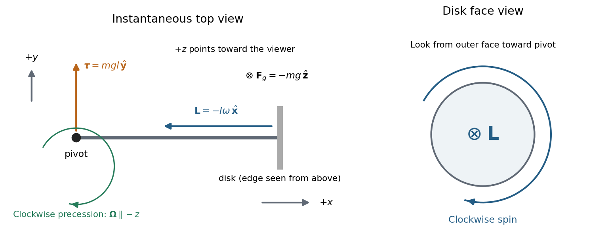

<h1 id="section-b/8/solution">Solution</h1>

↑ **Parent:** [8](../8.md)

**Directions.** Choose $+x$ along the horizontal spindle from the pivot to the disk, and $+z$ vertically upward. With [lever arm](../../../../lever-arm.md) $\mathbf r=l\widehat{\mathbf x}$ and weight $\mathbf F_g=-mg\widehat{\mathbf z}$, the [torque](../../../../torque.md) about the pivot is

$$
\boldsymbol\tau=\mathbf r\times\mathbf F_g=mgl\widehat{\mathbf y}.
$$

Clockwise [precession](../../../../precession.md) viewed from above has $\boldsymbol\Omega=-\Omega\widehat{\mathbf z}$. The relation $\boldsymbol\tau=\boldsymbol\Omega\times\mathbf L$ therefore requires the spin [angular momentum](../../../../angular-momentum.md) to point along $-x$, **from the disk toward the pivot**. The disk spins **clockwise when viewed from its outer face looking along the spindle toward the pivot**. Looking from the pivot reverses that apparent rotation. The [right-hand rule](../../../../right-hand-rule.md) fixes these signs unambiguously.

**[Figure 1](#section-b/8/image-top-view-torque-and-angular-momentum-directions-with-the-disk-s-spin-viewed-from-its-outer-face). Top-view torque and angular-momentum directions, with the disk's spin viewed from its outer face**.

The drawing shows an instantaneous top view; the disk's [angular momentum](../../../../angular-momentum.md) and the horizontal spindle turn clockwise together. The pivot [force](../../../../force-split.md) has zero [torque](../../../../torque.md) about the pivot.

**Rate of precession.** For steady horizontal motion the spin contribution has magnitude $L=I\omega$ and turns through $d\phi=\Omega\,dt$ in time $dt$. Its change is perpendicular to itself and has magnitude $dL=L\,d\phi$. Hence

$$
|\boldsymbol\tau|=\left|\frac{d\mathbf L}{dt}\right|=\Omega I\omega=mgl,
\qquad
\boxed{\Omega=\frac{mgl}{I\omega}.}
$$

This is the usual [slow steady gyroscope precession](../../../../slow-steady-gyroscope-precession.md) relation. Any constant vertical [angular momentum](../../../../angular-momentum.md) associated with steady precession has zero time derivative; the horizontal spin contribution supplies the changing component here. Transient [nutation](../../../../nutation.md) is excluded by the prescribed horizontal steady motion.

**Clock design.** Convert both rotation rates to [angular frequencies](../../../../angular-frequency.md):

$$
\Omega=\frac{2\pi}{60}\,\mathrm{rad\,s^{-1}},\qquad
\omega=2\pi(300)\,\mathrm{rad\,s^{-1}}.
$$

For the [moment of inertia of a uniform disc](../../../../moment-of-inertia-of-a-uniform-disc.md), $I=mR^2/2$, so the [mass](../../../../mass.md) cancels:

$$
\boxed{l=\frac{\Omega R^2\omega}{2g}
=\frac{(2\pi/60)(0.10)^2(600\pi)}{2(9.8)}
=0.1007\,\mathrm m\simeq10.1\,\mathrm{cm}.}
$$

**Spin friction.** At fixed geometry, reducing $\omega$ increases $\Omega\propto1/\omega$. The [precession](../../../../precession.md) period, $T_p=2\pi/\Omega$, therefore **decreases**. This trend holds while slow steady [precession](../../../../precession.md) remains a suitable description; it cannot be extrapolated to a stopped disk.

**Counterweight.** To oppose the disk's gravitational [torque](../../../../torque.md), place the counterweight on the other side of the pivot, at $-l_c\widehat{\mathbf x}$. The net [torque](../../../../torque.md) is

$$
\boldsymbol\tau=g(ml-m_cl_c)\widehat{\mathbf y}.
$$

A horizontal axle can remain fixed when this vanishes, giving

$$
\boxed{l_c=\frac{ml}{m_c}\quad\text{on the opposite side of the pivot}.}
$$

For the fixed spin direction already found, [counterbalanced gyroscope precession](../../../../counterbalanced-gyroscope-precession.md) has signed rate

$$
\Omega_z=-\frac{g(ml-m_cl_c)}{I\omega}.
$$

Moving the counterweight outward from the pivot first slows the clockwise motion, eliminates its driving [torque](../../../../torque.md) at balance, and then reverses the steady motion to counterclockwise. A counterweight on the disk's side would add to the gravitational [torque](../../../../torque.md). These statements neglect axial spin [moment of inertia](../../../../moment-of-inertia.md) of the counterweight and assume the stated horizontal motion, without a separately imposed precession at balance.

## ↑ Ancestors (12)

1. [8](../8.md)
2. [Section B](../../section-b.md)
3. [2018](../../../2018-split.md)
4. [Past exam of the physics course of the year 1 of the natural sciences course of the University of Cambridge](../../../split.md)
5. [Physics course of the year 1 of the natural sciences course of the University of Cambridge](../../../../physics-course-of-the-year-1-of-the-natural-sciences-course-of-the-university-of-cambridge.md)
6. [Year 1 of the natural sciences course of the University of Cambridge](../../../../year-1-of-the-natural-sciences-course-of-the-university-of-cambridge.md)
7. [Year of the natural sciences course of the University of Cambridge](../../../../year-of-the-natural-sciences-course-of-the-university-of-cambridge.md)
8. [Natural sciences course of the University of Cambridge](../../../../natural-sciences-course-of-the-university-of-cambridge.md)
9. [Course of the University of Cambridge](../../../../course-of-the-university-of-cambridge.md)
10. [University of Cambridge](../../../../university-of-cambridge-split.md)
11. [List of universities](../../../../list-of-universities.md)
12. [Codex Wiki](../../../../split.md)
