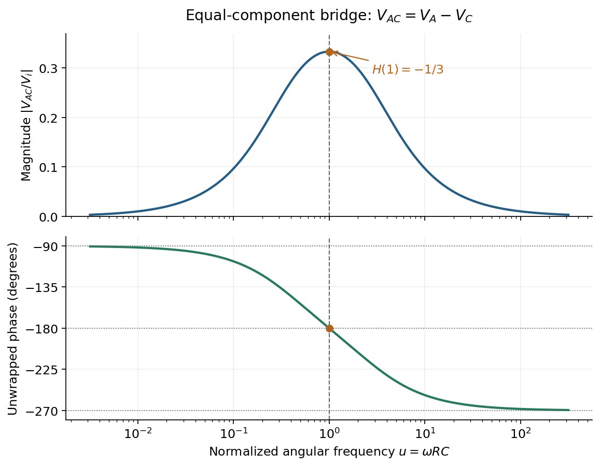

<h1 id="section-c/11/solution">Solution</h1>

↑ **Parent:** [11](../11.md)

**Complex impedance.** In sinusoidal steady state write physical voltage and [electric current](../../../../electric-current.md) as real parts of $\widetilde V e^{i\omega t}$ and $\widetilde I e^{i\omega t}$. The [electrical impedance](../../../../electrical-impedance.md) $Z=\widetilde V/\widetilde I$ is a ratio of [phasors](../../../../phasor.md); its magnitude gives the voltage-to-current amplitude ratio and its argument gives their phase difference. It is measured in [ohms](../../../../ohm.md).

For an ideal [capacitor](../../../../capacitor.md), $q=Cv$ and $i=dq/dt=C\,dv/dt$. Consequently $\widetilde I=i\omega C\widetilde V$, giving

$$
\boxed{Z_C=\frac1{i\omega C}=-\frac i{\omega C}.}
$$

With this time convention the voltage lags the [electric current](../../../../electric-current.md) by $\pi/2$.

**Bridge output.** The original diagram has $R_1$ and $C_1$ in parallel in the upper-left arm, and $R_2$ and $C_2$ in series in the lower-left arm. The point labelled $C$ is connected to the upper supply node. Set the lower supply node to zero, so $V_C=V_i$. Assuming the measured output draws negligible [electric current](../../../../electric-current.md), the two [voltage dividers](../../../../voltage-divider.md) give

$$
V_A=V_i\frac{Z_2}{Z_1+Z_2},\qquad
V_B=V_i\frac{R_4}{R_3+R_4}.
$$

Their difference is therefore

$$
\boxed{\frac{V_{AB}}{V_i}=\frac{Z_2}{Z_1+Z_2}-\frac{R_4}{R_3+R_4}.}
$$

The reactive-arm [electrical impedances](../../../../electrical-impedance.md) are

$$
Z_1=\left(\frac1{R_1}+i\omega C_1\right)^{-1},\qquad
Z_2=R_2+\frac1{i\omega C_2}.
$$

**Balance.** Setting $V_{AB}=0$ and cross-multiplying gives $R_3Z_2=R_4Z_1$. For this [Wien bridge](../../../../wien-bridge.md),

$$
\frac{Z_2}{Z_1}
=\left(R_2+\frac1{i\omega C_2}\right)\left(\frac1{R_1}+i\omega C_1\right)
=\frac{R_2}{R_1}+\frac{C_1}{C_2}
+i\left(\omega R_2C_1-\frac1{\omega R_1C_2}\right).
$$

The right-hand side must be the real number $R_4/R_3$. Equating imaginary and real parts gives

$$
\boxed{\omega=\frac1{\sqrt{R_1R_2C_1C_2}},\qquad
\frac{C_1}{C_2}=\frac{R_4}{R_3}-\frac{R_2}{R_1}.}
$$

Positive [capacitances](../../../../capacitance.md) require $R_4/R_3>R_2/R_1$. In the equal-component case $R_1=R_2=R$ and $C_1=C_2=C$, this reduces to

$$
\boxed{\omega=\frac1{RC},\qquad R_4=2R_3.}
$$

**Band-pass output and phase.** Preserve the requested voltage polarity: $V_{AC}=V_A-V_C$. Since $V_C=V_i$,

$$
\frac{V_{AC}}{V_i}=\frac{Z_2}{Z_1+Z_2}-1
=-\frac{Z_1}{Z_1+Z_2}.
$$

Put $u=\omega RC>0$. The equal-component ratio is $Z_2/Z_1=2+i(u-u^{-1})$, so the [Wien bridge band-pass response](../../../../wien-bridge-band-pass-response.md) is

$$
\boxed{H(\omega)=\frac{V_{AC}}{V_i}
=-\frac1{3+i(u-u^{-1})}
=-\frac{iu}{1-u^2+3iu}.}
$$

At finite positive [frequency](../../../../frequency.md), its imaginary part vanishes exactly when $u-u^{-1}=0$. Thus

$$
\boxed{\omega_r=\frac1{RC},\qquad H(\omega_r)=-\frac13.}
$$

The magnitude $|H|=[9+(u-u^{-1})^2]^{-1/2}$ is maximal there and tends to zero at both frequency extremes, as expected for a [band-pass filter](../../../../band-pass-filter.md).

A convenient continuous, unwrapped [wave phase](../../../../phase-waves.md) is

$$
\boxed{\phi(\omega)=-\pi-\arctan\!\left(\frac{u-u^{-1}}3\right).}
$$

It decreases from $-\pi/2$ as $\omega\to0^+$, passes through $-\pi$ at $\omega_r$, and tends to $-3\pi/2$ as $\omega\to\infty$. A principal-value plot instead jumps from $-\pi$ to $+\pi$ at resonance; both represent the same [phasor](../../../../phasor.md). Reversing the output to $V_{CA}$ would shift the phase by $\pi$ and make the resonant ratio $+1/3$, but that is a different output polarity from the one printed.

**[Figure 2](#section-c/11/image-band-pass-magnitude-and-continuous-phase-for-the-printed-output-polarity-va-minus-vc). Band-pass magnitude and continuous phase for the printed output polarity VA minus VC**.

## ↑ Ancestors (12)

1. [11](../11.md)
2. [Section C](../../section-c.md)
3. [2018](../../../2018-split.md)
4. [Past exam of the physics course of the year 1 of the natural sciences course of the University of Cambridge](../../../split.md)
5. [Physics course of the year 1 of the natural sciences course of the University of Cambridge](../../../../physics-course-of-the-year-1-of-the-natural-sciences-course-of-the-university-of-cambridge.md)
6. [Year 1 of the natural sciences course of the University of Cambridge](../../../../year-1-of-the-natural-sciences-course-of-the-university-of-cambridge.md)
7. [Year of the natural sciences course of the University of Cambridge](../../../../year-of-the-natural-sciences-course-of-the-university-of-cambridge.md)
8. [Natural sciences course of the University of Cambridge](../../../../natural-sciences-course-of-the-university-of-cambridge.md)
9. [Course of the University of Cambridge](../../../../course-of-the-university-of-cambridge.md)
10. [University of Cambridge](../../../../university-of-cambridge-split.md)
11. [List of universities](../../../../list-of-universities.md)
12. [Codex Wiki](../../../../split.md)
