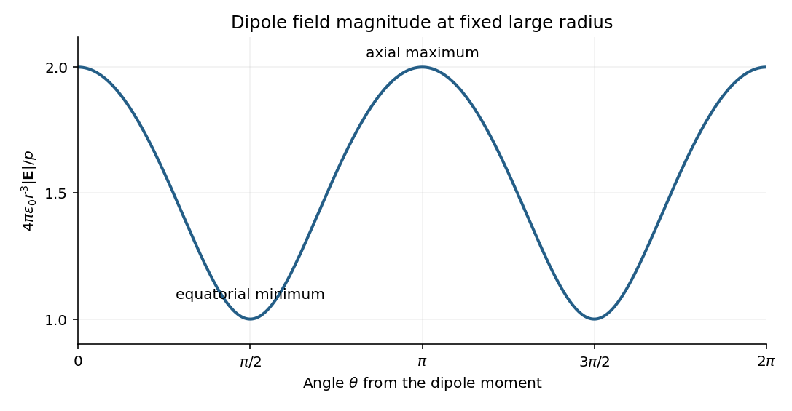

# 2019

↑ **Parent:** [Past exam of the physics course of the year 1 of the natural sciences course of the University of Cambridge](../past-exam-of-the-physics-course-of-the-year-1-of-the-natural-sciences-course-of-the-university-of-cambridge.md)

[Original paper, released PDF pages 31–38](https://www.whatdotheyknow.com/request/natural_science_tripos_physics_e/response/2127325/attach/3/FOI%202022%20639%20Sullivan%20materials.pdf?cookie_passthrough=1#page=31)

**Table of contents**

- [Section A](#section-a)
  - [1](#section-a/1)
    - [Solution](#section-a/1/solution)
  - [2](#section-a/2)
    - [Solution](#section-a/2/solution)
  - [3](#section-a/3)
    - [Solution](#section-a/3/solution)
  - [4](#section-a/4)
    - [Solution](#section-a/4/solution)
  - [5](#section-a/5)
    - [Solution](#section-a/5/solution)
- [Section B](#section-b)
  - [6](#section-b/6)
    - [Solution](#section-b/6/solution)
  - [7](#section-b/7)
    - [Solution](#section-b/7/solution)
  - [8](#section-b/8)
    - [a](#section-b/8/a)
      - [Solution](#section-b/8/a/solution)
    - [b](#section-b/8/b)
      - [Solution](#section-b/8/b/solution)
    - [c](#section-b/8/c)
      - [Solution](#section-b/8/c/solution)
    - [d](#section-b/8/d)
      - [Solution](#section-b/8/d/solution)
    - [e](#section-b/8/e)
      - [Solution](#section-b/8/e/solution)
    - [f](#section-b/8/f)
      - [Solution](#section-b/8/f/solution)
  - [9](#section-b/9)
    - [Solution](#section-b/9/solution)
  - [10](#section-b/10)
    - [Solution](#section-b/10/solution)

## Section A

↑ **Parent:** [2019](2019.md)

<h3 id="section-a/1">1</h3>

↑ **Parent:** [Section A](#section-a)

<h4 id="section-a/1/solution">Solution</h4>

↑ **Parent:** [1](#section-a/1)

Rearrange the supplied form of [Kepler's third law](../mathematical-physics.md#kepler-s-third-law) to make the [gravitational constant](../newton-s-law-of-universal-gravitation.md#gravitational-constant) the subject:

$$
G=\frac{4\pi^2a^3}{MT^2}.
$$

Convert the [semi-major axis](../celestial-mechanics.md#semi-major-axis) and [orbital period](../celestial-mechanics.md#orbital-period) to [SI](../physics.md#international-system-of-units) units before substitution:

$$
a=1.491\times10^{11}\,\mathrm m,\qquad
T=365.3\times86400\,\mathrm s=3.156192\times10^7\,\mathrm s.
$$

The central value is therefore

$$
G=\frac{4\pi^2(1.491\times10^{11})^3}
{(1.99\times10^{30})(3.156192\times10^7)^2}
=6.60105\times10^{-11}\,\mathrm{m^3\,kg^{-1}\,s^{-2}}.
$$

For [monomial uncertainty propagation](../wave-equation.md#monomial-uncertainty-propagation), [logarithmic differentiation](../calculus.md#logarithmic-differentiation) gives

$$
\frac{dG}{G}=3\frac{da}{a}-\frac{dM}{M}-2\frac{dT}{T}.
$$

If the quoted errors are [independent](../random-variable.md#independent-random-variables) [standard uncertainties](../physics.md#standard-uncertainty), the [variances](../variance.md) of these contributions add:

$$
\left(\frac{\sigma_G}{G}\right)^2
=9\left(\frac{1.1}{149.1}\right)^2+(0.01)^2
+4\left(\frac{0.5}{365.3}\right)^2
=(0.0244408)^2.
$$

Thus $\sigma_G=1.61335\times10^{-12}\,\mathrm{m^3\,kg^{-1}\,s^{-2}}$, and the measured result under that statistical convention is

$$
\boxed{G=(6.60\pm0.16)\times10^{-11}\,\mathrm{m^3\,kg^{-1}\,s^{-2}}.}
$$

The [semi-major axis](../celestial-mechanics.md#semi-major-axis) measurement supplies the largest individual contribution to the relative uncertainty.

The paper does not specify whether its errors are statistical uncertainties or bounds. If they are maximum input errors, the first-order worst-case [error propagation](../wave-equation.md#propagation-of-uncertainty) estimate adds magnitudes:

$$
\frac{\Delta G}{G}\lesssim3\frac{1.1}{149.1}+0.01+2\frac{0.5}{365.3}
=0.0348703,
\qquad
\boxed{\Delta G\simeq0.23\times10^{-11}\,\mathrm{m^3\,kg^{-1}\,s^{-2}}.}
$$

[Correlation](../variance.md#pearson-correlation-coefficient) between input errors would instead require the [covariance](../variance.md#covariance) terms in the general [propagation of uncertainty](../wave-equation.md#propagation-of-uncertainty) formula; they are not specified.

<h3 id="section-a/2">2</h3>

↑ **Parent:** [Section A](#section-a)

<h4 id="section-a/2/solution">Solution</h4>

↑ **Parent:** [2](#section-a/2)

The original diagram places the output across the $10\,\Omega$ [resistor](../electric-charge.md#resistor), in series with an ideal $1\,\mathrm{mH}$ [inductor](../electromagnetism.md#inductor). Treat the voltages as [phasors](../wave.md#phasor) with time dependence $e^{i\omega t}$. The [electrical impedances](../electrical-circuit.md#electrical-impedance) are $Z_R=R$ and $Z_L=i\omega L$, so the same [electric current](../electric-charge.md#electric-current) flows through both:

$$
I=\frac{V_0}{R+i\omega L},\qquad
\boxed{H(\omega)=\frac{V_1}{V_0}=\frac{R}{R+i\omega L},\qquad
|H|=\frac{1}{\sqrt{1+(\omega L/R)^2}}.}
$$

This is an [RL low-pass filter](../electrical-engineering.md#rl-low-pass-filter), with corner [angular frequency](../lagrangian-mechanics.md#angular-frequency)

$$
\omega_c=\frac RL=\frac{10\,\Omega}{10^{-3}\,\mathrm H}
=10^4\,\mathrm{rad\,s^{-1}}.
$$

The [frequency response](../electrical-engineering.md#frequency-response) tends to one for $\omega\ll\omega_c$, has magnitude $1/\sqrt2$ at the corner, and tends to $\omega_c/\omega$ for $\omega\gg\omega_c$. The requested sketch uses a logarithmic horizontal axis and a linear voltage-gain axis:

**[Figure 1](#section-a/2/image-voltage-gain-of-the-original-rl-circuit-with-signal-corner-and-noise-frequencies-marked). Voltage gain of the original RL circuit, with signal, corner and noise frequencies marked**.

At the two specified [angular frequencies](../lagrangian-mechanics.md#angular-frequency),

$$
|H(10^3)|=\frac1{\sqrt{1.01}}=0.995037,\qquad
|H(10^5)|=\frac1{\sqrt{101}}=0.0995037.
$$

The [relative attenuation by a linear filter](../electrical-engineering.md#relative-attenuation-by-a-linear-filter) is the ratio of these gains:

$$
\boxed{\frac{(V_{\rm noise}/V_{\rm signal})_{\rm out}}
{(V_{\rm noise}/V_{\rm signal})_{\rm in}}
=\frac{|H(10^5)|}{|H(10^3)|}=0.100.}
$$

Thus the noise [amplitude](../wave.md#wave-amplitude) is **attenuated by a factor of 10 relative to the signal**. A squared-voltage ratio would decrease by a factor of $100$; the question's voltage transfer function gives the amplitude comparison.

<h3 id="section-a/3">3</h3>

↑ **Parent:** [Section A](#section-a)

<h4 id="section-a/3/solution">Solution</h4>

↑ **Parent:** [3](#section-a/3)

The [Huygens-Fresnel principle](../physical-optics.md#huygens-fresnel-principle) constructs a new [wavefront](../physical-optics.md#wavefront) as the envelope of secondary wavelets emitted by points on an earlier [wavefront](../physical-optics.md#wavefront). Let the [phase velocities](../dispersion-relation.md#phase-velocity) in the two media be $v_1=c/n_1$ and $v_2=c/n_2$, with [refractive indices](../electromagnetic-wave.md#refractive-index) evaluated at the light's fixed [frequency](../wave.md#frequency).

**[Figure 2](#section-a/3/image-an-original-secondary-wavelet-construction-of-refraction-at-a-plane-interface). An original secondary-wavelet construction of refraction at a plane interface**.

For [refraction from secondary wavelets](../physical-optics.md#refraction-from-secondary-wavelets), let point $A$ of the incident [wavefront](../physical-optics.md#wavefront) reach the interface first. A second point $B$ reaches the interface at $C$ after time $\Delta t$, so $BC=v_1\Delta t$. During the same interval, the secondary wavelet centered on $A$ advances radius $AD=v_2\Delta t$ into the second medium. The refracted [wavefront](../physical-optics.md#wavefront) $CD$ is tangent to this wavelet, hence $AD\perp CD$; also $BC\perp AB$ because a ray is normal to its [wavefront](../physical-optics.md#wavefront) in these isotropic media.

Let $\theta_1,\theta_2$ be the incident and refracted ray angles from the interface normal. They also equal the corresponding acute angles between the [wavefronts](../physical-optics.md#wavefront) and the interface. The two right triangles have common hypotenuse $AC$, giving

$$
\sin\theta_1=\frac{BC}{AC}=\frac{v_1\Delta t}{AC},\qquad
\sin\theta_2=\frac{AD}{AC}=\frac{v_2\Delta t}{AC}.
$$

Their ratio eliminates both $AC$ and $\Delta t$:

$$
\frac{\sin\theta_1}{\sin\theta_2}=\frac{v_1}{v_2}=\frac{n_2}{n_1},
\qquad
\boxed{n_1\sin\theta_1=n_2\sin\theta_2.}
$$

This is [Snell's law](../partial-differential-equation.md#snell-s-law). In particular, entering a medium of larger [refractive index](../electromagnetic-wave.md#refractive-index) reduces the ray's angle to the normal. The construction assumes a stationary interface and homogeneous isotropic media with a propagating refracted wave.

<h3 id="section-a/4">4</h3>

↑ **Parent:** [Section A](#section-a)

<h4 id="section-a/4/solution">Solution</h4>

↑ **Parent:** [4](#section-a/4)

Use base dimensions $\mathsf M,\mathsf L,\mathsf T$ for [mass](../classical-mechanics.md#mass), [length](../physics.md#length) and [time](../classical-mechanics.md#time-in-physics). The proposed [dimensional analysis](../mathematical-physics.md#dimensional-analysis) gives

$$
[v]=\mathsf L\mathsf T^{-1},\quad
[\omega]=\mathsf T^{-1},\quad
[\rho]=\mathsf M\mathsf L^{-3},\quad
[g]=\mathsf L\mathsf T^{-2},
$$

so

$$
[\omega^a\rho^bg^c]
=\mathsf M^b\mathsf L^{-3b+c}\mathsf T^{-a-2c}.
$$

Equating the independent dimensional powers requires

$$
b=0,\qquad -3b+c=1,\qquad -a-2c=-1.
$$

Consequently

$$
\boxed{a=-1,\qquad b=0,\qquad c=1,\qquad v\propto\frac g\omega.}
$$

The [mass density](../fluid-mechanics.md#density) drops out because there is no other mass-bearing quantity with which to combine it under the stated assumptions.

[Dimensional analysis](../mathematical-physics.md#dimensional-analysis) fixes the powers but leaves a dimensionless coefficient undetermined. For a linear [deep-water gravity wave](../fluid-mechanics.md#deep-water-gravity-wave), the [dispersion relation](../dispersion-relation.md) is $\omega^2=gk$, giving [phase velocity](../dispersion-relation.md#phase-velocity) $\omega/k=g/\omega$ and [group velocity](../dispersion-relation.md#group-velocity) $d\omega/dk=g/(2\omega)$. Both obey the inferred scaling. The phrase wave speed alone does not distinguish these two velocities or fix the coefficient.

<h3 id="section-a/5">5</h3>

↑ **Parent:** [Section A](#section-a)

<h4 id="section-a/5/solution">Solution</h4>

↑ **Parent:** [5](#section-a/5)

Choose a positive unit normal $\hat{\mathbf n}$ to the loop and choose positive circulation by the [right-hand rule](../electromagnetism.md#right-hand-rule). Write the applied [magnetic field](../magnetic-field.md) as $\mathbf B(t)=B_0\cos(\omega t)\hat{\mathbf b}$, where $\hat{\mathbf b}\cdot\hat{\mathbf n}=\cos\theta$. Because the field is uniform, the external [magnetic flux](../magnetic-field.md#magnetic-flux) is

$$
\Phi_B(t)=\int\mathbf B\cdot d\mathbf S
=\pi r^2B_0\cos\theta\cos(\omega t).
$$

[Faraday's law of induction](../maxwell-equations.md#faraday-s-law-of-induction) gives the induced [electromotive force](../electric-charge.md#electromotive-force), and [Ohm's law](../electric-charge.md#ohm-s-law) gives the current through the loop's [electrical resistance](../electric-charge.md#electrical-resistance):

$$
\mathcal E=-\frac{d\Phi_B}{dt}=\pi r^2B_0\omega\cos\theta\sin(\omega t),
\qquad
\boxed{I(t)=\frac{\pi r^2B_0\omega\cos\theta}{R}\sin(\omega t).}
$$

This is the [induced current in a tilted resistive loop](../maxwell-equations.md#induced-current-in-a-tilted-resistive-loop) with the self-generated magnetic-flux contribution neglected as requested. The factor has units $\mathrm{Wb\,s^{-1}\,\Omega^{-1}}=\mathrm A$. A field parallel to the loop plane has $\cos\theta=0$ and induces no current in this uniform-field model.

For $\cos\theta>0$, the initial normal flux is positive. At $\omega t=\pi/2$, the external [magnetic field](../magnetic-field.md) is instantaneously zero but its normal component is decreasing, so $d\Phi_B/dt<0$ and $I>0$. The current is counterclockwise when viewed from the positive-normal side. Its own [magnetic field](../magnetic-field.md) points along $+\hat{\mathbf n}$ through the loop, preserving the initial normal flux in accordance with [Lenz's law](../maxwell-equations.md#lenz-s-law).

**[Figure 3](#section-a/5/image-initial-oblique-field-and-the-induced-current-a-quarter-cycle-later-for-a-positive-initial-normal-flux). Initial oblique field and the induced current a quarter-cycle later, for a positive initial normal flux**.

For $\cos\theta<0$, both circulation and the induced normal-field direction reverse. The current follows the rate of change of [magnetic flux](../magnetic-field.md#magnetic-flux); the quarter-cycle current is nonzero even though the external field itself vanishes then.

## Section B

↑ **Parent:** [2019](2019.md)

<h3 id="section-b/6">6</h3>

↑ **Parent:** [Section B](#section-b)

<h4 id="section-b/6/solution">Solution</h4>

↑ **Parent:** [6](#section-b/6)

**Definitions**. The [torque](../momentum.md#torque) of a [force](../force.md) $\mathbf F$ about an origin is $\boldsymbol\tau=\mathbf r\times\mathbf F$, where $\mathbf r$ runs from that origin to the force's point of application. Its component about a fixed axis changes [angular momentum](../momentum.md#angular-momentum) about that axis. The [moment of inertia](../rigid-body-dynamics.md#moment-of-inertia) about that axis is

$$
\boxed{I=\int s^2\,dm,}
$$

where $s$ is perpendicular distance to the axis. It measures resistance to [angular acceleration](../rigid-body-dynamics.md#angular-acceleration); for fixed-axis rigid rotation, $\tau_{\rm net}=I\alpha$. The units are $\mathrm{N\,m}$ for [torque](../momentum.md#torque) and $\mathrm{kg\,m^2}$ for [moment of inertia](../rigid-body-dynamics.md#moment-of-inertia).

**Mass and axial inertia**. Slice the shaft perpendicular to its common axis. A slice of radius $r(z)$ has [mass](../classical-mechanics.md#mass) $dm=\rho\pi r(z)^2dz$ and [moment of inertia](../rigid-body-dynamics.md#moment-of-inertia) $dI=\tfrac12r(z)^2dm$, using the [moment of inertia of a uniform disc](../rigid-body-dynamics.md#moment-of-inertia-of-a-uniform-disc). Thus the [axial moment of inertia of a solid of revolution](../rigid-body-dynamics.md#axial-moment-of-inertia-of-a-solid-of-revolution) uses the second and fourth powers of its radius:

$$
M=\rho\pi\int r(z)^2dz,\qquad
I=\frac{\rho\pi}{2}\int r(z)^4dz.
$$

For the tapered section, take $z$ from its narrow end toward its wide end, so $r(z)=a(1+z/l)$ for $0\leq z\leq l$. Its contributions are

$$
M_{\rm taper}=\rho\pi a^2l\int_0^1(1+u)^2du
=\frac73\rho\pi a^2l,
\qquad
I_{\rm taper}=\frac{\rho\pi a^4l}{2}\int_0^1(1+u)^4du
=\frac{31}{10}\rho\pi a^4l.
$$

The two cylinders contribute $4\rho\pi a^2l$ and $\rho\pi a^2l$ to [mass](../classical-mechanics.md#mass), and $8\rho\pi a^4l$ and $\tfrac12\rho\pi a^4l$ to [moment of inertia](../rigid-body-dynamics.md#moment-of-inertia). Adding the three sections gives

$$
\boxed{M=\left(4+\frac73+1\right)\rho\pi a^2l
=\frac{22}{3}\rho\pi a^2l,}
$$

$$
I=\left(8+\frac{31}{10}+\frac12\right)\rho\pi a^4l
=\frac{58}{5}\rho\pi a^4l,
\qquad
\boxed{I=\frac{58/5}{22/3}Ma^2=\frac{87}{55}Ma^2.}
$$

All slice rotation axes coincide with the shaft axis, so the moments add directly.

**Frictional torque**. The normal load on the narrow circular end is $Mg$. With the stipulated uniform [pressure](../pressure.md), $p_N=Mg/(\pi a^2)$. A contact annulus of radius $s$ and width $ds$ has area $dA=2\pi s\,ds$, normal [force](../force.md) $p_NdA$ and tangential [kinetic friction](../newtonian-mechanics.md#kinetic-friction) $dF=\mu p_NdA$. Multiplying by its lever arm $s$ and integrating gives the [uniform-pressure friction torque on a circular contact](../newtonian-mechanics.md#uniform-pressure-friction-torque-on-a-circular-contact):

$$
G_f=\int_0^a s\,\mu\frac{Mg}{\pi a^2}\,2\pi s\,ds
=\frac{2\mu Mg}{a^2}\frac{a^3}{3},
\qquad
\boxed{G_f=\frac{2M\mu ga}{3}.}
$$

Here $G_f$ is the positive magnitude; its [torque](../momentum.md#torque) opposes the [angular velocity](../rigid-body-dynamics.md#angular-velocity).

**Steady speed and stopping rotations**. Mechanical [power](../energy.md#power) in rotation is $P=\tau\omega$. At steady [angular velocity](../rigid-body-dynamics.md#angular-velocity), the driving and frictional torques balance, so [constant-power rotation against dry friction](../momentum.md#constant-power-rotation-against-dry-friction) gives

$$
\boxed{\omega_*=\frac{P}{G_f}=\frac{3P}{2M\mu ga}.}
$$

Using $g=9.81\,\mathrm{m\,s^{-2}}$ and $a=0.100\,\mathrm m$,

$$
I=0.0316364\,\mathrm{kg\,m^2},\qquad
G_f=0.3924\,\mathrm{N\,m},\qquad
\boxed{\omega_*=25.4842\,\mathrm{rad\,s^{-1}}\simeq25.5\,\mathrm{rad\,s^{-1}}.}
$$

Once the motor is removed, the speed-independent [kinetic friction](../newtonian-mechanics.md#kinetic-friction) gives constant [angular acceleration](../rigid-body-dynamics.md#angular-acceleration) $-G_f/I$. Equivalently, the initial [rotational kinetic energy](../energy.md#rotational-kinetic-energy) is dissipated as frictional work. The [stopping angle under constant resisting torque](../momentum.md#stopping-angle-under-constant-resisting-torque) is therefore

$$
G_f\Delta\phi=\frac12I\omega_*^2,\qquad
\Delta\phi=\frac{I\omega_*^2}{2G_f}=26.1800\,\mathrm{rad}.
$$

The total [angular displacement](../classical-mechanics.md#angular-displacement) corresponds to

$$
N=\frac{\Delta\phi}{2\pi}=\frac{IP^2}{4\pi G_f^3}=4.16668\ \text{revolutions}.
$$

Hence the shaft completes

$$
\boxed{\lfloor N\rfloor=4\ \text{complete rotations},}
$$

and then another $0.16668$ of a rotation. Its stopping time is $I\omega_*/G_f=2.05461\,\mathrm s$. Using the rounded value $g=9.8\,\mathrm{m\,s^{-2}}$ changes the fractional rotation slightly but leaves four complete rotations.

<h3 id="section-b/7">7</h3>

↑ **Parent:** [Section B](#section-b)

<h4 id="section-b/7/solution">Solution</h4>

↑ **Parent:** [7](#section-b/7)

**Equilibrium and undamped motion**. Resolve [forces](../force.md) along the incline, taking positive displacement down the slope. At [equilibrium](../dynamical-systems.md#equilibrium-point-of-a-dynamical-system), [Hooke's law](../elasticity-physics.md#hooke-s-law) balances the downhill component of [weight](../semisimple-lie-algebra.md#weight-representation-theory):

$$
k(l_{\rm eq}-l_0)=mg\sin\theta,
\qquad
\boxed{l_{\rm eq}=l_0+\frac{mg\sin\theta}{k}.}
$$

If $x$ is measured from that equilibrium position, [Newton's second law](../force.md#newton-s-second-law) becomes

$$
m\ddot x=mg\sin\theta-k(l_{\rm eq}+x-l_0)=-kx.
$$

Thus the motion is a [harmonic oscillator](../classical-mechanics.md#simple-harmonic-motion) with

$$
\boxed{\omega_0=\sqrt{\frac km}.}
$$

[Gravity](../physics.md#gravity) shifts the equilibrium extension but drops out of this oscillation frequency because the downhill force component is constant.

**Viscous damping**. For a [damped harmonic oscillator](../analysis.md#damped-harmonic-oscillator), put $\beta=b/(2m)$. Substitution of $z=Ae^{-pt}$ in the supplied [linear ordinary differential equation](../linear-ordinary-differential-equation.md) gives

$$
p^2-\frac bm p+\frac km=0,
\qquad
p=\beta\pm\sqrt{\beta^2-\omega_0^2}.
$$

In the [underdamped](../wave-equation.md#underdamping) regime $\beta<\omega_0$, define $\omega_d=\sqrt{\omega_0^2-\beta^2}$. The two [characteristic roots](../differential-equation.md#characteristic-root-of-a-constant-coefficient-differential-equation) are $p=\beta\pm i\omega_d$, and the general real [displacement](../classical-mechanics.md#displacement) is

$$
\boxed{x(t)=e^{-\beta t}\left[C\cos(\omega_dt)+D\sin(\omega_dt)\right]
=A_{\rm env}e^{-\beta t}\cos(\omega_dt-\phi).}
$$

Here $C,D$, or equivalently $A_{\rm env}$ and $\phi$, are fixed by the [initial conditions](../differential-equation.md#initial-condition). For release from rest at $x_0$, the condition $\dot x(0)=0$ requires $D=\beta x_0/\omega_d$, not $D=0$:

$$
\boxed{x(t)=x_0e^{-\beta t}
\left[\cos(\omega_dt)+\frac\beta{\omega_d}\sin(\omega_dt)\right].}
$$

The curve oscillates about zero between exponentially shrinking envelopes $\pm A_{\rm env}e^{-\beta t}$, where $A_{\rm env}=|x_0|\sqrt{1+(\beta/\omega_d)^2}$ for this release. The upper panel illustrates that shape; its damping strength is chosen to make the envelope visible.

**[Figure 4](#section-b/7/image-an-underdamped-release-and-the-first-encounter-with-the-stop-for-the-given-parameters). An underdamped release and the first encounter with the stop for the given parameters**.

**Frequency change**. [Viscous damping](../wave-equation.md#viscous-damping) reduces the [angular frequency](../lagrangian-mechanics.md#angular-frequency) and lengthens the [oscillation period](../classical-mechanics.md#period-of-an-oscillation):

$$
\boxed{\omega_d=\sqrt{\frac km-\frac{b^2}{4m^2}}<\omega_0,\qquad T_d=\frac{2\pi}{\omega_d}.}
$$

For light [damping](../wave-equation.md#damping), $\omega_d\simeq\omega_0[1-b^2/(8mk)]$, so the frequency shift is second order in $b$, even though the envelope decay rate is first order in $b$.

**Will the block reach the stop?** The given parameters give

$$
\beta=0.00500\,\mathrm s^{-1},\qquad
\omega_0=\sqrt{10}=3.16227766\,\mathrm{rad\,s^{-1}},\qquad
\omega_d=3.16227371\,\mathrm{rad\,s^{-1}}.
$$

For $x_0=-0.260\,\mathrm m$, differentiating the release-from-rest solution gives

$$
\dot x(t)=-\frac{x_0\omega_0^2}{\omega_d}
 e^{-\beta t}\sin(\omega_dt).
$$

It is positive throughout the first half-cycle. The first positive turning point therefore occurs at $t_+=\pi/\omega_d=0.993460\,\mathrm s$. The [turning points of an underdamped release from rest](../wave-equation.md#turning-points-of-an-underdamped-release-from-rest) give its unobstructed height:

$$
x_+=-x_0e^{-\beta\pi/\omega_d}
=0.260e^{-0.00496730}\,\mathrm m=0.258712\,\mathrm m.
$$

Since $x_+>0.250\,\mathrm m$ and the [displacement](../classical-mechanics.md#displacement) increases continuously up to that point,

$$
\boxed{\text{The block hits the stop on its first downward swing.}}
$$

Solving $x(t)=0.250\,\mathrm m$ gives first contact at approximately $0.91117\,\mathrm s$. The plotted dashed continuation is the hypothetical free motion after that time; the post-impact motion is not determined by the supplied damping model.

<h3 id="section-b/8">8</h3>

↑ **Parent:** [Section B](#section-b)

<h4 id="section-b/8/a">a</h4>

↑ **Parent:** [8](#section-b/8)

<h5 id="section-b/8/a/solution">Solution</h5>

↑ **Parent:** [A](#section-b/8/a)

Use a stationary [wavefunction](../wave-function.md) $\Psi(x,t)=\psi(x)e^{-iEt/\hbar}$ solving the [time-independent Schrödinger equation](../mathematical-physics.md#time-independent-schrodinger-equation). For [energy](../energy.md) above the positive [step potential](../quantum-scattering.md#step-potential), the positive [wavenumbers](../wave-equation.md#wavenumber) are

$$
\boxed{k_1=\frac{\sqrt{2mE}}{\hbar},\qquad
k_2=\frac{\sqrt{2m(E-V_0)}}{\hbar}.}
$$

Incidence only from the left permits a right-moving incident [plane wave](../wave-function.md#plane-wave) and a left-moving reflected [plane wave](../wave-function.md#plane-wave) for $x\leq0$, but only a right-moving transmitted [plane wave](../wave-function.md#plane-wave) for $x>0$:

$$
\psi(x)=\begin{cases}
Ae^{ik_1x}+Be^{-ik_1x},&x\leq0,\\
Ce^{ik_2x},&x>0.
\end{cases}
$$

The omitted right-incident component would describe a different scattering experiment. [Wavefunction matching at a finite potential step](../mathematical-physics.md#wavefunction-matching-at-a-finite-potential-step) requires continuity of both $\psi$ and $d\psi/dx$ for a finite jump and the same [mass](../classical-mechanics.md#mass) on either side:

$$
A+B=C,\qquad ik_1(A-B)=ik_2C.
$$

Eliminate $B=C-A$ from the second condition:

$$
k_1(2A-C)=k_2C,
\qquad
\boxed{\frac CA=\frac{2k_1}{k_1+k_2},\qquad
\frac BA=\frac{k_1-k_2}{k_1+k_2}.}
$$

The first ratio is a [transmission amplitude](../quantum-scattering.md#transmission-amplitude); a transmitted [probability current](../wave-function.md#probability-current) also depends on its different propagation [velocity](../classical-mechanics.md#velocity).

<h4 id="section-b/8/b">b</h4>

↑ **Parent:** [8](#section-b/8)

<h5 id="section-b/8/b/solution">Solution</h5>

↑ **Parent:** [B](#section-b/8/b)

The [probability current](../wave-function.md#probability-current) of the incident wave is $j_{\rm in}=\hbar k_1|A|^2/m$, and that of the reflected wave is $j_{\rm ref}=-\hbar k_1|B|^2/m$. The [quantum reflection probability](../quantum-scattering.md#quantum-reflection-probability) is the positive ratio of reflected to incident flux magnitudes:

$$
\boxed{R=\frac{|j_{\rm ref}|}{j_{\rm in}}=\frac{|B|^2}{|A|^2}
=\left(\frac{k_1-k_2}{k_1+k_2}\right)^2.}
$$

For comparison, the transmitted [probability current](../wave-function.md#probability-current) is $j_{\rm tr}=\hbar k_2|C|^2/m$, so the [transmission probability](../quantum-scattering.md#transmission-probability) is

$$
T=\frac{k_2}{k_1}\left|\frac CA\right|^2
=\frac{4k_1k_2}{(k_1+k_2)^2}.
$$

These satisfy $R+T=1$, as required by conservation of [probability current](../wave-function.md#probability-current) for a real, nonabsorbing [potential energy](../energy.md#potential-energy). In particular, $|C/A|^2$ alone is not the transmitted flux fraction when $k_2\ne k_1$.

<h4 id="section-b/8/c">c</h4>

↑ **Parent:** [8](#section-b/8)

<h5 id="section-b/8/c/solution">Solution</h5>

↑ **Parent:** [C](#section-b/8/c)

For $E\gg V_0$, the two [wavenumbers](../wave-equation.md#wavenumber) nearly coincide:

$$
k_2=k_1\sqrt{1-\frac{V_0}{E}}
\simeq k_1\left(1-\frac{V_0}{2E}\right).
$$

Consequently $B/A\simeq V_0/(4E)\to0$ and $C/A\to1$. To leading order the complete [wavefunction](../wave-function.md) is

$$
\boxed{\Psi(x,t)\simeq A\exp\!\left[i\left(k_1x-\frac{Et}{\hbar}\right)\right].}
$$

The small fractional change in kinetic [energy](../energy.md) scarcely changes the propagation [wavenumber](../wave-equation.md#wavenumber), so reflection vanishes and the particle behaves approximately as a free right-moving [plane wave](../wave-function.md#plane-wave). A more accurate phase at large positive $x$ retains $k_2x$ on the transmitted side; even a small wavenumber difference accumulates over a sufficiently long distance.

<h4 id="section-b/8/d">d</h4>

↑ **Parent:** [8](#section-b/8)

<h5 id="section-b/8/d/solution">Solution</h5>

↑ **Parent:** [D](#section-b/8/d)

Take the threshold from the above-step side used in the preceding parts, $E\to V_0^+$. Then $k_2\to0$ while $k_1\to\sqrt{2mV_0}/\hbar$ remains finite. The reflected [probability amplitude](../wave-function.md#probability-amplitude) approaches $B=A$, and the transmitted amplitude approaches $C=2A$. At each fixed position, the [potential-step threshold wavefunction](../quantum-scattering.md#potential-step-threshold-wavefunction) is therefore

$$
\psi(x)\longrightarrow\begin{cases}
A(e^{ik_1x}+e^{-ik_1x})=2A\cos(k_1x),&x\leq0,\\
2A,&x>0.
\end{cases}
$$

Its [probability density](../wave-function.md#probability-density) is

$$
\boxed{|\psi(x)|^2\longrightarrow\begin{cases}
4|A|^2\cos^2(k_1x),&x\leq0,\\
4|A|^2,&x>0.
\end{cases}}
$$

**[Figure 5](#section-b/8/d/image-probability-density-at-the-positive-step-threshold-normalized-to-the-incident-amplitude-squared). Probability density at the positive-step threshold, normalized to the incident amplitude squared**.

The left-hand [standing wave](../mathematical-physics.md#standing-wave) has zero-density nodes at $k_1x=-\pi/2,-3\pi/2,\ldots$ and maxima of height $4|A|^2$. Its density period is $\pi/k_1$, half the incident [de Broglie wavelength](../wave-function.md#de-broglie-wavelength). At the origin the density is a maximum, continuous with the constant value on the right; its first [derivative](../calculus.md#derivative) is also zero on either side there.

The nonzero right-hand density does not imply transmitted flux: $j_{\rm tr}=\hbar k_2|C|^2/m\to0$, so $R\to1$ and $T\to0$. The exact threshold solution with no incoming component from the right is the limiting constant solution of $\psi''=0$ in the raised region. These stationary scattering states are not normalized over the whole real line; finite-interval density ratios are nevertheless well defined.

<h4 id="section-b/8/e">e</h4>

↑ **Parent:** [8](#section-b/8)

<h5 id="section-b/8/e/solution">Solution</h5>

↑ **Parent:** [E](#section-b/8/e)

Use adjacent segments $[-\ell,0]$ and $[0,\ell]$, with $\ell=2\pi/k_1$. Integrate the threshold [probability density](../wave-function.md#probability-density) from part (d). The left segment contains two complete density periods, so its average $\cos^2$ is $1/2$:

$$
P_-\propto\int_{-\ell}^{0}4|A|^2\cos^2(k_1x)\,dx
=2|A|^2\ell=\frac{4\pi|A|^2}{k_1}.
$$

The right-hand density is constant:

$$
P_+\propto\int_0^\ell4|A|^2\,dx
=4|A|^2\ell=\frac{8\pi|A|^2}{k_1}.
$$

The common stationary-state normalization cancels, yielding

$$
\boxed{\frac{P_-}{P_+}=\frac12,\qquad P_-:P_+=1:2.}
$$

The larger local probability weight on the right is compatible with zero transmitted [probability current](../wave-function.md#probability-current) at threshold: density and flux measure different quantities.

<h4 id="section-b/8/f">f</h4>

↑ **Parent:** [8](#section-b/8)

<h5 id="section-b/8/f/solution">Solution</h5>

↑ **Parent:** [F](#section-b/8/f)

For a downward [step potential](../quantum-scattering.md#step-potential), $V_0=-|V_0|$, the region on the right is classically allowed at every positive incident [energy](../energy.md). The same matching calculation applies with

$$
k_1=\frac{\sqrt{2mE}}\hbar,\qquad
k_2=\frac{\sqrt{2m(E+|V_0|)}}\hbar.
$$

As $E\to0^+$, $k_1\to0$ and $k_2\to k_*=\sqrt{2m|V_0|}/\hbar>0$. Hence

$$
\frac BA=\frac{k_1-k_2}{k_1+k_2}\to-1,\qquad
\frac CA=\frac{2k_1}{k_1+k_2}\sim\frac{2k_1}{k_*}\to0,
$$

and the flux coefficients satisfy

$$
\boxed{R=\left(\frac{k_1-k_2}{k_1+k_2}\right)^2\longrightarrow1,\qquad
T=\frac{4k_1k_2}{(k_1+k_2)^2}\sim\frac{4k_1}{k_*}\longrightarrow0.}
$$

This [quantum reflection at a downward step](../quantum-scattering.md#quantum-reflection-at-a-downward-step) occurs even though a classical particle would simply accelerate into the lower-potential region. The abrupt change in [wavenumber](../wave-equation.md#wavenumber) causes strong reflected-wave interference.

Both this limit and part (d) give total reflection, but their [probability amplitudes](../wave-function.md#probability-amplitude) and spatial densities differ. At the upward-step threshold, $B/A\to+1$ and $C/A\to2$: an antinode meets the origin and the right-hand density stays finite while its propagation [velocity](../classical-mechanics.md#velocity) vanishes. Here $B/A\to-1$ and $C/A\to0$: the incident and reflected waves nearly cancel at the origin, and the transmitted density vanishes while the right-hand propagation velocity remains finite. In both descriptions the incident [probability amplitude](../wave-function.md#probability-amplitude) is held fixed for comparison.

The coefficients above are limiting flux ratios for $E>0$. At exactly $E=0$ the incident [probability current](../wave-function.md#probability-current) vanishes, so directly dividing zero-energy fluxes would not define a scattering probability.

<h3 id="section-b/9">9</h3>

↑ **Parent:** [Section B](#section-b)

<h4 id="section-b/9/solution">Solution</h4>

↑ **Parent:** [9](#section-b/9)

**Experimental evidence**. [Tests of special relativity](../special-relativity.md#tests-of-special-relativity) check linked predictions about light propagation, clocks and [four-momentum](../special-relativity.md#four-momentum). Several independent kinds of experiment support those predictions.

- In the [Michelson-Morley experiment](../special-relativity.md#michelson-morley-experiment), light follows perpendicular paths in an [interferometer](../physical-optics.md#interferometer). Rotating the apparatus would change their round-trip travel-time difference in a classical stationary-aether model. The expected orientation-dependent [interference fringe](../physical-optics.md#interference-fringe) shift was absent at the predicted scale, consistent with isotropy of the round-trip [speed of light](../special-relativity.md#speed-of-light) in [special relativity](../special-relativity.md). This experiment alone does not distinguish special relativity from every alternative theory.[1887 report, apparatus and predicted versus observed orientation-dependent fringe shifts](../physics-bibliography.md#on-the-relative-motion-of-the-earth-and-the-luminiferous-ether-by-albert-abraham-michelson-and-edward-w-morley)
- The [Fizeau experiment](../special-relativity.md#fizeau-experiment) compares light propagation with and against flowing [water](../chemical-substance.md#water) using an [interference fringe](../physical-optics.md#interference-fringe) displacement. Neglecting [optical dispersion](../geometrical-optics.md#dispersion-optics), the [velocity-addition formula](../special-relativity.md#velocity-addition-formula) predicts

$$
v_{\rm lab}=\frac{c/n+u}{1+u/(nc)}
\simeq\frac cn+u\left(1-\frac1{n^2}\right).
$$

The observed partial-drag coefficient agrees with this first-order prediction rather than simple Galilean addition of $u$. It tests a different consequence of the [Lorentz transformation](../special-relativity.md#lorentz-transformation) from a particle-lifetime measurement.[1851 report, counter-propagating beams, reversing water flow and resulting fringe displacements](../physics-bibliography.md#the-hypotheses-relating-to-the-luminous-aether-by-hippolyte-fizeau)
- A controlled [muon storage-ring time-dilation experiment](../special-relativity.md#muon-storage-ring-time-dilation-experiment) measured circulating [muons](../standard-model.md#muon) at $\gamma=29.33$. Its measured [mean lifetimes](../relativistic-quantum-field.md#mean-lifetime-physics) were about $64.4\,\mathrm{\mu s}$, compared with about $2.2\,\mathrm{\mu s}$ at rest, consistent with $\tau_{\rm lab}=\gamma\tau_0$. This tests [time dilation](../special-relativity.md#time-dilation) with accelerator-selected particles.[1977 abstract, Lorentz factor and positive- and negative-muon lifetimes](../physics-bibliography.md#measurements-of-relativistic-time-dilatation-for-positive-and-negative-muons-in-a-circular-orbit-by-j-bailey-and-others)

**Atmospheric muons and the two frame descriptions**. Atmospheric [cosmic rays](../galaxy.md#cosmic-ray) create unstable particles whose decay chains produce [muons](../standard-model.md#muon). A stopped-muon experiment measures the time between a stopping signal and the subsequent decay electron, obtaining the proper [mean lifetime](../relativistic-quantum-field.md#mean-lifetime-physics) $\tau_0\simeq2.2\,\mathrm{\mu s}$. The associated light-travel distance is only $c\tau_0\simeq660\,\mathrm m$, yet substantial numbers of energetic atmospheric [muons](../standard-model.md#muon) reach detectors after travelling several kilometres.

For an ideal selected cohort produced height $h$ above a detector and moving downward at constant [speed](../classical-mechanics.md#speed) $v$, the flight time in the terrestrial frame is $h/v$. [Time dilation](../special-relativity.md#time-dilation) predicts a laboratory [mean lifetime](../relativistic-quantum-field.md#mean-lifetime-physics) $\gamma\tau_0$, hence survival fraction

$$
\boxed{\frac{N(h\to0)}{N(h)}=\exp\!\left(-\frac{h}{\gamma v\tau_0}\right),\qquad
\gamma=\frac1{\sqrt{1-v^2/c^2}}.}
$$

Without [time dilation](../special-relativity.md#time-dilation), the predicted exponent would be $-h/(v\tau_0)$ and the surviving population much smaller. Altitude comparisons constitute a [cosmic-ray muon time-dilation experiment](../special-relativity.md#cosmic-ray-muon-time-dilation-experiment): select comparable [momenta](../momentum.md) or [energies](../energy.md) and account for detector acceptance, atmospheric energy loss and backgrounds before interpreting the count ratio.

For illustration, not as a claimed measurement, take $h=10\,\mathrm{km}$ and $v=0.998c$. Then $\gamma=15.82$, the laboratory flight time is $33.4\,\mathrm{\mu s}$, and the predicted surviving fraction is about $0.38$. Omitting [time dilation](../special-relativity.md#time-dilation) would give only about $2.5\times10^{-7}$ on the same idealized constant-speed model.

In the [muon](../standard-model.md#muon) [rest frame](../mathematical-physics.md#rest-frame), its decay still follows $e^{-\Delta\tau/\tau_0}$. The atmosphere and ground move upward. Their separation, measured simultaneously in that frame, is shortened by [length contraction](../special-relativity.md#length-contraction):

$$
h'=\frac h\gamma,\qquad
\Delta\tau=\frac{h'}v=\frac{h}{\gamma v}.
$$

The same survival fraction follows. The terrestrial description uses a longer-lived moving particle; the muon-frame description uses a shorter atmospheric flight path. They describe the same production and detection events. This consistency illustrates both [time dilation](../special-relativity.md#time-dilation) and [length contraction](../special-relativity.md#length-contraction), while the survival measurement is not two independent experimental tests merely because it can be described in two frames.

**Energy-momentum invariant**. For a particle with rest [mass](../classical-mechanics.md#mass) $m$,

$$
\boxed{E^2-p^2c^2=m^2c^4.}
$$

Since $E=mc^2+K$, substitution and cancellation of $m^2c^4$ give

$$
(mc^2+K)^2-p^2c^2=m^2c^4,
\qquad
\boxed{K^2+2mKc^2=p^2c^2.}
$$

This [relativistic energy-momentum relation](../special-relativity.md#energy-momentum-relation) reduces to $K\simeq p^2/(2m)$ when $K\ll mc^2$.

**Laboratory beam energies**. If both final [muons](../standard-model.md#muon) are at rest in the laboratory, their total [momentum](../momentum.md) is zero and their total [energy](../energy.md) is $2m_\mu c^2$. [Four-momentum conservation](../special-relativity.md#four-momentum-conservation) therefore requires equal and opposite incoming [momenta](../momentum.md). Because the [electron](../physics.md#electron) and [Positron](../physics.md#positron) have equal rest [masses](../classical-mechanics.md#mass), they then have equal total [energies](../energy.md):

$$
E_-=E_+=m_\mu c^2.
$$

Subtract each particle's own rest [energy](../energy.md):

$$
\boxed{K_-=K_+=(m_\mu-m_e)c^2.}
$$

Using the usual handbook rest energies gives approximately $105.1\,\mathrm{MeV}$ for each beam. These are the ideal kinematic threshold values. Just above threshold, the pair has small, equal and opposite [momenta](../momentum.md) in this laboratory frame.

**Positron momentum**. Apply the [relativistic energy-momentum relation](../special-relativity.md#energy-momentum-relation) to $E_+=m_\mu c^2$ and use its stipulated negative-$x$ direction:

$$
p_x^2c^2=m_\mu^2c^4-m_e^2c^4,
\qquad
\boxed{p_x=-c\sqrt{m_\mu^2-m_e^2}.}
$$

The [electron](../physics.md#electron) has the opposite momentum, $p_{e,x}=+p_0$ with $p_0=c\sqrt{m_\mu^2-m_e^2}$.

**Boost to the electron rest frame**. The electron's [velocity](../classical-mechanics.md#velocity) is $v=p_{e,x}c^2/E_-=p_0/m_\mu>0$. Thus $S'$ moves in the positive-$x$ direction, and its [Lorentz factor](../special-relativity.md#lorentz-factor) satisfies

$$
\gamma=\frac{E_-}{m_ec^2}=\frac{m_\mu}{m_e}.
$$

The positron has the same laboratory total [energy](../energy.md) as the electron, so $vE_+/c^2=vm_\mu=p_0$. The supplied [Lorentz transformation](../special-relativity.md#lorentz-transformation) then gives

$$
p'_x=\gamma\left(p_x-\frac{vE_+}{c^2}\right)
=\gamma(-p_0-p_0),
\qquad
\boxed{p'_x=-2\gamma c\sqrt{m_\mu^2-m_e^2}.}
$$

As a sign check, the same boost gives $p'_{e,x}=\gamma(p_0-vE_-/c^2)=0$, as required for the [electron](../physics.md#electron) [rest frame](../mathematical-physics.md#rest-frame).

<h3 id="section-b/10">10</h3>

↑ **Parent:** [Section B](#section-b)

<h4 id="section-b/10/solution">Solution</h4>

↑ **Parent:** [10](#section-b/10)

**Point-charge field and superposition**. [Coulomb's law](../electrostatics.md#coulomb-s-law) gives the [Coulomb force](../electrostatics.md#coulomb-force) on a test [electric charge](../electric-charge.md) $q_t$ a displacement $\mathbf R$ from a source [point charge](../electric-field.md#point-charge) $Q$:

$$
\mathbf F=\frac{Qq_t}{4\pi\epsilon_0}\frac{\mathbf R}{R^3}.
$$

The [electric field](../electric-field.md) is force per infinitesimal test charge, so

$$
\boxed{\mathbf E=\frac{\mathbf F}{q_t}
=\frac{Q}{4\pi\epsilon_0R^2}\hat{\mathbf R}.}
$$

It points outward for positive $Q$ and inward for negative $Q$. For several [point charges](../electric-field.md#point-charge), the [superposition principle](../vector-space.md#superposition-principle) adds their fields as [vectors](../vector-space.md#vector):

$$
\mathbf E(\mathbf r)=\frac1{4\pi\epsilon_0}\sum_i
q_i\frac{\mathbf r-\mathbf r_i}{|\mathbf r-\mathbf r_i|^3}.
$$

This formula excludes the source points themselves, where the ideal point-charge field is singular.

**Exact field components of the pair**. Put

$$
R_+=\sqrt{(x-a)^2+y^2},\qquad
R_-=\sqrt{(x+a)^2+y^2}.
$$

The displacement vectors from the positive and negative charges to the observation point are $(x-a)\hat{\mathbf i}+y\hat{\mathbf j}$ and $(x+a)\hat{\mathbf i}+y\hat{\mathbf j}$. Including the signs of the charges gives

$$
\mathbf E(x,y)=\frac q{4\pi\epsilon_0}
\left[\frac{(x-a)\hat{\mathbf i}+y\hat{\mathbf j}}{R_+^3}
-\frac{(x+a)\hat{\mathbf i}+y\hat{\mathbf j}}{R_-^3}\right].
$$

Reading off both components,

$$
\boxed{E_x=\frac q{4\pi\epsilon_0}
\left[\frac{x-a}{((x-a)^2+y^2)^{3/2}}
-\frac{x+a}{((x+a)^2+y^2)^{3/2}}\right],}
$$

$$
\boxed{E_y=\frac{qy}{4\pi\epsilon_0}
\left[\frac1{((x-a)^2+y^2)^{3/2}}
-\frac1{((x+a)^2+y^2)^{3/2}}\right].}
$$

For example, on the perpendicular bisector $x=0$, the two $y$ components cancel and the $x$ components add toward the negative charge, checking both relative signs.

**Far-field polar components**. The pair's [electric dipole moment](../electrostatics.md#electric-dipole-moment) points from negative to positive charge:

$$
\mathbf p=2qa\hat{\mathbf i},\qquad p=2qa.
$$

Use [polar coordinates](../multivariable-calculus.md#polar-coordinates) $x=r\cos\theta$, $y=r\sin\theta$, with $\theta$ measured from that positive dipole axis. The supplied leading [electric dipole field](../electrostatics.md#electric-dipole-field) becomes

$$
E_x=\frac{p}{4\pi\epsilon_0r^3}(3\cos^2\theta-1),\qquad
E_y=\frac{p}{4\pi\epsilon_0r^3}(3\cos\theta\sin\theta).
$$

Taking the [dot products](../inner-product.md#dot-product) with the radial and angular unit vectors gives

$$
\begin{aligned}
E_r&=E_x\cos\theta+E_y\sin\theta
=\frac p{4\pi\epsilon_0r^3}\left[3\cos\theta(\cos^2\theta+\sin^2\theta)-\cos\theta\right],\\
E_\theta&=-E_x\sin\theta+E_y\cos\theta
=\frac p{4\pi\epsilon_0r^3}\sin\theta.
\end{aligned}
$$

Therefore

$$
\boxed{E_r=\frac{2p\cos\theta}{4\pi\epsilon_0r^3},\qquad
E_\theta=\frac{p\sin\theta}{4\pi\epsilon_0r^3}.}
$$

The unit vectors for [polar coordinates](../multivariable-calculus.md#polar-coordinates) are orthonormal, so the magnitude is

$$
\boxed{|\mathbf E(r,\theta)|=\sqrt{E_r^2+E_\theta^2}
=\frac{p}{4\pi\epsilon_0r^3}\sqrt{1+3\cos^2\theta},\qquad r\gg a.}
$$

The units are $\mathrm{N\,C^{-1}}$, since the [electric dipole moment](../electrostatics.md#electric-dipole-moment) has units $\mathrm{C\,m}$.

**Angular sketch and comparison**. At fixed large $r$, the magnitude has period $\pi$. It is largest on the dipole axis, $\theta=0,\pi$, with value $2p/(4\pi\epsilon_0r^3)$, and smallest on the perpendicular directions, $\theta=\pi/2,3\pi/2$, with value $p/(4\pi\epsilon_0r^3)$. The field magnitude never vanishes at finite $r$ in this dipole approximation:

**[Figure 6](#section-b/10/image-the-angular-dependence-of-the-far-field-electric-dipole-magnitude-at-a-fixed-radius). The angular dependence of the far-field electric dipole magnitude at a fixed radius**.

The neutral charge pair has no net [electric charge](../electric-charge.md), so its leading far field falls as $r^{-3}$ and depends on direction. An isolated nonzero [point charge](../electric-field.md#point-charge) has an $r^{-2}$ field whose magnitude is isotropic, with purely radial direction. The dipole also generally has a nonzero $E_\theta$ component.

A molecular example is the interaction between permanent [electric dipoles](../electrostatics.md#electric-dipole) of [hydrogen chloride](../electronegativity.md#hydrogen-chloride) molecules, whose unequal charge distributions give each molecule a nonzero [electric dipole moment](../electrostatics.md#electric-dipole-moment). The [electric dipole-dipole interaction](../electrostatics.md#electric-dipole-dipole-interaction) depends on their relative orientations:

$$
U=\frac{\mathbf p_1\cdot\mathbf p_2
-3(\mathbf p_1\cdot\hat{\mathbf r})(\mathbf p_2\cdot\hat{\mathbf r})}
{4\pi\epsilon_0r^3}.
$$

For two parallel dipoles pointing along their line of separation, $U=-2p_1p_2/(4\pi\epsilon_0r^3)<0$, illustrating an attractive molecular configuration.

## ↑ Ancestors (9)

1. [Past exam of the physics course of the year 1 of the natural sciences course of the University of Cambridge](../past-exam-of-the-physics-course-of-the-year-1-of-the-natural-sciences-course-of-the-university-of-cambridge.md)
2. [Physics course of the year 1 of the natural sciences course of the University of Cambridge](../university-of-cambridge.md#physics-course-of-the-year-1-of-the-natural-sciences-course-of-the-university-of-cambridge)
3. [Year 1 of the natural sciences course of the University of Cambridge](../university-of-cambridge.md#year-1-of-the-natural-sciences-course-of-the-university-of-cambridge)
4. [Year of the natural sciences course of the University of Cambridge](../university-of-cambridge.md#year-of-the-natural-sciences-course-of-the-university-of-cambridge)
5. [Natural sciences course of the University of Cambridge](../university-of-cambridge.md#natural-sciences-course-of-the-university-of-cambridge)
6. [Course of the University of Cambridge](../university-of-cambridge.md#course-of-the-university-of-cambridge)
7. [University of Cambridge](../university-of-cambridge.md)
8. [List of universities](../README.md#list-of-universities)
9. [Codex Wiki](../README.md)
