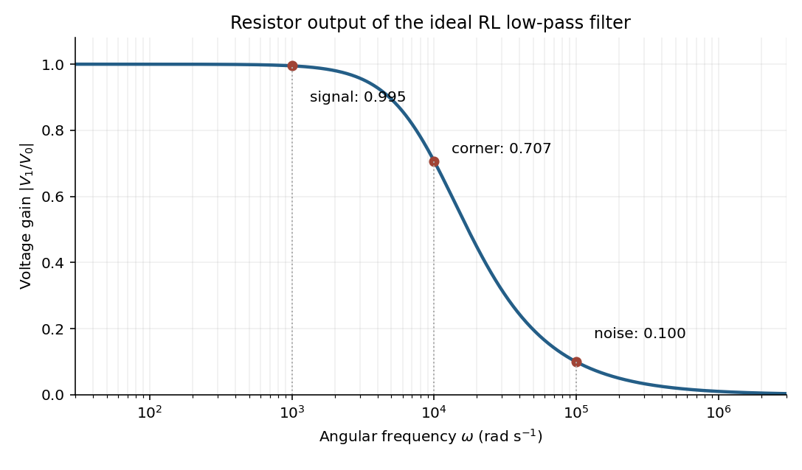

<h1 id="section-a/2/solution">Solution</h1>

↑ **Parent:** [2](../2.md)

The original diagram places the output across the $10\,\Omega$ [resistor](../../../../resistor.md), in series with an ideal $1\,\mathrm{mH}$ [inductor](../../../../inductor.md). Treat the voltages as [phasors](../../../../phasor.md) with time dependence $e^{i\omega t}$. The [electrical impedances](../../../../electrical-impedance.md) are $Z_R=R$ and $Z_L=i\omega L$, so the same [electric current](../../../../electric-current.md) flows through both:

$$
I=\frac{V_0}{R+i\omega L},\qquad
\boxed{H(\omega)=\frac{V_1}{V_0}=\frac{R}{R+i\omega L},\qquad
|H|=\frac{1}{\sqrt{1+(\omega L/R)^2}}.}
$$

This is an [RL low-pass filter](../../../../rl-low-pass-filter.md), with corner [angular frequency](../../../../angular-frequency.md)

$$
\omega_c=\frac RL=\frac{10\,\Omega}{10^{-3}\,\mathrm H}
=10^4\,\mathrm{rad\,s^{-1}}.
$$

The [frequency response](../../../../frequency-response.md) tends to one for $\omega\ll\omega_c$, has magnitude $1/\sqrt2$ at the corner, and tends to $\omega_c/\omega$ for $\omega\gg\omega_c$. The requested sketch uses a logarithmic horizontal axis and a linear voltage-gain axis:

**[Figure 1](#section-a/2/image-voltage-gain-of-the-original-rl-circuit-with-signal-corner-and-noise-frequencies-marked). Voltage gain of the original RL circuit, with signal, corner and noise frequencies marked**.

At the two specified [angular frequencies](../../../../angular-frequency.md),

$$
|H(10^3)|=\frac1{\sqrt{1.01}}=0.995037,\qquad
|H(10^5)|=\frac1{\sqrt{101}}=0.0995037.
$$

The [relative attenuation by a linear filter](../../../../relative-attenuation-by-a-linear-filter.md) is the ratio of these gains:

$$
\boxed{\frac{(V_{\rm noise}/V_{\rm signal})_{\rm out}}
{(V_{\rm noise}/V_{\rm signal})_{\rm in}}
=\frac{|H(10^5)|}{|H(10^3)|}=0.100.}
$$

Thus the noise [amplitude](../../../../wave-amplitude.md) is **attenuated by a factor of 10 relative to the signal**. A squared-voltage ratio would decrease by a factor of $100$; the question's voltage transfer function gives the amplitude comparison.

## ↑ Ancestors (12)

1. [2](../2.md)
2. [Section A](../../section-a.md)
3. [2019](../../../2019-split.md)
4. [Past exam of the physics course of the year 1 of the natural sciences course of the University of Cambridge](../../../split.md)
5. [Physics course of the year 1 of the natural sciences course of the University of Cambridge](../../../../physics-course-of-the-year-1-of-the-natural-sciences-course-of-the-university-of-cambridge.md)
6. [Year 1 of the natural sciences course of the University of Cambridge](../../../../year-1-of-the-natural-sciences-course-of-the-university-of-cambridge.md)
7. [Year of the natural sciences course of the University of Cambridge](../../../../year-of-the-natural-sciences-course-of-the-university-of-cambridge.md)
8. [Natural sciences course of the University of Cambridge](../../../../natural-sciences-course-of-the-university-of-cambridge.md)
9. [Course of the University of Cambridge](../../../../course-of-the-university-of-cambridge.md)
10. [University of Cambridge](../../../../university-of-cambridge-split.md)
11. [List of universities](../../../../list-of-universities.md)
12. [Codex Wiki](../../../../split.md)
