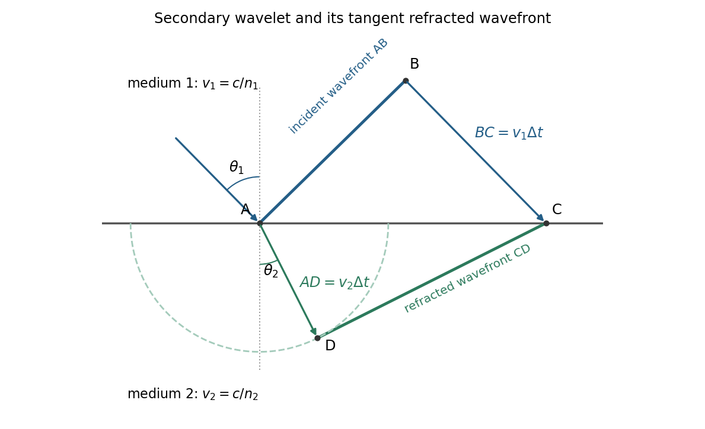

<h1 id="section-a/3/solution">Solution</h1>

↑ **Parent:** [3](../3.md)

The [Huygens-Fresnel principle](../../../../huygens-fresnel-principle.md) constructs a new [wavefront](../../../../wavefront.md) as the envelope of secondary wavelets emitted by points on an earlier [wavefront](../../../../wavefront.md). Let the [phase velocities](../../../../phase-velocity.md) in the two media be $v_1=c/n_1$ and $v_2=c/n_2$, with [refractive indices](../../../../refractive-index.md) evaluated at the light's fixed [frequency](../../../../frequency.md).

**[Figure 2](#section-a/3/image-an-original-secondary-wavelet-construction-of-refraction-at-a-plane-interface). An original secondary-wavelet construction of refraction at a plane interface**.

For [refraction from secondary wavelets](../../../../refraction-from-secondary-wavelets.md), let point $A$ of the incident [wavefront](../../../../wavefront.md) reach the interface first. A second point $B$ reaches the interface at $C$ after time $\Delta t$, so $BC=v_1\Delta t$. During the same interval, the secondary wavelet centered on $A$ advances radius $AD=v_2\Delta t$ into the second medium. The refracted [wavefront](../../../../wavefront.md) $CD$ is tangent to this wavelet, hence $AD\perp CD$; also $BC\perp AB$ because a ray is normal to its [wavefront](../../../../wavefront.md) in these isotropic media.

Let $\theta_1,\theta_2$ be the incident and refracted ray angles from the interface normal. They also equal the corresponding acute angles between the [wavefronts](../../../../wavefront.md) and the interface. The two right triangles have common hypotenuse $AC$, giving

$$
\sin\theta_1=\frac{BC}{AC}=\frac{v_1\Delta t}{AC},\qquad
\sin\theta_2=\frac{AD}{AC}=\frac{v_2\Delta t}{AC}.
$$

Their ratio eliminates both $AC$ and $\Delta t$:

$$
\frac{\sin\theta_1}{\sin\theta_2}=\frac{v_1}{v_2}=\frac{n_2}{n_1},
\qquad
\boxed{n_1\sin\theta_1=n_2\sin\theta_2.}
$$

This is [Snell's law](../../../../snell-s-law.md). In particular, entering a medium of larger [refractive index](../../../../refractive-index.md) reduces the ray's angle to the normal. The construction assumes a stationary interface and homogeneous isotropic media with a propagating refracted wave.

## ↑ Ancestors (12)

1. [3](../3.md)
2. [Section A](../../section-a.md)
3. [2019](../../../2019-split.md)
4. [Past exam of the physics course of the year 1 of the natural sciences course of the University of Cambridge](../../../split.md)
5. [Physics course of the year 1 of the natural sciences course of the University of Cambridge](../../../../physics-course-of-the-year-1-of-the-natural-sciences-course-of-the-university-of-cambridge.md)
6. [Year 1 of the natural sciences course of the University of Cambridge](../../../../year-1-of-the-natural-sciences-course-of-the-university-of-cambridge.md)
7. [Year of the natural sciences course of the University of Cambridge](../../../../year-of-the-natural-sciences-course-of-the-university-of-cambridge.md)
8. [Natural sciences course of the University of Cambridge](../../../../natural-sciences-course-of-the-university-of-cambridge.md)
9. [Course of the University of Cambridge](../../../../course-of-the-university-of-cambridge.md)
10. [University of Cambridge](../../../../university-of-cambridge-split.md)
11. [List of universities](../../../../list-of-universities.md)
12. [Codex Wiki](../../../../split.md)
