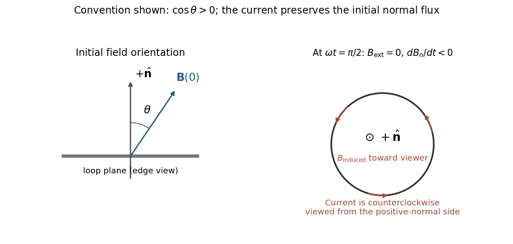

<h1 id="section-a/5/solution">Solution</h1>

↑ **Parent:** [5](../5.md)

Choose a positive unit normal $\hat{\mathbf n}$ to the loop and choose positive circulation by the [right-hand rule](../../../../right-hand-rule.md). Write the applied [magnetic field](../../../../magnetic-field-split.md) as $\mathbf B(t)=B_0\cos(\omega t)\hat{\mathbf b}$, where $\hat{\mathbf b}\cdot\hat{\mathbf n}=\cos\theta$. Because the field is uniform, the external [magnetic flux](../../../../magnetic-flux.md) is

$$
\Phi_B(t)=\int\mathbf B\cdot d\mathbf S
=\pi r^2B_0\cos\theta\cos(\omega t).
$$

[Faraday's law of induction](../../../../faraday-s-law-of-induction.md) gives the induced [electromotive force](../../../../electromotive-force.md), and [Ohm's law](../../../../ohm-s-law.md) gives the current through the loop's [electrical resistance](../../../../electrical-resistance.md):

$$
\mathcal E=-\frac{d\Phi_B}{dt}=\pi r^2B_0\omega\cos\theta\sin(\omega t),
\qquad
\boxed{I(t)=\frac{\pi r^2B_0\omega\cos\theta}{R}\sin(\omega t).}
$$

This is the [induced current in a tilted resistive loop](../../../../induced-current-in-a-tilted-resistive-loop.md) with the self-generated magnetic-flux contribution neglected as requested. The factor has units $\mathrm{Wb\,s^{-1}\,\Omega^{-1}}=\mathrm A$. A field parallel to the loop plane has $\cos\theta=0$ and induces no current in this uniform-field model.

For $\cos\theta>0$, the initial normal flux is positive. At $\omega t=\pi/2$, the external [magnetic field](../../../../magnetic-field-split.md) is instantaneously zero but its normal component is decreasing, so $d\Phi_B/dt<0$ and $I>0$. The current is counterclockwise when viewed from the positive-normal side. Its own [magnetic field](../../../../magnetic-field-split.md) points along $+\hat{\mathbf n}$ through the loop, preserving the initial normal flux in accordance with [Lenz's law](../../../../lenz-s-law.md).

**[Figure 3](#section-a/5/image-initial-oblique-field-and-the-induced-current-a-quarter-cycle-later-for-a-positive-initial-normal-flux). Initial oblique field and the induced current a quarter-cycle later, for a positive initial normal flux**.

For $\cos\theta<0$, both circulation and the induced normal-field direction reverse. The current follows the rate of change of [magnetic flux](../../../../magnetic-flux.md); the quarter-cycle current is nonzero even though the external field itself vanishes then.

## ↑ Ancestors (12)

1. [5](../5.md)
2. [Section A](../../section-a.md)
3. [2019](../../../2019-split.md)
4. [Past exam of the physics course of the year 1 of the natural sciences course of the University of Cambridge](../../../split.md)
5. [Physics course of the year 1 of the natural sciences course of the University of Cambridge](../../../../physics-course-of-the-year-1-of-the-natural-sciences-course-of-the-university-of-cambridge.md)
6. [Year 1 of the natural sciences course of the University of Cambridge](../../../../year-1-of-the-natural-sciences-course-of-the-university-of-cambridge.md)
7. [Year of the natural sciences course of the University of Cambridge](../../../../year-of-the-natural-sciences-course-of-the-university-of-cambridge.md)
8. [Natural sciences course of the University of Cambridge](../../../../natural-sciences-course-of-the-university-of-cambridge.md)
9. [Course of the University of Cambridge](../../../../course-of-the-university-of-cambridge.md)
10. [University of Cambridge](../../../../university-of-cambridge-split.md)
11. [List of universities](../../../../list-of-universities.md)
12. [Codex Wiki](../../../../split.md)
