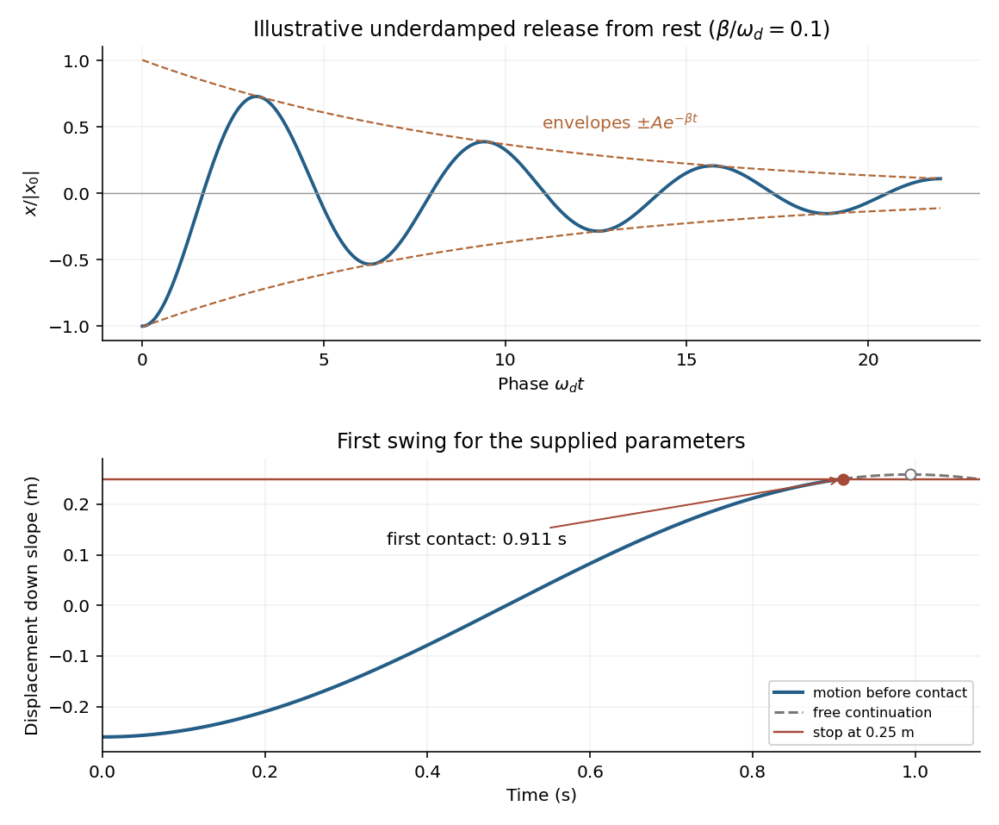

<h1 id="section-b/7/solution">Solution</h1>

↑ **Parent:** [7](../7.md)

**Equilibrium and undamped motion**. Resolve [forces](../../../../force-split.md) along the incline, taking positive displacement down the slope. At [equilibrium](../../../../equilibrium-point-of-a-dynamical-system.md), [Hooke's law](../../../../hooke-s-law.md) balances the downhill component of [weight](../../../../weight-representation-theory.md):

$$
k(l_{\rm eq}-l_0)=mg\sin\theta,
\qquad
\boxed{l_{\rm eq}=l_0+\frac{mg\sin\theta}{k}.}
$$

If $x$ is measured from that equilibrium position, [Newton's second law](../../../../newton-s-second-law.md) becomes

$$
m\ddot x=mg\sin\theta-k(l_{\rm eq}+x-l_0)=-kx.
$$

Thus the motion is a [harmonic oscillator](../../../../simple-harmonic-motion.md) with

$$
\boxed{\omega_0=\sqrt{\frac km}.}
$$

[Gravity](../../../../gravity.md) shifts the equilibrium extension but drops out of this oscillation frequency because the downhill force component is constant.

**Viscous damping**. For a [damped harmonic oscillator](../../../../damped-harmonic-oscillator.md), put $\beta=b/(2m)$. Substitution of $z=Ae^{-pt}$ in the supplied [linear ordinary differential equation](../../../../linear-ordinary-differential-equation-split.md) gives

$$
p^2-\frac bm p+\frac km=0,
\qquad
p=\beta\pm\sqrt{\beta^2-\omega_0^2}.
$$

In the [underdamped](../../../../underdamping.md) regime $\beta<\omega_0$, define $\omega_d=\sqrt{\omega_0^2-\beta^2}$. The two [characteristic roots](../../../../characteristic-root-of-a-constant-coefficient-differential-equation.md) are $p=\beta\pm i\omega_d$, and the general real [displacement](../../../../displacement.md) is

$$
\boxed{x(t)=e^{-\beta t}\left[C\cos(\omega_dt)+D\sin(\omega_dt)\right]
=A_{\rm env}e^{-\beta t}\cos(\omega_dt-\phi).}
$$

Here $C,D$, or equivalently $A_{\rm env}$ and $\phi$, are fixed by the [initial conditions](../../../../initial-condition.md). For release from rest at $x_0$, the condition $\dot x(0)=0$ requires $D=\beta x_0/\omega_d$, not $D=0$:

$$
\boxed{x(t)=x_0e^{-\beta t}
\left[\cos(\omega_dt)+\frac\beta{\omega_d}\sin(\omega_dt)\right].}
$$

The curve oscillates about zero between exponentially shrinking envelopes $\pm A_{\rm env}e^{-\beta t}$, where $A_{\rm env}=|x_0|\sqrt{1+(\beta/\omega_d)^2}$ for this release. The upper panel illustrates that shape; its damping strength is chosen to make the envelope visible.

**[Figure 4](#section-b/7/image-an-underdamped-release-and-the-first-encounter-with-the-stop-for-the-given-parameters). An underdamped release and the first encounter with the stop for the given parameters**.

**Frequency change**. [Viscous damping](../../../../viscous-damping.md) reduces the [angular frequency](../../../../angular-frequency.md) and lengthens the [oscillation period](../../../../period-of-an-oscillation.md):

$$
\boxed{\omega_d=\sqrt{\frac km-\frac{b^2}{4m^2}}<\omega_0,\qquad T_d=\frac{2\pi}{\omega_d}.}
$$

For light [damping](../../../../damping.md), $\omega_d\simeq\omega_0[1-b^2/(8mk)]$, so the frequency shift is second order in $b$, even though the envelope decay rate is first order in $b$.

**Will the block reach the stop?** The given parameters give

$$
\beta=0.00500\,\mathrm s^{-1},\qquad
\omega_0=\sqrt{10}=3.16227766\,\mathrm{rad\,s^{-1}},\qquad
\omega_d=3.16227371\,\mathrm{rad\,s^{-1}}.
$$

For $x_0=-0.260\,\mathrm m$, differentiating the release-from-rest solution gives

$$
\dot x(t)=-\frac{x_0\omega_0^2}{\omega_d}
 e^{-\beta t}\sin(\omega_dt).
$$

It is positive throughout the first half-cycle. The first positive turning point therefore occurs at $t_+=\pi/\omega_d=0.993460\,\mathrm s$. The [turning points of an underdamped release from rest](../../../../turning-points-of-an-underdamped-release-from-rest.md) give its unobstructed height:

$$
x_+=-x_0e^{-\beta\pi/\omega_d}
=0.260e^{-0.00496730}\,\mathrm m=0.258712\,\mathrm m.
$$

Since $x_+>0.250\,\mathrm m$ and the [displacement](../../../../displacement.md) increases continuously up to that point,

$$
\boxed{\text{The block hits the stop on its first downward swing.}}
$$

Solving $x(t)=0.250\,\mathrm m$ gives first contact at approximately $0.91117\,\mathrm s$. The plotted dashed continuation is the hypothetical free motion after that time; the post-impact motion is not determined by the supplied damping model.

## ↑ Ancestors (12)

1. [7](../7.md)
2. [Section B](../../section-b.md)
3. [2019](../../../2019-split.md)
4. [Past exam of the physics course of the year 1 of the natural sciences course of the University of Cambridge](../../../split.md)
5. [Physics course of the year 1 of the natural sciences course of the University of Cambridge](../../../../physics-course-of-the-year-1-of-the-natural-sciences-course-of-the-university-of-cambridge.md)
6. [Year 1 of the natural sciences course of the University of Cambridge](../../../../year-1-of-the-natural-sciences-course-of-the-university-of-cambridge.md)
7. [Year of the natural sciences course of the University of Cambridge](../../../../year-of-the-natural-sciences-course-of-the-university-of-cambridge.md)
8. [Natural sciences course of the University of Cambridge](../../../../natural-sciences-course-of-the-university-of-cambridge.md)
9. [Course of the University of Cambridge](../../../../course-of-the-university-of-cambridge.md)
10. [University of Cambridge](../../../../university-of-cambridge-split.md)
11. [List of universities](../../../../list-of-universities.md)
12. [Codex Wiki](../../../../split.md)
