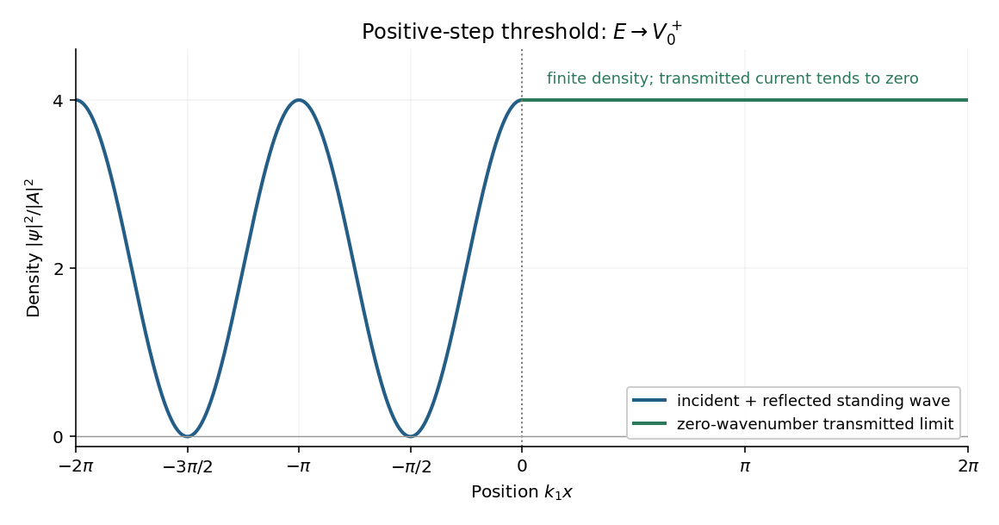

<h1 id="section-b/8/d/solution">Solution</h1>

↑ **Parent:** [D](../d.md)

Take the threshold from the above-step side used in the preceding parts, $E\to V_0^+$. Then $k_2\to0$ while $k_1\to\sqrt{2mV_0}/\hbar$ remains finite. The reflected [probability amplitude](../../../../../probability-amplitude.md) approaches $B=A$, and the transmitted amplitude approaches $C=2A$. At each fixed position, the [potential-step threshold wavefunction](../../../../../potential-step-threshold-wavefunction.md) is therefore

$$
\psi(x)\longrightarrow\begin{cases}
A(e^{ik_1x}+e^{-ik_1x})=2A\cos(k_1x),&x\leq0,\\
2A,&x>0.
\end{cases}
$$

Its [probability density](../../../../../probability-density.md) is

$$
\boxed{|\psi(x)|^2\longrightarrow\begin{cases}
4|A|^2\cos^2(k_1x),&x\leq0,\\
4|A|^2,&x>0.
\end{cases}}
$$

**[Figure 5](#section-b/8/d/image-probability-density-at-the-positive-step-threshold-normalized-to-the-incident-amplitude-squared). Probability density at the positive-step threshold, normalized to the incident amplitude squared**.

The left-hand [standing wave](../../../../../standing-wave.md) has zero-density nodes at $k_1x=-\pi/2,-3\pi/2,\ldots$ and maxima of height $4|A|^2$. Its density period is $\pi/k_1$, half the incident [de Broglie wavelength](../../../../../de-broglie-wavelength.md). At the origin the density is a maximum, continuous with the constant value on the right; its first [derivative](../../../../../derivative.md) is also zero on either side there.

The nonzero right-hand density does not imply transmitted flux: $j_{\rm tr}=\hbar k_2|C|^2/m\to0$, so $R\to1$ and $T\to0$. The exact threshold solution with no incoming component from the right is the limiting constant solution of $\psi''=0$ in the raised region. These stationary scattering states are not normalized over the whole real line; finite-interval density ratios are nevertheless well defined.

## ↑ Ancestors (13)

1. [D](../d.md)
2. [8](../../8.md)
3. [Section B](../../../section-b.md)
4. [2019](../../../../2019-split.md)
5. [Past exam of the physics course of the year 1 of the natural sciences course of the University of Cambridge](../../../../split.md)
6. [Physics course of the year 1 of the natural sciences course of the University of Cambridge](../../../../../physics-course-of-the-year-1-of-the-natural-sciences-course-of-the-university-of-cambridge.md)
7. [Year 1 of the natural sciences course of the University of Cambridge](../../../../../year-1-of-the-natural-sciences-course-of-the-university-of-cambridge.md)
8. [Year of the natural sciences course of the University of Cambridge](../../../../../year-of-the-natural-sciences-course-of-the-university-of-cambridge.md)
9. [Natural sciences course of the University of Cambridge](../../../../../natural-sciences-course-of-the-university-of-cambridge.md)
10. [Course of the University of Cambridge](../../../../../course-of-the-university-of-cambridge.md)
11. [University of Cambridge](../../../../../university-of-cambridge-split.md)
12. [List of universities](../../../../../list-of-universities.md)
13. [Codex Wiki](../../../../../split.md)
