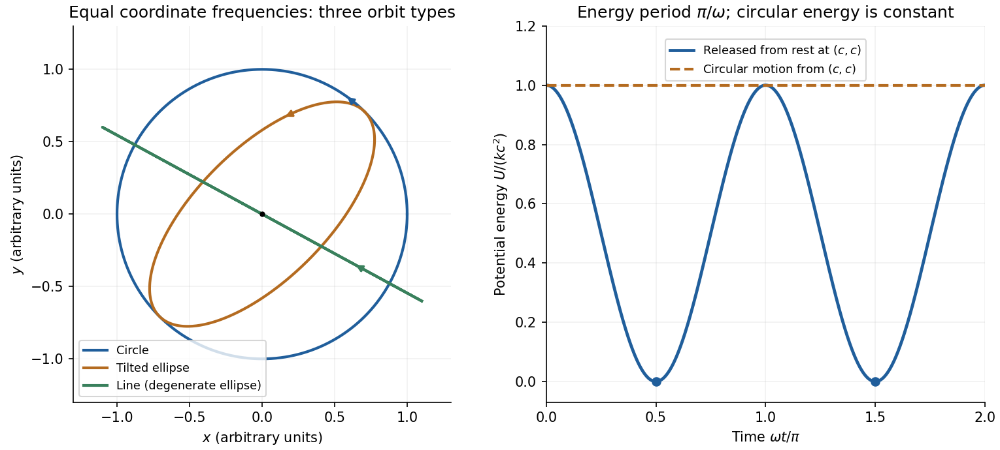

# 2021

↑ **Parent:** [Past exam of the physics course of the year 1 of the natural sciences course of the University of Cambridge](../past-exam-of-the-physics-course-of-the-year-1-of-the-natural-sciences-course-of-the-university-of-cambridge.md)

[Original paper, released PDF pages 42–49](https://www.whatdotheyknow.com/request/natural_science_tripos_physics_e/response/2127325/attach/3/FOI%202022%20639%20Sullivan%20materials.pdf?cookie_passthrough=1#page=42)

The released examiner commentary gives performance observations rather than complete worked solutions. Questions 6 and 7 contain several unlettered tasks.[Examiner commentary for the 2021 IA Physics paper, released PDF pages 50–52](https://www.whatdotheyknow.com/request/natural_science_tripos_physics_e/response/2127325/attach/3/FOI%202022%20639%20Sullivan%20materials.pdf?cookie_passthrough=1#page=50)

**Table of contents**

- [Section A](#section-a)
  - [1](#section-a/1)
    - [Solution](#section-a/1/solution)
  - [2](#section-a/2)
    - [Solution](#section-a/2/solution)
  - [3](#section-a/3)
    - [Solution](#section-a/3/solution)
  - [4](#section-a/4)
    - [Solution](#section-a/4/solution)
  - [5](#section-a/5)
    - [Solution](#section-a/5/solution)
- [Section B](#section-b)
  - [6](#section-b/6)
    - [Solution](#section-b/6/solution)
  - [7](#section-b/7)
    - [Solution](#section-b/7/solution)
  - [8](#section-b/8)
    - [a](#section-b/8/a)
      - [Solution](#section-b/8/a/solution)
    - [b](#section-b/8/b)
      - [Solution](#section-b/8/b/solution)
    - [c](#section-b/8/c)
      - [Solution](#section-b/8/c/solution)
    - [d](#section-b/8/d)
      - [Solution](#section-b/8/d/solution)
    - [e](#section-b/8/e)
      - [Solution](#section-b/8/e/solution)
    - [f](#section-b/8/f)
      - [Solution](#section-b/8/f/solution)
    - [g](#section-b/8/g)
      - [Solution](#section-b/8/g/solution)
  - [9](#section-b/9)
    - [a](#section-b/9/a)
      - [Solution](#section-b/9/a/solution)
    - [b](#section-b/9/b)
      - [Solution](#section-b/9/b/solution)
    - [c](#section-b/9/c)
      - [Solution](#section-b/9/c/solution)
    - [d](#section-b/9/d)
      - [Solution](#section-b/9/d/solution)
  - [10](#section-b/10)
    - [a](#section-b/10/a)
      - [Solution](#section-b/10/a/solution)
    - [b](#section-b/10/b)
      - [Solution](#section-b/10/b/solution)
    - [c](#section-b/10/c)
      - [Solution](#section-b/10/c/solution)
    - [d](#section-b/10/d)
      - [Solution](#section-b/10/d/solution)

## Section A

↑ **Parent:** [2021](2021.md)

<h3 id="section-a/1">1</h3>

↑ **Parent:** [Section A](#section-a)

<h4 id="section-a/1/solution">Solution</h4>

↑ **Parent:** [1](#section-a/1)

For a [simple pendulum](../simple-pendulum.md) in the [small-angle approximation](../geometry-and-topology.md#small-angle-approximation), the [oscillation period](../classical-mechanics.md#period-of-an-oscillation) is $T=2\pi\sqrt{L/g}$, so

$$
g=\frac{4\pi^2L}{T^2}.
$$

Interpret the quoted random timing error and length error as [standard uncertainties](../physics.md#standard-uncertainty), with [independent](../random-variable.md#independent-random-variables) errors and no additional [systematic error](../physics.md#systematic-error). For $N$ [independent](../random-variable.md#independent-random-variables) measurements, the [standard error](../statistical-inference.md#standard-error) of the [sample mean](../variance.md#sample-mean) of the period is $\sigma_{\overline T}/T=0.02/\sqrt N$. The length has relative [standard uncertainty](../physics.md#standard-uncertainty) $\sigma_L/L=0.1/25.0=0.004$. By [propagation of uncertainty](../wave-equation.md#propagation-of-uncertainty),

$$
\left(\frac{\sigma_g}{g}\right)^2=\left(\frac{\sigma_L}{L}\right)^2+4\left(\frac{\sigma_{\overline T}}{T}\right)^2=(0.004)^2+\frac{(0.04)^2}{N}.
$$

Requiring a relative [standard uncertainty](../physics.md#standard-uncertainty) no greater than $0.01$ gives

$$
N\ge\frac{0.04^2}{0.01^2-0.004^2}=19.0476\ldots,\qquad\boxed{N_{\min}=20\text{ measurements}.}
$$

For $N=20$, the combined relative [standard uncertainty](../physics.md#standard-uncertainty) is $0.009798$, or $0.980\%$; $N=19$ gives $1.001\%$ and just fails. Repeating the timing does not reduce the fixed length [measurement uncertainty](../physics.md#measurement-uncertainty). The stated “accuracy” is consequently a statistical uncertainty target, not a guarantee for every experimental outcome. This is an example of [repeated-timing uncertainty in a pendulum gravity measurement](../wave-equation.md#repeated-timing-uncertainty-in-a-pendulum-gravity-measurement).

<h3 id="section-a/2">2</h3>

↑ **Parent:** [Section A](#section-a)

<h4 id="section-a/2/solution">Solution</h4>

↑ **Parent:** [2](#section-a/2)

The original diagram shows two equal balls, each of [mass](../classical-mechanics.md#mass) $m$, attached to the fixed upper pivot and light sliding collar by four equal rods. Each ball describes a horizontal circle of radius $r=L\sin\theta$. The pivot-to-collar distance is $2L\cos\theta$, so the upward collar displacement compresses the [spring](../elasticity-physics.md#spring) by

$$
\delta=2L(1-\cos\theta).
$$

Thus [Hooke's law](../elasticity-physics.md#hooke-s-law) gives a downward spring [force](../force.md) $F_s=k\delta$ on the collar. Let $T_u,T_l$ be the [tensions](../force.md#tension) in the upper and lower rods attached to one ball. Vertical [force](../force.md) balance on the light collar and then on either ball gives

$$
2T_l\cos\theta=F_s,\qquad T_u\cos\theta-T_l\cos\theta=mg.
$$

The radial [force](../force.md) on one ball supplies its [centripetal acceleration](../classical-mechanics.md#centripetal-acceleration):

$$
(T_u+T_l)\sin\theta=m\omega^2L\sin\theta.
$$

For $\theta\ne0$, adding the vertical-balance results and eliminating the rod [tensions](../force.md#tension) gives

$$
\boxed{\omega^2=\frac{mg+F_s}{mL\cos\theta}=\frac{g}{L\cos\theta}+\frac{2k}{m}\frac{1-\cos\theta}{\cos\theta}.}
$$

For the given [centrifugal governor](../mathematical-physics.md#centrifugal-governor), $\cos30^\circ=\sqrt3/2$ and

$$
\delta=0.0535898\,\mathrm m,\qquad F_s=26.7949\,\mathrm N,\qquad \omega^2=133.988\,\mathrm{s^{-2}}.
$$

Hence

$$
\boxed{\omega=11.58\,\mathrm{rad\,s^{-1}}\simeq110.5\text{ revolutions per minute}.}
$$

The factor of two in the collar balance matters: both lower rods support the same light collar. The spring force is not an extra downward force of this full magnitude on each ball; its effect on each ball is transmitted through its own lower rod. The formula is the steady [spring-loaded centrifugal governor](../mathematical-physics.md#spring-loaded-centrifugal-governor) balance.

<h3 id="section-a/3">3</h3>

↑ **Parent:** [Section A](#section-a)

<h4 id="section-a/3/solution">Solution</h4>

↑ **Parent:** [3](#section-a/3)

Let the [cylinder](../geometry-and-topology.md#cylinder-geometry) length be $\ell=0.020\,\mathrm m$, cross-sectional [area](../differential-geometry.md#surface-area) $A$, and the fluid [mass density](../fluid-mechanics.md#density) $\rho_f$. At [floating equilibrium](../fluid-mechanics.md#floating-equilibrium), [Archimedes' principle](../fluid-mechanics.md#archimedes-principle) gives

$$
mg=\rho_f gA\frac\ell2,\qquad m=\rho_f A\frac\ell2.
$$

For a small downward displacement $z$ from this [equilibrium](../dynamical-systems.md#equilibrium-point-of-a-dynamical-system), the displaced fluid [volume](../geometry-and-topology.md#volume) increases by $Az$. The additional upward [buoyant force](../fluid-mechanics.md#buoyancy) is $\rho_fgAz$, and [Newton's second law](../force.md#newton-s-second-law) becomes

$$
m\ddot z=-\rho_fgAz,\qquad\ddot z+\frac{2g}{\ell}z=0.
$$

This is [simple harmonic motion](../classical-mechanics.md#simple-harmonic-motion), with [angular frequency](../lagrangian-mechanics.md#angular-frequency) $\omega=\sqrt{2g/\ell}$ and [oscillation period](../classical-mechanics.md#period-of-an-oscillation)

$$
\boxed{T=2\pi\sqrt{\frac\ell{2g}}=2\pi\sqrt{\frac{0.020\,\mathrm m}{2(9.81\,\mathrm{m\,s^{-2}})}}=0.2006\,\mathrm s\simeq0.20\,\mathrm s.}
$$

The result for [vertical oscillations of a floating cylinder](../fluid-mechanics.md#vertical-oscillations-of-a-floating-cylinder) is independent of its cross-sectional [area](../differential-geometry.md#surface-area) and fluid [mass density](../fluid-mechanics.md#density) because those quantities cancel using the known immersion fraction. It neglects [drag](../fluid-mechanics.md#drag-physics), surface effects and the extra fluid inertia from the motion; the [cylinder](../geometry-and-topology.md#cylinder-geometry) must remain partly immersed throughout the small motion.

<h3 id="section-a/4">4</h3>

↑ **Parent:** [Section A](#section-a)

<h4 id="section-a/4/solution">Solution</h4>

↑ **Parent:** [4](#section-a/4)

For a [diffraction grating](../physical-optics.md#diffraction-grating) with $N$ illuminated lines in order $p$, its ideal [spectral resolving power](../optical-instrument.md#spectral-resolving-power) is

$$
\mathcal R=\frac\lambda{\Delta\lambda}=pN.
$$

The two [spectral lines](../stellar-astrophysics.md#spectral-line) have separation $\Delta\lambda=3.4\,\mathrm{nm}$ and mean [wavelength](../wave-equation.md#wavelength) $\overline\lambda=395.1\,\mathrm{nm}$. In first order, $p=1$, so the [Rayleigh criterion](../point-spread-function.md#rayleigh-criterion) requires

$$
N\gtrsim\frac{395.1}{3.4}=116.2.
$$

With line density $500\,\mathrm{mm^{-1}}$, the ideal continuous estimate for the illuminated width is

$$
W\simeq\frac{116.2}{500\,\mathrm{mm^{-1}}}=\boxed{0.2324\,\mathrm{mm}\simeq0.23\,\mathrm{mm}.}
$$

Rounding the required number of illuminated grating lines upward gives **$117$ lines**, conventionally an illuminated width $W\simeq117/(500\,\mathrm{mm^{-1}})=\boxed{0.234\,\mathrm{mm}}$. Using the longer [wavelength](../wave-equation.md#wavelength) rather than the mean also gives the same integer requirement. This is the ideal limit set by the [resolving power of a diffraction grating](../physical-optics.md#resolving-power-of-a-diffraction-grating); additional broadening from the illumination or observing apparatus could require a larger width.

<h3 id="section-a/5">5</h3>

↑ **Parent:** [Section A](#section-a)

<h4 id="section-a/5/solution">Solution</h4>

↑ **Parent:** [5](#section-a/5)

The tunnel is taken thin enough that removal of its material does not significantly disturb spherical [symmetry](../physics.md#symmetry-physics). For $a\le r\le2a$, the enclosed [mass](../classical-mechanics.md#mass) is

$$
M(r)=\frac{4\pi\rho}{3}(r^3-a^3).
$$

By the [spherical shell theorem](../mathematical-physics.md#spherical-shell-theorem), the inward [gravitational acceleration](../newton-s-law-of-universal-gravitation.md#gravitational-acceleration) has magnitude

$$
g(r)=\frac{GM(r)}{r^2}=\frac{4\pi G\rho}{3}\left(r-\frac{a^3}{r^2}\right).
$$

The released [gravitational potential energy](../energy.md#gravitational-energy) is the positive [work](../energy.md#work) done by gravity while the [mass](../classical-mechanics.md#mass) falls from radius $2a$ to $a$:

$$
\begin{aligned}
U_A-U_B&=m\int_a^{2a}g(r)\,dr\\
&=\frac{4\pi G\rho m}{3}\left[\frac{r^2}{2}+\frac{a^3}{r}\right]_a^{2a}\\
&=\boxed{\frac{4\pi G\rho ma^2}{3}.}
\end{aligned}
$$

By [conservation of mechanical energy](../energy.md#conservation-of-mechanical-energy),

$$
\frac12mv_B^2=U_A-U_B,\qquad\boxed{v_B=a\sqrt{\frac{8\pi G\rho}{3}}.}
$$

Inside the cavity, the [spherical shell theorem](../mathematical-physics.md#spherical-shell-theorem) gives zero [gravitational field](../physics.md#gravitational-field), so the [velocity](../classical-mechanics.md#velocity) stays constant. The original figure places B and C at opposite ends of a cavity diameter, a distance $2a$ apart. Therefore

$$
\boxed{t_{BC}=\frac{2a}{v_B}=\sqrt{\frac3{2\pi G\rho}}.}
$$

The quantity $G\rho$ has units $\mathrm{s^{-2}}$, so this is a [time](../classical-mechanics.md#time-in-physics). There are no numerical values for $a$ or $\rho$ in the paper. The transit [time](../classical-mechanics.md#time-in-physics) is independent of $a$ and the falling [mass](../classical-mechanics.md#mass) $m$. The cavity's [gravitational potential](../newton-s-law-of-universal-gravitation.md#newtonian-potential-of-a-point-mass) is constant, not necessarily zero; only its [gradient](../multivariable-calculus.md#gradient) vanishes. The calculation is a [hollow-sphere gravitational transit](../mathematical-physics.md#hollow-sphere-gravitational-transit).

## Section B

↑ **Parent:** [2021](2021.md)

<h3 id="section-b/6">6</h3>

↑ **Parent:** [Section B](#section-b)

<h4 id="section-b/6/solution">Solution</h4>

↑ **Parent:** [6](#section-b/6)

**Translation and rotation.** For particles constituting a [rigid body](../rigid-body-dynamics.md), the total [linear momentum](../momentum.md) is

$$
\mathbf P=\sum_i m_i\mathbf v_i=M\mathbf V_{\rm CM},\qquad\frac{d\mathbf P}{dt}=\sum_i\mathbf F_{i,\rm ext}.
$$

Thus the total external [force](../force.md) governs the motion of the [centre of mass](../classical-mechanics.md#center-of-mass). About that [centre of mass](../classical-mechanics.md#center-of-mass), the [angular momentum](../momentum.md#angular-momentum) and applied [torque](../momentum.md#torque) are

$$
\mathbf L_{\rm CM}=\sum_i\mathbf r_i'\times m_i\mathbf v_i',\qquad\mathbf G_{\rm CM}=\sum_i\mathbf r_i'\times\mathbf F_{i,\rm ext},\qquad\frac{d\mathbf L_{\rm CM}}{dt}=\mathbf G_{\rm CM},
$$

where primes denote relative positions and [velocities](../classical-mechanics.md#velocity). The [derivative](../calculus.md#derivative) of the vector is taken relative to nonrotating axes. The [inertia tensor](../rigid-body-dynamics.md#inertia-tensor) relates [angular momentum](../momentum.md#angular-momentum) to [angular velocity](../rigid-body-dynamics.md#angular-velocity), $\mathbf L_{\rm CM}=\mathsf I\boldsymbol\omega$. For rotation about a fixed unit direction $\mathbf n$, the [moment of inertia](../rigid-body-dynamics.md#moment-of-inertia) is $I_{\mathbf n}=\int r_\perp^2\,dm=\mathbf n\cdot\mathsf I\mathbf n$; it measures the resistance to changing that rotation and gives rotational [kinetic energy](../energy.md#kinetic-energy) $I_{\mathbf n}\omega^2/2$. The simpler vector relation $\mathbf L=I\boldsymbol\omega$ applies when the rotation axis is a [principal axis](../rigid-body-dynamics.md#principal-axis), not for every orientation of an arbitrary [rigid body](../rigid-body-dynamics.md). These translational and rotational balances must be applied together; a nonzero [torque](../momentum.md#torque) does not replace the net-[force](../force.md) equation.

**Gyroscope precession.** A rapidly spinning [gyroscope](../momentum.md#gyroscope) has a large [angular momentum](../momentum.md#angular-momentum) approximately along its spin axis. The [torque](../momentum.md#torque) component parallel to this vector changes its magnitude, while the perpendicular component turns its direction. If the vector undergoes [precession](../rigid-body-dynamics.md#precession) with [angular velocity](../rigid-body-dynamics.md#angular-velocity) $\boldsymbol\Omega$, then over $dt$ its change is the infinitesimal rotation $d\mathbf L=(\boldsymbol\Omega\,dt)\times\mathbf L$. Hence

$$
\boxed{\mathbf G=\frac{d\mathbf L}{dt}=\boldsymbol\Omega\times\mathbf L.}
$$

This describes direction-changing [precession](../rigid-body-dynamics.md#precession) at constant $|\mathbf L|$; any spin-up contribution must be added separately. For perpendicular [torque](../momentum.md#torque) and [angular momentum](../momentum.md#angular-momentum), the precessional component perpendicular to $\mathbf L$ is $\boldsymbol\Omega_\perp=\mathbf L\times\mathbf G/L^2$. The familiar tendency of a supported [gyroscope](../momentum.md#gyroscope) to turn sideways is this vector balance, not the absence of gravitational [force](../force.md).

**Wheel-lift threshold without the flywheel.** Let $h=0.50\,\mathrm m$ be the [centre of mass](../classical-mechanics.md#center-of-mass) height, $a=1.0\,\mathrm m$ half the wheel separation, and $R_b=10\,\mathrm m$ the bend radius. The required inward [force](../force.md) is $F=Mv^2/R_b$, provided by [static friction](../force.md#static-friction). Let $N_o,N_i$ be the summed outer and inner wheel [normal forces](../force.md#normal-force). Vertical balance gives $N_o+N_i=Mg$. Moment balance about the [centre of mass](../classical-mechanics.md#center-of-mass) gives

$$
a(N_o-N_i)=h\frac{Mv^2}{R_b},\qquad N_i=\frac M2\left(g-\frac{hv^2}{aR_b}\right).
$$

The inner wheels lift when $N_i=0$. Thus the [vehicle rollover threshold](../rigid-body-dynamics.md#vehicle-rollover-threshold) is

$$
\boxed{v_{\max}=\sqrt{\frac{gaR_b}{h}}=14.01\,\mathrm{m\,s^{-1}}=50.4\,\mathrm{km\,h^{-1}}.}
$$

The stated [mass](../classical-mechanics.md#mass) cancels. This assumes the rigid geometry and sufficient [static friction](../force.md#static-friction) specified in the paper; the threshold is set by loss of contact, not by sliding.

**Engine flywheel.** The [moment of inertia of a uniform disc](../rigid-body-dynamics.md#moment-of-inertia-of-a-uniform-disc) gives

$$
I_f=\frac12M_fr_f^2=\frac12(50)(0.4)^2=4.00\,\mathrm{kg\,m^2}.
$$

Its spin [angular speed](../rigid-body-dynamics.md#angular-speed), spin [angular momentum](../momentum.md#angular-momentum), and turn [angular speed](../rigid-body-dynamics.md#angular-speed) at $40\,\mathrm{km\,h^{-1}}$ are

$$
\omega_f=4000\frac{2\pi}{60}=418.88\,\mathrm{rad\,s^{-1}},\quad L_f=I_f\omega_f=1675.52\,\mathrm{kg\,m^2\,s^{-1}},\quad\Omega=\frac{40/3.6}{10}=1.1111\,\mathrm{rad\,s^{-1}}.
$$

The transverse flywheel axis is perpendicular to the vertical turn axis, so

$$
\boxed{G=\Omega L_f=1.862\times10^3\,\mathrm{N\,m}.}
$$

To specify its direction, use right-handed axes $+x$ forward, $+y$ to the car's left, and $+z$ upward, and consider a left turn. Then $\boldsymbol\Omega=+\Omega\widehat{\mathbf z}$. Choose the flywheel [angular momentum](../momentum.md#angular-momentum) to the car's right, $\mathbf L_f=-L_f\widehat{\mathbf y}$. The car must apply

$$
\mathbf G_{\rm on\ flywheel}=+\Omega L_f\widehat{\mathbf x},\qquad\boxed{\mathbf G_{\rm on\ car}=-\Omega L_f\widehat{\mathbf x}}
$$

to obtain the required [precession](../rigid-body-dynamics.md#precession). This [gyroscopic roll torque in a turning vehicle](../momentum.md#gyroscopic-roll-torque-in-a-turning-vehicle) opposes the outward roll tendency in a left turn. By the [right-hand rule](../electromagnetism.md#right-hand-rule), the flywheel must turn **counterclockwise viewed from the car's right side toward its centre**, opposite to the rotation of wheels rolling forward. Reversing flywheel spin would aggravate the outward roll. Reversing the turn reverses both roll and gyroscopic [torques](../momentum.md#torque), so the same flywheel spin remains helpful.

**[Figure 1](#section-b/6/image-gyroscope-vector-directions-for-a-left-turning-car-and-the-flywheel-spin-needed-to-oppose-outward-roll). Gyroscope vector directions for a left-turning car and the flywheel spin needed to oppose outward roll**.

For comparison, the outward inertial roll moment at the stated [speed](../classical-mechanics.md#speed) is $Mhv^2/R_b=6173\,\mathrm{N\,m}$, and the limiting gravitational restoring moment is $Mga=9810\,\mathrm{N\,m}$. The gyroscopic reaction is about $30\%$ of the former and $19\%$ of the latter, so it is appreciable for this large flywheel. If this ideal model is extended to include the favorable gyroscopic reaction in the wheel-lift condition, it gives $Mhv^2/R_b-L_fv/R_b=Mga$, or about $56.8\,\mathrm{km\,h^{-1}}$ rather than $50.4\,\mathrm{km\,h^{-1}}$. This quantifies a useful but finite increase in the rollover threshold.

<h3 id="section-b/7">7</h3>

↑ **Parent:** [Section B](#section-b)

<h4 id="section-b/7/solution">Solution</h4>

↑ **Parent:** [7](#section-b/7)

**Frame definitions and relativistic effects.** Let $S$ be the [inertial frame](../mathematical-physics.md#inertial-frame) of Earth and the stationary asteroid, with $+x$ pointing toward the asteroid. Bob's [inertial frame](../mathematical-physics.md#inertial-frame) $S'$ moves at $+v$ relative to $S$. For two events at Bob's fixed position, $\Delta x'=0$, the inverse [Lorentz transformation](../special-relativity.md#lorentz-transformation) gives

$$
\Delta t=\gamma\Delta t',\qquad\gamma=(1-v^2/c^2)^{-1/2}.
$$

The elapsed [proper time](../special-relativity.md#proper-time) on Bob's clock is $\Delta\tau=\Delta t'$, so [time dilation](../special-relativity.md#time-dilation) means $\Delta t=\gamma\Delta\tau$: the separation of his clock ticks is larger in Earth coordinates. For a rod at rest in $S'$ with [proper length](../special-relativity.md#proper-length) $L_0$, a length measurement in $S$ uses simultaneous endpoints, $\Delta t=0$. The direct spatial [Lorentz transformation](../special-relativity.md#lorentz-transformation) gives $L_0=\Delta x'=\gamma\Delta x$, hence [length contraction](../special-relativity.md#length-contraction):

$$
\boxed{L=L_0/\gamma.}
$$

The simultaneity condition is essential: the endpoint events used to measure length are different from the two clock-tick events used to demonstrate [time dilation](../special-relativity.md#time-dilation).

**Bob's speed.** Food consumption measures Bob's own [proper time](../special-relativity.md#proper-time), $\tau_B=4\text{ months}=1/3\,\mathrm{yr}$. The Earth-frame distance is $D=1/4\,\mathrm{ly}$ and the Earth travel [time](../classical-mechanics.md#time-in-physics) is $D/v$. Consequently

$$
\tau_B=\frac{D}{\gamma v},\qquad\gamma\frac vc=\frac{D}{c\tau_B}=\frac34.
$$

Putting $\beta=v/c$, $\beta^2/(1-\beta^2)=9/16$, so

$$
\boxed{v=\frac35c=0.600c,\qquad\gamma=\frac54.}
$$

The Earth travel [time](../classical-mechanics.md#time-in-physics) is $5/12\,\mathrm{yr}=5$ months. Equivalently Bob measures the contracted Earth-asteroid separation $D/\gamma=0.20\,\mathrm{ly}$ and sees the asteroid approach at $0.60c$, taking $1/3\,\mathrm{yr}$ to reach him.

**Events A and B.** Set both coordinate origins at Event A. Alice reaches the asteroid at Event B, travelling at $u=2c/3$ in $S$, so

$$
\boxed{\Delta x=\frac14\,\mathrm{ly},\qquad\Delta t=\frac{D}{u}=\frac38\,\mathrm{yr}=4.5\text{ months}.}
$$

The [Lorentz transformations](../special-relativity.md#lorentz-transformation) into Bob's frame give

$$
\begin{aligned}
\Delta t'&=\frac54\left(\frac38-\frac35\frac14\right)\mathrm{yr}=\boxed{\frac9{32}\,\mathrm{yr}=3.375\text{ months}},\\
\Delta x'&=\frac54\left(\frac14-\frac35\frac38\right)\mathrm{ly}=\boxed{\frac1{32}\,\mathrm{ly}=0.03125\,\mathrm{ly}}.
\end{aligned}
$$

Here $c(1\,\mathrm{yr})=1\,\mathrm{ly}$ has been used consistently. With the time-positive sign convention, the [Minkowski interval](../special-relativity.md#minkowski-interval) is

$$
\begin{aligned}
\Delta s^2&=c^2\Delta t^2-\Delta x^2=\left(\frac9{64}-\frac4{64}\right)\mathrm{ly^2}=\boxed{\frac5{64}\,\mathrm{ly^2}},\\
\Delta s'^2&=c^2\Delta t'^2-\Delta x'^2=\left(\frac{81}{1024}-\frac1{1024}\right)\mathrm{ly^2}=\boxed{\frac5{64}\,\mathrm{ly^2}}.
\end{aligned}
$$

Thus the [Minkowski interval](../special-relativity.md#minkowski-interval) is invariant. It is timelike, as expected for two events on Alice's subluminal [worldline](../special-relativity.md#world-line). Using the opposite metric sign convention would change both signs together, without changing invariance.

**Relative velocity and spacetime diagram.** Divide the differential spatial and temporal [Lorentz transformations](../special-relativity.md#lorentz-transformation) for the same trajectory:

$$
u_x'=\frac{dx'}{dt'}=\frac{\gamma(dx-v\,dt)}{\gamma(dt-v\,dx/c^2)}=\boxed{\frac{u_x-v}{1-vu_x/c^2}}.
$$

For Alice,

$$
\boxed{u'_{\rm Alice}=\frac{(2/3-3/5)c}{1-(2/3)(3/5)}=\frac19c.}
$$

The [spacetime diagram](../mathematical-physics.md#spacetime-diagram) uses horizontal $x'$ and vertical $ct'$. In these coordinates Bob's [worldline](../special-relativity.md#world-line) is $x'=0$, Alice's is $x'=ct'/9$, and the asteroid's is

$$
x'_{\rm asteroid}=\frac D\gamma-vt'=\frac15\,\mathrm{ly}-\frac35ct'.
$$

Thus Alice has slope $d(ct')/dx'=9$, while the asteroid has slope $-5/3$. Their intersection is exactly B, $(x',ct')=(1/32,9/32)\,\mathrm{ly}$. The asteroid later reaches Bob at $(0,1/3)\,\mathrm{ly}$. These intercepts and gradients show the [relativistic velocity addition](../special-relativity.md#velocity-addition-formula) geometrically.

**[Figure 2](#section-b/7/image-spacetime-diagram-in-bob-s-inertial-frame-with-alice-s-velocity-asteroid-motion-and-the-a-to-b-coordinate-differences). Spacetime diagram in Bob's inertial frame, with Alice's velocity, asteroid motion and the A-to-B coordinate differences**.

<h3 id="section-b/8">8</h3>

↑ **Parent:** [Section B](#section-b)

<h4 id="section-b/8/a">a</h4>

↑ **Parent:** [8](#section-b/8)

<h5 id="section-b/8/a/solution">Solution</h5>

↑ **Parent:** [A](#section-b/8/a)

The [force](../force.md) law separates into two identical [harmonic oscillator equations](../classical-mechanics.md#simple-harmonic-motion):

$$
m\ddot x=-kx,\qquad m\ddot y=-ky.
$$

For positive $m,k$, the general real solution is

$$
\boxed{x(t)=x_0\cos(\omega t+\phi_1),\qquad y(t)=y_0\cos(\omega t+\phi_2),\qquad\omega=\sqrt{k/m}.}
$$

Since $\operatorname{Re}(e^{i\alpha})=\cos\alpha$ by [Euler's formula](../complex-analysis.md#euler-s-formula), these are exactly the stated [real parts](../complex-analysis.md#real-part) of [complex exponentials](../calculus.md#complex-exponential-function). The [amplitudes](../wave.md#wave-amplitude) $x_0,y_0$ and [phases](../wave.md#phase-waves) $\phi_1,\phi_2$ are fixed by the four initial position and [velocity](../classical-mechanics.md#velocity) components. This is two-dimensional [isotropic harmonic oscillator flow](../hamiltonian-mechanics.md#isotropic-harmonic-oscillator-flow): the same [angular frequency](../lagrangian-mechanics.md#angular-frequency) acts in every direction.

<h4 id="section-b/8/b">b</h4>

↑ **Parent:** [8](#section-b/8)

<h5 id="section-b/8/b/solution">Solution</h5>

↑ **Parent:** [B](#section-b/8/b)

Put $\delta=\phi_2-\phi_1$. If both coordinate [amplitudes](../wave.md#wave-amplitude) are nonzero, eliminate the common [phase](../wave.md#phase-waves) to obtain

$$
\boxed{\left(\frac{x}{x_0}\right)^2+\left(\frac{y}{y_0}\right)^2-2\frac{xy}{x_0y_0}\cos\delta=\sin^2\delta.}
$$

For $\sin\delta\ne0$, this is an [ellipse](../euclidean-geometry.md#ellipse) centred at the origin. The following special cases exhaust the possible nontrivial shapes:

- $\delta=0$ or $\pi$ gives straight-line [simple harmonic motion](../classical-mechanics.md#simple-harmonic-motion), including an axis-aligned line if one coordinate [amplitude](../wave.md#wave-amplitude) vanishes.
- $\delta=\pm\pi/2$ gives an axis-aligned [ellipse](../euclidean-geometry.md#ellipse); if additionally $x_0=y_0$, it is a [circle](../topology.md#circle) traversed in one of the two orientations.
- Other [phase differences](../wave.md#phase-difference) give tilted [ellipses](../euclidean-geometry.md#ellipse).

The degenerate zero-[amplitude](../wave.md#wave-amplitude) solution is the stationary origin. There are no general multi-loop patterns here because the two [angular frequencies](../lagrangian-mechanics.md#angular-frequency) are equal. Another useful description is $\mathbf r=\mathbf a\cos\omega t+\mathbf b\sin\omega t$, the image of a [circle](../topology.md#circle) under a [linear map](../vector-space.md#linear-map).

**[Figure 3](#section-b/8/b/image-undamped-planar-harmonic-oscillator-trajectories-and-potential-energy-for-the-two-specified-initial-conditions). Undamped planar harmonic oscillator trajectories and potential energy for the two specified initial conditions**.

<h4 id="section-b/8/c">c</h4>

↑ **Parent:** [8](#section-b/8)

<h5 id="section-b/8/c/solution">Solution</h5>

↑ **Parent:** [C](#section-b/8/c)

The [force](../force.md) is conservative, with $\mathbf F=-\nabla U$ and [potential energy](../energy.md#potential-energy) zero at the origin:

$$
\boxed{U(t)=\frac k2[x(t)^2+y(t)^2]=\frac k2\left[x_0^2\cos^2(\omega t+\phi_1)+y_0^2\cos^2(\omega t+\phi_2)\right].}
$$

Released from rest at $(c,c)$, the trajectory has $x=y=c\cos\omega t$, giving

$$
\boxed{U(t)=kc^2\cos^2\omega t=\frac{kc^2}{2}(1+\cos2\omega t).}
$$

The right panel of the figure shows this nonnegative [oscillation](../wave.md#oscillation): it starts at a maximum $kc^2$, reaches zero at $t=\pi/(2\omega)$, and repeats after $\pi/\omega$. Its [frequency](../wave.md#frequency) is twice the coordinate [frequency](../wave.md#frequency). [Conservation of mechanical energy](../energy.md#conservation-of-mechanical-energy) gives $K(t)=kc^2\sin^2\omega t$, so the missing [potential energy](../energy.md#potential-energy) is [kinetic energy](../energy.md#kinetic-energy), not an energy loss.

<h4 id="section-b/8/d">d</h4>

↑ **Parent:** [8](#section-b/8)

<h5 id="section-b/8/d/solution">Solution</h5>

↑ **Parent:** [D](#section-b/8/d)

The starting radius is $r_0=\sqrt2\,c$. In uniform [circular motion](../classical-mechanics.md#circular-motion), the required [centripetal acceleration](../classical-mechanics.md#centripetal-acceleration) has magnitude $\omega^2r_0=kr_0/m$. The initial [velocity](../classical-mechanics.md#velocity) must be tangent to the starting radius, with the orientation chosen anticlockwise:

$$
\boxed{\mathbf v(0)=\omega\widehat{\mathbf z}\times(c,c,0)=(-\omega c,\omega c).}
$$

The resulting trajectory is

$$
x=c(\cos\omega t-\sin\omega t),\qquad y=c(\cos\omega t+\sin\omega t).
$$

It has constant $x^2+y^2=2c^2$, so

$$
\boxed{U(t)=kc^2\quad\text{for all }t.}
$$

This is the horizontal line in the right panel of the figure. The [kinetic energy](../energy.md#kinetic-energy) also equals $kc^2$, giving total [mechanical energy](../energy.md#mechanical-energy) $2kc^2$, twice that for release from rest at the same point.

<h4 id="section-b/8/e">e</h4>

↑ **Parent:** [8](#section-b/8)

<h5 id="section-b/8/e/solution">Solution</h5>

↑ **Parent:** [E](#section-b/8/e)

Write $\gamma=b/(2m)$ and $\nu=\sqrt{\omega^2-\gamma^2}$, where $\omega=\sqrt{k/m}$ is the undamped [angular frequency](../lagrangian-mechanics.md#angular-frequency). The [linear drag](../fluid-mechanics.md#linear-drag) gives the vector [damped harmonic oscillator](../analysis.md#damped-harmonic-oscillator) equation

$$
\ddot{\mathbf r}+2\gamma\dot{\mathbf r}+\omega^2\mathbf r=0.
$$

For the original circular [initial conditions](../differential-equation.md#initial-condition), $\mathbf r_0=(c,c)$ and $\mathbf v_0=\omega(-c,c)$, the exact [underdamped](../wave-equation.md#underdamping) solution is

$$
\mathbf r(t)=e^{-\gamma t}\left[\mathbf r_0\cos\nu t+\frac{\mathbf v_0+\gamma\mathbf r_0}{\nu}\sin\nu t\right].
$$

Using $|\mathbf r_0|^2=2c^2$, $|\mathbf v_0|^2=2\omega^2c^2$ and $\mathbf r_0\cdot\mathbf v_0=0$ gives

$$
\boxed{U(t)=kc^2e^{-2\gamma t}\left[1+\frac\gamma\nu\sin2\nu t+\frac{2\gamma^2}{\nu^2}\sin^2\nu t\right].}
$$

This exact [potential energy](../energy.md#potential-energy) is useful because it satisfies the prescribed [initial conditions](../differential-equation.md#initial-condition), including $\dot U(0)=k\mathbf r_0\cdot\mathbf v_0=0$. In the stated weak-[damping](../wave-equation.md#damping) limit $\gamma\ll\omega$, $\nu\simeq\omega$ and the square bracket differs from one by a small oscillatory term. The leading approximation is therefore

$$
\boxed{U(t)\simeq kc^2e^{-bt/m}.}
$$

The radius is approximately $\sqrt2\,c\,e^{-bt/(2m)}$, so the trajectory is approximately a shrinking [logarithmic spiral](../topology.md#logarithmic-spiral). The exactly exponential result would require slightly adjusted initial [velocity](../classical-mechanics.md#velocity); with the specified undamped circular [velocity](../classical-mechanics.md#velocity), the small modulation above is real. This is the [initially circular damped planar oscillator](../analysis.md#initially-circular-damped-planar-oscillator).

<h4 id="section-b/8/f">f</h4>

↑ **Parent:** [8](#section-b/8)

<h5 id="section-b/8/f/solution">Solution</h5>

↑ **Parent:** [F](#section-b/8/f)

The parameters give

$$
\omega=\sqrt{3.95/0.10}=6.28490\,\mathrm{rad\,s^{-1}},\qquad\gamma=\frac{0.05}{2(0.10)}=0.2500\,\mathrm{s^{-1}},\qquad\nu=6.27993\,\mathrm{rad\,s^{-1}}.
$$

The coordinate expressions for the [initially circular damped planar oscillator](../analysis.md#initially-circular-damped-planar-oscillator) are

$$
\boxed{\begin{aligned}
\frac{x(t)}c&=e^{-\gamma t}\left[\cos\nu t+\frac{\gamma-\omega}{\nu}\sin\nu t\right],\\
\frac{y(t)}c&=e^{-\gamma t}\left[\cos\nu t+\frac{\gamma+\omega}{\nu}\sin\nu t\right].
\end{aligned}}
$$

The damped [oscillation period](../classical-mechanics.md#period-of-an-oscillation) $2\pi/\nu=1.00052\,\mathrm s$ gives almost four anticlockwise turns in four seconds. The radius envelope falls by $e^{-\gamma(4\,\mathrm s)}=e^{-1}=0.3679$. Substitution into the exact coordinates gives

$$
\boxed{(x(4\,\mathrm s),y(4\,\mathrm s))=(0.37245c,0.36286c),\qquad r(4\,\mathrm s)/r_0=0.36769.}
$$

The left panel annotates the initial tangent, time marks and endpoint. Because $c$ is an unspecified starting coordinate, the axes are normalized by $c$ rather than assigned numerical lengths.

**[Figure 4](#section-b/8/f/image-exact-underdamped-trajectory-over-four-seconds-and-a-representative-overdamped-trajectory-for-the-same-initial-circular-velocity). Exact underdamped trajectory over four seconds and a representative overdamped trajectory for the same initial circular velocity**.

<h4 id="section-b/8/g">g</h4>

↑ **Parent:** [8](#section-b/8)

<h5 id="section-b/8/g/solution">Solution</h5>

↑ **Parent:** [G](#section-b/8/g)

For [overdamping](../wave-equation.md#overdamping), $\gamma=b/(2m)>\omega$. Put $\alpha=\sqrt{\gamma^2-\omega^2}>0$. Both [characteristic roots](../differential-equation.md#characteristic-root-of-a-constant-coefficient-differential-equation) $-\gamma\pm\alpha$ are negative real numbers. Replacing trigonometric functions by [hyperbolic functions](../calculus.md#hyperbolic-function) gives the exact trajectory

$$
\boxed{\mathbf r(t)=e^{-\gamma t}\left[\mathbf r_0\cosh\alpha t+\frac{\mathbf v_0+\gamma\mathbf r_0}{\alpha}\sinh\alpha t\right].}
$$

It starts from $(c,c)$ with tangent $(-\omega c,\omega c)$, bends anticlockwise toward the origin, and approaches it without repeated revolutions. The right panel gives a representative choice $\gamma=1.5\omega$; the paper does not specify one particular value of $b$ in this regime.

One can make the qualitative shape precise. In radial and tangential directions relative to the initial radius, the angle turned from the starting direction obeys

$$
\tan\Delta\phi(t)=\frac{\omega\sinh\alpha t}{\alpha\cosh\alpha t+\gamma\sinh\alpha t}\quad\Longrightarrow\quad\boxed{\Delta\phi(\infty)=\arctan\frac\omega{\gamma+\alpha}<\frac\pi4.}
$$

For $c>0$, both coordinates stay positive, and the approach is along the fixed ray with $y/x\to(\gamma+\alpha+\omega)/(\gamma+\alpha-\omega)$. The initial [velocity](../classical-mechanics.md#velocity) is tangential, so an immediately straight radial return would be incorrect. The absence of oscillatory [characteristic roots](../differential-equation.md#characteristic-root-of-a-constant-coefficient-differential-equation) prevents repeated revolutions. This is a [non-spiralling overdamped central oscillator trajectory](../analysis.md#non-spiralling-overdamped-central-oscillator-trajectory).

<h3 id="section-b/9">9</h3>

↑ **Parent:** [Section B](#section-b)

<h4 id="section-b/9/a">a</h4>

↑ **Parent:** [9](#section-b/9)

<h5 id="section-b/9/a/solution">Solution</h5>

↑ **Parent:** [A](#section-b/9/a)

Use the original diagram's positive distances: $u$ from the object to the vertex, $d$ from the vertex to the image, and $R$ from the vertex toward the centre of curvature on the outgoing side. Let a paraxial [light ray](../geometrical-optics.md#light-ray) strike at height $Y$. Its incoming inclination is $\alpha\simeq Y/u$ above the [optical axis](../geometrical-optics.md#optical-axis), its outgoing inclination is $\beta\simeq Y/d$ below it, and the inward surface normal is inclined by $\theta\simeq Y/R$ below it. Thus the incidence and refraction angles relative to that normal are respectively $\alpha+\theta$ and $\theta-\beta$.

The local tangent-plane form of [Snell's law](../partial-differential-equation.md#snell-s-law), using the [small-angle approximation](../geometry-and-topology.md#small-angle-approximation), gives

$$
n_1(\alpha+\theta)=n_2(\theta-\beta),\qquad n_1\alpha+n_2\beta=(n_2-n_1)\theta.
$$

Substitute the three height-to-distance ratios and cancel $Y$:

$$
\boxed{\frac{n_1}{u}+\frac{n_2}{d}=\frac{n_2-n_1}{R}.}
$$

This [refraction at a spherical surface](../optics.md#refraction-at-a-spherical-surface) result keeps only first-order ray angles. The surface sag shifts the height's axial reference only at higher order. Distances for other object, image or curvature orientations must be signed consistently; the displayed positive-distance form follows the particular orientation in the paper.

<h4 id="section-b/9/b">b</h4>

↑ **Parent:** [9](#section-b/9)

<h5 id="section-b/9/b/solution">Solution</h5>

↑ **Parent:** [B](#section-b/9/b)

Keep the paper's $R_1,R_2>0$ as magnitudes for the two convex faces. With the standard signed-curvature convention measured to the right, the first surface has signed radius $+R_1$ and the second $-R_2$. This explains why the requested formula contains a sum of the two reciprocal magnitudes.

Let the axial lens thickness be $\ell$, and let $d_1$ be the distance from the first vertex to the intermediate focus that its refracted rays would reach without the second surface. The first [refraction at a spherical surface](../optics.md#refraction-at-a-spherical-surface) gives

$$
\frac{n_1}{u}+\frac{n_2}{d_1}=\frac{n_2-n_1}{R_1}.
$$

At the second face those rays are still converging toward that intermediate focus, so its object distance is negative, $u_2=-d_2$, with $d_2=d_1-\ell$. Applying the signed spherical-surface equation again gives

$$
-\frac{n_2}{d_2}+\frac{n_1}{v}=\frac{n_1-n_2}{-R_2}=\frac{n_2-n_1}{R_2}.
$$

In the [thin lens](../geometrical-optics.md#thin-lens) limit, $d_2\simeq d_1$. Adding cancels the intermediate-focus terms:

$$
\boxed{\frac1u+\frac1v=\left(\frac{n_2}{n_1}-1\right)\left(\frac1{R_1}+\frac1{R_2}\right).}
$$

The [focal length](../geometrical-optics.md#focal-length) is the image distance for parallel incident [light rays](../geometrical-optics.md#light-ray), $u\to\infty$, hence the [lensmaker's equation](../geometrical-optics.md#lensmaker-s-equation) is

$$
\boxed{f=\left[\left(\frac{n_2}{n_1}-1\right)\left(\frac1{R_1}+\frac1{R_2}\right)\right]^{-1}.}
$$

The same surrounding [refractive index](../electromagnetic-wave.md#refractive-index) $n_1$ is assumed on both sides. For $n_2>n_1$ this biconvex [thin lens](../geometrical-optics.md#thin-lens) has positive [focal length](../geometrical-optics.md#focal-length). With signed radii $R_a=R_1$, $R_b=-R_2$, the equivalent familiar expression is $1/f=(n_2/n_1-1)(1/R_a-1/R_b)$.

<h4 id="section-b/9/c">c</h4>

↑ **Parent:** [9](#section-b/9)

<h5 id="section-b/9/c/solution">Solution</h5>

↑ **Parent:** [C](#section-b/9/c)

Use positive object distance $u=20\,\mathrm{cm}$ and [focal length](../geometrical-optics.md#focal-length) $f=4\,\mathrm{cm}$. The [thin lens](../geometrical-optics.md#thin-lens) equation gives

$$
\frac1v=\frac14-\frac1{20}=\frac15\,\mathrm{cm^{-1}},\qquad\boxed{v=5.0\,\mathrm{cm}.}
$$

The [transverse magnification](../optics.md#transverse-magnification) is $M=-v/u=-1/4$, so the signed height is

$$
\boxed{h_i=Mh_o=-\frac14(2\,\mathrm{cm})=-0.50\,\mathrm{cm}.}
$$

The [real image](../optics.md#real-image) lies **$5.0\,\mathrm{cm}$ beyond the lens**, is **inverted**, and has positive height magnitude **$0.50\,\mathrm{cm}$**.

<h4 id="section-b/9/d">d</h4>

↑ **Parent:** [9](#section-b/9)

<h5 id="section-b/9/d/solution">Solution</h5>

↑ **Parent:** [D](#section-b/9/d)

For $u=8\,\mathrm{cm}$ and negative [focal length](../geometrical-optics.md#focal-length) $f=-8\,\mathrm{cm}$,

$$
\frac1v=\frac1f-\frac1u=-\frac18-\frac18=-\frac14\,\mathrm{cm^{-1}},\qquad\boxed{v=-4.0\,\mathrm{cm}.}
$$

The [transverse magnification](../optics.md#transverse-magnification) is $M=-v/u=+1/2$, so

$$
\boxed{h_i=+1.0\,\mathrm{cm}.}
$$

Thus the [virtual image](../optics.md#virtual-image) is upright, half the object's height, and **$4.0\,\mathrm{cm}$ from the lens on the object's side**. A parallel incident [light ray](../geometrical-optics.md#light-ray) diverges after the lens as though it originated at the near [optical focus](../geometrical-optics.md#focus-optics); the central [light ray](../geometrical-optics.md#light-ray) continues undeviated in the ideal [thin lens](../geometrical-optics.md#thin-lens) model. Their backward extensions meet at the image tip, $(-4,1)\,\mathrm{cm}$.

**[Figure 5](#section-b/9/d/image-ray-tracing-for-the-diverging-thin-lens-backward-extensions-locate-the-upright-virtual-image). Ray tracing for the diverging thin lens: backward extensions locate the upright virtual image**.

<h3 id="section-b/10">10</h3>

↑ **Parent:** [Section B](#section-b)

<h4 id="section-b/10/a">a</h4>

↑ **Parent:** [10](#section-b/10)

<h5 id="section-b/10/a/solution">Solution</h5>

↑ **Parent:** [A](#section-b/10/a)

For steady [electric currents](../electric-charge.md#electric-current) in [vacuum](../physics.md#vacuum), [Ampère's circuital law](../maxwell-equations.md#ampere-s-circuital-law) is

$$
\boxed{\oint_C\mathbf B\cdot d\mathbf l=\mu_0 I_{\rm enclosed}.}
$$

Choose an oriented closed contour and a spanning surface; the positive enclosed [electric current](../electric-charge.md#electric-current) crosses that surface according to the [right-hand rule](../electromagnetism.md#right-hand-rule) for the contour. First use the source [symmetry](../physics.md#symmetry-physics) to establish the direction of $\mathbf B$ and which positions have the same magnitude. Then choose the contour so its useful segments are parallel to $\mathbf B$ with constant magnitude, and the remaining segments are perpendicular to $\mathbf B$ or have vanishing field contribution. The [line integral](../multivariable-calculus.md#line-integral) reduces to the unknown magnitude times a known length or sum of lengths.

For example, cylindrical [symmetry](../physics.md#symmetry-physics) around an infinite wire allows a circular contour, giving $B(2\pi r)=\mu_0I$. A uniform [current sheet](../electric-charge.md#current-sheet) instead calls for a rectangle straddling it. The law is always valid in this magnetostatic setting, but by itself does not determine the local [magnetic field](../magnetic-field.md) from an arbitrary enclosed current without these extra [symmetry](../physics.md#symmetry-physics) arguments. Here $\mu_0$ is the [vacuum permeability](../maxwell-equations.md#vacuum-permeability).

<h4 id="section-b/10/b">b</h4>

↑ **Parent:** [10](#section-b/10)

<h5 id="section-b/10/b/solution">Solution</h5>

↑ **Parent:** [B](#section-b/10/b)

Choose $+x$ along the [electric current](../electric-charge.md#electric-current), $+z$ upward normal to the sheet, and $+y$ to complete a right-handed frame. In the interior region far from its edges, treat the sheet as infinite in its plane. Its [surface current density](../electric-charge.md#surface-current-density) is

$$
\mathbf K=\frac Iw\widehat{\mathbf x}.
$$

Reflection and translational [symmetry](../physics.md#symmetry-physics) make the [magnetic field](../magnetic-field.md) parallel to the sheet, perpendicular to its current, and equal in magnitude with opposite direction above and below. Choose an [Ampère's circuital law](../maxwell-equations.md#ampere-s-circuital-law) rectangle with length $s$ along $y$, straddling the full thickness. The two long sides each contribute $Bs$ with the same sign; on the vertical sides $\mathbf B\cdot d\mathbf l=0$ since $\mathbf B$ is horizontal. The enclosed [electric current](../electric-charge.md#electric-current) is $Ks=Is/w$. Thus

$$
2Bs=\mu_0\frac Iw s,\qquad\boxed{B=\frac{\mu_0I}{2w}.}
$$

The [right-hand rule](../electromagnetism.md#right-hand-rule) fixes the directions:

$$
\boxed{\mathbf B_{\rm above}=-\frac{\mu_0I}{2w}\widehat{\mathbf y},\qquad\mathbf B_{\rm below}=+\frac{\mu_0I}{2w}\widehat{\mathbf y}.}
$$

The [current density](../electric-charge.md#current-density) inside the finite-thickness conductor is $\mathbf J=I/(wt)\,\widehat{\mathbf x}$, so integrating through thickness $t$ gives the same $\mathbf K$. These are exterior fields in the broad-sheet approximation, not exact finite-width edge fields.

<h4 id="section-b/10/c">c</h4>

↑ **Parent:** [10](#section-b/10)

<h5 id="section-b/10/c/solution">Solution</h5>

↑ **Parent:** [C](#section-b/10/c)

Keep $+x$ along the upper-sheet current and $+z$ upward, putting the lower sheet at $z=0$ and upper sheet at $z=d$. Between them, the upper sheet's lower-side [magnetic field](../magnetic-field.md) is $+\mu_0I/(2w)\widehat{\mathbf y}$. The lower sheet carries current in $-x$, so its upper-side [magnetic field](../magnetic-field.md) is also $+\mu_0I/(2w)\widehat{\mathbf y}$. The [superposition principle](../vector-space.md#superposition-principle) therefore gives

$$
\boxed{\mathbf B=\frac{\mu_0I}{w}\widehat{\mathbf y}.}
$$

Each perfect conductor is an [equipotential](../electric-field.md#equipotential). The circuit's [resistor](../electric-charge.md#resistor) carries current from upper to lower, so [Ohm's law](../electric-charge.md#ohm-s-law) fixes their [electric potential difference](../electric-field.md#electric-potential-difference):

$$
V_{\rm upper}-V_{\rm lower}=IR.
$$

The broad parallel faces and their constant potentials make the [electric field](../electric-field.md) perpendicular to them and independent of the coordinates along them, away from edges. There is no volume [electric charge](../electric-charge.md) in the gap. Apply [Gauss's law](../maxwell-equations.md#gauss-s-law) to a small pillbox wholly within the gap, with equal face [areas](../differential-geometry.md#surface-area) $A$ at heights $z_1,z_2$. Its side flux is zero, so

$$
[E_z(z_2)-E_z(z_1)]A=\frac{Q_{\rm enclosed}}{\varepsilon_0}=0.
$$

Thus $E_z$ is independent of height as well. Since $V_{\rm upper}-V_{\rm lower}=-\int_0^dE_z\,dz$,

$$
\boxed{\mathbf E=-\frac{IR}{d}\widehat{\mathbf z},\qquad E=\frac{IR}{d}.}
$$

It points from the higher-potential upper sheet to the lower sheet. [Gauss's law](../maxwell-equations.md#gauss-s-law) requires the planar [symmetry](../physics.md#symmetry-physics) argument: zero enclosed charge alone would not prove a uniform [electric field](../electric-field.md) in a general geometry. These combined fields characterize [parallel current sheets with a resistive termination](../electric-charge.md#parallel-current-sheets-with-a-resistive-termination).

<h4 id="section-b/10/d">d</h4>

↑ **Parent:** [10](#section-b/10)

<h5 id="section-b/10/d/solution">Solution</h5>

↑ **Parent:** [D](#section-b/10/d)

For injected [velocity](../classical-mechanics.md#velocity) $\mathbf v=v\widehat{\mathbf x}$, the [Lorentz force](../relativistic-electromagnetism.md#lorentz-force) is

$$
\mathbf F=q(\mathbf E+\mathbf v\times\mathbf B)=q\left(-\frac{IR}{d}+v\frac{\mu_0I}{w}\right)\widehat{\mathbf z}.
$$

For nonzero [electric charge](../electric-charge.md) and nonzero operating current, the [velocity selector](../relativistic-electromagnetism.md#velocity-selector) condition is

$$
\boxed{v=\frac EB=\frac{Rw}{\mu_0d}.}
$$

The requested nonrelativistic [kinetic energy](../energy.md#kinetic-energy) is consequently

$$
\boxed{T=\frac m2\left(\frac{Rw}{\mu_0d}\right)^2.}
$$

Both [electric current](../electric-charge.md#electric-current) and [electric charge](../electric-charge.md) cancel. Reversing the sign of $q$ reverses both component [forces](../force.md) and preserves their cancellation. The dimensions are consistent because $R/\mu_0$ has units of [speed](../classical-mechanics.md#speed), while $w/d$ is dimensionless. The assumed [nonrelativistic particle](../special-relativity.md#nonrelativistic-particle) regime requires $Rw/(\mu_0d)\ll c$; the problem supplies no values with which to evaluate a numerical [energy](../energy.md).

## ↑ Ancestors (9)

1. [Past exam of the physics course of the year 1 of the natural sciences course of the University of Cambridge](../past-exam-of-the-physics-course-of-the-year-1-of-the-natural-sciences-course-of-the-university-of-cambridge.md)
2. [Physics course of the year 1 of the natural sciences course of the University of Cambridge](../university-of-cambridge.md#physics-course-of-the-year-1-of-the-natural-sciences-course-of-the-university-of-cambridge)
3. [Year 1 of the natural sciences course of the University of Cambridge](../university-of-cambridge.md#year-1-of-the-natural-sciences-course-of-the-university-of-cambridge)
4. [Year of the natural sciences course of the University of Cambridge](../university-of-cambridge.md#year-of-the-natural-sciences-course-of-the-university-of-cambridge)
5. [Natural sciences course of the University of Cambridge](../university-of-cambridge.md#natural-sciences-course-of-the-university-of-cambridge)
6. [Course of the University of Cambridge](../university-of-cambridge.md#course-of-the-university-of-cambridge)
7. [University of Cambridge](../university-of-cambridge.md)
8. [List of universities](../README.md#list-of-universities)
9. [Codex Wiki](../README.md)
